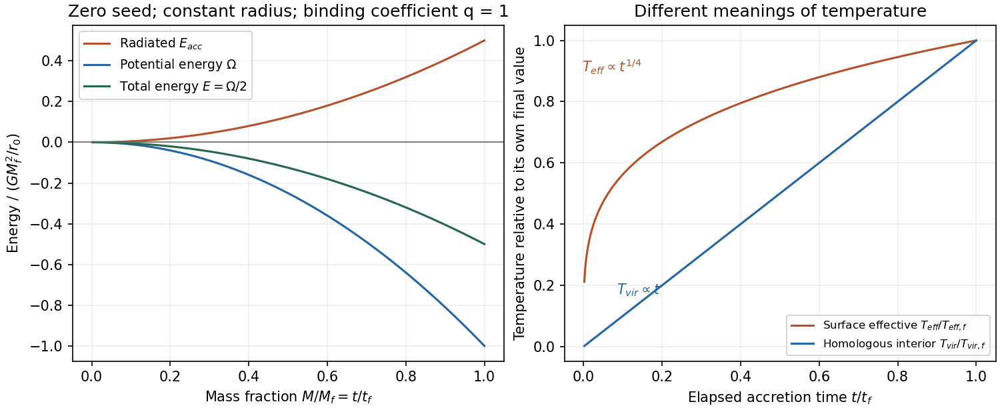

<h1 id="2/solution">Solution</h1>

↑ **Parent:** [2](../2.md)

**[mass](../../../../mass.md) and [energy](../../../../energy-split.md) signs.** The enclosed [mass](../../../../mass.md) is $M(r)=\int_0^r4\pi s^2\rho(s)\,ds$, so $dM/dr=+4\pi r^2\rho$. The negative sign printed in that equation cannot describe positive enclosed [mass](../../../../mass.md). Use the physical sign and define [gravitational potential energy](../../../../gravitational-energy.md) by

$$
\Omega=-\int_0^M\frac{GM_r}{r}\,dM_r<0.
$$

**Boundary-pressure [virial theorem](../../../../virial-theorem.md).** Multiply [hydrostatic equilibrium](../../../../hydrostatic-equilibrium.md) by $4\pi r^3$ and integrate. The left side is $[4\pi r^3p]_0^{r_0}-3\int_0^{r_0}4\pi r^2p\,dr$, while the right side is $\Omega$. The central boundary contribution vanishes when $r^3p\to0$ and the outer [pressure](../../../../pressure-split.md) is $p(r_0)=p_0$. Thus

$$
\boxed{3\int\frac p\rho\,dM+\Omega=4\pi r_0^3p_0=3p_0V}.
$$

A finite external [pressure](../../../../pressure-split.md) is compatible with a gravitationally self-contained cloud, but is not the zero-surface-force notion of isolation. External ram stress or [mass](../../../../mass.md) flow would require additional terms.

**[radiation budget of monatomic cloud collapse](../../../../radiation-budget-of-monatomic-cloud-collapse.md).** For an [ideal gas](../../../../ideal-gas-split.md) with fixed $\gamma$, the specific [internal energy](../../../../internal-energy-split.md) is $u=p/[\rho(\gamma-1)]$. Therefore the [pressure](../../../../pressure-split.md) [integral](../../../../integral-split.md) is $3(\gamma-1)U$. Cold monatomic [hydrogen](../../../../hydrogen.md) has $\gamma=5/3$ when only translational degrees of freedom matter. With negligible final surface [pressure](../../../../pressure-split.md), $2U+\Omega=0$, so $E_f=U+\Omega=\Omega/2$. If the initial cloud is sufficiently extended and cold that $E_i\simeq0$, the emitted [energy](../../../../energy-split.md) is

$$
\boxed{E_{\rm rad}=E_i-E_f\simeq-\frac\Omega2>0}.
$$

Being initially at rest alone does not set its [binding energy](../../../../binding-energy.md) to zero. If the initial total [energy](../../../../energy-split.md) is appreciable, retain $E_{\rm rad}=E_i-\Omega/2$; a different [equation of state](../../../../equation-of-state.md) also changes the half-energy result.

**Inside-out [accretion](../../../../accretion.md).** The combination of $a_T$ and $G$ with dimensions of [mass](../../../../mass.md) per time is

$$
\boxed{\dot M=C\frac{a_T^3}{G}},
$$

where [dimensional analysis](../../../../dimensional-analysis.md) leaves the dimensionless coefficient $C$ undetermined. An isothermal gas keeps $a_T$ constant, giving constant supply in the self-similar idealization. A front at radius $a_Tt$ and an isothermal [mass](../../../../mass.md) scale $M(r)\sim a_T^2r/G$ give the same scaling. The front's swept [mass](../../../../mass.md) is not automatically the accreted central [mass](../../../../mass.md); the coefficient requires a dynamical similarity solution.[Inside-out similarity model; only the dimensional scaling is required here](../../../../self-similar-collapse-of-isothermal-spheres-and-star-formation-by-frank-h-shu.md)

**[constant-radius accretion energy budget](../../../../constant-radius-accretion-energy-budget.md).** If all available [accretion](../../../../accretion.md) power is radiated at the fixed radius, $L_{\rm acc}=GM\dot M/r_0$. Neglecting the seed [mass](../../../../mass.md),

$$
\int L_{\rm acc}\,dt=\int_0^M\frac{GM'}{r_0}\,dM'
=\frac{GM^2}{2r_0}.
$$

This equals $-\Omega/2$ precisely when

$$
\boxed{\Omega=-\frac{GM^2}{r_0}}.
$$

The positive sign in the final printed [energy](../../../../energy-split.md) condition is inconsistent with the earlier use of negative [gravitational potential energy](../../../../gravitational-energy.md). Equivalently its positive right side must denote the binding-energy magnitude $|\Omega|$. A general structural coefficient $\Omega=-qGM^2/r_0$ leaves a mismatch unless $q=1$ under these other idealizations. Radiation trapped in the object, outflows or release over a different radius also change the budget.

**Which [temperature](../../../../temperature-split.md)?** With $M=M_s+\dot M t$ and fixed $r_0$, $L_{\rm acc}\propto M$. If this power emerges thermally from area $4\pi r_0^2$, the [accretion-powered effective-temperature scaling](../../../../accretion-powered-effective-temperature-scaling.md) is

$$
\boxed{T_{\rm eff}=\left(\frac{GM\dot M}{4\pi\sigma_{\rm SB}r_0^3}\right)^{1/4}
\ \propto\ t^{1/4}}
$$

when the seed [mass](../../../../mass.md) is negligible. This is the radiating surface's [effective temperature](../../../../effective-temperature.md), inferred from the preceding accretion-[luminosity](../../../../luminosity.md) calculation. A homologous ideal-gas interior instead has [virial temperature](../../../../virial-temperature.md) $T_c\sim\mu m_HGM/(k_Br_0)\propto t$. Thus **the surface-effective and interior-virial scalings are $t^{1/4}$ and $t$, respectively**, under their stated assumptions. Inferring a detailed interior [temperature](../../../../temperature-split.md) profile would additionally require a structural and transport model.

**[Figure 1](#2/image-original-constant-radius-accretion-energy-budget-and-distinct-surface-effective-and-virial-temperature-scalings). Original constant-radius accretion energy budget and distinct surface-effective and virial temperature scalings**.

## ↑ Ancestors (13)

1. [2](../2.md)
2. [Paper 1](../../paper-1-split.md)
3. [2013](../../split.md)
4. [Past exam of the formation of Structure in the Universe course of the University of Cambridge](../../../split.md)
5. [Formation of Structure in the Universe course of the University of Cambridge](../../../../formation-of-structure-in-the-universe-course-of-the-university-of-cambridge.md)
6. [Physics course of the year 4 of the natural sciences course of the University of Cambridge](../../../../physics-course-of-the-year-4-of-the-natural-sciences-course-of-the-university-of-cambridge.md)
7. [Year 4 of the natural sciences course of the University of Cambridge](../../../../year-4-of-the-natural-sciences-course-of-the-university-of-cambridge.md)
8. [Year of the natural sciences course of the University of Cambridge](../../../../year-of-the-natural-sciences-course-of-the-university-of-cambridge.md)
9. [Natural sciences course of the University of Cambridge](../../../../natural-sciences-course-of-the-university-of-cambridge.md)
10. [Course of the University of Cambridge](../../../../course-of-the-university-of-cambridge.md)
11. [University of Cambridge](../../../../university-of-cambridge-split.md)
12. [List of universities](../../../../list-of-universities.md)
13. [Codex Wiki](../../../../split.md)
