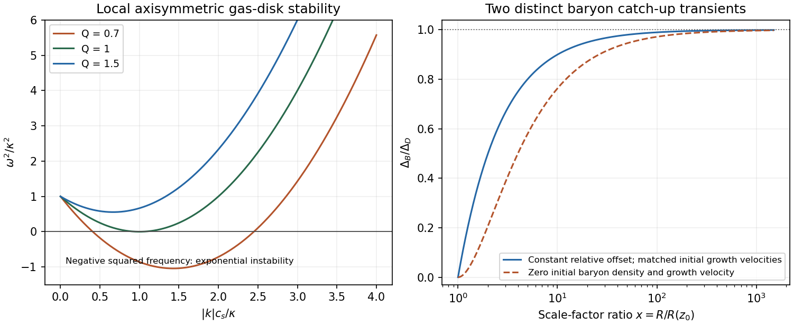

<h1 id="3/solution">Solution</h1>

↑ **Parent:** [3](../3.md)

**Growing and decaying modes.** Neglect [pressure](../../../../pressure-split.md) and insert the Einstein-de Sitter background. A trial $\Delta\propto t^p$ gives

$$
p(p-1)+\frac43p-\frac23=0,\qquad p=\frac23,-1.
$$

Therefore

$$
\boxed{\Delta=A t^{2/3}+B t^{-1},\qquad
\Delta_{\rm growing}\propto R\propto(1+z)^{-1}}.
$$

The quoted growth law selects the growing mode; arbitrary initial data can also contain the decaying one. In a static homogeneous Jeans model, $\ddot\Delta=(4\pi G\bar\rho-k^2c_s^2)\Delta$, so an unstable mode grows exponentially, $e^{\sqrt{4\pi G\bar\rho-k^2c_s^2}\,t}$. Expansion introduces the $2H\dot\Delta$ damping term and a falling background [density](../../../../density.md), yielding power-law growth instead. If the [wavevector](../../../../wavevector.md) in the supplied [pressure](../../../../pressure-split.md) term is comoving, that term would need $R^{-2}$; the pressureless result does not depend on this convention.

**Amplitude problem.** Using the stated [recombination](../../../../recombination-cosmology.md) epoch, matter-era growth from then until today is only about $1501$. A baryonic [density](../../../../density.md) perturbation of order $10^{-5}$ would reach merely $1.5\times10^{-2}$, far below the order-unity regime needed for nonlinear collapse. [photon](../../../../photon.md) coupling also prevents [baryons](../../../../baryon.md) from freely collapsing before [recombination](../../../../recombination-cosmology.md). The observed microwave [temperature](../../../../temperature-split.md) contrast is not an exact direct measurement of [baryon](../../../../baryon.md) [density contrast](../../../../density-contrast.md) at every scale: acoustic transfer and gravitational [redshift](../../../../redshift.md) matter. The estimate expresses the insufficient growth of tiny photon-coupled baryonic seeds, not an exact conversion between the two observables.

**Coupled gravitational response.** Both pressureless components respond to the same perturbed potential. The equations are

$$
\boxed{\begin{aligned}
\ddot\Delta_B+2H\dot\Delta_B&=4\pi G(\bar\rho_B\Delta_B+\bar\rho_D\Delta_D),\\
\ddot\Delta_D+2H\dot\Delta_D&=4\pi G(\bar\rho_B\Delta_B+\bar\rho_D\Delta_D).
\end{aligned}}
$$

Their difference obeys $\ddot D+2H\dot D=0$, where $D=\Delta_D-\Delta_B$. Thus $\dot D\propto R^{-2}$ and, in Einstein-de Sitter, $D=C_0+C_1t^{-1/3}=C_0+\widetilde C_1R^{-1/2}$.

**Catch-up branch and its condition.** With [dark matter](../../../../dark-matter.md) dominating the source and in its growing mode, write $\Delta_D=AR$. The full [baryon](../../../../baryon.md) solution is

$$
\boxed{\Delta_B=AR-C_0-\widetilde C_1R^{-1/2}}.
$$

The requested [baryon catch-up approximation after recombination](../../../../baryon-catch-up-approximation-after-recombination.md) selects the branch with negligible relative decaying mode, $\widetilde C_1=0$. Defining $C_0=AR(z_0)$ then gives

$$
\boxed{\frac{\Delta_B}{\Delta_D}=1-\frac{R(z_0)}{R(z)}
=1-\frac{1+z}{1+z_0}}.
$$

This branch applies at and after $z_0$ and has $\Delta_B(z_0)=0$ and matched [baryon](../../../../baryon.md)/dark-matter growth velocities at that epoch. It does not follow uniquely from vanishing initial [baryon](../../../../baryon.md) [density contrast](../../../../density-contrast.md) alone. If both $\Delta_B$ and its initial time [derivative](../../../../derivative.md) vanish at $R=R(z_0)$, the [zero-initial-baryon-velocity catch-up transient](../../../../zero-initial-baryon-velocity-catch-up-transient.md) instead gives

$$
\frac{\Delta_B}{\Delta_D}=1-3x^{-1}+2x^{-3/2},\qquad x=R/R(z_0).
$$

Both approach unity for $x\gg1$. The displayed target therefore needs its stated no-relative-decaying-mode assumption; a finite [baryon](../../../../baryon.md) fraction modifies the transient further.

**Physical consequence.** [cold dark matter](../../../../cold-dark-matter.md) is not held to the radiation by [Thomson scattering](../../../../thomson-scattering.md), and can build gravitational wells before [baryon](../../../../baryon.md) decoupling, with appreciable matter-era growth after equality. Its growing perturbations then attract [baryons](../../../../baryon.md) once [pressure](../../../../pressure-split.md) and radiation drag become unimportant. The relative offset stays constant or decays while the common mode grows, so [baryons](../../../../baryon.md) catch up. **Nonlinear structure need not grow solely from the tiny baryonic perturbation inferred at decoupling.** [cold dark matter](../../../../cold-dark-matter.md) growth during [radiation domination](../../../../radiation-domination.md) is slower than the matter-era law, and the stated formula is neither a radiation-era nor a nonlinear-collapse solution.

**[Figure 2](#3/image-original-local-gas-disk-stability-curves-and-comparison-of-constant-offset-and-zero-initial-velocity-baryon-catch-up-branches). Original local gas-disk stability curves and comparison of constant-offset and zero-initial-velocity baryon catch-up branches**.

## ↑ Ancestors (13)

1. [3](../3.md)
2. [Paper 1](../../paper-1-split.md)
3. [2013](../../split.md)
4. [Past exam of the formation of Structure in the Universe course of the University of Cambridge](../../../split.md)
5. [Formation of Structure in the Universe course of the University of Cambridge](../../../../formation-of-structure-in-the-universe-course-of-the-university-of-cambridge.md)
6. [Physics course of the year 4 of the natural sciences course of the University of Cambridge](../../../../physics-course-of-the-year-4-of-the-natural-sciences-course-of-the-university-of-cambridge.md)
7. [Year 4 of the natural sciences course of the University of Cambridge](../../../../year-4-of-the-natural-sciences-course-of-the-university-of-cambridge.md)
8. [Year of the natural sciences course of the University of Cambridge](../../../../year-of-the-natural-sciences-course-of-the-university-of-cambridge.md)
9. [Natural sciences course of the University of Cambridge](../../../../natural-sciences-course-of-the-university-of-cambridge.md)
10. [Course of the University of Cambridge](../../../../course-of-the-university-of-cambridge.md)
11. [University of Cambridge](../../../../university-of-cambridge-split.md)
12. [List of universities](../../../../list-of-universities.md)
13. [Codex Wiki](../../../../split.md)
