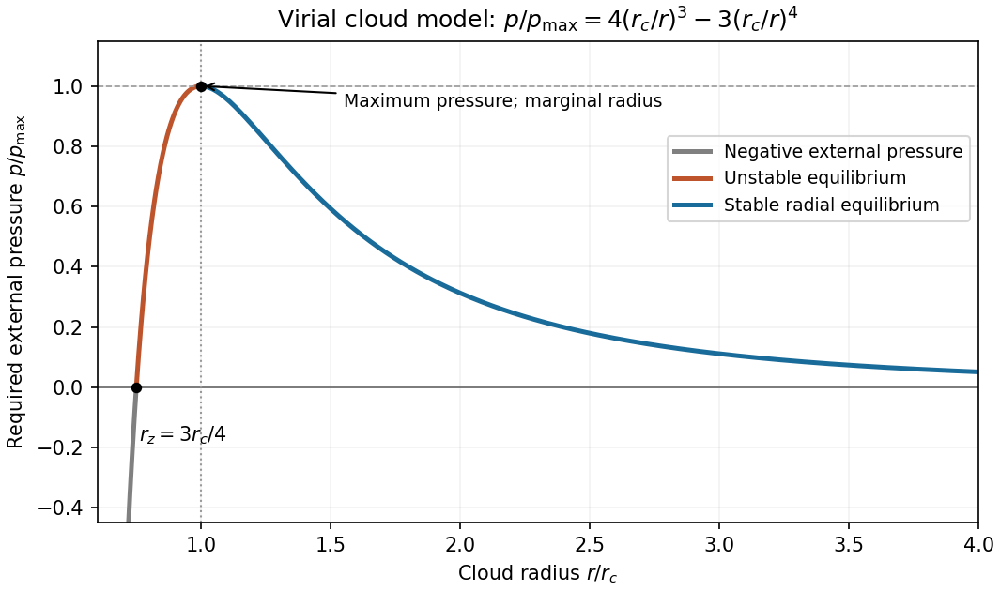
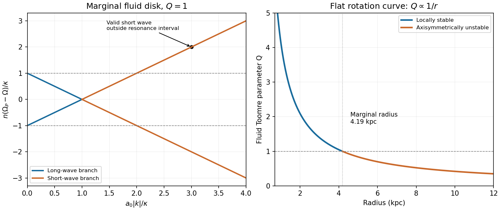

# Paper 1

↑ **Parent:** [2014](../2014.md)

[Original public PDF, physical pages 669–671](https://www.whatdotheyknow.com/request/natural_science_tripos_physics_e_2/response/2340776/attach/2/FOI%202023%20399%20Zahid%20materials.pdf?cookie_passthrough=1)

**Table of contents**

- [1](#1)
  - [Solution](#1/solution)
- [2](#2)
  - [Solution](#2/solution)
- [3](#3)
  - [a](#3/a)
    - [Solution](#3/a/solution)
  - [b](#3/b)
    - [Solution](#3/b/solution)
  - [c](#3/c)
    - [Solution](#3/c/solution)
  - [d](#3/d)
    - [Solution](#3/d/solution)

## 1

↑ **Parent:** [Paper 1](paper-1.md)

<h3 id="1/solution">Solution</h3>

↑ **Parent:** [1](#1)

**[virial pressure-radius curve with uniform-sphere binding energy](../../statistical-physics.md#virial-pressure-radius-curve-with-uniform-sphere-binding-energy).** Put $c_s^2=k_BT/\mu$. Isothermality makes $\int(p/\rho)dM=c_s^2M_0$, so the [virial theorem](../../classical-mechanics.md#virial-theorem) gives

$$
\boxed{p_0=\frac{A}{r_0^3}-\frac{B}{r_0^4},\qquad
A=\frac{3c_s^2M_0}{4\pi},\quad B=\frac{3GM_0^2}{20\pi}}.
$$

The curve crosses zero at $r_z=B/A=GM_0/(5c_s^2)$, rises to its maximum at

$$
\boxed{r_c=\frac{4B}{3A}=\frac{4GM_0}{15c_s^2}},
$$

then decreases toward zero at large radius. Since $p_0'=(4B-3Ar_0)/r_0^5$, a cloud displaced outward at fixed external [pressure](../../pressure.md) has a restoring [pressure](../../pressure.md) deficit only on the descending branch. Thus **the homologous, isothermal radial mode is stable for $r_0>r_c$**, unstable for $r_z<r_0<r_c$, and marginal at $r_c$. The negative-pressure branch is not a physical equilibrium with a positive confining [pressure](../../pressure.md). This conclusion uses the stipulated gravitational-energy approximation, not the exact isothermal [density](../../fluid-mechanics.md#density) profile.

**[Figure 1](#1/image-original-pressure-radius-curve-and-stable-versus-unstable-branches-of-the-stipulated-virial-cloud-model). Original pressure-radius curve and stable versus unstable branches of the stipulated virial cloud model**.

**[critical mass from a virial pressure turning point](../../statistical-physics.md#critical-mass-from-a-virial-pressure-turning-point).** At the turning point, $B=3Ar_c/4$; hence

$$
\boxed{p_{\max}=\frac{A}{4r_c^3}
=\frac{10125}{1024\pi}\frac{c_s^8}{G^3M_0^2}
\propto\left(\frac{T^2}{M_0}\right)^2}.
$$

Using the cloud's [mean density](../../fluid-mechanics.md#mean-density) $\bar\rho=3M_0/(4\pi r_0^3)$, the condition $r_0>4GM_0/(15c_s^2)$ becomes

$$
\boxed{M_0<M_{\rm crit}=\left(\frac{15c_s^2}{4G}\right)^{3/2}
\left(\frac{3}{4\pi\bar\rho}\right)^{1/2}
\propto\left(\frac{T^3}{\bar\rho}\right)^{1/2}}.
$$

Using the boundary [density](../../fluid-mechanics.md#density) instead changes the numerical coefficient, not this scaling. The coefficient should not be identified with the exact [Bonnor-Ebert sphere](../../statistical-physics.md#pressure-confined-isothermal-sphere) threshold because the assumed [potential energy](../../energy.md#potential-energy) is different.

**[mass and luminosity weighting of a stellar initial mass function](../../stellar-astrophysics.md#mass-and-luminosity-weighting-of-a-stellar-initial-mass-function).** Impose finite birth-mass cutoffs $m_l,m_u$. The stellar birth [mass](../../classical-mechanics.md#mass) and main-sequence [luminosity](../../astrophysics.md#luminosity) scale as

$$
M_{\rm born}=\frac{\xi_0}{0.35}(m_l^{-0.35}-m_u^{-0.35}),\qquad
L_{\rm tot}\propto\frac{\xi_0}{2.65}(m_u^{2.65}-m_l^{2.65}).
$$

For a broad [mass](../../classical-mechanics.md#mass) interval, the low-mass end controls the first [integral](../../integral.md) and the high-mass end the second. Per logarithmic [mass](../../classical-mechanics.md#mass) interval the weights are respectively $m^2\xi\propto m^{-0.35}$ and $mL\xi\propto m^{2.65}$. Finite lifetimes remove massive stars from an aging population, so the [luminosity](../../astrophysics.md#luminosity) conclusion applies while those stars remain on the [main sequence](../../stellar-astrophysics.md#main-sequence).

**[exponential closed-box gas consumption](../../galaxy.md#exponential-closed-box-gas-consumption).** The gross formation rate is $\Psi=\epsilon M_g$, but the permanent locking rate is $\alpha\Psi$. The [instantaneous recycling approximation](../../galaxy.md#instantaneous-recycling-approximation) and [mass conservation](../../continuum-mechanics.md#mass-conservation) give $\dot M_g=-\alpha\epsilon M_g$, $\dot M_*=\alpha\epsilon M_g$. Therefore

$$
\boxed{M_g=M_0e^{-\alpha\epsilon t},\qquad
M_*=M_0(1-e^{-\alpha\epsilon t}),\qquad
f_g=e^{-\alpha\epsilon t}}.
$$

Here $M_*$ means surviving locked stellar [mass](../../classical-mechanics.md#mass) in the [galactic gas fraction](../../galaxy.md#galactic-gas-fraction), not the cumulative gross [mass](../../classical-mechanics.md#mass) that has passed through [star formation](../../stellar-astrophysics.md#star-formation).

**[locked-mass and returned-mass yield conventions](../../galaxy.md#locked-mass-and-returned-mass-yield-conventions).** Pre-existing metals are locked at rate $\alpha Z\Psi$; the stipulated newly produced metal source is $b(1-\alpha)\Psi$. Thus

$$
\frac{d(M_gZ)}{dt}=-\alpha Z\Psi+b(1-\alpha)\Psi,
\qquad M_g\dot Z=b(1-\alpha)\Psi.
$$

For $\alpha>0$ and initially pristine gas,

$$
\boxed{Z=y\ln\frac{M_0}{M_g}=y\ln\frac1{f_g},\qquad
y=\frac{b(1-\alpha)}\alpha,\qquad
Z(t)=b(1-\alpha)\epsilon t}.
$$

The effective yield $y$ is per unit permanently locked [mass](../../classical-mechanics.md#mass); it is not the source parameter $b$. For $\alpha=0$, $M_g=M_0$ and the direct time equation gives $Z=b\epsilon t$. For $\alpha=1$, the explicitly stipulated metal source vanishes, so this particular enrichment model gives $Z=0$. Constant yield is a trace-enrichment approximation; the formal logarithmic divergence as gas is exhausted must not be interpreted as a physical metal fraction exceeding one.

**[backward extrapolation of exponential closed-box star formation](../../galaxy.md#backward-extrapolation-of-exponential-closed-box-star-formation).** Denote the present [age of the universe](../../cosmology.md#age-of-the-universe) by $t_{\rm now}$. With the last paragraph's $\alpha=1$,

$$
\boxed{\Psi(z\simeq3)=\left(1M_\odot\,\mathrm{yr^{-1}}\right)
\exp\left[0.5\left(\frac{t_{\rm now}}{\mathrm{Gyr}}-2\right)\right]}.
$$

Adopting a present [age of the universe](../../cosmology.md#age-of-the-universe) $t_{\rm now}=13.8\,\mathrm{Gyr}$ for the estimate gives about **$365M_\odot\,\mathrm{yr^{-1}}$**, requiring $7.3\times10^{11}M_\odot$ of gas at that epoch in the same model. The boxed expression makes the dependence on the adopted present age explicit. This is an extreme history for a present Milky-Way-like system, although intense high-redshift [star formation](../../stellar-astrophysics.md#star-formation) by itself is not forbidden.

The extrapolation forces a fixed gas reservoir to decline exponentially over many [gas-depletion times](../../stellar-astrophysics.md#gas-depletion-time). Gas [accretion](../../astrophysics.md#accretion), outflows, evolving gas [density](../../fluid-mechanics.md#density) and star-formation efficiency, delayed recycling, and galaxy assembly break that assumption. The empirical disk-averaged relation is not a universal constant-efficiency law for all gas: the original measurements combined [Balmer series](../../mathematical-physics.md#balmer-series) H-alpha, atomic gas, [carbon monoxide](../../chemical-substance.md#carbon-monoxide) and [infrared](../../optics.md#infrared) data, with tracer calibration and dust corrections entering the inference.[Abstract: observed tracers, sample, and fitted index](../../physics-bibliography.md#the-global-schmidt-law-in-star-forming-galaxies-by-robert-c-kennicutt-jr) Cosmological calculations explicitly support continuing cold-gas supply to rapidly forming high-redshift galaxies, providing a physical alternative to this closed-box backward extrapolation.[Abstract: stream-fed galaxies and comparison with observed abundance](../../physics-bibliography.md#cold-streams-in-early-massive-hot-haloes-as-the-main-mode-of-galaxy-formation-by-avishai-dekel-and-others)

## 2

↑ **Parent:** [Paper 1](paper-1.md)

<h3 id="2/solution">Solution</h3>

↑ **Parent:** [2](#2)

**Radial [epicyclic motion](../../astrophysical-disk.md#epicyclic-motion).** At fixed [specific angular momentum](../../celestial-mechanics.md#specific-angular-momentum), use $\Phi_{\rm eff}=\Phi+\ell^2/(2r^2)$ and $\ddot r=-\Phi_{\rm eff}'$. A [circular orbit](../../classical-mechanics.md#circular-orbit) at $r_c$ obeys $\Phi'(r_c)=\ell^2/r_c^3=r_c\Omega^2$. Expanding $r=r_c+\xi$ gives $\ddot\xi+\kappa^2\xi=0$, where

$$
\boxed{\kappa^2=\Phi''+\frac{3\ell^2}{r_c^4}
=4\Omega^2+2r_c\Omega\Omega'
=4\Omega^2\left(1+\frac{r_c\Omega'}{2\Omega}\right)}.
$$

For $\kappa^2>0$ the [radial epicyclic frequency](../../astrophysical-disk.md#radial-epicyclic-frequency) describes [simple harmonic motion](../../classical-mechanics.md#simple-harmonic-motion). The angular correction follows from [conservation of angular momentum](../../momentum.md#conservation-of-angular-momentum), $\dot\phi\simeq\Omega(1-2\xi/r_c)$, and describes an [epicyclic motion](../../astrophysical-disk.md#epicyclic-motion) around the guiding [circular orbit](../../classical-mechanics.md#circular-orbit).

**Stabilizing terms.** In the given local fluid [dispersion relation](../../dispersion-relation.md), $\kappa^2$ is rotational support, important at long [wavelength](../../wave-equation.md#wavelength); $a_0^2k^2$ is random-motion or [pressure](../../pressure.md) support, important at short [wavelength](../../wave-equation.md#wavelength). The term $-2\pi G\Sigma|k|$ is destabilizing [self-gravity](../../newton-s-law-of-universal-gravitation.md#self-gravity). Although the wording refers to stellar dispersion, this algebra uses the supplied fluid approximation; a collisionless stellar treatment has a reduction factor and a different numerical normalization.[Abstract and Sections II–V: collisionless stability threshold and random-motion support](../../physics-bibliography.md#on-the-gravitational-stability-of-a-disk-of-stars-by-alar-toomre)

**Axisymmetric threshold.** For $n=0$, set $q=|k|\geq0$. Completing the square gives

$$
\omega^2=a_0^2(q-q_*)^2+\kappa^2(1-Q^{-2}),
\qquad q_*=\frac{\pi G\Sigma}{a_0^2},\quad
Q=\frac{\kappa a_0}{\pi G\Sigma}.
$$

Thus **$Q>1$ gives local axisymmetric oscillatory stability; $Q<1$ gives a growing band**, with

$$
q_-<q<q_+,\qquad
q_\pm=\frac{\pi G\Sigma}{a_0^2}\left(1\pm\sqrt{1-Q^2}\right).
$$

At $Q=1$, the minimizing mode has zero [frequency](../../wave.md#frequency) and is marginal, not a strictly restoring oscillation. Local axisymmetric stability does not establish stability to every global nonaxisymmetric mode.

**[long-wave and short-wave branches at marginal Toomre stability](../../gravitational-instability-of-an-astrophysical-disk.md#long-wave-and-short-wave-branches-at-marginal-toomre-stability).** For $Q=1$ and $n\geq1$,

$$
n^2(\Omega_P-\Omega)^2=(a_0q-\kappa)^2,
\qquad
q=\frac{\kappa\pm n|\Omega_P-\Omega|}{a_0}.
$$

The long-wavelength branch, using the minus sign, requires

$$
\boxed{\Omega-\frac\kappa n\leq\Omega_P\leq\Omega+\frac\kappa n}.
$$

These endpoints are the inner and outer [Lindblad resonance](../../planetary-science.md#lindblad-resonance) conditions. **The stated [dispersion relation](../../dispersion-relation.md) does not restrict every wave solution to that interval.** Its plus-sign short-wavelength branch has $q>0$ even outside it: for example, $\Omega_P=\Omega+2\kappa/n$ gives $q=3\kappa/a_0$ and satisfies the equation. Additional branch selection or resonant absorption physics would be needed for an absolute confinement claim. No such condition is supplied.

**[Toomre stability radius of a flat-rotation disk](../../gravitational-instability-of-an-astrophysical-disk.md#toomre-stability-radius-of-a-flat-rotation-disk).** With $\Omega=v_0/r$, $\kappa=\sqrt2v_0/r$. Using $G=4.3009\times10^{-3}\ \mathrm{pc}\,(\mathrm{km\,s^{-1}})^2M_\odot^{-1}$,

$$
\boxed{Q(r)=\frac{\sqrt2v_0a_0}{\pi G\Sigma r}
\simeq\frac{4.19\ \mathrm{kpc}}r}.
$$

The supplied local model therefore predicts stable radii below about **$4.19\ \mathrm{kpc}$**, marginality at that radius, and axisymmetric instability farther out while its assumed constant [surface density](../../astrophysical-disk.md#surface-density-of-a-disk) and thin-disk approximation remain applicable. An infinite constant-density, flat-rotation disk is an idealization, not a global self-consistent galaxy model.

**[Figure 2](#2/image-original-marginal-disk-dispersion-branches-and-radial-toomre-parameter-showing-the-long-wave-restriction-and-the-surviving-short-wave-branch). Original marginal-disk dispersion branches and radial Toomre parameter, showing the long-wave restriction and the surviving short-wave branch**.

## 3

↑ **Parent:** [Paper 1](paper-1.md)

<h3 id="3/a">a</h3>

↑ **Parent:** [3](#3)

<h4 id="3/a/solution">Solution</h4>

↑ **Parent:** [A](#3/a)

For a monatomic [ideal gas](../../ideal-gas.md), write the thermal [energy](../../energy.md) [density](../../fluid-mechanics.md#density) as $u=3nk_BT/2$. At low [optical depth](../../astrophysics.md#optical-depth), radiative loss uses an [astrophysical cooling function](../../heat.md#astrophysical-cooling-function), often written $\mathcal C=n_en_H\Lambda(T,Z)$, while $\mathcal H$ contains heating. At fixed [density](../../fluid-mechanics.md#density) the net [radiative gas cooling time](../../heat.md#optically-thin-gas-cooling-time) is approximately $u/(\mathcal C-\mathcal H)$ when the denominator is positive; a cooling flow closer to constant [pressure](../../pressure.md) must include [enthalpy](../../enthalpy.md) and compressional work. Comparing this time with the [free-fall time of a uniform sphere](../../astrophysics.md#free-fall-time-of-a-uniform-sphere) determines whether [pressure](../../pressure.md) can be lost during gravitational contraction.

Hot ionized gas cools by [bremsstrahlung](../../electromagnetic-radiation.md#bremsstrahlung) and [recombination](../../cosmology.md#recombination-cosmology); [collisional excitation](../../atomic-physics.md#collisional-excitation) followed by [photon](../../quantum-mechanics.md#photon) escape supplies atomic and metal-line cooling at lower [temperatures](../../temperature.md). [molecular line cooling](../../heat.md#molecular-line-cooling) through rotational or vibrational lines and [dust thermal emission](../../heat.md#dust-thermal-emission) become important in cold dense gas. Abundances, [ionization](../../atomic-physics.md#ionization) state, density-dependent collisional de-excitation, and [photon](../../quantum-mechanics.md#photon) trapping all change the cooling function. Optically thick gas requires [radiative transfer](../../astrophysics.md#radiative-transfer), not a simple local density-squared loss law.

Heating comes from [photoionization](../../atomic-physics.md#photoionization), [grain photoelectric heating](../../quantum-mechanics.md#grain-photoelectric-heating) driven by ultraviolet light, [cosmic rays](../../galaxy.md#cosmic-ray), [shocks](../../transport-equation.md#shock-wave), turbulent dissipation and compression. [photoionization heating](../../atomic-physics.md#photoionization-heating) deposits the [photon](../../quantum-mechanics.md#photon) [energy](../../energy.md) above the [ionization](../../atomic-physics.md#ionization) threshold as electron [kinetic energy](../../energy.md#kinetic-energy). A [thermal equilibrium](../../thermal-equilibrium.md) satisfies $\mathcal H=\mathcal C$; its stability depends on how the net loss changes under the relevant [pressure](../../pressure.md) or [density](../../fluid-mechanics.md#density) constraint, not merely on equality. Different stable balances permit a multiphase [interstellar medium](../../galaxy.md#interstellar-medium). Spectral-line ratios constrain [temperature](../../temperature.md) and [ionization](../../atomic-physics.md#ionization), but interpreting them requires [density](../../fluid-mechanics.md#density) diagnostics, [interstellar extinction](../../galaxy.md#interstellar-extinction) corrections and a radiation-field model.

<h3 id="3/b">b</h3>

↑ **Parent:** [3](#3)

<h4 id="3/b/solution">Solution</h4>

↑ **Parent:** [B](#3/b)

A cold self-gravitating core initially contracts on a dynamical scale $t_{\rm ff}\sim(G\rho)^{-1/2}$ if cooling prevents [pressure](../../pressure.md) from halting collapse. Increasing [optical depth](../../astrophysics.md#optical-depth) eventually traps [radiation](../../physics.md#radiation) and forms a pressure-supported [first hydrostatic core](../../stellar-astrophysics.md#first-hydrostatic-core). Dissociation of [molecular hydrogen](../../chemical-substance.md#molecular-hydrogen) absorbs compressional [energy](../../energy.md), softens the [equation of state](../../pressure.md#equation-of-state) and triggers a [second protostellar collapse](../../stellar-astrophysics.md#second-protostellar-collapse) to a compact [protostar](../../stellar-astrophysics.md#protostar). Rotation produces a disk; angular-momentum transport permits continuing [accretion](../../astrophysics.md#accretion), while outflows remove some [mass](../../classical-mechanics.md#mass) and [angular momentum](../../momentum.md#angular-momentum).

An accreting object's [luminosity](../../astrophysics.md#luminosity) includes a contribution of order $L_{\rm acc}\sim GM\dot M/R$, with a coefficient set by where [accretion](../../astrophysics.md#accretion) [energy](../../energy.md) is radiated or retained. After [accretion](../../astrophysics.md#accretion) subsides, gravitational contraction supplies internal [luminosity](../../astrophysics.md#luminosity) over the [Kelvin-Helmholtz cooling time](../../stellar-astrophysics.md#kelvin-helmholtz-cooling-time) $t_{\rm KH}\sim GM^2/(RL_{\rm int})$. Hydrostatic contraction heats the interior even while [energy](../../energy.md) is radiated, as follows from the [virial theorem](../../classical-mechanics.md#virial-theorem) and the [negative heat capacity of a virialized gravitational system](../../classical-mechanics.md#negative-heat-capacity-of-a-virialized-gravitational-system). [accretion luminosity](../../stellar-astrophysics.md#accretion-luminosity) must not be substituted for $L_{\rm int}$ in the contraction time without an energy-budget justification.

Low-mass, nearly fully convective [pre-main-sequence stars](../../stellar-astrophysics.md#pre-main-sequence-star) contract down a [Hayashi track](../../stellar-astrophysics.md#hayashi-track) at roughly constant [effective temperature](../../stellar-structure.md#effective-temperature) and decreasing radius and [luminosity](../../astrophysics.md#luminosity). A developing [radiative core](../../stellar-structure.md#radiative-core) can lead onto a [Henyey track](../../stellar-astrophysics.md#henyey-track) toward higher [effective temperature](../../stellar-structure.md#effective-temperature); the route depends on [mass](../../classical-mechanics.md#mass) and opacity. The [deuterium-burning energy-generation rate](../../stellar-astrophysics.md#deuterium-burning-energy-generation-rate) can temporarily moderate contraction, but sustained core [hydrogen burning](../../stellar-astrophysics.md#hydrogen-burning) marks arrival on the [main sequence](../../stellar-astrophysics.md#main-sequence). Massive objects may begin [hydrogen burning](../../stellar-astrophysics.md#hydrogen-burning) while still accreting, and substellar objects never establish long-lived [hydrogen burning](../../stellar-astrophysics.md#hydrogen-burning). An [infrared](../../optics.md#infrared) spectral class reflects envelope and disk emission as well as inclination and [interstellar extinction](../../galaxy.md#interstellar-extinction), so it is not a unique stellar age or interior evolutionary track.

<h3 id="3/c">c</h3>

↑ **Parent:** [3](#3)

<h4 id="3/c/solution">Solution</h4>

↑ **Parent:** [C](#3/c)

Stellar [radiation](../../physics.md#radiation), [stellar winds](../../stellar-astrophysics.md#stellar-wind) and [supernovae](../../stellar-astrophysics.md#supernova) return [energy](../../energy.md), [momentum](../../momentum.md), [mass](../../classical-mechanics.md#mass) and metals to surrounding gas. Heating, [ionization](../../atomic-physics.md#ionization), turbulent support and gas removal can reduce subsequent [star formation](../../stellar-astrophysics.md#star-formation); swept-up shells can also compress gas locally. Whether thermal [energy](../../energy.md) drives an outflow depends on its [radiative gas cooling time](../../heat.md#optically-thin-gas-cooling-time) relative to expansion: radiative losses can remove [energy](../../energy.md) while leaving substantial [momentum](../../momentum.md) transfer. Thus deposited [energy](../../energy.md) alone does not specify the dynamical effect.

The [galactic gas regulator](../../galaxy.md#galactic-gas-regulator) has [mass](../../classical-mechanics.md#mass) budget $\dot M_g=\dot M_{\rm in}-(1-R+\eta)\Psi$, where $R$ is the returned fraction and $\eta=\dot M_{\rm out}/\Psi$ is the [mass-loading factor](../../galaxy.md#mass-loading-factor). In a quasi-steady state, $\Psi\simeq\dot M_{\rm in}/(1-R+\eta)$. This connects feedback to the available gas supply. A wind's kinetic power $\dot M_{\rm out}v_w^2/2$ and [momentum](../../momentum.md) flux $\dot M_{\rm out}v_w$ must fit the source budget and gravitational binding cost. Gas that fails to escape may form a [galactic fountain](../../galaxy.md#galactic-fountain) and later return; preferential metal loss changes chemical evolution.

Absorption against a galaxy's stellar continuum provides a concrete outflow test: compare interstellar sodium absorption with the systemic velocity and stellar absorption spectrum. A primary starburst survey found blueshifted interstellar absorption and an inclination dependence consistent with minor-axis outflows. Its saturated lines also illustrate why velocity detection is more direct than a unique column [density](../../fluid-mechanics.md#density) or [mass](../../classical-mechanics.md#mass) flux.[Abstract: NaD spectra, systemic velocities, viewing angle and optical depth](../../physics-bibliography.md#absorption-line-probes-of-gas-and-dust-in-galactic-superwinds-by-timothy-m-heckman-and-others) Deprojection, covering fraction, [ionization](../../atomic-physics.md#ionization), radius and the unseen hot phase limit total outflow-rate estimates.

An accreting [supermassive black hole](../../astrophysical-black-hole.md#supermassive-black-hole) adds [radiation](../../physics.md#radiation), winds and [astrophysical jets](../../astrophysics.md#astrophysical-jet). Coupling these to the interstellar or [circumgalactic medium](../../galaxy.md#circumgalactic-medium) can suppress cooling or expel gas, especially in deep potentials where stellar driving alone may be inadequate. Jet cavities, line-emitting gas and multiphase outflows test different channels; coexisting activity and low [star formation](../../stellar-astrophysics.md#star-formation) alone do not prove a causal feedback history.

<h3 id="3/d">d</h3>

↑ **Parent:** [3](#3)

<h4 id="3/d/solution">Solution</h4>

↑ **Parent:** [D](#3/d)

Small primordial fluctuations seed later structure. For [adiabatic cosmological perturbations](../../cosmic-microwave-background-anisotropy.md#adiabatic-initial-conditions) on scales outside the horizon, the [uniform-density curvature perturbation](../../linear-cosmological-perturbation-theory.md#uniform-density-curvature-perturbation) is conserved when the [non-adiabatic pressure perturbation](../../cosmic-inflation.md#non-adiabatic-pressure-perturbation) and the decaying mode can be neglected. A [density contrast](../../linear-cosmological-density-perturbation.md#density-contrast) outside the horizon is gauge-dependent, so its apparent power-law growth should not be confused with directly measured local collapse.

For subhorizon, pressureless matter, the linearized [continuity equation](../../mathematical-physics.md#continuity-equation), [Euler equation](../../euler-equations-for-an-inviscid-fluid.md) and [Poisson equation](../../partial-differential-equation.md#poisson-s-equation) combine into

$$
\boxed{\ddot\delta+2H\dot\delta-4\pi G\bar\rho_m\delta=0}.
$$

Hubble expansion damps peculiar motion; [self-gravity](../../newton-s-law-of-universal-gravitation.md#self-gravity) amplifies overdensities. During [radiation domination](../../linear-cosmological-density-perturbation.md#radiation-domination), [radiation](../../physics.md#radiation) [pressure](../../pressure.md) drives acoustic oscillations and [cold dark matter](../../cosmology.md#cold-dark-matter) growth after horizon entry is only logarithmic. During [matter domination](../../linear-cosmological-density-perturbation.md#matter-domination) the growing and decaying solutions are $\delta\propto a$ and $\delta\propto a^{-3/2}$. Dark-energy domination later suppresses growth relative to the matter-era law.

For a pressure-supported fluid the Fourier-mode equation also contains $+c_s^2k^2\delta/a^2$, giving a [Jeans length](../../linear-cosmological-density-perturbation.md#jeans-length) separating acoustic support from gravitational growth. Before [recombination](../../cosmology.md#recombination-cosmology), [baryons](../../physics.md#baryon) are tightly coupled to [photons](../../quantum-mechanics.md#photon) and oscillate rather than freely following [dark matter](../../cosmology.md#dark-matter). [Silk damping](../../cosmic-microwave-background-anisotropy.md#cosmic-microwave-background-diffusion-damping) from photon diffusion damps small-scale photon-baryon fluctuations; after decoupling, [baryons](../../physics.md#baryon) can fall into dark-matter potential wells. [free streaming](../../linear-cosmological-density-perturbation.md#free-streaming) smooths species-dependent scales and distinguishes cold from warm or hot [dark matter](../../cosmology.md#dark-matter).

Schematically, the linear [matter power spectrum](../../linear-cosmological-density-perturbation.md#matter-power-spectrum) can be written $P_\delta(k,a)=A k^{n_s}T^2(k)D^2(a)$ under the usual primordial-curvature normalization. The [cosmological transfer function](../../linear-cosmological-perturbation-theory.md#cosmological-transfer-function) records horizon entry, matter-radiation equality, acoustic physics and damping; the [linear growth factor](../../linear-cosmological-density-perturbation.md#linear-growth-factor) records later amplification. [density contrasts](../../linear-cosmological-density-perturbation.md#density-contrast) approaching unity require nonlinear collapse and halo formation beyond this approximation. [cosmic microwave background](../../cosmic-microwave-background.md) anisotropies and [galaxy clustering](../../large-scale-structure-of-the-universe.md#galaxy-clustering) test the same initial perturbations through different transfer histories; [galaxy bias](../../large-scale-structure-of-the-universe.md#galaxy-bias), [redshift-space distortions](../../large-scale-structure-of-the-universe.md#redshift-space-distortions) and observational selection enter the galaxy comparison.

## ↑ Ancestors (11)

1. [2014](../2014.md)
2. [Past exam of the formation of Structure in the Universe course of the University of Cambridge](../../past-exam-of-the-formation-of-structure-in-the-universe-course-of-the-university-of-cambridge.md)
3. [Formation of Structure in the Universe course of the University of Cambridge](../../university-of-cambridge.md#formation-of-structure-in-the-universe-course-of-the-university-of-cambridge)
4. [Physics course of the year 4 of the natural sciences course of the University of Cambridge](../../university-of-cambridge.md#physics-course-of-the-year-4-of-the-natural-sciences-course-of-the-university-of-cambridge)
5. [Year 4 of the natural sciences course of the University of Cambridge](../../university-of-cambridge.md#year-4-of-the-natural-sciences-course-of-the-university-of-cambridge)
6. [Year of the natural sciences course of the University of Cambridge](../../university-of-cambridge.md#year-of-the-natural-sciences-course-of-the-university-of-cambridge)
7. [Natural sciences course of the University of Cambridge](../../university-of-cambridge.md#natural-sciences-course-of-the-university-of-cambridge)
8. [Course of the University of Cambridge](../../university-of-cambridge.md#course-of-the-university-of-cambridge)
9. [University of Cambridge](../../university-of-cambridge.md)
10. [List of universities](../../README.md#list-of-universities)
11. [Codex Wiki](../../README.md)
