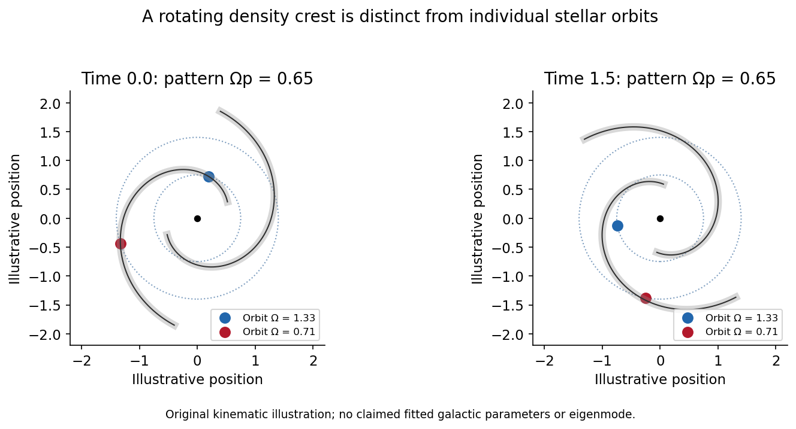

<h1 id="1/a/solution">Solution</h1>

↑ **Parent:** [A](../a.md)

**A [spiral density wave](../../../../../spiral-density-wave.md) is an organized [density](../../../../../density.md) and gravitational-potential perturbation through which stars and [gas](../../../../../gas.md) can move; it is not generally a permanently labelled set of stars.** [Differential rotation](../../../../../differential-rotation.md) winds a material arm rapidly. In a wave description, a perturbation has phase $m\phi+\int k\,dr-\omega t$, with [pattern speed](../../../../../pattern-speed.md) $\Omega_p=\omega/m$ distinct from the local stellar angular speed.

For a thin fluid disk the local tightly wound dispersion relation is

$$
(\omega-m\Omega)^2=\kappa^2+c_s^2k^2-2\pi G\Sigma|k|.
$$

Rotation and [pressure](../../../../../pressure-split.md) resist self-gravity. A collisionless stellar disk requires its stellar response function instead of simply replacing $c_s$ by a dispersion; the familiar local axisymmetric stability parameter is $Q_\star=\sigma_R\kappa/(3.36G\Sigma)$. This is distinct from the [gas](../../../../../gas.md) $Q_g=c_s\kappa/(\pi G\Sigma)$.

Waves exchange [angular momentum](../../../../../angular-momentum.md) at [Lindblad resonances](../../../../../lindblad-resonance.md) and near [corotation radius](../../../../../corotation-radius.md). [Swing amplification](../../../../../swing-amplification.md) can strengthen a leading disturbance as shear turns it into a trailing one. Bars or companions can force a coherent spiral; recurrent self-excited disturbances also occur. Thus a single indefinitely steady wave is one model, not a description established for every [spiral galaxy](../../../../../spiral-galaxy.md). [Gas](../../../../../gas.md) compression and shocks along arms can organize [star formation](../../../../../star-formation.md), while gravitational torques redistribute [angular momentum](../../../../../angular-momentum.md). Arm brightness, recent [star formation](../../../../../star-formation.md) and stellar [mass](../../../../../mass.md) [density](../../../../../density.md) need not trace precisely the same pattern.[Sections4–6: wave dynamics, recurrent versus quasi-steady patterns, and [gas](../../../../../gas.md) response](../../../../../spirals-in-galaxies-by-jerry-a-sellwood-and-karen-l-masters.md)

**[Figure 1](#1/a/image-differentially-orbiting-stars-can-cross-a-spiral-density-pattern-with-its-own-angular-speed). Differentially orbiting stars can cross a spiral density pattern with its own angular speed**. [Source](paper-1-spiral-pattern.py).

## ↑ Ancestors (14)

1. [A](../a.md)
2. [1](../../1.md)
3. [Paper 1](../../../paper-1-split.md)
4. [2015](../../../split.md)
5. [Past exam of the formation of Structure in the Universe course of the University of Cambridge](../../../../split.md)
6. [Formation of Structure in the Universe course of the University of Cambridge](../../../../../formation-of-structure-in-the-universe-course-of-the-university-of-cambridge.md)
7. [Physics course of the year 4 of the natural sciences course of the University of Cambridge](../../../../../physics-course-of-the-year-4-of-the-natural-sciences-course-of-the-university-of-cambridge.md)
8. [Year 4 of the natural sciences course of the University of Cambridge](../../../../../year-4-of-the-natural-sciences-course-of-the-university-of-cambridge.md)
9. [Year of the natural sciences course of the University of Cambridge](../../../../../year-of-the-natural-sciences-course-of-the-university-of-cambridge.md)
10. [Natural sciences course of the University of Cambridge](../../../../../natural-sciences-course-of-the-university-of-cambridge.md)
11. [Course of the University of Cambridge](../../../../../course-of-the-university-of-cambridge.md)
12. [University of Cambridge](../../../../../university-of-cambridge-split.md)
13. [List of universities](../../../../../list-of-universities.md)
14. [Codex Wiki](../../../../../split.md)
