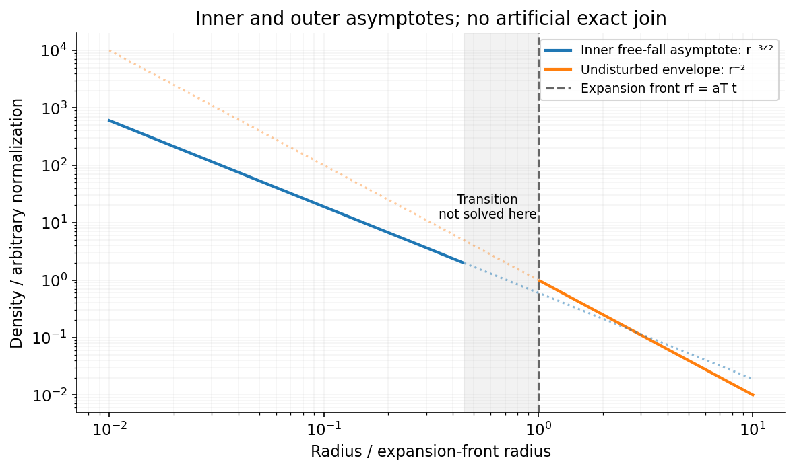

<h1 id="2/b/solution">Solution</h1>

↑ **Parent:** [B](../b.md)

For [inside-out collapse of a singular isothermal sphere](../../../../../inside-out-collapse-of-a-singular-isothermal-sphere.md), the expansion front is at $r_f=a_Tt$. The original [mass](../../../../../mass.md) swept by this front is

$$
M_{\rm swept}=\frac{2a_T^2r_f}{G}=\frac{2a_T^3t}{G}.
$$

Thus the only time-independent accretion scale is $a_T^3/G$. The front-sweeping estimate has coefficient two, but [gas](../../../../../gas.md) takes time to fall from the front to the object; it is not an exact central accretion coefficient. Write

$$
\boxed{\dot M_\star=m_0\frac{a_T^3}{G}\propto\left(\frac{k_BT}{\mu m_H}\right)^{3/2}\propto T^{3/2},}
$$

for fixed mean particle [mass](../../../../../mass.md) $\mu m_H$. Determining the dimensionless coefficient $m_0$ requires the collapse solution; it is not fixed by front propagation alone and is not needed for the requested [temperature](../../../../../temperature-split.md) scaling.[1977 expansion-wave solution: central accretion and the free-falling envelope](../../../../../self-similar-collapse-of-isothermal-spheres-and-star-formation-by-frank-h-shu.md)

Well inside the front, where the point [mass](../../../../../mass.md) dominates and infall is approximately pressureless and locally steady, $|v_r|\simeq\sqrt{2GM_\star/r}$. Conserving the radial [mass](../../../../../mass.md) flux gives the [free-fall density profile around a growing point mass](../../../../../free-fall-density-profile-around-a-growing-point-mass.md):

$$
\boxed{\rho(r,t)=\frac{\dot M_\star}{4\pi r^2|v_r|}\simeq\frac{\dot M_\star}{4\pi\sqrt{2GM_\star(t)}}r^{-3/2}.}
$$

The inner slope is $-3/2$, versus $-2$ in the undisturbed outer cloud. For constant $\dot M_\star$ and negligible initial object [mass](../../../../../mass.md), $M_\star\propto t$ and the inner normalization varies as $t^{-1/2}$. These are inner asymptotes, not an assertion of an abrupt exact power-law join at the front.

**[Figure 2](#2/b/image-an-inside-out-collapse-has-a-freely-falling-inner-density-slope-distinct-from-the-undisturbed-isothermal-envelope). An inside-out collapse has a freely falling inner density slope distinct from the undisturbed isothermal envelope**. [Source](paper-1-inside-out-collapse.py).

## ↑ Ancestors (14)

1. [B](../b.md)
2. [2](../../2.md)
3. [Paper 1](../../../paper-1-split.md)
4. [2015](../../../split.md)
5. [Past exam of the formation of Structure in the Universe course of the University of Cambridge](../../../../split.md)
6. [Formation of Structure in the Universe course of the University of Cambridge](../../../../../formation-of-structure-in-the-universe-course-of-the-university-of-cambridge.md)
7. [Physics course of the year 4 of the natural sciences course of the University of Cambridge](../../../../../physics-course-of-the-year-4-of-the-natural-sciences-course-of-the-university-of-cambridge.md)
8. [Year 4 of the natural sciences course of the University of Cambridge](../../../../../year-4-of-the-natural-sciences-course-of-the-university-of-cambridge.md)
9. [Year of the natural sciences course of the University of Cambridge](../../../../../year-of-the-natural-sciences-course-of-the-university-of-cambridge.md)
10. [Natural sciences course of the University of Cambridge](../../../../../natural-sciences-course-of-the-university-of-cambridge.md)
11. [Course of the University of Cambridge](../../../../../course-of-the-university-of-cambridge.md)
12. [University of Cambridge](../../../../../university-of-cambridge-split.md)
13. [List of universities](../../../../../list-of-universities.md)
14. [Codex Wiki](../../../../../split.md)
