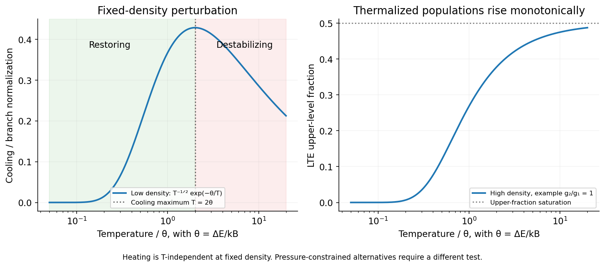

<h1 id="2/e/solution">Solution</h1>

↑ **Parent:** [E](../e.md)

First specify the perturbation: take fixed [gas](../../../../../gas.md) [density](../../../../../density.md), fixed ionic abundance and the same [temperature](../../../../../temperature-split.md)-independent heating, so thermal stability requires $d\mathcal C/dT>0$ at an equilibrium. Let $\theta=\Delta E/k_B$, $n_e$ be the collider [density](../../../../../density.md) and $n_A=n_1+n_2$ the atomic [density](../../../../../density.md). A two-level optically thin balance is

$$
n_1n_eq_{12}=n_2(A_{21}+n_eq_{21}),\qquad\mathcal C=n_2A_{21}\Delta E.
$$

The [critical density of an atomic transition](../../../../../critical-density-of-an-atomic-transition.md) is approximately $A_{21}/q_{21}$. At **low [density](../../../../../density.md)**, each rare collisional excitation is followed by an escaping [photon](../../../../../photon.md), so

$$
\mathcal C\simeq n_An_eq_{12}\Delta E\propto T^{-1/2}e^{-\theta/T},\qquad\frac{d\ln\mathcal C}{d\ln T}=-\frac12+\frac\theta T.
$$

The [isochoric thermal stability of a collisionally excited line](../../../../../isochoric-thermal-stability-of-a-collisionally-excited-line.md) therefore gives

$$
\boxed{T<2\theta:\ \text{stable};\qquad T>2\theta:\ \text{unstable}.}
$$

At $T=2\theta$ the linear restoring coefficient vanishes; the cooling maximum is marginal to first order and is not robust two-sided stability.

At **high [density](../../../../../density.md)**, collisional de-excitation competes successfully with radiative decay, and collisions establish [local thermodynamic equilibrium](../../../../../local-thermodynamic-equilibrium.md) level populations. Detailed balance gives $n_2/n_1=g e^{-\theta/T}$, where $g=g_2/g_1$. The cooling is then

$$
\mathcal C=n_AA_{21}\Delta E\,f_u(T),\qquad f_u=\frac{g e^{-\theta/T}}{1+g e^{-\theta/T}},\qquad\frac{d\ln f_u}{d\ln T}=\frac\theta T(1-f_u)>0.
$$

Thus **the high-[density](../../../../../density.md) fixed-[density](../../../../../density.md) branch is stable for finite $T$**, becoming weakly restoring as the upper fraction saturates at high [temperature](../../../../../temperature-split.md). It is incorrect to retain the low-[density](../../../../../density.md) factor $T^{-1/2}$ in the [radiative cooling](../../../../../radiative-cooling.md) law once populations are thermalized.[Section2.2: collisional excitation, critical [density](../../../../../density.md) and the high-[density](../../../../../density.md) Boltzmann limit](../../../../../agn-emission-lines-by-hagai-netzer.md)

The [isobaric thermal stability of a two-level coolant](../../../../../isobaric-thermal-stability-of-a-two-level-coolant.md) is a distinct question. If the intended heating is a fixed rate **per particle**, then $n\propto T^{-1}$ and stability tests the cooling per particle. The low-[density](../../../../../density.md) boundary becomes $T<2\theta/3$; the high-[density](../../../../../density.md) cooling per particle remains proportional to $f_u$, so remains stable. If instead heating is constant **per volume**, the isobaric low-[density](../../../../../density.md) boundary is $T<2\theta/5$, and the high-[density](../../../../../density.md) stability condition is $\theta(1-f_u)/T>1$. The source gives no [pressure](../../../../../pressure-split.md) constraint or explicit heating normalization: the boxed $2\theta$ result is the fixed-[density](../../../../../density.md) answer, with these conditional alternatives stated to avoid asserting a universal boundary.

**[Figure 3](#2/e/image-low-density-collisional-line-cooling-has-a-temperature-maximum-whereas-high-density-lte-emission-rises-toward-saturation). Low-density collisional line cooling has a temperature maximum, whereas high-density LTE emission rises toward saturation**. [Source](paper-1-line-cooling-stability.py).

## ↑ Ancestors (14)

1. [E](../e.md)
2. [2](../../2.md)
3. [Paper 1](../../../paper-1-split.md)
4. [2015](../../../split.md)
5. [Past exam of the formation of Structure in the Universe course of the University of Cambridge](../../../../split.md)
6. [Formation of Structure in the Universe course of the University of Cambridge](../../../../../formation-of-structure-in-the-universe-course-of-the-university-of-cambridge.md)
7. [Physics course of the year 4 of the natural sciences course of the University of Cambridge](../../../../../physics-course-of-the-year-4-of-the-natural-sciences-course-of-the-university-of-cambridge.md)
8. [Year 4 of the natural sciences course of the University of Cambridge](../../../../../year-4-of-the-natural-sciences-course-of-the-university-of-cambridge.md)
9. [Year of the natural sciences course of the University of Cambridge](../../../../../year-of-the-natural-sciences-course-of-the-university-of-cambridge.md)
10. [Natural sciences course of the University of Cambridge](../../../../../natural-sciences-course-of-the-university-of-cambridge.md)
11. [Course of the University of Cambridge](../../../../../course-of-the-university-of-cambridge.md)
12. [University of Cambridge](../../../../../university-of-cambridge-split.md)
13. [List of universities](../../../../../list-of-universities.md)
14. [Codex Wiki](../../../../../split.md)
