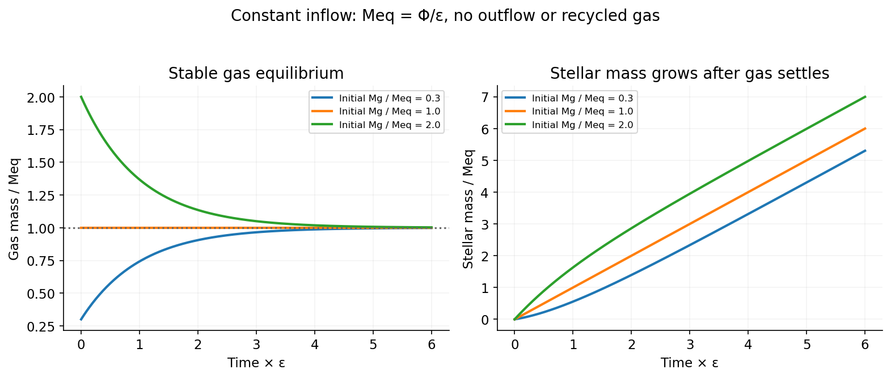

<h1 id="3/a/solution">Solution</h1>

↑ **Parent:** [A](../a.md)

For constant inflow $\Phi$ and efficiency $\epsilon>0$, with no recycling or outflow, [mass](../../../../../mass.md) conservation gives the [constant-inflow gas regulator solution](../../../../../constant-inflow-gas-regulator-solution.md):

$$
\dot M_g=\Phi-\epsilon M_g,\qquad\boxed{M_g(t)=\frac\Phi\epsilon+\left(M_0-\frac\Phi\epsilon\right)e^{-\epsilon t}.}
$$

The equilibrium $M_{g,\rm eq}=\Phi/\epsilon$ is stable: a [gas](../../../../../gas.md)-[mass](../../../../../mass.md) perturbation obeys $\delta\dot M_g=-\epsilon\delta M_g$. At late times the [star formation rate](../../../../../star-formation-rate.md) approaches $\Psi=\Phi$, while the [gas](../../../../../gas.md) reservoir approaches a constant.

Integrating $\dot M_\star=\epsilon M_g$ with $M_\star(0)=0$ gives the [stellar mass in a constant-inflow gas regulator](../../../../../stellar-mass-in-a-constant-inflow-gas-regulator.md):

$$
\boxed{M_\star(t)=\Phi t+\left(M_0-\frac\Phi\epsilon\right)(1-e^{-\epsilon t}).}
$$

It also follows immediately from $M_g+M_\star=M_0+\Phi t$. **The [gas](../../../../../gas.md) [mass](../../../../../mass.md) equilibrates; the stellar [mass](../../../../../mass.md) generally keeps growing.** With $\Phi=0$, these reduce to exponential [gas](../../../../../gas.md) depletion and $M_\star=M_0(1-e^{-\epsilon t})$.

A constant inflow is implicit in the requested steady asymptote, not automatic for an arbitrary prescribed rate. For time-dependent $\Phi(t)$ the exact integrating-factor result is

$$
M_g(t)=M_0e^{-\epsilon t}+\int_0^t e^{-\epsilon(t-s)}\Phi(s)\,ds;
$$

a constant late-time [gas](../../../../../gas.md) [mass](../../../../../mass.md) then requires a corresponding asymptotically steady supply. Both printed mark groups remain in this single unlettered continuation of part(a).

**[Figure 4](#3/a/image-gas-approaches-an-inflow-supported-equilibrium-while-the-stellar-mass-continues-to-grow). Gas approaches an inflow-supported equilibrium while the stellar mass continues to grow**. [Source](paper-1-gas-regulator.py).

## ↑ Ancestors (14)

1. [A](../a.md)
2. [3](../../3.md)
3. [Paper 1](../../../paper-1-split.md)
4. [2015](../../../split.md)
5. [Past exam of the formation of Structure in the Universe course of the University of Cambridge](../../../../split.md)
6. [Formation of Structure in the Universe course of the University of Cambridge](../../../../../formation-of-structure-in-the-universe-course-of-the-university-of-cambridge.md)
7. [Physics course of the year 4 of the natural sciences course of the University of Cambridge](../../../../../physics-course-of-the-year-4-of-the-natural-sciences-course-of-the-university-of-cambridge.md)
8. [Year 4 of the natural sciences course of the University of Cambridge](../../../../../year-4-of-the-natural-sciences-course-of-the-university-of-cambridge.md)
9. [Year of the natural sciences course of the University of Cambridge](../../../../../year-of-the-natural-sciences-course-of-the-university-of-cambridge.md)
10. [Natural sciences course of the University of Cambridge](../../../../../natural-sciences-course-of-the-university-of-cambridge.md)
11. [Course of the University of Cambridge](../../../../../course-of-the-university-of-cambridge.md)
12. [University of Cambridge](../../../../../university-of-cambridge-split.md)
13. [List of universities](../../../../../list-of-universities.md)
14. [Codex Wiki](../../../../../split.md)
