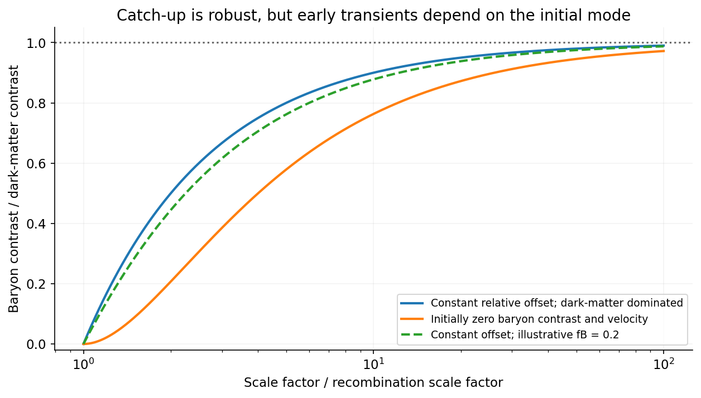

<h1 id="3/c/solution">Solution</h1>

↑ **Parent:** [C](../c.md)

Put $H=2/(3t)$ and let $f_B=\rho_B/\bar\rho$, $f_D=1-f_B$ be constant background matter fractions. Define the total matter perturbation $S=f_B\Delta_B+f_D\Delta_D$ and the relative mode $D=\Delta_D-\Delta_B$. Adding with the background weights and subtracting the two given equations respectively gives

$$
\ddot S+\frac4{3t}\dot S-\frac2{3t^2}S=0,\qquad\ddot D+\frac4{3t}\dot D=0.
$$

The [total and relative density modes of two pressureless matter fluids](../../../../../total-and-relative-density-modes-of-two-pressureless-matter-fluids.md) are consequently

$$
\boxed{S=A t^{2/3}+B t^{-1},\qquad D=C+E t^{-1/3},\qquad\Delta_B=S-f_DD,\quad\Delta_D=S+f_BD.}
$$

These are the general consequences of the supplied equations; a single ratio additionally needs initial-mode assumptions.

For the usual dark-matter-dominated growing-mode approximation, take $f_B\ll1$, neglect the decaying modes, and set the relative-velocity mode $E=0$. Then $\Delta_D\propto t^{2/3}\propto R$. With $\Delta_B(t_r)=0$ at recombination, $C=\Delta_D(t_r)$, so the [baryon catch-up approximation after recombination](../../../../../baryon-catch-up-approximation-after-recombination.md) is

$$
\boxed{\Delta_B(t)=\Delta_D(t)\left[1-\frac{R(t_r)}{R(t)}\right]=\Delta_D(t)\left[1-\frac{1+z}{1+z_0}\right].}
$$

At redshifts $z,z_0\gg1$, replacing $1+z$ by $z$ gives the printed $\Delta_B\simeq\Delta_D(1-z/z_0)$. **The printed relation is a high-redshift approximation with a specified relative mode, not an exact identity for arbitrary solutions of the two-fluid equations.**

For example, retaining a finite baryon fraction with a growing total mode and constant relative mode gives, with $x=R/R(t_r)$,

$$
\frac{\Delta_B}{\Delta_D}=\frac{f_D(x-1)}{f_Dx+f_B}.
$$

Alternatively, if initially both $\Delta_B=0$ and $\dot\Delta_B=0$ while the dark-matter growing mode is already present, then in the dark-matter-dominated limit the relative transient is not zero and

$$
\frac{\Delta_B}{\Delta_D}=1-3x^{-1}+2x^{-3/2}.
$$

These different solutions show why the initial-velocity convention matters. **The quoted catch-up law is the dark-matter-dominated branch with the relative decaying mode neglected**, together with the high-redshift approximation stated above. The general solution retains the transient and a finite baryon fraction, so the additional assumptions needed for that special case remain explicit.

The physical conclusion is robust: after decoupling, baryonic [gas](../../../../../gas.md) can fall into pre-existing dark-matter potential wells and its fractional [density](../../../../../density.md) perturbation catches up. The absolute constant offset need not vanish; it becomes small relative to the growing common mode. The pressureless approximation applies on scales above the baryonic Jeans scale and while perturbations remain linear; subsequent collapse requires nonlinear treatment.[Sections3.1–3.3: matter growth, decoupling, Jeans support and dark-matter seeds](../../../../../cosmology-by-david-tong.md)

**[Figure 5](#3/c/image-baryons-approach-the-dark-matter-density-contrast-with-transient-behaviour-set-by-the-initial-relative-velocity). Baryons approach the dark-matter density contrast, with transient behaviour set by the initial relative velocity**. [Source](paper-1-baryon-catch-up.py).

## ↑ Ancestors (14)

1. [C](../c.md)
2. [3](../../3.md)
3. [Paper 1](../../../paper-1-split.md)
4. [2015](../../../split.md)
5. [Past exam of the formation of Structure in the Universe course of the University of Cambridge](../../../../split.md)
6. [Formation of Structure in the Universe course of the University of Cambridge](../../../../../formation-of-structure-in-the-universe-course-of-the-university-of-cambridge.md)
7. [Physics course of the year 4 of the natural sciences course of the University of Cambridge](../../../../../physics-course-of-the-year-4-of-the-natural-sciences-course-of-the-university-of-cambridge.md)
8. [Year 4 of the natural sciences course of the University of Cambridge](../../../../../year-4-of-the-natural-sciences-course-of-the-university-of-cambridge.md)
9. [Year of the natural sciences course of the University of Cambridge](../../../../../year-of-the-natural-sciences-course-of-the-university-of-cambridge.md)
10. [Natural sciences course of the University of Cambridge](../../../../../natural-sciences-course-of-the-university-of-cambridge.md)
11. [Course of the University of Cambridge](../../../../../course-of-the-university-of-cambridge.md)
12. [University of Cambridge](../../../../../university-of-cambridge-split.md)
13. [List of universities](../../../../../list-of-universities.md)
14. [Codex Wiki](../../../../../split.md)
