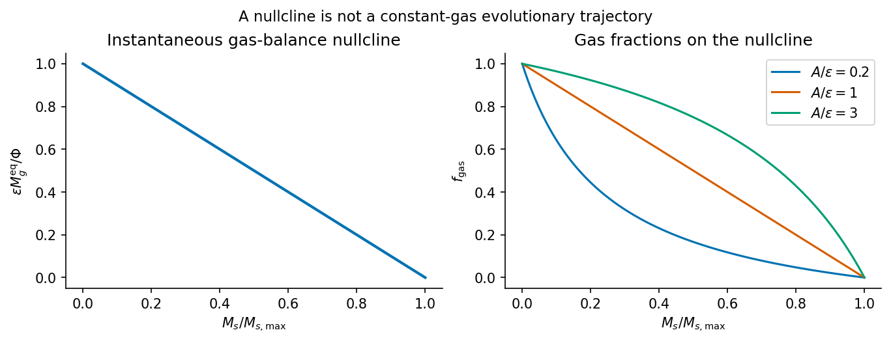

<h1 id="1/a/solution">Solution</h1>

↑ **Parent:** [A](../a.md)

Write $A=\lambda\beta\ell_E$, where $\ell_E=L_{\rm Edd}/M_{\rm BH}$. For ionized [hydrogen](../../../../../hydrogen.md) with [Thomson scattering](../../../../../thomson-scattering.md) opacity, radiation force on one electron-proton pair balances gravity when

$$
\frac{\sigma_T L}{4\pi r^2c}=\frac{GM_{\rm BH}m_p}{r^2},
\qquad
\ell_E=\frac{4\pi Gm_pc}{\sigma_T}.
$$

The mass-loading coefficient $A$ has units of inverse time. With the stated neglect of returned and directly accreted gas, [mass conservation](../../../../../mass-conservation.md) gives

$$
\dot M_g=\Phi-\epsilon M_g-A M_s,\qquad
\dot M_s=\epsilon M_g.
$$

At a specified stellar mass, the [gas-balance nullcline](../../../../../gas-balance-nullcline.md) is

$$
M_g^{\rm eq}(M_s)=\frac{\Phi-A M_s}{\epsilon}.
$$

A positive reservoir exists only below the limiting mass

$$
\boxed{M_{s,\max}=\frac{\Phi}{A}
=\frac{\Phi\sigma_T}{4\pi Gm_pc\,\lambda\beta}.}
$$

Equality has zero gas, so this is the supremum of masses with a positive instantaneous [equilibrium](../../../../../equilibrium-point-of-a-dynamical-system.md). For $\Phi,\epsilon,A>0$, the corresponding gas fraction is

$$
\boxed{f_{\rm gas}(M_s)=
\frac{\Phi-A M_s}{\Phi+(\epsilon-A)M_s}
=\left[1+\frac{\epsilon M_s}{\Phi-A M_s}\right]^{-1},
\quad0\leq M_s<M_{s,\max}.}
$$

It decreases from one to zero: the derivative is $-\epsilon\Phi/[\Phi+(\epsilon-A)M_s]^2<0$. This is a [gas regulator](../../../../../galactic-gas-regulator.md) with an outflow increasing with the stellar mass through the assumed black-hole scaling.

There is an important time-dependence qualification. A positive gas mass cannot remain exactly constant forever while the stellar mass continues to increase and $M_{\rm BH}=\beta M_s$ is maintained: differentiating $\dot M_g=0$ would require $A\epsilon M_g=0$. The expression above is the instantaneous [equilibrium](../../../../../equilibrium-point-of-a-dynamical-system.md), or a quasisteady approximation when gas relaxation is fast relative to stellar-mass evolution. The only exact [fixed point](../../../../../fixed-point.md) of the coupled idealized equations is $(M_g,M_s)=(0,\Phi/A)$. It is not a sustained star-forming state.

Above the limiting mass, $\dot M_g<0$ for every nonnegative reservoir: the assumed Eddington-driven wind already demands more than the incoming supply, even before [star formation](../../../../../star-formation.md) consumes gas. The reservoir is depleted and [star formation](../../../../../star-formation.md) is quenched. The equations must cease to apply when gas runs out; one cannot continue to negative gas mass or power an indefinitely Eddington-luminous nucleus without fuel. At fixed $M_s>M_{s,\max}$ the depletion time from $M_{g,0}$ is

$$
t_{\rm dep}=\epsilon^{-1}\ln\left(1+
\frac{\epsilon M_{g,0}}{A M_s-\Phi}\right).
$$

Allowing $M_s$ to grow only strengthens the initial depletion tendency. If $\lambda\beta=0$, this particular feedback threshold is absent.

**[Figure 1](#1/a/image-original-dimensionless-gas-regulator-nullcline-and-its-decreasing-equilibrium-gas-fraction). Original dimensionless gas-regulator nullcline and its decreasing equilibrium gas fraction**.

## ↑ Ancestors (14)

1. [A](../a.md)
2. [1](../../1.md)
3. [Paper 1](../../../paper-1-split.md)
4. [2016](../../../split.md)
5. [Past exam of the formation of Structure in the Universe course of the University of Cambridge](../../../../split.md)
6. [Formation of Structure in the Universe course of the University of Cambridge](../../../../../formation-of-structure-in-the-universe-course-of-the-university-of-cambridge.md)
7. [Physics course of the year 4 of the natural sciences course of the University of Cambridge](../../../../../physics-course-of-the-year-4-of-the-natural-sciences-course-of-the-university-of-cambridge.md)
8. [Year 4 of the natural sciences course of the University of Cambridge](../../../../../year-4-of-the-natural-sciences-course-of-the-university-of-cambridge.md)
9. [Year of the natural sciences course of the University of Cambridge](../../../../../year-of-the-natural-sciences-course-of-the-university-of-cambridge.md)
10. [Natural sciences course of the University of Cambridge](../../../../../natural-sciences-course-of-the-university-of-cambridge.md)
11. [Course of the University of Cambridge](../../../../../course-of-the-university-of-cambridge.md)
12. [University of Cambridge](../../../../../university-of-cambridge-split.md)
13. [List of universities](../../../../../list-of-universities.md)
14. [Codex Wiki](../../../../../split.md)
