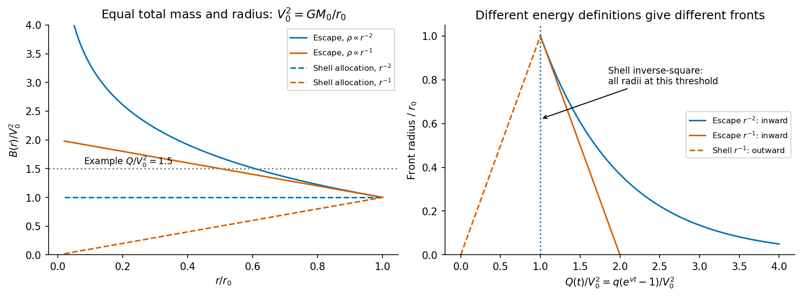

<h1 id="2/b/solution">Solution</h1>

↑ **Parent:** [B](../b.md)

Introduce the constant $\nu>0$ by $\psi(r,t)=\nu\rho_g(r,t)$, and set $q=\gamma E_{\rm SN}$, the injected energy per unit mass of newly formed [stars](../../../../../star.md). Before a local wind switches on, no return or matter exchange implies

$$
\rho_g(r,t)=\rho_0(r)e^{-\nu t},\qquad
\rho_s(r,t)=\rho_0(r)(1-e^{-\nu t}).
$$

In this [independent-volume supernova quenching](../../../../../independent-volume-supernova-quenching.md) model, the accumulated injection per volume is

$$
u_{\rm SN}(r,t)=\int_0^t\gamma E_{\rm SN}\psi(r,t')\,\mathrm dt'
=q\rho_0(r)(1-e^{-\nu t}).
$$

For any specified positive [binding energy](../../../../../binding-energy.md) per unit remaining gas mass $B(r)$, the local threshold is

$$
u_{\rm SN}=\rho_g B(r)
\quad\Longleftrightarrow\quad
\boxed{Q(t)\equiv q(e^{\nu t}-1)=B(r).}
$$

Gas conversion must be included in this comparison; replacing the integrated [star formation](../../../../../star-formation.md) by its initial rate times $t$ is only a short-time approximation.

For a [quenching front in a fixed galactic potential](../../../../../quenching-front-in-a-fixed-galactic-potential.md), take $B(r)=-\Phi_{\rm grav}(r)=2k[1+\ln(r_0/r)]$. This treats the gravitating profile as fixed: newly formed [stars](../../../../../star.md) initially replace gas at the same radius, and later changes of the potential caused by expelled gas are neglected. Gas first becomes unbound at the outer edge, at

$$
t_{\rm start}=\nu^{-1}\ln\left(1+\frac{2k}{q}\right).
$$

Thereafter the inner edge of the quenched exterior region is

$$
\boxed{r_{\rm quench}(t)
=r_0\exp\left[1-\frac{q}{2k}(e^{\nu t}-1)\right],
\qquad t\geq t_{\rm start}.}
$$

There is no quenched radius inside the [galaxy](../../../../../galaxy-split.md) before this onset. The remaining star-forming region is $0<r<r_{\rm quench}$; the front moves inward. The ideal logarithmically divergent central potential delays complete removal to infinite time in this fixed-profile model. It should not be interpreted as a physical unresolved central core.

The [local binding-energy allocation in galactic feedback](../../../../../local-binding-energy-allocation-in-galactic-feedback.md) also admits a different convention, because it calls $\phi$ an energy of a volume element without specifying how the nonlocal self-gravitating energy is assigned to that element. If the intended prescription is instead the shell-assembly contribution from part (a),

$$
\phi_{\rm shell}=-\frac{GM_0(r)}r\rho_g=-2k\rho_g,
$$

then $B_{\rm shell}=2k$ at every radius. The same time $t_{\rm start}$ applies everywhere: **all shells quench simultaneously**, and there is no continuously propagating radial front. This is a shell-energy toy model, not the escape potential including exterior shells.

Both results follow from explicit definitions. A convention assigning $\tfrac12\rho_g\Phi_{\rm grav}$ locally replaces $B$ by $B/2$ in $Q(t)=B(r)$; it is again an energy allocation rather than test-parcel escape. Updating the potential after gas loss or choosing a fixed initial-gas binding budget instead of the remaining-gas budget would require an additional closure. The stated independent-volume assumptions do not uniquely choose between these. The displayed escape-potential result and shell prescription must therefore not be presented as interchangeable universal laws.

**[Figure 2](#2/b/image-original-comparison-of-quenching-thresholds-for-two-initial-density-slopes-distinguishing-escape-potential-from-shell-energy-allocation). Original comparison of quenching thresholds for two initial density slopes, distinguishing escape potential from shell-energy allocation**.

## ↑ Ancestors (14)

1. [B](../b.md)
2. [2](../../2.md)
3. [Paper 1](../../../paper-1-split.md)
4. [2016](../../../split.md)
5. [Past exam of the formation of Structure in the Universe course of the University of Cambridge](../../../../split.md)
6. [Formation of Structure in the Universe course of the University of Cambridge](../../../../../formation-of-structure-in-the-universe-course-of-the-university-of-cambridge.md)
7. [Physics course of the year 4 of the natural sciences course of the University of Cambridge](../../../../../physics-course-of-the-year-4-of-the-natural-sciences-course-of-the-university-of-cambridge.md)
8. [Year 4 of the natural sciences course of the University of Cambridge](../../../../../year-4-of-the-natural-sciences-course-of-the-university-of-cambridge.md)
9. [Year of the natural sciences course of the University of Cambridge](../../../../../year-of-the-natural-sciences-course-of-the-university-of-cambridge.md)
10. [Natural sciences course of the University of Cambridge](../../../../../natural-sciences-course-of-the-university-of-cambridge.md)
11. [Course of the University of Cambridge](../../../../../course-of-the-university-of-cambridge.md)
12. [University of Cambridge](../../../../../university-of-cambridge-split.md)
13. [List of universities](../../../../../list-of-universities.md)
14. [Codex Wiki](../../../../../split.md)
