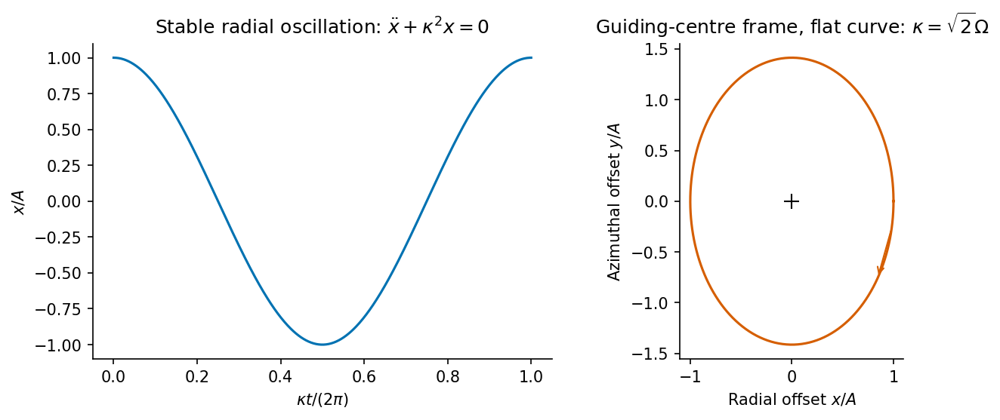

<h1 id="2/d/solution">Solution</h1>

↑ **Parent:** [D](../d.md)

To test [radial stability of an axisymmetric circular orbit](../../../../../radial-stability-of-an-axisymmetric-circular-orbit.md), let $\Phi(r)$ be the time-independent [gravitational potential](../../../../../newtonian-potential-of-a-point-mass.md) per unit stellar mass in the midplane. Axial symmetry conserves the [specific angular momentum](../../../../../specific-angular-momentum.md) $j=r^2\dot\varphi$. The radial equation is

$$
\ddot r=\frac{j^2}{r^3}-\Phi'(r)
=-\frac{\mathrm d\Phi_{\rm eff}}{\mathrm dr},
\qquad
\Phi_{\rm eff}(r)=\Phi(r)+\frac{j^2}{2r^2}.
$$

A [circular orbit](../../../../../circular-orbit.md) at $r_0$ obeys $j_0^2=r_0^3\Phi'(r_0)$. Choose the guiding [circular orbit](../../../../../circular-orbit.md) with the same conserved [angular momentum](../../../../../angular-momentum.md) as the perturbed [star](../../../../../star.md). Setting $r=r_0+x$ and expanding at fixed $j=j_0$ gives

$$
\ddot x=
\left[-\frac{3j_0^2}{r_0^4}-\Phi''(r_0)\right]x+O(x^2)
=-\kappa^2x+O(x^2),
$$

where the [radial epicyclic frequency](../../../../../radial-epicyclic-frequency.md) is

$$
\boxed{\kappa^2=\Phi''(r_0)+\frac3{r_0}\Phi'(r_0)
=4\Omega_0^2+
r_0\left.\frac{\mathrm d\Omega^2}{\mathrm dr}\right|_{r_0}
=\left.\frac1{r^3}\frac{\mathrm d j_c^2}{\mathrm dr}\right|_{r_0}.}
$$

Here $\Omega^2(r)=\Phi'(r)/r$ and $j_c=r^2\Omega$ refer to the family of [circular orbits](../../../../../circular-orbit.md). They are differentiated as functions of radius only after the perturbation equation has been expanded at conserved stellar $j$.

For a radially stable [circular orbit](../../../../../circular-orbit.md), $\kappa^2>0$, so to linear order

$$
\boxed{x(t)=C\cos(\kappa t)+D\sin(\kappa t).}
$$

Thus the orbit performs small simple harmonic radial oscillations about its guiding radius.

**[Figure 3](#2/d/image-original-linear-epicycle-calculation-for-stable-circular-motion-with-a-flat-circular-speed-curve). Original linear epicycle calculation for stable circular motion with a flat circular-speed curve**.

Symmetry alone is insufficient to guarantee [stability](../../../../../stability-of-a-numerical-method.md): $\kappa^2<0$ gives exponentially growing displacement, and $\kappa^2=0$ is marginal. The intended statement assumes a stable unperturbed orbit.

For a Kepler potential $\kappa=\Omega$; for a flat circular-speed curve $\kappa=\sqrt2\,\Omega$; for [solid-body rotation](../../../../../solid-body-rotation.md) $\kappa=2\Omega$. Conservation of $j$ also gives $\dot\varphi\simeq\Omega_0(1-2x/r_0)$, explaining the accompanying azimuthal epicycle rather than a purely radial motion in the inertial plane.

## ↑ Ancestors (14)

1. [D](../d.md)
2. [2](../../2.md)
3. [Paper 1](../../../paper-1-split.md)
4. [2016](../../../split.md)
5. [Past exam of the formation of Structure in the Universe course of the University of Cambridge](../../../../split.md)
6. [Formation of Structure in the Universe course of the University of Cambridge](../../../../../formation-of-structure-in-the-universe-course-of-the-university-of-cambridge.md)
7. [Physics course of the year 4 of the natural sciences course of the University of Cambridge](../../../../../physics-course-of-the-year-4-of-the-natural-sciences-course-of-the-university-of-cambridge.md)
8. [Year 4 of the natural sciences course of the University of Cambridge](../../../../../year-4-of-the-natural-sciences-course-of-the-university-of-cambridge.md)
9. [Year of the natural sciences course of the University of Cambridge](../../../../../year-of-the-natural-sciences-course-of-the-university-of-cambridge.md)
10. [Natural sciences course of the University of Cambridge](../../../../../natural-sciences-course-of-the-university-of-cambridge.md)
11. [Course of the University of Cambridge](../../../../../course-of-the-university-of-cambridge.md)
12. [University of Cambridge](../../../../../university-of-cambridge-split.md)
13. [List of universities](../../../../../list-of-universities.md)
14. [Codex Wiki](../../../../../split.md)
