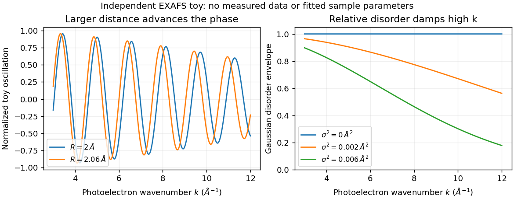

<h1 id="2/solution">Solution</h1>

↑ **Parent:** [2](../2.md)

The large rises mark the opening of Ga and As K-shell [photoionization](../../../../photoionization.md) channels at their respective thresholds. Above each edge, the outgoing [photoelectron](../../../../photoelectron.md) interferes with waves backscattered by neighboring atoms; that [interference](../../../../interference-wave-propagation.md) modulates the absorption transition probability. Near-edge resonances and multiple scattering require a different level of treatment from the simple high-energy single-scattering formula. Ga has four As nearest neighbors, while As has four Ga nearest neighbors, so the two edges sample different central atoms and scattering factors even though they probe the same nearest-neighbor bond lengths.

Write $k=\sqrt{2m_e(E-E_0)}/\hbar$ and $\chi=(\mu-\mu_0)/\mu_0$ relative to a smooth atomic background. The phase $2kR_j+\phi_j(k)$ includes the outward-and-return propagation distance and atomic [phase shifts](../../../../phase-shift.md). The factor $R_j^{-2}$ describes geometrical spreading; the backscattering amplitude depends on the neighbor species. The exponential $e^{-2R_j/\lambda(k)}$ accounts for loss of coherent [photoelectron](../../../../photoelectron.md) propagation. Averaging over Gaussian bond-length fluctuations gives $\langle e^{2ik\delta R}\rangle=e^{-2k^2\sigma_j^2}$.

The printed [polarization](../../../../polarization-waves.md) factor needs a notation correction: for K-shell dipole absorption it is proportional to $(\widehat{\mathbf R}_j\cdot\boldsymbol\epsilon)^2=\cos^2\theta_j$, not literally the cosine of a dimensional vector dot product. Four equivalent tetrahedral bonds have an isotropic sum of these projection weights. If the sum is over shells rather than individual neighbors, it also needs the [coordination number](../../../../coordination-number.md). A common conventional amplitude contains $S_0^2f_j(k)/(kR_j^2)$; omitted normalization and $1/k$ factors must be absorbed in the printed $f_B$ convention rather than silently changing its dimensions.

These are the ingredients of [extended X-ray absorption fine structure](../../../../extended-x-ray-absorption-fine-structure.md). A shell fit uses calculated or reference scattering amplitudes and phases, and refines bond distances, coordination and mean-square relative disorder together with an edge-energy correction. Fourier transformation separates approximate distance contributions, but the uncorrected peak position is shifted by the scattering phase and is not an exact bond length.[Chapter 3, equations 3.9–3.11 and subsequent mean-free-path correction; Chapter 6, shell fitting](../../../../fundamentals-of-xafs-by-matthew-newville.md)

**Sample A has the larger Ga–As bond length.** Its oscillations advance slightly faster with $k$: at higher $k$ its corresponding maxima lie to the left of B's. Reading several full cycles gives approximate periods $\Delta k_A\simeq1.47\,\mathrm{\mathring A^{-1}}$ and $\Delta k_B\simeq1.50\,\mathrm{\mathring A^{-1}}$. In the constant/common-phase-slope estimate, $R\propto1/\Delta k$, so

$$
\boxed{\frac{R_A-R_B}{R_B}\approx\frac{\Delta k_B}{\Delta k_A}-1\sim0.02.}
$$

This is a **rough percent-level difference**, not a precise fitted strain. Nonconstant atomic [phase shifts](../../../../phase-shift.md) affect the absolute distance inferred from a period and also limit this fractional estimate. The graph does not establish which alloy has which [indium](../../../../indium.md) concentration or how much its bulk lattice parameter changed. Local Ga–As relaxation need not follow a uniform bulk strain exactly.

Low [temperature](../../../../temperature-split.md) reduces thermal relative motion, preserving high-$k$ oscillations and separating small phase changes more clearly. It does not remove [zero-point motion](../../../../zero-point-motion.md) or static alloy disorder. To obtain an illustrative disorder estimate, take the high-$k$ envelope of the plotted $k\chi(k)$ to fall from about $0.19$ at $k=7.5\,\mathrm{\mathring A^{-1}}$ to $0.12$ at $k=10.4\,\mathrm{\mathring A^{-1}}$. If other envelope factors vary slowly over this interval,

$$
\sigma^2\approx\frac{\log(0.19/0.12)}{2(10.4^2-7.5^2)}\,\mathrm{\mathring A^2}
\simeq\boxed{4\times10^{-3}\,\mathrm{\mathring A^2}},\qquad \sigma\sim0.06\,\mathrm{\mathring A}.
$$

The value is only an order-of-magnitude, model-dependent reading: the backscattering amplitude, [mean free path](../../../../mean-free-path.md) and normalization have not been independently removed. In particular, $\sigma^2$ is the **bond-projected mean-square relative displacement**,

$$
\sigma^2=\langle[(\mathbf u_{\rm As}-\mathbf u_{\rm Ga})\cdot\widehat{\mathbf R}]^2\rangle,
$$

including [correlations](../../../../pearson-correlation-coefficient.md) and static disorder. It is not uniquely either atom's mean-square displacement. Equal uncorrelated projected displacements would each contribute $\sigma^2/2$, but that extra assumption is not supplied by the figure.

**[Figure 1](#2/image-bond-distance-and-disorder-affect-exafs-differently). Bond distance and disorder affect EXAFS differently**. Original independent toy signals: distance changes oscillation phase, while Gaussian relative disorder damps the high-wavenumber envelope. Curves are not fits to the exam spectra or measurements.

## ↑ Ancestors (13)

1. [2](../2.md)
2. [Paper 1](../../paper-1-split.md)
3. [2012](../../split.md)
4. [Past exam of the frontiers of experimental condensed matter physics course of the University of Cambridge](../../../split.md)
5. [Frontiers of Experimental Condensed Matter Physics course of the University of Cambridge](../../../../frontiers-of-experimental-condensed-matter-physics-course-of-the-university-of-cambridge.md)
6. [Physics course of the year 4 of the natural sciences course of the University of Cambridge](../../../../physics-course-of-the-year-4-of-the-natural-sciences-course-of-the-university-of-cambridge.md)
7. [Year 4 of the natural sciences course of the University of Cambridge](../../../../year-4-of-the-natural-sciences-course-of-the-university-of-cambridge.md)
8. [Year of the natural sciences course of the University of Cambridge](../../../../year-of-the-natural-sciences-course-of-the-university-of-cambridge.md)
9. [Natural sciences course of the University of Cambridge](../../../../natural-sciences-course-of-the-university-of-cambridge.md)
10. [Course of the University of Cambridge](../../../../course-of-the-university-of-cambridge.md)
11. [University of Cambridge](../../../../university-of-cambridge-split.md)
12. [List of universities](../../../../list-of-universities.md)
13. [Codex Wiki](../../../../split.md)
