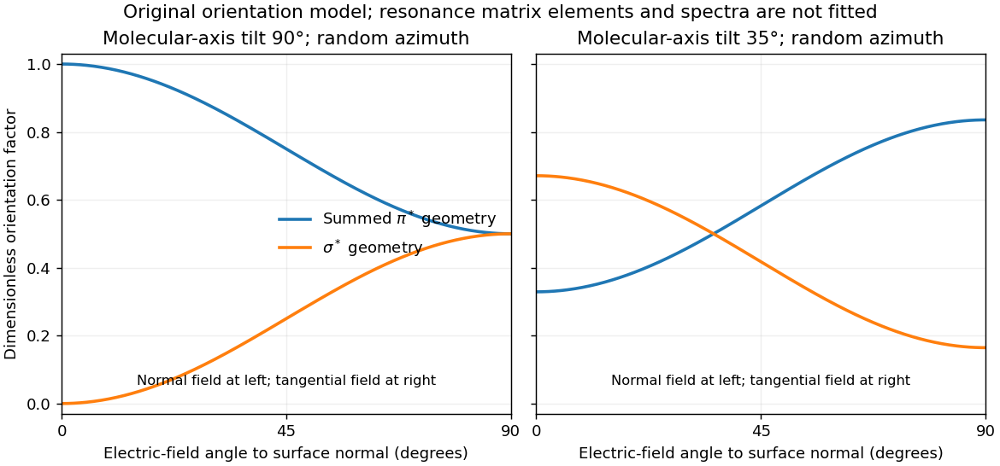

# Paper 1

↑ **Parent:** [2013](../2013.md)

Original public paper: [Physical PDF pages 592–595](https://www.whatdotheyknow.com/request/natural_science_tripos_physics_e_2/response/2340776/attach/2/FOI%202023%20399%20Zahid%20materials.pdf?cookie_passthrough=1#page=592). All three optional notes, both question 2 alternatives and the full microscopy question are covered.

**Table of contents**

- [1](#1)
  - [a](#1/a)
    - [Solution](#1/a/solution)
  - [b](#1/b)
    - [Solution](#1/b/solution)
  - [c](#1/c)
    - [Solution](#1/c/solution)
- [2](#2)
  - [a](#2/a)
    - [Solution](#2/a/solution)
  - [b](#2/b)
    - [Solution](#2/b/solution)
- [3](#3)
  - [Solution](#3/solution)

## 1

↑ **Parent:** [Paper 1](paper-1.md)

<h3 id="1/a">a</h3>

↑ **Parent:** [1](#1)

<h4 id="1/a/solution">Solution</h4>

↑ **Parent:** [A](#1/a)

[X-ray diffraction](../../quantum-scattering.md#x-ray-diffraction) arises predominantly from electromagnetic scattering by the electronic charge distribution. For elastic scattering, contributions from different unit cells interfere constructively at a [reciprocal lattice](../../quantum-scattering.md#reciprocal-lattice) vector, while the unit-cell [structure factor](../../quantum-scattering.md#structure-factor) weights the different atoms and their positions. The atomic X-ray scattering factor generally decreases with increasing [momentum](../../momentum.md) transfer because an extended [electron](../../physics.md#electron) cloud scatters out of phase with itself. Heavy atoms often scatter more strongly, making a light atom difficult to locate beside a heavy one; near an absorption edge, anomalous dispersion changes the contrast and can provide additional chemical sensitivity.

In [neutron diffraction](../../neutron.md#neutron-diffraction), the strong interaction with atomic nuclei supplies a short-range nuclear scattering amplitude. Its coherent scattering length depends on isotope and does not vary monotonically with atomic number; isotope substitution can therefore give useful contrast, and some light elements can be prominent. A neutron's magnetic moment also couples to magnetic moments in a specimen, so magnetic [diffraction](../../quantum-scattering.md#diffraction) measures ordered spin structures. Absorption and incoherent scattering depend strongly on isotope as well. The nuclear scattering length is approximately independent of [momentum](../../momentum.md) transfer in the usual thermal-neutron regime, whereas magnetic scattering has a form factor reflecting the electronic magnetization distribution.

[Electron diffraction](../../quantum-scattering.md#electron-diffraction) probes the electrostatic potential of both nuclei and [electrons](../../physics.md#electron). The [electron](../../physics.md#electron)'s charge makes scattering strong, allowing thin specimens or surfaces to be studied with intense signals. Strong interaction also makes multiple, dynamical scattering more important, so [electron](../../physics.md#electron) [diffraction](../../quantum-scattering.md#diffraction) intensities often cannot be interpreted as a simple single-scattering structure factor squared. Transmission geometry needs electron-transparent material; reflected low-energy [electrons](../../physics.md#electron) provide a surface-sensitive geometry. All three methods use phase-sensitive [interference](../../physical-optics.md#interference-wave-propagation) to reveal periodic structure, but their scattering interactions, penetration, sample requirements and contrast differ.

<h3 id="1/b">b</h3>

↑ **Parent:** [1](#1)

<h4 id="1/b/solution">Solution</h4>

↑ **Parent:** [B](#1/b)

A [scanning tunneling microscope](../../quantum-mechanics.md#scanning-tunneling-microscope) can modify an adsorbate's potential landscape as well as image it. First locate the atom with a weakly perturbing tunnel-current setpoint. Bringing the tip closer strengthens tip–atom coupling. In [lateral atomic manipulation](../../quantum-mechanics.md#lateral-atomic-manipulation), moving the tip parallel to the surface can pull or push the atom between adsorption sites; reducing the coupling afterwards leaves it at the chosen location. A change in tunneling current during the motion can signal a jump, and a subsequent low-current image checks the final arrangement.

In [vertical atomic manipulation](../../quantum-mechanics.md#vertical-atomic-manipulation), a suitable tip interaction or voltage pulse transfers an atom between substrate and tip. The tip is repositioned and the atom is deposited elsewhere by changing that interaction again. [Electric fields](../../electric-field.md) and inelastic tunneling excitation can also change adsorption, induce hopping or modify bonds. The useful mechanism depends on the atom, substrate, tip and bias: there is no universal pulse amplitude that works for every system. Low [temperature](../../temperature.md) suppresses thermal diffusion and ultrahigh vacuum helps preserve a clean, stable surface.

A motivating demonstration is [IBM in atoms](../../quantum-mechanics.md#ibm-atoms). [Don Eigler](../../physicist.md#don-eigler) and [Erhard Schweizer](../../physicist.md#erhard-schweizer) used a low-temperature STM to position individual [xenon](../../chemical-substance.md#xenon) atoms on a [nickel](../../chemical-substance.md#nickel) surface, constructing a chosen atomic pattern. The 1990 paper reported operation at about $4\,\mathrm K$ with atomic positioning precision. This demonstrates controlled rearrangement of surface adsorbates, rather than making the image alone prove that every STM feature is an isolated atom.[1990 abstract: low-temperature positioning of individual xenon atoms on single-crystal nickel](../../physics-bibliography.md#positioning-single-atoms-with-a-scanning-tunnelling-microscope-by-don-eigler-and-erhard-schweizer)

<h3 id="1/c">c</h3>

↑ **Parent:** [1](#1)

<h4 id="1/c/solution">Solution</h4>

↑ **Parent:** [C](#1/c)

In [inelastic scattering](../../quantum-scattering.md#inelastic-scattering), the probe transfers [energy](../../energy.md) as well as [momentum](../../momentum.md) to the specimen. A neutron, X-ray or [electron](../../physics.md#electron) can create or annihilate a [phonon](../../quantum-ideal-gas-statistics.md#phonon), while electronic or magnetic excitations provide other channels. Measuring the incident and outgoing energies resolves the transfer $\hbar\omega$; their wavevectors determine [momentum](../../momentum.md) transfer $\hbar\mathbf Q$. In a crystal, phonon [momentum](../../momentum.md) is conserved modulo a [reciprocal lattice](../../quantum-scattering.md#reciprocal-lattice) vector. Resolved spectra therefore probe excitation dispersions and lifetimes, rather than only average atomic positions.

[Thermal diffuse scattering](../../quantum-scattering.md#thermal-diffuse-scattering) arises from thermally populated lattice displacements and their correlations. The equilibrium lattice produces sharp Bragg peaks, but displacements redistribute part of the scattering into diffuse intensity. To one-phonon order a mode contribution contains a displacement projection and thermal occupation factors of the form

$$
I_\nu(\mathbf Q)\propto\frac{|\mathbf Q\cdot\mathbf e_{\mathbf q\nu}|^2}{\omega_{\mathbf q\nu}}
\left[n_B(\omega_{\mathbf q\nu})+\frac12\right],
$$

with atomic scattering weights, phases and geometrical factors understood. Stokes and anti-Stokes energy-resolved components carry $n_B+1$ and $n_B$ respectively; the displayed combination describes their summed scale. At high [temperature](../../temperature.md), $n_B\simeq k_BT/(\hbar\omega)$, so soft modes and their [polarization](../../wave.md#polarization-waves) strongly influence the pattern. Zero-point motion also contributes at low [temperature](../../temperature.md). An energy-integrating [diffraction](../../quantum-scattering.md#diffraction) image can record this inelastic intensity as a diffuse background without resolving its small [energy](../../energy.md) transfers. Static disorder gives additional diffuse scattering, so diffuse intensity alone does not establish a thermal mechanism.

## 2

↑ **Parent:** [Paper 1](paper-1.md)

<h3 id="2/a">a</h3>

↑ **Parent:** [2](#2)

<h4 id="2/a/solution">Solution</h4>

↑ **Parent:** [A](#2/a)

In [near-edge X-ray absorption fine structure](../../physics.md#near-edge-x-ray-absorption-fine-structure), a [photon](../../quantum-mechanics.md#photon) promotes a core [electron](../../physics.md#electron) into an unoccupied molecular or solid-state level. Near an oxygen K-edge this is principally an O $1s$ excitation. Bound or resonant final states, orbital symmetry, local bonding and multiple scattering shape the edge. A monochromatic tunable X-ray beam can measure transmission through a thin specimen, or fluorescence or [electron](../../physics.md#electron) yield as an absorption proxy. In [scanning transmission X-ray microscopy](../../optics.md#scanning-transmission-x-ray-microscopy), a focused spot is scanned while transmitted intensity is recorded; [energy](../../energy.md) stacks across an edge distinguish regions with different chemistry even when their thicknesses are similar. A zone plate or another suitable X-ray optic sets spatial resolution, while [energy](../../energy.md) resolution and reference spectra control chemical discrimination.

The dipole transition amplitude contains $\mathbf e\cdot\mathbf r$, so the incident electric-field direction selects final-orbital orientations. For an approximately free diatomic molecule with axis $\mathbf n$, the axial $\sigma^*$ transition has strength proportional to $|\mathbf e\cdot\mathbf n|^2$. Summing the two perpendicular $\pi^*$ directions gives strength proportional to $1-|\mathbf e\cdot\mathbf n|^2$, with separate radial matrix-element factors for the two resonance families. This [NEXAFS orientation dependence of a diatomic molecule](../../physics.md#nexafs-orientation-dependence-of-a-diatomic-molecule) explains the complementary [polarization](../../wave.md#polarization-waves) behavior; the molecular axis is not itself the direction of a $\pi^*$ orbital.

In the supplied geometry, normal incidence has [electric field](../../electric-field.md) parallel to the surface, whereas near-grazing incidence with the illustrated [polarization](../../wave.md#polarization-waves) has a large surface-normal field component. The single-layer curves show a stronger $\pi^*$ resonance and much weaker $\sigma^*$ structure in the latter geometry. This is consistent with oxygen axes lying largely parallel to the surface: a normal [electric field](../../electric-field.md) is perpendicular to those axes and excites $\pi^*$ efficiently, while suppressing the axial $\sigma^*$ transition. For flat molecules with random in-plane azimuths, the ideal axial factor is $1/2$ for a tangential field and zero for a normal field.

The multilayer curves instead have a strong $\pi^*$ peak at normal incidence and substantially stronger relative $\sigma^*$ response at grazing incidence. Their axes therefore have a substantial surface-normal component, consistent with the proposed tilted, more upright packing. The distinction supports a different orientation distribution in the multilayer and monolayer, rather than one isotropically oriented molecular population in both.

**[Figure 1](#2/a/image-ideal-dipole-orientation-factors-for-flat-and-tilted-diatomic-molecules). Ideal dipole orientation factors for flat and tilted diatomic molecules**.

For illustration, a molecular polar tilt $\beta$ and random azimuth give $\langle|\mathbf e\cdot\mathbf n|^2\rangle=\cos^2\beta\cos^2\alpha+\tfrac12\sin^2\beta\sin^2\alpha$, where $\alpha$ is the electric-field angle to the surface normal. The original diagram plots these ideal factors for two chosen tilts; it is not a reconstruction or fit of the supplied spectra. Quantitative tilt extraction would additionally need intensity normalization, [polarization](../../wave.md#polarization-waves) purity, azimuthal distribution and substrate-induced changes of the resonances. The spectra alone do not determine unique bond lengths or every adsorption site.

<h3 id="2/b">b</h3>

↑ **Parent:** [2](#2)

<h4 id="2/b/solution">Solution</h4>

↑ **Parent:** [B](#2/b)

[Ultraviolet photoelectron spectroscopy](../../physical-chemistry.md#ultraviolet-photoelectron-spectroscopy) probes occupied valence states through photoemitted [electron](../../physics.md#electron) energies. [Angle-resolved photoemission spectroscopy](../../physical-chemistry.md#angle-resolved-photoemission-spectroscopy) adds emission direction and therefore parallel crystal [momentum](../../momentum.md), revealing occupied band dispersions and Fermi contours. For a clean periodic surface, $k_\parallel=\sqrt{2m_eE_{\rm kin}}\sin\theta/\hbar$ modulo a surface reciprocal-lattice vector. A two-dimensional surface band has no intrinsic perpendicular dispersion; varying [photon](../../quantum-mechanics.md#photon) [energy](../../energy.md) helps distinguish it from bulk bands, while allowing for matrix-element changes. A simple surface-state example is a parabolic band $E(\mathbf k_\parallel)=E_0+\hbar^2k_\parallel^2/(2m_*)$.

[Scanning tunneling spectroscopy](../../quantum-mechanics.md#scanning-tunneling-spectroscopy) measures local differential conductance. With a suitable featureless tip and weak tunneling, $dI/dV$ samples the local [density of states](../../quantum-ideal-gas-statistics.md#density-of-states), giving occupied and unoccupied features on opposite bias sides. It provides spatial localization, defects and standing-wave patterns, while ordinary spectroscopy at one point does not directly give the complete momentum-resolved band structure. For the parabolic two-dimensional band, the ideal [density of states](../../quantum-ideal-gas-statistics.md#density-of-states) has a step at its onset, while spatial [interference](../../physical-optics.md#interference-wave-propagation) can supply information about allowed wavevectors. [Inverse photoemission spectroscopy](../../physics.md#inverse-photoemission-spectroscopy) accesses unoccupied states by injecting [electrons](../../physics.md#electron) and measuring emitted [photons](../../quantum-mechanics.md#photon). Optical absorption and [electron energy loss spectroscopy](../../physics.md#electron-energy-loss-spectroscopy) instead probe allowed excitation energies and collective modes, with their own selection rules and [momentum](../../momentum.md) ranges. These methods supply complementary information; none automatically returns the full interacting band structure without matrix elements, resolution and surface effects.

For the Pt core-level spectra, [electrons](../../physics.md#electron) suffering inelastic losses emerge with reduced [kinetic energy](../../energy.md#kinetic-energy) and appear at larger inferred binding energies. Loss tails and secondary-electron contributions therefore generate the background, principally on the high-binding-energy side of a core peak. The two clean-surface components correspond to different environments of the same Pt core-level branch. The stated values imply a [surface core-level shift](../../physical-chemistry.md#surface-core-level-shift)

$$
\boxed{E_B^{\rm surface}-E_B^{\rm bulk}=70.5-70.9=-0.4\,\mathrm{eV}.}
$$

Reduced coordination at a surface narrows the $d$ band. In a simple almost-filled-band picture, maintaining its occupation moves the band center upward relative to the Fermi level; associated local-potential changes can move core levels upward too, reducing their binding [energy](../../energy.md). This is a plausible initial-state explanation of the negative shift. Final-state screening of the core hole also matters, so the measured shift alone does not uniquely determine a local charge or separate these mechanisms.

After adsorption, Pt atoms directly bonded to CO have a different local potential, hybridization and core-hole screening. In [carbon monoxide adsorption on platinum](../../physical-chemistry.md#carbon-monoxide-adsorption-on-platinum), carbon-end donation and metal-to-molecule back-donation change the Pt–CO bond and hence the Pt core binding [energy](../../energy.md). The additional weak high-binding-energy component is naturally assigned to these chemically modified surface Pt atoms. Its small weight is compatible with only a minority of surface sites being occupied; a quantitative coverage estimate requires fitted areas and appropriate attenuation assumptions.

The new component is centered at approximately $71.9$–$72.0\,\mathrm{eV}$ in the supplied plot. Relative to bare surface Pt at $70.5\,\mathrm{eV}$, the [core-level chemical shift](../../physical-chemistry.md#core-level-chemical-shift) is therefore

$$
\boxed{\Delta E_B^{\rm CO}\simeq+1.4\text{–}1.5\,\mathrm{eV}.}
$$

Using the bulk peak as the reference would instead give about $+1.0$–$1.1\,\mathrm{eV}$, which answers a different comparison. The plotted axis runs toward decreasing binding [energy](../../energy.md) to the right, so the additional peak on its left is a positive binding-energy shift. The estimate is a graphical reading, with no claim to sub-tenth-eV precision or a unique charge-transfer value.

## 3

↑ **Parent:** [Paper 1](paper-1.md)

<h3 id="3/solution">Solution</h3>

↑ **Parent:** [3](#3)

[Atomic force microscopy](../../engineering.md#atomic-force-microscopy) senses tip–sample interactions through a compliant cantilever. Contact deflection, oscillation amplitude, phase or resonance [frequency](../../wave.md#frequency) can be converted into a feedback signal. Chemical bonding and short-range repulsion, van der Waals [forces](../../force.md), electrostatic [forces](../../force.md) and, where relevant, magnetic or capillary interactions produce contrast. Apparent height at a fixed [force](../../force.md) or [frequency](../../wave.md#frequency) setpoint can therefore contain interaction contrast as well as geometry. Lateral resolution depends on the effective tip apex and interaction range; finite tip radius broadens features. Vertical sensitivity also depends on thermal and detector noise, cantilever calibration, vibration, drift and feedback bandwidth. Strongly localized short-range [forces](../../force.md) favor atomic resolution, whereas extended interactions average over more of the tip and surface.

For small oscillations about equilibrium separation $z_0$, write $z=z_0+x$ and linearize $F(z)=F(z_0)+F'(z_0)x$. The constant [force](../../force.md) is absorbed into the equilibrium displacement. The [cantilever](../../elasticity-physics.md#cantilever) equation becomes

$$
m_{\rm eff}\ddot x=-\left[c-F'(z_0)\right]x,\qquad
\omega^2=\omega_0^2\left[1-\frac{F'(z_0)}c\right],\quad\omega_0^2=c/m_{\rm eff}.
$$

Consequently the [small-amplitude AFM frequency shift](../../engineering.md#small-amplitude-afm-frequency-shift) is

$$
\boxed{\frac{\Delta\omega}{\omega_0}=\sqrt{1-\frac{F'(z_0)}c}-1
\simeq-\frac1{2c}\frac{dF}{dz}(z_0).}
$$

The linear expression is the small-force-gradient approximation, $|F'|\ll c$, in addition to the small-oscillation assumption. For an attractive [force](../../force.md) $F=-C/z^2$, $F'>0$ and the resonance softens. A finite oscillation amplitude samples a weighted range of [forces](../../force.md) rather than only the gradient at one separation, and $F'\ge c$ destroys local stability in this simple static model.

**[Figure 2](#3/image-afm-frequency-shift-exact-local-linearized-oscillator-and-the-weak-gradient-approximation). AFM frequency shift: exact local linearized oscillator and the weak-gradient approximation**.

In a [scanning electron microscope](../../optics.md#scanning-electron-microscope), a focused [electron](../../physics.md#electron) beam scans the surface and a detector records an emitted signal at each beam position. Low-energy [secondary electrons](../../physics.md#secondary-electron) escape from near the surface; changes in local slope, edges and detector-facing geometry give strong [secondary-electron topographic contrast](../../optics.md#secondary-electron-topographic-contrast). [Backscattered electrons](../../physics.md#backscattered-electron) result from elastic deflection of primary [electrons](../../physics.md#electron) and generally have a larger yield for higher atomic number. Their [backscattered-electron atomic-number contrast](../../optics.md#backscattered-electron-atomic-number-contrast) therefore helps separate compositional regions. Detector geometry, crystal orientation and topography can also affect this signal, so brightness is not a unique elemental identification.

An [environmental scanning electron microscope](../../optics.md#environmental-scanning-electron-microscope) admits gas around the specimen while pressure-limiting apertures and differential pumping preserve the electron-optical column's vacuum. [Electron](../../physics.md#electron) collisions ionize the gas. Positive ions can neutralize negative charging of a poorly conducting specimen, enabling observation without a conductive coating. A [gaseous secondary electron detector](../../optics.md#gaseous-secondary-electron-detector) uses gas amplification to collect secondary-electron signals under these conditions. Gas [pressure](../../pressure.md), path length and scattering must be controlled because they also affect the probe and background.[glossary entry: gas-ion charge neutralization and environmental secondary-electron detection](../../physics-bibliography.md#low-vacuum-sem-by-jeol)

Finally, acquire an [energy-dispersive X-ray spectroscopy](../../physics.md#energy-dispersive-x-ray-spectroscopy) spectrum at each pixel to add elemental specificity. The beam creates inner-shell vacancies, and characteristic X-rays emitted as they fill identify chemical elements. Selecting fitted characteristic-line intensities yields elemental maps that can be compared with the [electron](../../physics.md#electron) image. Peak overlap, detector response, absorption and the X-ray-generating interaction [volume](../../geometry-and-topology.md#volume) limit identification, quantification and spatial resolution. This gives chemical-element contrast; resolving different bonds or oxidation states generally needs more detailed spectral information than one broad elemental map.

## ↑ Ancestors (11)

1. [2013](../2013.md)
2. [Past exam of the frontiers of experimental condensed matter physics course of the University of Cambridge](../../past-exam-of-the-frontiers-of-experimental-condensed-matter-physics-course-of-the-university-of-cambridge.md)
3. [Frontiers of Experimental Condensed Matter Physics course of the University of Cambridge](../../university-of-cambridge.md#frontiers-of-experimental-condensed-matter-physics-course-of-the-university-of-cambridge)
4. [Physics course of the year 4 of the natural sciences course of the University of Cambridge](../../university-of-cambridge.md#physics-course-of-the-year-4-of-the-natural-sciences-course-of-the-university-of-cambridge)
5. [Year 4 of the natural sciences course of the University of Cambridge](../../university-of-cambridge.md#year-4-of-the-natural-sciences-course-of-the-university-of-cambridge)
6. [Year of the natural sciences course of the University of Cambridge](../../university-of-cambridge.md#year-of-the-natural-sciences-course-of-the-university-of-cambridge)
7. [Natural sciences course of the University of Cambridge](../../university-of-cambridge.md#natural-sciences-course-of-the-university-of-cambridge)
8. [Course of the University of Cambridge](../../university-of-cambridge.md#course-of-the-university-of-cambridge)
9. [University of Cambridge](../../university-of-cambridge.md)
10. [List of universities](../../README.md#list-of-universities)
11. [Codex Wiki](../../README.md)
