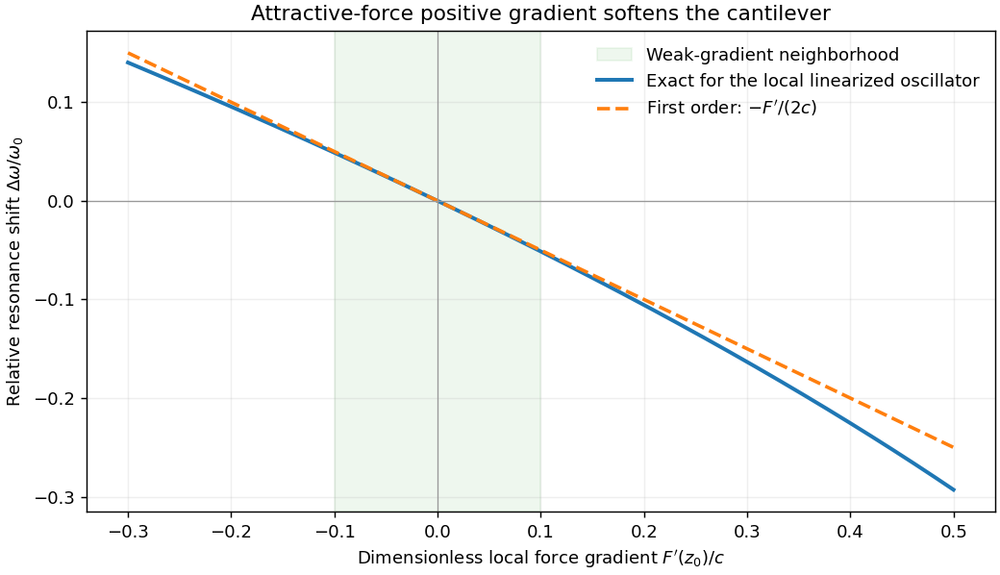

<h1 id="3/solution">Solution</h1>

↑ **Parent:** [3](../3.md)

[Atomic force microscopy](../../../../atomic-force-microscopy.md) senses tip–sample interactions through a compliant cantilever. Contact deflection, oscillation amplitude, phase or resonance [frequency](../../../../frequency.md) can be converted into a feedback signal. Chemical bonding and short-range repulsion, van der Waals [forces](../../../../force-split.md), electrostatic [forces](../../../../force-split.md) and, where relevant, magnetic or capillary interactions produce contrast. Apparent height at a fixed [force](../../../../force-split.md) or [frequency](../../../../frequency.md) setpoint can therefore contain interaction contrast as well as geometry. Lateral resolution depends on the effective tip apex and interaction range; finite tip radius broadens features. Vertical sensitivity also depends on thermal and detector noise, cantilever calibration, vibration, drift and feedback bandwidth. Strongly localized short-range [forces](../../../../force-split.md) favor atomic resolution, whereas extended interactions average over more of the tip and surface.

For small oscillations about equilibrium separation $z_0$, write $z=z_0+x$ and linearize $F(z)=F(z_0)+F'(z_0)x$. The constant [force](../../../../force-split.md) is absorbed into the equilibrium displacement. The [cantilever](../../../../cantilever.md) equation becomes

$$
m_{\rm eff}\ddot x=-\left[c-F'(z_0)\right]x,\qquad
\omega^2=\omega_0^2\left[1-\frac{F'(z_0)}c\right],\quad\omega_0^2=c/m_{\rm eff}.
$$

Consequently the [small-amplitude AFM frequency shift](../../../../small-amplitude-afm-frequency-shift.md) is

$$
\boxed{\frac{\Delta\omega}{\omega_0}=\sqrt{1-\frac{F'(z_0)}c}-1
\simeq-\frac1{2c}\frac{dF}{dz}(z_0).}
$$

The linear expression is the small-force-gradient approximation, $|F'|\ll c$, in addition to the small-oscillation assumption. For an attractive [force](../../../../force-split.md) $F=-C/z^2$, $F'>0$ and the resonance softens. A finite oscillation amplitude samples a weighted range of [forces](../../../../force-split.md) rather than only the gradient at one separation, and $F'\ge c$ destroys local stability in this simple static model.

**[Figure 2](#3/image-afm-frequency-shift-exact-local-linearized-oscillator-and-the-weak-gradient-approximation). AFM frequency shift: exact local linearized oscillator and the weak-gradient approximation**.

In a [scanning electron microscope](../../../../scanning-electron-microscope.md), a focused [electron](../../../../electron.md) beam scans the surface and a detector records an emitted signal at each beam position. Low-energy [secondary electrons](../../../../secondary-electron.md) escape from near the surface; changes in local slope, edges and detector-facing geometry give strong [secondary-electron topographic contrast](../../../../secondary-electron-topographic-contrast.md). [Backscattered electrons](../../../../backscattered-electron.md) result from elastic deflection of primary [electrons](../../../../electron.md) and generally have a larger yield for higher atomic number. Their [backscattered-electron atomic-number contrast](../../../../backscattered-electron-atomic-number-contrast.md) therefore helps separate compositional regions. Detector geometry, crystal orientation and topography can also affect this signal, so brightness is not a unique elemental identification.

An [environmental scanning electron microscope](../../../../environmental-scanning-electron-microscope.md) admits gas around the specimen while pressure-limiting apertures and differential pumping preserve the electron-optical column's vacuum. [Electron](../../../../electron.md) collisions ionize the gas. Positive ions can neutralize negative charging of a poorly conducting specimen, enabling observation without a conductive coating. A [gaseous secondary electron detector](../../../../gaseous-secondary-electron-detector.md) uses gas amplification to collect secondary-electron signals under these conditions. Gas [pressure](../../../../pressure-split.md), path length and scattering must be controlled because they also affect the probe and background.[glossary entry: gas-ion charge neutralization and environmental secondary-electron detection](../../../../low-vacuum-sem-by-jeol.md)

Finally, acquire an [energy-dispersive X-ray spectroscopy](../../../../energy-dispersive-x-ray-spectroscopy.md) spectrum at each pixel to add elemental specificity. The beam creates inner-shell vacancies, and characteristic X-rays emitted as they fill identify chemical elements. Selecting fitted characteristic-line intensities yields elemental maps that can be compared with the [electron](../../../../electron.md) image. Peak overlap, detector response, absorption and the X-ray-generating interaction [volume](../../../../volume.md) limit identification, quantification and spatial resolution. This gives chemical-element contrast; resolving different bonds or oxidation states generally needs more detailed spectral information than one broad elemental map.

## ↑ Ancestors (13)

1. [3](../3.md)
2. [Paper 1](../../paper-1-split.md)
3. [2013](../../split.md)
4. [Past exam of the frontiers of experimental condensed matter physics course of the University of Cambridge](../../../split.md)
5. [Frontiers of Experimental Condensed Matter Physics course of the University of Cambridge](../../../../frontiers-of-experimental-condensed-matter-physics-course-of-the-university-of-cambridge.md)
6. [Physics course of the year 4 of the natural sciences course of the University of Cambridge](../../../../physics-course-of-the-year-4-of-the-natural-sciences-course-of-the-university-of-cambridge.md)
7. [Year 4 of the natural sciences course of the University of Cambridge](../../../../year-4-of-the-natural-sciences-course-of-the-university-of-cambridge.md)
8. [Year of the natural sciences course of the University of Cambridge](../../../../year-of-the-natural-sciences-course-of-the-university-of-cambridge.md)
9. [Natural sciences course of the University of Cambridge](../../../../natural-sciences-course-of-the-university-of-cambridge.md)
10. [Course of the University of Cambridge](../../../../course-of-the-university-of-cambridge.md)
11. [University of Cambridge](../../../../university-of-cambridge-split.md)
12. [List of universities](../../../../list-of-universities.md)
13. [Codex Wiki](../../../../split.md)
