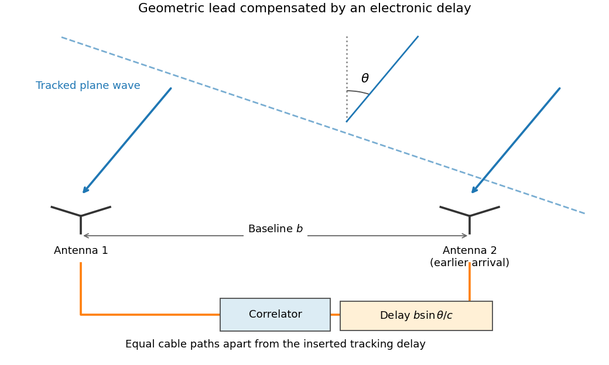
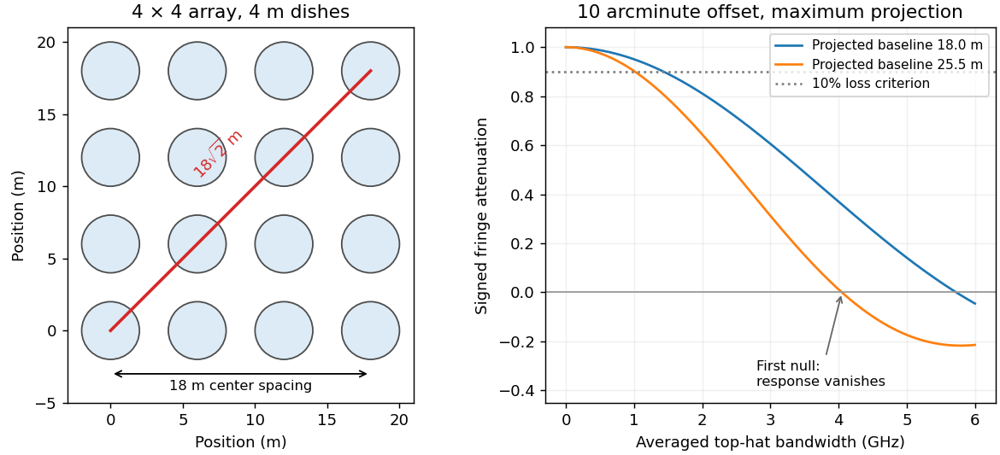

# Paper 1

↑ **Parent:** [2012](../2012.md)

Source: [Cambridge examination PDF, physical pages 498–499; printed paper 220](https://www.whatdotheyknow.com/request/natural_science_tripos_physics_e_2/response/2340776/attach/2/FOI%202023%20399%20Zahid%20materials.pdf?cookie_passthrough=1).

**Table of contents**

- [1](#1)
  - [Solution](#1/solution)
  - [a](#1/a)
    - [Solution](#1/a/solution)
  - [b](#1/b)
    - [Solution](#1/b/solution)
  - [c](#1/c)
    - [Solution](#1/c/solution)
- [2](#2)
  - [Solution](#2/solution)
- [3](#3)
  - [a](#3/a)
    - [Solution](#3/a/solution)
  - [b](#3/b)
    - [Solution](#3/b/solution)
  - [c](#3/c)
    - [Solution](#3/c/solution)
  - [d](#3/d)
    - [Solution](#3/d/solution)

## 1

↑ **Parent:** [Paper 1](paper-1.md)

<h3 id="1/solution">Solution</h3>

↑ **Parent:** [1](#1)

The geometric path difference for a direction at zenith angle $\theta+\alpha$ is $b\sin(\theta+\alpha)$. Equal cable lengths leave that difference unchanged; the inserted electronic delay cancels $b\sin\theta$ for the tracking center. The residual delay is therefore

$$
\tau=\frac bc[\sin(\theta+\alpha)-\sin\theta]\simeq\frac{b\alpha\cos\theta}{c}.
$$

The [complex visibility](../../astrophysics.md#complex-visibility) of the unresolved source has phase $2\pi\nu\tau$, giving $\exp(ikb\alpha\cos\theta)$ in the chosen baseline ordering. Reversing the signal order complex-conjugates it without changing the measured visibility magnitude. Tracking the [antennas](../../electrical-engineering.md#antenna-radio) geometrically does not itself provide this [fringe stopping](../../astrophysics.md#fringe-stopping).

**[Figure 1](#1/image-tracking-delay-in-a-two-antenna-interferometer). Tracking delay in a two-antenna interferometer**. Original functional schematic. The nearer antenna receives the tracked wave earlier and its electronic delay compensates that geometric lead. Angles are exaggerated and cable paths are schematic.

For a top-hat band centered at $\nu_0$, let $f=\nu-\nu_0$. Averaging the residual fringe gives

$$
\frac1{\Delta\nu}\int_{-\Delta\nu/2}^{\Delta\nu/2}e^{2\pi i(\nu_0+f)\tau}\,df
=e^{2\pi i\nu_0\tau}\operatorname{sinc}(\pi\Delta\nu\tau),
\qquad\operatorname{sinc}x=\frac{\sin x}{x}.
$$

After removing the central fringe phase, its envelope is exactly

$$
\boxed{\operatorname{sinc}\left(\frac{\pi\Delta\nu b\alpha\cos\theta}{c}\right).}
$$

The full complex average retains the displayed central-frequency phase; the bare sinc in the question is the phase-referenced envelope or an average written in frequency-offset coordinates. This [bandwidth decorrelation of a point source](../../astrophysics.md#bandwidth-decorrelation-of-a-point-source) is cancellation between different frequency-dependent phases, not absorption of source radiation.

<h3 id="1/a">a</h3>

↑ **Parent:** [1](#1)

<h4 id="1/a/solution">Solution</h4>

↑ **Parent:** [A](#1/a)

The center-to-center extent is $18\,\mathrm m$ on each side and $18\sqrt2=25.46\,\mathrm m$ diagonally, while the shortest nonzero baseline is $6\,\mathrm m$. At $\lambda=0.02\,\mathrm m$, characteristic scales are

$$
\boxed{\theta_{\rm syn}\sim\frac\lambda{b_{\max}}=2.70',\qquad
\theta_{\rm large}\sim\frac\lambda{b_{\min}}=11.46',\qquad
\theta_{\rm primary}\sim\frac\lambda D=17.19'.}
$$

These describe the finest synthesized scale, a largest recoverable scale estimate, and the individual-dish field of view, respectively. Along an array side the longest baseline is only $18\,\mathrm m$, giving $3.82'$ rather than the diagonal estimate. Projection, weighting and sidelobes determine an actual [synthesized beam](../../astrophysics.md#synthesized-beam).

There is no sharp universal largest-scale cutoff: the commonly used $0.6\lambda/b_{\min}$ convention would give $6.88'$. For an ideal uniformly illuminated circular dish, the primary-beam full width at half maximum is approximately $1.02\lambda/D=17.5'$, while the first-null angular radius is $1.22\lambda/D=21.0'$. These definitions should not be mixed. Uniform lattice spacing also produces grating sidelobes; the [primary beam](../../astrophysics.md#primary-beam) restricts the useful field but does not supply the missing zero-baseline [flux](../../mathematical-physics.md#flux).

<h3 id="1/b">b</h3>

↑ **Parent:** [1](#1)

<h4 id="1/b/solution">Solution</h4>

↑ **Parent:** [B](#1/b)

Use the projected baseline along the source offset, $b_p$, and $\alpha=10'=2.909\times10^{-3}\,\mathrm{rad}$. The first [bandwidth](../../electrical-engineering.md#bandwidth-signal-processing) null occurs at $\Delta\nu=c/(b_p\alpha)$. A worst-case $b_p=25.46\,\mathrm m$ gives $4.05\,\mathrm{GHz}$. **That is a zero of the response, not a good usable [bandwidth](../../electrical-engineering.md#bandwidth-signal-processing).** A quantitative maximum needs an allowed attenuation.

For example, requiring a response of at least $0.9$ gives $\operatorname{sinc}x=0.9$ at $x\simeq0.787$. Hence

$$
\boxed{\Delta\nu_{10\%}\simeq0.250\frac c{b_p\alpha}\simeq1.01\,\mathrm{GHz}}
$$

for that worst projection. A strictly east-west offset in a sides-aligned square instead samples at most $18\,\mathrm m$, giving a $5.73\,\mathrm{GHz}$ first null and a $1.43\,\mathrm{GHz}$ ten-percent-loss [bandwidth](../../electrical-engineering.md#bandwidth-signal-processing). The original two-antenna geometry supplies an additional $\cos\theta$ projection; these examples use its maximum magnitude. Thus **a [bandwidth](../../electrical-engineering.md#bandwidth-signal-processing) of order $1\,\mathrm{GHz}$** is a reasonable conservative estimate with a stated small-loss criterion, rather than a unique geometry-free limit.

**[Figure 2](#1/b/image-array-baselines-and-bandwidth-decorrelation-away-from-the-tracking-center). Array baselines and bandwidth decorrelation away from the tracking center**. Original array geometry and rectangular-band sinc calculations for a ten-arcminute offset. The marked ten-percent-loss bandwidth is an illustrative response criterion; the first null is not a usable-bandwidth recommendation.

To use a much wider total band, channelize the signals before correlation or before irreversible [frequency](../../wave.md#frequency) averaging. Correlate sufficiently narrow channels, track the reference delay and phase at each [frequency](../../wave.md#frequency), and combine frequency-aware visibilities or images. This preserves sensitivity while avoiding [field-dependent averaging losses in radio interferometry](../../astrophysics.md#field-dependent-averaging-losses-in-radio-interferometry). Merely adding a phase correction after a broad channel has decorrelated cannot recover the lost signal; nor can one tracking delay cancel every sky direction simultaneously.[VLA Observational Status Summary 2018A, bandwidth and time-averaging limitations](../../physics-bibliography.md#field-of-view-by-national-radio-astronomy-observatory)

<h3 id="1/c">c</h3>

↑ **Parent:** [1](#1)

<h4 id="1/c/solution">Solution</h4>

↑ **Parent:** [C](#1/c)

The [wavelength](../../wave-equation.md#wavelength) corresponds to about $15\,\mathrm{GHz}$, in the low-frequency decrement part of the [thermal Sunyaev-Zeldovich effect](../../cosmic-microwave-background.md#thermal-sunyaev-zeldovich-effect). Hot cluster [electrons](../../physics.md#electron) inverse-Compton scatter CMB [photons](../../quantum-mechanics.md#photon). In the Rayleigh-Jeans limit,

$$
\frac{\Delta T}{T_{\rm CMB}}\simeq-2y,\qquad
y=\int n_e\sigma_T\frac{k_BT_e}{m_ec^2}\,dl.
$$

The signal probes integrated [electron](../../physics.md#electron) [pressure](../../pressure.md). Short baselines give sensitivity to extended arcminute-scale cluster structure, while the primary field covers the cluster and surrounding sky. The array's several-arcminute resolution suits many such structures; it is not equally well matched to every cluster size.

Simultaneous cross-correlations reject uncorrelated receiver [noise](../../electrical-engineering.md#noise-signal-processing) and provide spatial information; compact radio sources can be constrained with the relatively longer baselines and separated from extended structure. Broad [frequency](../../wave.md#frequency) coverage helps sensitivity provided channel smearing is controlled. Correlated atmospheric emission, [calibration](../../differential-geometry.md#calibration-differential-geometry) error, primordial CMB fluctuations and radio-source contamination remain relevant. The lack of zero and very short spacings also [means](../../expected-value.md) that total integrated cluster [flux](../../mathematical-physics.md#flux) requires a model or complementary data. An interferometer is therefore useful for the spatially resolved decrement, rather than automatically measuring every cluster's full [pressure](../../pressure.md) integral.

## 2

↑ **Parent:** [Paper 1](paper-1.md)

<h3 id="2/solution">Solution</h3>

↑ **Parent:** [2](#2)

An observed catalogue is the result of a population, an instrument and a selection rule. Its [astronomical selection function](../../astrophysics.md#astronomical-selection-function) can depend on [flux](../../mathematical-physics.md#flux), color, size, [surface brightness](../../astrophysics.md#surface-brightness), sky location, cadence and follow-up success. The relevant cut is often on noisy measured quantities. A model that selects on noiseless true [flux](../../mathematical-physics.md#flux) instead can predict a different sample even when it uses the same nominal threshold.

[Malmquist bias](../../astrophysics.md#malmquist-bias) occurs because brighter members of a population are visible through a larger [volume](../../geometry-and-topology.md#volume) in a flux-limited survey. For a uniform Euclidean population, $r_{\max}\propto\sqrt L$ and $V_{\max}\propto L^{3/2}$. The selected [luminosity](../../astrophysics.md#luminosity) distribution is therefore weighted toward large $L$. For an intrinsic [Gaussian](../../probability-distribution.md#normal-distribution) absolute-magnitude distribution with [mean](../../expected-value.md) $M_0$ and [variance](../../variance.md) $\sigma_M^2$, multiplying by $10^{-0.6M}$ and completing the square gives the [Gaussian absolute-magnitude Malmquist shift](../../astrophysics.md#gaussian-absolute-magnitude-malmquist-shift)

$$
\boxed{\langle M\rangle_{\rm selected}=M_0-0.6\ln(10)\,\sigma_M^2
\simeq M_0-1.382\sigma_M^2.}
$$

This assumes the stated simple population, a complete [flux](../../mathematical-physics.md#flux) cut and no additional boundaries. Exactly identical noiseless [standard candles](../../astrophysics.md#standard-candle) have a distance truncation, not a [luminosity](../../astrophysics.md#luminosity) spread to reweight. Scatter, [extinction](../../ecology.md#extinction), cosmological [volume](../../geometry-and-topology.md#volume) and source evolution need their own model.

[Lutz-Kelker bias](../../astrophysics.md#lutz-kelker-bias) concerns parallax errors, spatial population weighting and selected [calibration](../../differential-geometry.md#calibration-differential-geometry) samples. Uniform spatial [density](../../fluid-mechanics.md#density) gives $p(r)\propto r^2$ locally, hence $p(\varpi)\propto\varpi^{-4}$ on the physically valid range. More distant objects can scatter into a measured-parallax cut. In addition, inversion $r=1/\widehat\varpi$ is nonlinear and gives misleading estimates at low signal-to-noise; a negative measured parallax is possible even for a positive true distance. A [posterior](../../bayesian-statistics.md#bayesian-posterior) instead combines the parallax [likelihood](../../maximum-likelihood-estimation.md#likelihood-function) with a justified population [prior](../../bayesian-statistics.md#prior-probability). An unbounded uniform-volume [prior](../../bayesian-statistics.md#prior-probability) is improper here; a finite population model or a [proper distance prior for parallax inference](../../astrophysics.md#proper-distance-prior-for-parallax-inference) is necessary.[classical selected-sample parallax-calibration model](../../physics-bibliography.md#on-the-use-of-trigonometric-parallaxes-for-the-calibration-of-luminosity-systems-theory-by-t-e-lutz-and-d-h-kelker)

[Bayes' theorem](../../probability-theory.md#bayes-theorem) makes the assumptions explicit. If $\eta$ denotes population parameters, $x$ latent properties and $S$ the catalogue inclusion event, a selected-sample [likelihood](../../maximum-likelihood-estimation.md#likelihood-function) has the form

$$
p(d\mid\eta,S)=\frac{\mathbf1_S(d)\int p(d\mid x)p(x\mid\eta)\,dx}
{\int_{d'\in S}\!dd'\int p(d'\mid x)p(x\mid\eta)\,dx}.
$$

This [selection-normalized astronomical likelihood](../../astrophysics.md#selection-normalized-astronomical-likelihood) accounts for the model-dependent [probability](../../probability-theory.md#probability) of entering the catalogue. For individual inference, selection information already determined by the fully conditioned measured data must not be multiplied in a second time. The sampling design, inferential target and actual conditioned information determine the appropriate expression.

Other effects include [Eddington bias](../../causal-inference.md#eddington-bias), where steep number counts and measurement scatter move more faint objects upward than bright objects downward, and surface-brightness selection that misses diffuse galaxies despite substantial total [flux](../../mathematical-physics.md#flux). Dust [extinction](../../ecology.md#extinction) affects both detectability and inferred [luminosity](../../astrophysics.md#luminosity). Variable-source detection depends on cadence and duration; spectroscopic follow-up can favor easy-to-measure redshifts or particular colors. Blends, [calibration](../../differential-geometry.md#calibration-differential-geometry) drift and redshift errors can mimic population changes.

Examples include magnitude-limited supernova samples used in distance-redshift fits, where [luminosity](../../astrophysics.md#luminosity) scatter and follow-up must be modeled, and radial-velocity planet surveys, which favor large-amplitude, short-period systems and leave inclination degeneracies. Forward modeling through the survey pipeline, injection-and-recovery estimates of completeness, calibrated [noise](../../electrical-engineering.md#noise-signal-processing) and properly modeled censored or nondetected observations address these effects. A universal correction or an unexamined inverse-volume weight does not replace an explicit generative and selection model.

## 3

↑ **Parent:** [Paper 1](paper-1.md)

<h3 id="3/a">a</h3>

↑ **Parent:** [3](#3)

<h4 id="3/a/solution">Solution</h4>

↑ **Parent:** [A](#3/a)

[Thermal bremsstrahlung](../../astrophysics.md#thermal-bremsstrahlung) arises from [electron](../../physics.md#electron) acceleration in [ion](../../chemistry.md#ion) Coulomb fields. For a thermal [plasma](../../physics.md#plasma-physics) its optically thin spectral emissivity has the dependence

$$
j_\nu\propto n_e\sum_iZ_i^2n_i\,T_e^{-1/2}e^{-h\nu/(k_BT_e)}g_{\rm ff}(\nu,T_e).
$$

The exponential high-energy slope helps constrain [temperature](../../temperature.md) in X-ray spectra, with composition, absorption and other emission components included. At radio frequencies with $h\nu\ll k_BT_e$, the thin spectrum is much flatter and does not alone determine a unique [temperature](../../temperature.md); the [Gaunt factor](../../astrophysics.md#gaunt-factor) supplies a weak [frequency](../../wave.md#frequency) dependence.

For an approximately isothermal layer, [radiative transfer](../../astrophysics.md#radiative-transfer) gives $I_\nu=B_\nu(T_e)(1-e^{-\tau_\nu})$. Radio free-free opacity scales approximately as $\tau_\nu\propto\mathrm{EM}\,T_e^{-3/2}\nu^{-2}g_{\rm ff}$, where the hydrogen-plasma [emission measure](../../astrophysics.md#emission-measure) is $\mathrm{EM}=\int n_e^2dl$. A resolved optically thick brightness [temperature](../../temperature.md) approaches $T_e$; an unresolved filling factor lowers the observed value. The turnover between thin and thick regimes helps constrain [emission measure](../../astrophysics.md#emission-measure).

An angular extent and distance give a physical size, and an assumed geometry supplies a line-of-sight depth. Combining that depth with [emission measure](../../astrophysics.md#emission-measure) estimates an rms [density](../../fluid-mechanics.md#density), $n_{e,\rm rms}\sim\sqrt{\mathrm{EM}/\ell}$. Clumping, filling factor, composition and unknown depth preserve a [density-depth degeneracy of free-free radiation](../../astrophysics.md#density-depth-degeneracy-of-free-free-radiation). These measurements constrain different combinations of [temperature](../../temperature.md), [density](../../fluid-mechanics.md#density) and size rather than independently fixing all three without assumptions.

<h3 id="3/b">b</h3>

↑ **Parent:** [3](#3)

<h4 id="3/b/solution">Solution</h4>

↑ **Parent:** [B](#3/b)

The [radial-velocity method](../../exoplanet.md#doppler-spectroscopy) measures repeated Doppler shifts of stellar [spectral lines](../../stellar-astrophysics.md#spectral-line) as a star responds to an orbiting companion. A stable high-resolution spectrograph and [wavelength](../../wave-equation.md#wavelength) reference distinguish stellar motion from instrumental drift; many lines or a spectral template improve precision. A Keplerian fit yields period, eccentricity, phase and velocity semi-amplitude. For a companion [mass](../../classical-mechanics.md#mass) $m_p$, stellar [mass](../../classical-mechanics.md#mass) $M_*$ and inclination $i$,

$$
\boxed{K=\left(\frac{2\pi G}{P}\right)^{1/3}
\frac{m_p\sin i}{(M_*+m_p)^{2/3}\sqrt{1-e^2}}.}
$$

With a stellar-mass estimate and $m_p\ll M_*$, this measures approximately $m_p\sin i$, a minimum [mass](../../classical-mechanics.md#mass) unless the inclination is independently constrained. A nearly face-on orbit can hide a massive companion. The method preferentially detects larger masses, shorter periods and favorable inclinations.

Starspots, activity, pulsations, rotation, blended spectra and sampling aliases can imitate or distort a periodic signal. Line-shape diagnostics, activity indicators, repeated observations and independent constraints help test a planetary explanation. [Photon](../../quantum-mechanics.md#photon) [noise](../../electrical-engineering.md#noise-signal-processing) and [spectral line](../../stellar-astrophysics.md#spectral-line) width constrain precision even for a perfectly calibrated spectrograph. Multiple planets or incomplete orbital coverage require an adequate model and longer monitoring; a periodic centroid shift alone is not a proof of a particular planetary system.

<h3 id="3/c">c</h3>

↑ **Parent:** [3](#3)

<h4 id="3/c/solution">Solution</h4>

↑ **Parent:** [C](#3/c)

A [charge-coupled device](../../optical-instrument.md#charge-coupled-device) converts absorbed [photons](../../quantum-mechanics.md#photon) into stored charge in semiconductor potential wells. An exposure accumulates a pixelated image; clocked electrodes transfer rows toward a serial register and output amplifier. [Quantum efficiency](../../optical-instrument.md#quantum-efficiency), pixel sampling and optical throughput connect collected [photons](../../quantum-mechanics.md#photon) to the expected signal. In ordinary optical imaging it primarily counts photoelectrons rather than independently measuring every [photon](../../quantum-mechanics.md#photon)'s [energy](../../energy.md).

The [CCD noise budget](../../optical-instrument.md#ccd-noise-budget) combines source and sky [shot noise](../../electrical-engineering.md#shot-noise), dark-current fluctuations and [read noise](../../optical-instrument.md#read-noise). For an aperture containing $n$ pixels, known background expectation $N_b$, total dark expectation $N_d$, source expectation $N_s$ and per-pixel [read noise](../../optical-instrument.md#read-noise) $r$,

$$
\mathrm{SNR}=\frac{N_s}{\sqrt{N_s+N_b+N_d+nr^2}}.
$$

Estimating the background from a finite separate region adds its own uncertainty. Cooling reduces [dark current](../../optical-instrument.md#dark-current-physics); longer integration reduces the relative importance of one read but can encounter saturation, cosmic rays or changing conditions. [Full well capacity](../../optical-instrument.md#full-well-capacity), amplifier gain, [linearity](../../vector-space.md#linearity), blooming and charge-transfer efficiency limit useful [detector dynamic range](../../optical-instrument.md#detector-dynamic-range).

Bias frames establish the electronic offset; matched dark frames characterize time- and temperature-dependent dark signal. Flat fields calibrate pixel-to-pixel response and illumination, with appropriate attention to [wavelength](../../wave-equation.md#wavelength). Bad-pixel masks, repeated exposures and dithering help reject defects and cosmic rays. A calibrated [PSF](../../point-spread-function.md) and astrometric solution are needed for reliable [photometry](../../optics.md#photometry-optics) and positions. High [quantum efficiency](../../optical-instrument.md#quantum-efficiency) and stable linear integration are advantages, but an uncalibrated count array is not yet an astronomical [flux](../../mathematical-physics.md#flux) map.

<h3 id="3/d">d</h3>

↑ **Parent:** [3](#3)

<h4 id="3/d/solution">Solution</h4>

↑ **Parent:** [D](#3/d)

Atmospheric refractive-index fluctuations distort the incoming wavefront. In a Kolmogorov model, the long-exposure seeing width is approximately $0.98\lambda/r_0$, where the [Fried parameter](../../optics.md#fried-parameter) scales as $r_0\propto\lambda^{6/5}$. High-quality sites and longer [wavelengths](../../wave-equation.md#wavelength) can improve the observing conditions, but do not eliminate the distorted phase. Short coherence times also require rapid correction or exposure.

[Adaptive optics](../../optical-instrument.md#adaptive-optics) uses a guide source, [wavefront sensor](../../optical-instrument.md#wavefront-sensor), [deformable mirror](../../optical-instrument.md#deformable-mirror) and fast feedback loop. Tip-tilt correction removes image wander; higher-order actuators correct finer spatial distortions. Finite actuator spacing, sensor [noise](../../electrical-engineering.md#noise-signal-processing), delay and changing turbulence leave residual errors. A nearby natural [guide star](../../optical-instrument.md#guide-star-adaptive-optics) limits sky coverage, while a laser beacon supplies higher-order reference information over more directions. Conventional laser-guide-star systems still need independent image-motion information, commonly from a natural star.[ESO, tip-tilt information and sky-coverage limitation](../../physics-bibliography.md#laser-guide-star-for-adaptive-optics-by-european-southern-observatory) [Anisoplanatism](../../optics.md#anisoplanatism) limits the corrected field; laser finite-altitude sampling and variable [PSFs](../../point-spread-function.md) need their own [calibration](../../differential-geometry.md#calibration-differential-geometry).

[Lucky imaging](../../optics.md#lucky-imaging) selects favorable short exposures and aligns them, trading exposure efficiency and [photon](../../quantum-mechanics.md#photon) statistics for reduced blur. [Speckle interferometry](../../optics.md#speckle-interferometry) uses short-exposure spatial-frequency information and suitable phase/statistical reconstruction instead of simply averaging away the speckles. Both need adequate time resolution, detector performance and [calibration](../../differential-geometry.md#calibration-differential-geometry); selection cannot restore information never recorded. Interferometric methods can also recover fine structure with phase control or closure information. These approaches correct or infer wavefront effects; they do not make clouds, absorption or every atmospheric amplitude fluctuation disappear.[wavefront sensing, deformable-mirror correction and atmospheric limitations](../../physics-bibliography.md#adaptive-optics-by-european-southern-observatory)

## ↑ Ancestors (11)

1. [2012](../2012.md)
2. [Past exam of the frontiers of Observational Astrophysics course of the University of Cambridge](../../past-exam-of-the-frontiers-of-observational-astrophysics-course-of-the-university-of-cambridge.md)
3. [Frontiers of Observational Astrophysics course of the University of Cambridge](../../university-of-cambridge.md#frontiers-of-observational-astrophysics-course-of-the-university-of-cambridge)
4. [Physics course of the year 4 of the natural sciences course of the University of Cambridge](../../university-of-cambridge.md#physics-course-of-the-year-4-of-the-natural-sciences-course-of-the-university-of-cambridge)
5. [Year 4 of the natural sciences course of the University of Cambridge](../../university-of-cambridge.md#year-4-of-the-natural-sciences-course-of-the-university-of-cambridge)
6. [Year of the natural sciences course of the University of Cambridge](../../university-of-cambridge.md#year-of-the-natural-sciences-course-of-the-university-of-cambridge)
7. [Natural sciences course of the University of Cambridge](../../university-of-cambridge.md#natural-sciences-course-of-the-university-of-cambridge)
8. [Course of the University of Cambridge](../../university-of-cambridge.md#course-of-the-university-of-cambridge)
9. [University of Cambridge](../../university-of-cambridge.md)
10. [List of universities](../../README.md#list-of-universities)
11. [Codex Wiki](../../README.md)
