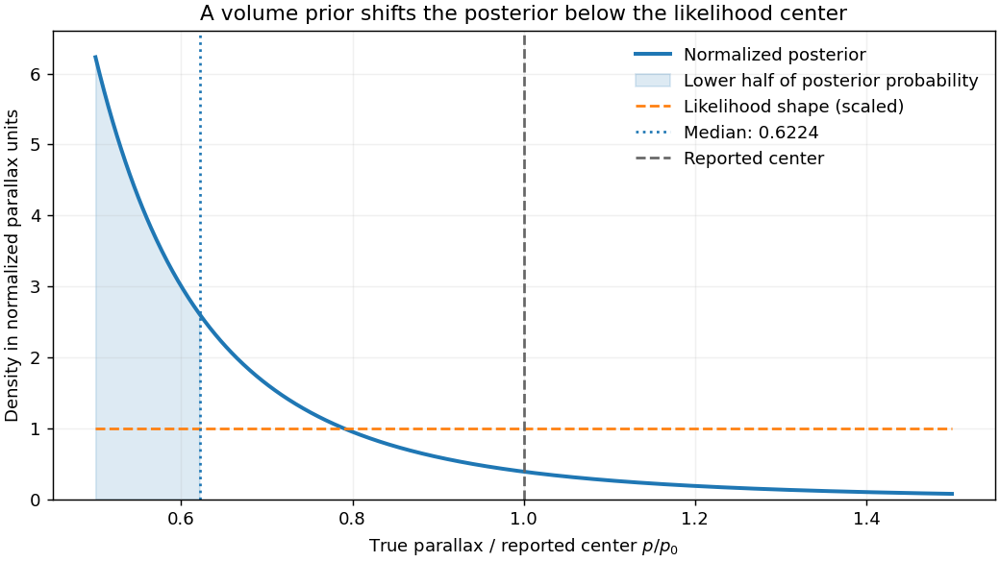

<h1 id="1/solution">Solution</h1>

↑ **Parent:** [1](../1.md)

[Bayes' theorem](../../../../bayes-theorem.md) relates a model parameter $p$ and observed data $D$ by $P(p\mid D)=P(D\mid p)P(p)/P(D)$. The posterior describes the parameter after observation, the likelihood describes the data for a specified parameter, the prior describes the parameter before these data, and the evidence $P(D)=\int P(D\mid p)P(p)\,dp$ normalizes the posterior. Likelihood is a function of the unknown parameter; it is not automatically a normalized [probability](../../../../probability.md) density over that parameter.

[Stellar parallax](../../../../stellar-parallax.md) is the apparent annual change of a nearby star's direction relative to distant background objects as the observer moves around the Sun. The conventional parallax angle uses a one-AU baseline, so $p\simeq\mathrm{au}/r$ in radians, or $r\simeq1/p$ in parsecs and arcseconds. Many small approximately independent centroiding and reference-frame errors can yield approximately Gaussian parallax errors through the [central limit theorem](../../../../central-limit-theorem.md). Correlated calibration errors, outliers and low-signal image fitting can violate that approximation; Gaussian measurement errors also need not produce Gaussian errors after taking a reciprocal distance.

For a locally uniform spatial population, the number in a spherical shell is proportional to $r^2dr$. Changing variables using $r=C/p$ gives

$$
P(p)\,dp\propto r^2\left|\frac{dr}{dp}\right|dp\propto p^{-4}dp.
$$

This is a local population-density rule on its valid distance range. It needs a finite population or survey boundary to be a normalized global prior. An unbounded [volume](../../../../volume.md) prior combined with a Gaussian parallax likelihood can otherwise yield an improper posterior, as explained by the [proper distance prior for parallax inference](../../../../proper-distance-prior-for-parallax-inference.md).

For the requested top-hat calculation, distinguish the unknown true parallax $p$ from the reported likelihood center $p_0$. Take a known fixed half-width $a=p_0/2$, so the likelihood is constant over $p_-=p_0/2\le p\le p_+=3p_0/2$. Assume this interval lies inside the applicable population range. The [top-hat parallax posterior under a uniform-volume prior](../../../../top-hat-parallax-posterior-under-a-uniform-volume-prior.md) is then

$$
f(p\mid D)=\frac{3p^{-4}}{p_-^{-3}-p_+^{-3}},\qquad
F(p\mid D)=\frac{p_-^{-3}-p^{-3}}{p_-^{-3}-p_+^{-3}}.
$$

Setting $F(p_{\rm med})=1/2$ gives

$$
p_{\rm med}^{-3}=\frac{p_-^{-3}+p_+^{-3}}2,\qquad
\boxed{p_{\rm med}=p_0\left(\frac{27}{112}\right)^{1/3}\simeq0.6224p_0.}
$$

The greater available [volume](../../../../volume.md) at smaller true parallaxes weights that side of the likelihood more strongly. This inference is not an additional measurement of the star's actual parallax.

**[Figure 1](#1/image-top-hat-parallax-likelihood-combined-with-a-local-uniform-volume-prior). Top-hat parallax likelihood combined with a local uniform-volume prior**.

The printed notation uses $\pi_t$ both for the unknown true parallax and for the top-hat center in the numerical comparison. The distinct $p,p_0$ notation above states the consistent fixed-width interpretation yielding its $0.62$ result. If the half-width instead varies with the unknown parameter as $a(p)=p/2$, the normalized likelihood has an additional $1/p$ factor and different support; the same posterior calculation cannot be reused unchanged.

To improve distance inference, use independent information on luminosity, spatial density, extinction and sample selection. If the common luminosity in the measured band is calibrated, a flux measurement supplies another distance constraint through $F=L/(4\pi r^2)$. If that common luminosity is unknown, it can be treated as a population parameter rather than silently assumed known. A finite distance distribution and the actual selection function specify which prior is appropriate. The classical [Lutz-Kelker bias](../../../../lutz-kelker-bias.md) is a sample-calibration problem; a posterior shift under a justified prior is not itself an error to remove by a universal correction.

With [flux-limited selection for identical standard candles](../../../../flux-limited-selection-for-identical-standard-candles.md) and a noise-free threshold, there is a maximum observable distance, hence a minimum true parallax. The selected prior is truncated there. **There is no luminosity-preference Malmquist bias if every object truly has the same luminosity.** With a luminosity distribution, the accessible Euclidean [volume](../../../../volume.md) scales as $L^{3/2}$, preferentially including brighter objects; this is the [Euclidean accessible-volume luminosity weighting](../../../../euclidean-accessible-volume-luminosity-weighting.md) underlying [Malmquist bias](../../../../malmquist-bias.md). Flux errors additionally scatter numerous faint sources upward across a threshold, biasing selected measured fluxes. Extinction, different spectral [energy](../../../../energy-split.md) distributions in a selection band, crowding, completeness and parallax-quality cuts can alter the effective population. These effects require a joint selection and error model rather than a single blanket parallax correction.

## ↑ Ancestors (13)

1. [1](../1.md)
2. [Paper 1](../../paper-1-split.md)
3. [2013](../../split.md)
4. [Past exam of the frontiers of Observational Astrophysics course of the University of Cambridge](../../../split.md)
5. [Frontiers of Observational Astrophysics course of the University of Cambridge](../../../../frontiers-of-observational-astrophysics-course-of-the-university-of-cambridge.md)
6. [Physics course of the year 4 of the natural sciences course of the University of Cambridge](../../../../physics-course-of-the-year-4-of-the-natural-sciences-course-of-the-university-of-cambridge.md)
7. [Year 4 of the natural sciences course of the University of Cambridge](../../../../year-4-of-the-natural-sciences-course-of-the-university-of-cambridge.md)
8. [Year of the natural sciences course of the University of Cambridge](../../../../year-of-the-natural-sciences-course-of-the-university-of-cambridge.md)
9. [Natural sciences course of the University of Cambridge](../../../../natural-sciences-course-of-the-university-of-cambridge.md)
10. [Course of the University of Cambridge](../../../../course-of-the-university-of-cambridge.md)
11. [University of Cambridge](../../../../university-of-cambridge-split.md)
12. [List of universities](../../../../list-of-universities.md)
13. [Codex Wiki](../../../../split.md)
