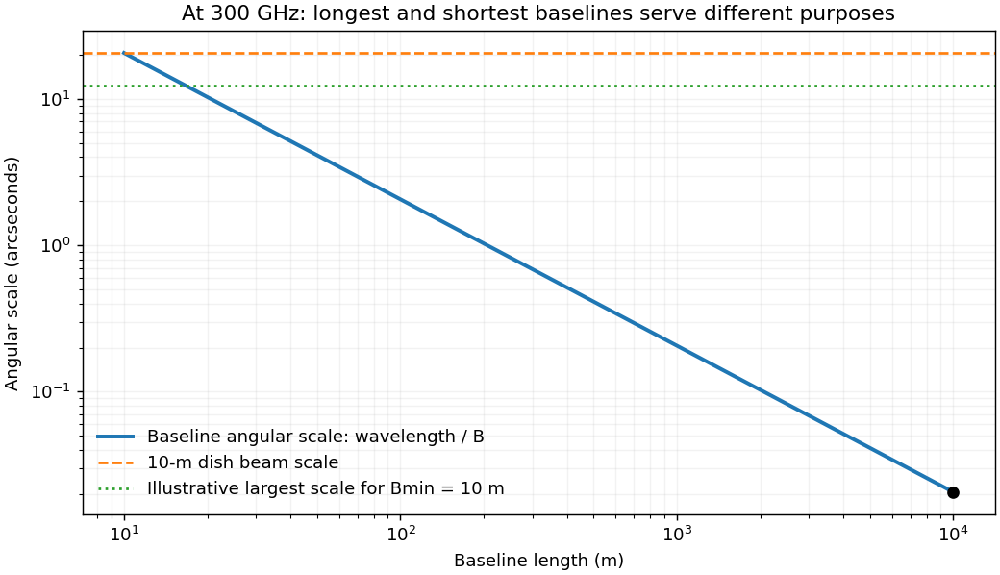

<h1 id="2/solution">Solution</h1>

↑ **Parent:** [2](../2.md)

The wavelength is $\lambda=c/\nu\simeq1.00\,\mathrm{mm}$. Thirty dishes give $N(N-1)/2=435$ interferometric baselines. The longest projected baseline sets the finest angular scale, while the individual dish beam sets the instantaneous field of view. At the maximum $10\,\mathrm{km}$ separation,

$$
\boxed{\theta_{\rm res}\sim\lambda/B_{\max}\simeq10^{-7}\,\mathrm{rad}\simeq0.021\,\mathrm{arcsec}.}
$$

A $10\,\mathrm m$ aperture instead has primary-beam width of order $\lambda/D=10^{-4}\,\mathrm{rad}$, about $21$ arcseconds; the Airy first-null convention gives about $25$ arcseconds. Illumination taper changes the precise beam definition. The array therefore resolves many synthesized beams within one pointing, but it does not image an arbitrarily wide field at that resolution.

The shortest useful baseline determines missing large-scale structure. A common estimate is $\theta_{\max}\sim0.6\lambda/B_{\min}$. If dishes can be packed with usable center separations near $10\,\mathrm m$, this is of order $12$ arcseconds. A more extended layout has a smaller recoverable scale. The site diameter does not specify $B_{\min}$ or the actual Fourier coverage, and low-elevation shadowing can remove short spacings. Mosaicking expands sky coverage but does not supply all zero-spacing information; suitable total-power or compact-array data help recover extended emission. Earth rotation and reconfiguration improve sampled baseline coverage, sidelobes and image reconstruction, with a tradeoff between resolution and surface-brightness sensitivity.

For dish aperture efficiency $\eta_A$, $A_{\rm eff}=\eta_A\pi D^2/4$. The [system-equivalent flux density](../../../../system-equivalent-flux-density.md) of one dish is

$$
\mathrm{SEFD}=\frac{2k_BT_{\rm sys}}{A_{\rm eff}}\simeq\frac{7030}{\eta_A}\,\mathrm{Jy}.
$$

For independent receivers, natural weighting, correlator efficiency $\eta_c$ and $n_{\rm pol}$ equally sensitive [polarization](../../../../polarization-waves.md) products contributing to intensity, the unresolved-source thermal rms is

$$
\boxed{\sigma_S\simeq\frac{\mathrm{SEFD}}{\eta_c\sqrt{n_{\rm pol}N(N-1)\Delta\nu\,t}}.}
$$

Here $\Delta\nu$ is usable bandwidth and $t$ integration time. A numerical sensitivity is therefore conditional on these unspecified observing choices. For an illustrative $1\,\mathrm{GHz}$ bandwidth, one hour, two [polarizations](../../../../polarization-waves.md) and $\eta_c=1$, it is about $0.089/\eta_A\,\mathrm{mJy}$, or $0.127\,\mathrm{mJy}$ at $\eta_A=0.7$. Resolved-source brightness sensitivity also depends on beam area and missing flux. The sensitivity expression assumes naturally weighted data and the stated [polarization](../../../../polarization-waves.md) convention.[Natural weighting, Eq. (3)](../../../../vla-sensitivity-guide-by-national-radio-astronomy-observatory-2012b.md)

Earth rotation changes geometric delay. At a baseline $B$, $\tau_g$ can be of order $B/c$, here $33\,\mathrm{\mu s}$, and a raw fringe-rate bound is

$$
f_{\rm fringe}\sim\nu\Omega_EB/c\simeq730\,\mathrm{Hz}.
$$

The actual rate depends on geometry and source direction. Correlator delay tracking and [fringe stopping](../../../../fringe-stopping.md) compensate the chosen phase center rather than averaging rapidly rotating uncorrected fringes away. Off-center directions retain residual delays and rates.

Finite bandwidth causes chromatic phase averaging and radial bandwidth smearing. A direction offset $\theta$ has residual delay of order $B\theta/c$; a channel should satisfy $\delta\nu B\theta/c\ll1$ for small decorrelation. Across a field of order $10^{-4}$ radians on the longest baseline, the one-cycle [frequency](../../../../frequency.md) scale is about $300\,\mathrm{MHz}$, so substantially narrower channels are required for accurate wide-field imaging. Similarly, time averaging should keep $\Delta t\,\Omega_E B\theta/\lambda\ll1$; the associated one-cycle scale is about $14$ seconds in this example. Frequency-resolved visibilities and shorter dumps control these [field-dependent averaging losses in radio interferometry](../../../../field-dependent-averaging-losses-in-radio-interferometry.md); they are averaging losses, not ordinary glass-lens chromatic focusing.

**[Figure 2](#2/image-millimeter-array-baseline-tradeoff-angular-resolution-and-the-loss-of-large-scale-structure). Millimeter-array baseline tradeoff: angular resolution and the loss of large-scale structure**.

At $300\,\mathrm{GHz}$, atmospheric water vapor produces absorption, thermal emission and path-length fluctuations. A high dry site reduces these effects, while phase fluctuations can still destroy coherence on long baselines. A one-radian phase corresponds to path fluctuation $\lambda/(2\pi)\simeq0.16\,\mathrm{mm}$, motivating frequent phase calibration or atmospheric path monitoring. Surface errors must also be small relative to the wavelength: the Ruze efficiency factor is $\exp[-(4\pi\sigma_h/\lambda)^2]$. Pointing errors matter relative to a primary beam only tens of arcseconds wide.

Important systematic errors include antenna gains and bandpasses, delay and baseline-coordinate errors, [polarization](../../../../polarization-waves.md) leakage, pointing, atmospheric opacity, correlator response and flux-scale calibration. Nearby compact calibrators, bandpass standards, appropriate total-power information and repeated configurations address different parts of this problem. High nominal collecting area and longest-baseline resolution alone do not determine image dynamic range or reliable extended-source flux.

## ↑ Ancestors (13)

1. [2](../2.md)
2. [Paper 1](../../paper-1-split.md)
3. [2013](../../split.md)
4. [Past exam of the frontiers of Observational Astrophysics course of the University of Cambridge](../../../split.md)
5. [Frontiers of Observational Astrophysics course of the University of Cambridge](../../../../frontiers-of-observational-astrophysics-course-of-the-university-of-cambridge.md)
6. [Physics course of the year 4 of the natural sciences course of the University of Cambridge](../../../../physics-course-of-the-year-4-of-the-natural-sciences-course-of-the-university-of-cambridge.md)
7. [Year 4 of the natural sciences course of the University of Cambridge](../../../../year-4-of-the-natural-sciences-course-of-the-university-of-cambridge.md)
8. [Year of the natural sciences course of the University of Cambridge](../../../../year-of-the-natural-sciences-course-of-the-university-of-cambridge.md)
9. [Natural sciences course of the University of Cambridge](../../../../natural-sciences-course-of-the-university-of-cambridge.md)
10. [Course of the University of Cambridge](../../../../course-of-the-university-of-cambridge.md)
11. [University of Cambridge](../../../../university-of-cambridge-split.md)
12. [List of universities](../../../../list-of-universities.md)
13. [Codex Wiki](../../../../split.md)
