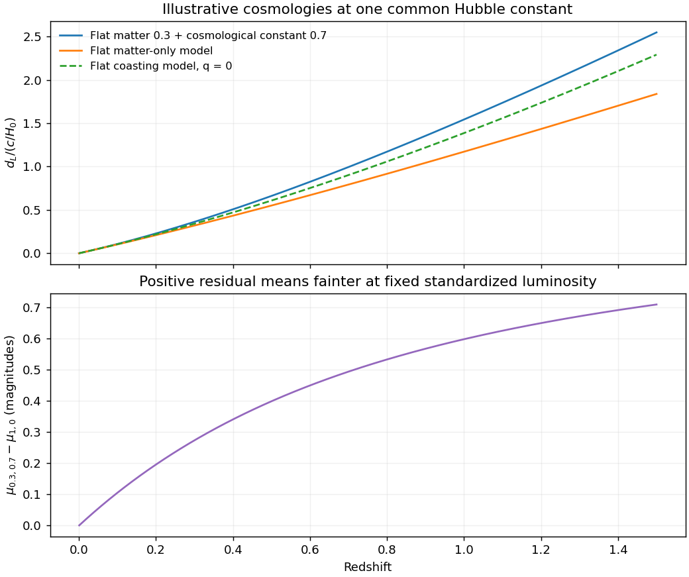

<h1 id="3/d/solution">Solution</h1>

↑ **Parent:** [D](../d.md)

[Type Ia supernovae](../../../../../type-ia-supernova.md) are [standardizable candles](../../../../../standardizable-candle.md). Multi-epoch photometry measures peak brightness, light-curve shape and color; spectroscopy identifies the supernova type and supplies a redshift, preferably also using the host. Correcting the empirical width–luminosity relation and attenuation reduces the spread of absolute magnitudes. A nearby sample fixes a distance-ladder intercept, while distant events test the shape of the [Hubble diagram](../../../../../hubble-diagram.md). The observable relation is

$$
\boxed{\mu=m-M=5\log_{10}\left(\frac{d_L}{10\,\mathrm{pc}}\right).}
$$

An unknown common $M$ remains degenerate with the Hubble-constant intercept unless externally calibrated; relative distance-versus-redshift shape can still constrain acceleration.

For a cosmological spacetime described by an [FLRW metric](../../../../../friedmann-lemaitre-robertson-walker-metric.md), the [deceleration parameter](../../../../../deceleration-parameter.md) is $q=-a\ddot a/\dot a^2$, and the low-redshift luminosity-distance expansion is

$$
d_L(z)=\frac{cz}{H_0}\left[1+\frac{1-q_0}{2}z+O(z^2)\right].
$$

A range of redshifts therefore tests the expansion history beyond the leading linear Hubble law. Within conventional matter-plus-cosmological-constant models, standardized distant supernovae fainter than a specified decelerating prediction imply larger luminosity distances and can favor $q_0<0$. For late-time matter and a cosmological constant, $q_0=\Omega_{m,0}/2-\Omega_{\Lambda,0}$. A flat $(0.3,0.7)$ example has $q_0=-0.55$. One brightness residual alone does not establish acceleration across arbitrary expansion histories or arbitrary attenuation models.

**[Figure 3](#3/d/image-illustrative-luminosity-distance-curves-expansion-histories-change-standardized-supernova-magnitudes). Illustrative luminosity-distance curves: expansion histories change standardized supernova magnitudes**.

The [supernova discovery of accelerating expansion](../../../../../supernova-discovery-of-accelerating-expansion.md) combined repeated imaging, difference-image candidate searches, spectroscopic classification and calibrated light curves. In the High-Z survey, CCD discovery images and later host images separated transient light from its host; point-spread-function fitting and artificial-star recovery tests checked the photometry. The measurements require K corrections between received and emitted passbands and account for the observed $(1+z)$ stretching of light-curve times.[Sections 2.1–2.2, discovery imaging, spectroscopy and photometric controls](../../../../../observational-evidence-from-supernovae-for-an-accelerating-universe-and-a-cosmological-constant-by-adam-riess-and-others.md)

Relevant systematic tests include dust and color laws, possible population evolution, flux-limited selection, calibration across filters and telescopes, gravitational lensing and host contamination. An accelerating interpretation is assessed by fitting a specified cosmological family and its nuisance parameters, checking those effects and comparing independent observations. The two principal discovery teams provided independent distant-supernova analyses, including the 42-event Supernova Cosmology Project result.[abstract and Section 2](../../../../../measurements-of-omega-and-lambda-from-42-high-redshift-supernovae-by-saul-perlmutter-and-others.md)

## ↑ Ancestors (14)

1. [D](../d.md)
2. [3](../../3.md)
3. [Paper 1](../../../paper-1-split.md)
4. [2013](../../../split.md)
5. [Past exam of the frontiers of Observational Astrophysics course of the University of Cambridge](../../../../split.md)
6. [Frontiers of Observational Astrophysics course of the University of Cambridge](../../../../../frontiers-of-observational-astrophysics-course-of-the-university-of-cambridge.md)
7. [Physics course of the year 4 of the natural sciences course of the University of Cambridge](../../../../../physics-course-of-the-year-4-of-the-natural-sciences-course-of-the-university-of-cambridge.md)
8. [Year 4 of the natural sciences course of the University of Cambridge](../../../../../year-4-of-the-natural-sciences-course-of-the-university-of-cambridge.md)
9. [Year of the natural sciences course of the University of Cambridge](../../../../../year-of-the-natural-sciences-course-of-the-university-of-cambridge.md)
10. [Natural sciences course of the University of Cambridge](../../../../../natural-sciences-course-of-the-university-of-cambridge.md)
11. [Course of the University of Cambridge](../../../../../course-of-the-university-of-cambridge.md)
12. [University of Cambridge](../../../../../university-of-cambridge-split.md)
13. [List of universities](../../../../../list-of-universities.md)
14. [Codex Wiki](../../../../../split.md)
