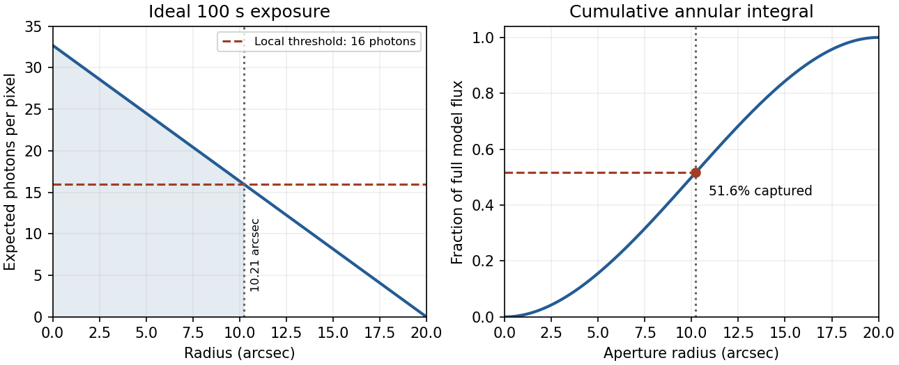

<h1 id="1/solution">Solution</h1>

↑ **Parent:** [1](../1.md)

The detector is intended for arcsecond-scale [astronomical seeing](../../../../astronomical-seeing.md), rather than the telescope's [diffraction limit](../../../../diffraction-limit.md). A circular [aperture](../../../../aperture.md) of this area has diameter $1.13\,\mathrm m$, giving a [Rayleigh criterion](../../../../rayleigh-criterion.md) angle about $0.11$ arcsec at the observing [wavelength](../../../../wavelength.md). One-arcsecond pixels conventionally sample an [astronomical seeing](../../../../astronomical-seeing.md) profile of roughly two arcseconds across with two samples; a one-arcsecond profile would be undersampled. **The pixel scale alone does not determine an exact [astronomical seeing](../../../../astronomical-seeing.md) width.**

Use the supplied [surface brightness](../../../../surface-brightness.md) as [radiative flux](../../../../radiative-flux.md) integrated over the [photometric passband](../../../../photometric-passband.md): its units contain no inverse hertz. Treat $h\nu$ as the representative [photon energy](../../../../photon-energy.md), and assume unit throughput and [quantum efficiency](../../../../quantum-efficiency.md). A genuinely frequency-specific brightness would require a [bandwidth](../../../../bandwidth-signal-processing.md). With angles measured consistently in arcseconds, an annulus has area $2\pi r\,dr$ square arcseconds, so

$$
F(r_m)=\int_0^{r_m}2\pi r\,a(1-kr)\,dr
=\boxed{2\pi a\left(\frac{r_m^2}{2}-\frac{kr_m^3}{3}\right)}.
$$

This is flux per collecting area; collected [energy](../../../../energy-split.md) is $AtF$. There is no extra conversion to [steradians](../../../../steradian.md) when both brightness and angular area use square arcseconds.

For [Poisson photon counting](../../../../poisson-photon-counting.md), a pixel with expected count $N$ has [energy](../../../../energy-split.md) $e=Nh\nu$ and [standard deviation](../../../../standard-deviation.md) $\sigma_e=h\nu\sqrt N$. Thus the local four-sigma rule gives $N=4\sqrt N$, or **16 [photons](../../../../photon.md) at the boundary**. With pixel area $\Delta\Omega=1\,\mathrm{arcsec}^2$,

$$
h\nu=3.9756\times10^{-19}\,\mathrm J,\qquad
N(r)=\frac{At\Delta\Omega\,a}{h\nu}(1-kr)=32.6991(1-kr).
$$

Consequently $r_m=(1-16/32.6991)/k=10.2138$ arcsec and

$$
\boxed{E_m=AtF(r_m)=2.8100\times10^{-15}\,\mathrm J}.
$$

Integrating to the model's outer radius $R=1/k=20$ arcsec instead gives

$$
\boxed{F_{\rm total}=\frac{\pi a}{3k^2}=5.4454\times10^{-17}\,\mathrm{W\,m^{-2}}},
\qquad E_{\rm total}=5.4454\times10^{-15}\,\mathrm J.
$$

The pixel cut retains **51.6%** of this total. It is an imposed [isophotal photometry](../../../../isophotal-photometry.md) rule, not a fundamental limit: averaging annuli or fitting a justified profile can recover signal below the per-pixel cut.

**[Figure 1](#1/image-original-photon-counting-profile-and-fraction-of-total-flux-inside-the-imposed-detection-radius). Original photon-counting profile and fraction of total flux inside the imposed detection radius**.

In practice, [sky background](../../../../sky-brightness.md) [photons](../../../../photon.md) add [shot noise](../../../../shot-noise.md) even after subtraction of the mean sky. [read noise](../../../../read-noise.md), [dark current](../../../../dark-current-physics.md), imperfect [flat-field correction](../../../../flat-field-correction.md), throughput [calibration](../../../../calibration-differential-geometry.md) and [atmospheric extinction](../../../../atmospheric-extinction.md) also matter. At large radius the dominant uncertainty can be a tiny error in the sky level, scattered light or the wings of the [point spread function](../../../../point-spread-function-split.md), rather than source [photon](../../../../photon.md) statistics. Mask foreground [stars](../../../../star.md) and background objects, compare blank-sky regions and dithered exposures, and check profile recovery by inserting artificial extended sources. [astronomical seeing](../../../../astronomical-seeing.md) and finite pixels convolve the intrinsic profile; model that response when extrapolating the total.

The [luminosity convergence of an outer surface-brightness profile](../../../../luminosity-convergence-of-an-outer-surface-brightness-profile.md) follows directly: $I\propto r^{-p}$ contributes $dF\propto r^{1-p}dr$, hence $F(<R)\propto R^{2-p}$ at large radius for $p<2$. For either shallow index considered, ever larger annuli dominate: extending the law to infinity gives an unphysical divergent [luminosity](../../../../luminosity.md). Such a law must eventually steepen or truncate. Over a finite range, however, substantial light can lie below a [surface-brightness selection](../../../../surface-brightness-selection.md) threshold and be mistaken for sky. This biases [galaxy](../../../../galaxy-split.md) [luminosities](../../../../luminosity.md), the [luminosity function](../../../../luminosity-function-astronomy.md) and the inferred diffuse light budget; distant diffuse [galaxies](../../../../galaxy-split.md) become especially incomplete because bolometric [cosmological surface-brightness dimming](../../../../cosmological-surface-brightness-dimming.md) scales as $(1+z)^{-4}$. An assumed finite-aperture total is therefore a model-dependent quantity.

## ↑ Ancestors (13)

1. [1](../1.md)
2. [Paper 1](../../paper-1-split.md)
3. [2014](../../split.md)
4. [Past exam of the frontiers of Observational Astrophysics course of the University of Cambridge](../../../split.md)
5. [Frontiers of Observational Astrophysics course of the University of Cambridge](../../../../frontiers-of-observational-astrophysics-course-of-the-university-of-cambridge.md)
6. [Physics course of the year 4 of the natural sciences course of the University of Cambridge](../../../../physics-course-of-the-year-4-of-the-natural-sciences-course-of-the-university-of-cambridge.md)
7. [Year 4 of the natural sciences course of the University of Cambridge](../../../../year-4-of-the-natural-sciences-course-of-the-university-of-cambridge.md)
8. [Year of the natural sciences course of the University of Cambridge](../../../../year-of-the-natural-sciences-course-of-the-university-of-cambridge.md)
9. [Natural sciences course of the University of Cambridge](../../../../natural-sciences-course-of-the-university-of-cambridge.md)
10. [Course of the University of Cambridge](../../../../course-of-the-university-of-cambridge.md)
11. [University of Cambridge](../../../../university-of-cambridge-split.md)
12. [List of universities](../../../../list-of-universities.md)
13. [Codex Wiki](../../../../split.md)
