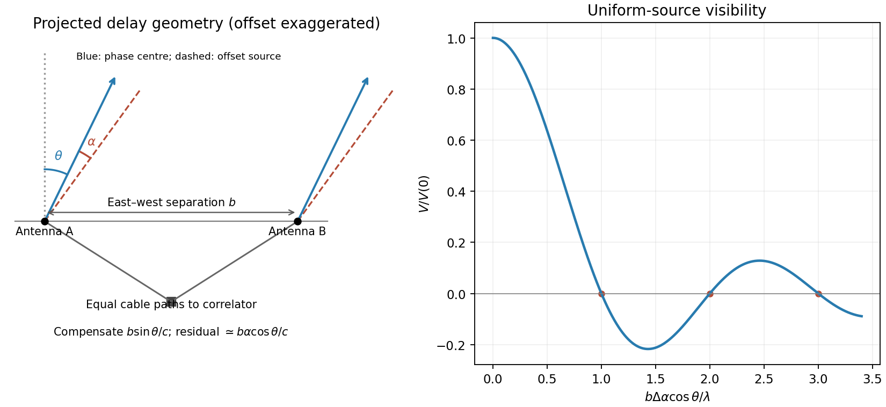
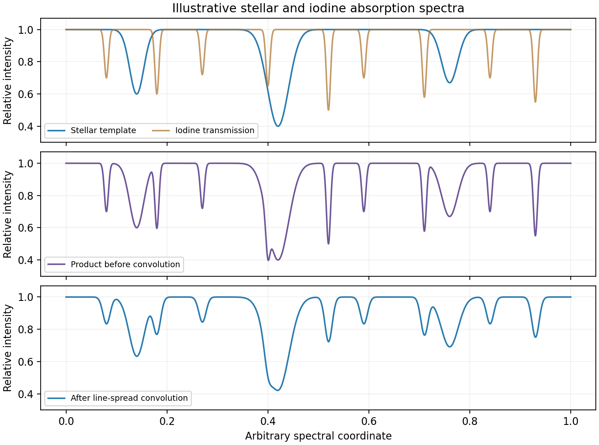
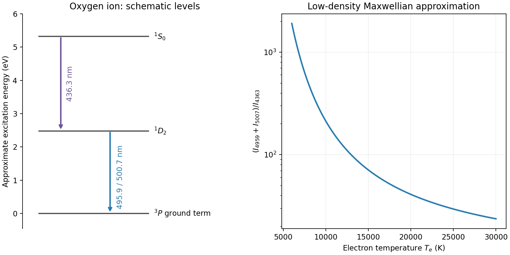

# Paper 1

↑ **Parent:** [2015](../2015.md)

Original paper: [Public original PDF, physical pages 740–742; questions on pages 741–742](https://www.whatdotheyknow.com/request/natural_science_tripos_physics_e_2/response/2340776/attach/2/FOI%202023%20399%20Zahid%20materials.pdf?cookie_passthrough=1#page=740).

**Table of contents**

- [1](#1)
  - [Solution](#1/solution)
- [2](#2)
  - [Solution](#2/solution)
- [3](#3)
  - [a](#3/a)
    - [Solution](#3/a/solution)
  - [b](#3/b)
    - [Solution](#3/b/solution)
  - [c](#3/c)
    - [Solution](#3/c/solution)
  - [d](#3/d)
    - [Solution](#3/d/solution)

## 1

↑ **Parent:** [Paper 1](paper-1.md)

<h3 id="1/solution">Solution</h3>

↑ **Parent:** [1](#1)

**Within-model inference.** The data $\mathbf d$ are the measurements, $H$ specifies a [statistical model](../../statistical-model.md) including its sampling assumptions, and $\theta$ is its unknown parameter or parameter vector. The posterior $p(\theta\mid\mathbf d,H)$ describes parameter uncertainty after the observation. The [likelihood](../../maximum-likelihood-estimation.md#likelihood-function) $\mathcal L(\theta)=p(\mathbf d\mid\theta,H)$ describes how that observed data set depends on a proposed parameter. The parameter prior $\pi(\theta\mid H)=p(\theta\mid H)$ encodes information before these data. The evidence $Z_H=p(\mathbf d\mid H)$ is the prior predictive [probability density](../../wave-function.md#probability-density) of the data and normalizes the posterior:

$$
\boxed{Z_H=\int\mathcal L(\theta)\pi(\theta\mid H)\,d\theta.}
$$

For continuous observations the [likelihood](../../maximum-likelihood-estimation.md#likelihood-function) and evidence are densities in data space, rather than [probabilities](../../probability-theory.md#probability) of one exact observation. The evidence compares different models only when they use the same data and reference measure.

**Uniform parameter priors.** Normalize each model's top-hat prior, so $\pi_H=1/(\theta_2-\theta_1)$ inside its allowed interval and zero elsewhere. Then

$$
\boxed{Z_H=\frac1{\theta_2-\theta_1}\int_{\theta_1}^{\theta_2}\mathcal L(\theta)\,d\theta.}
$$

Thus evidence is the average [likelihood](../../maximum-likelihood-estimation.md#likelihood-function) over the allowed parameter range, not its maximum and not the unnormalized area alone. Interpret the supplied measured distribution as proportional to a common [likelihood](../../maximum-likelihood-estimation.md#likelihood-function), $\mathcal L(\theta)=C\exp[-|100u-\theta|/(50u)]$, where the common constant $C$ cancels in model comparisons. If that distribution were instead a posterior calculated using a nonuniform reference prior, it would first need to be divided by that prior. No such alternative prior is specified here.

**Evidence calculation.** Put $x=\theta/u$. The three integrals, divided by the same $C$, are

$$
\begin{aligned}
Z_A/C&=\frac1{10}\int_{50}^{60}e^{(x-100)/50}dx
=5(e^{-0.8}-e^{-1})=0.407247615,\\
Z_B/C&=\frac1{20}\left[\int_{90}^{100}e^{(x-100)/50}dx+
\int_{100}^{110}e^{-(x-100)/50}dx\right]
=5(1-e^{-0.2})=0.906346235,\\
Z_C/C&=\frac1{100}\left[\int_{50}^{100}e^{(x-100)/50}dx+
\int_{100}^{150}e^{-(x-100)/50}dx\right]
=1-e^{-1}=0.632120559.
\end{aligned}
$$

Consequently the three pairwise [Bayes factors](../../bayesian-statistics.md#bayes-factor) may be given as

$$
\boxed{\frac{Z_B}{Z_A}=2.22554,\qquad
\frac{Z_B}{Z_C}=1.43382,\qquad
\frac{Z_C}{Z_A}=1.55218.}
$$

**B has the largest evidence.** Model A is narrow but lies away from the [likelihood](../../maximum-likelihood-estimation.md#likelihood-function) peak. Model C contains that peak but spreads much of its normalized prior over less well-fitting values. Model B concentrates its parameter prior near the peak and achieves the best average. Width is therefore not a universal penalty by itself: changing an interval can also improve its location. At fixed centre near a localized [likelihood](../../maximum-likelihood-estimation.md#likelihood-function) peak, extending the interval into poorly fitting values dilutes the evidence.

**[Figure 1](#1/image-original-likelihood-averages-over-the-three-top-hat-prior-intervals-bars-show-evidence-and-separately-prior-weighted-model-probabilities). Original likelihood averages over the three top-hat prior intervals; bars show evidence and separately prior-weighted model probabilities**.

**Between-model prior information.** The supplied $R_A:R_B:R_C=1:1:0.3$ are model prior odds, distinct from each model's uniform parameter prior. They multiply the evidences to give posterior model weights. The corresponding posterior odds are

$$
\boxed{\frac{p(B\mid\mathbf d)}{p(A\mid\mathbf d)}=2.22554,\qquad
\frac{p(B\mid\mathbf d)}{p(C\mid\mathbf d)}=4.77940,\qquad
\frac{p(A\mid\mathbf d)}{p(C\mid\mathbf d)}=2.14752.}
$$

Normalizing these weights gives $p(A\mid\mathbf d)=0.270915$, $p(B\mid\mathbf d)=0.602933$ and $p(C\mid\mathbf d)=0.126152$. **B is preferred with either equal model priors or the stated theoretical prior odds.** Multiplying by $R$ changes posterior odds; it does not redefine the [Bayes factors](../../bayesian-statistics.md#bayes-factor).

**Euclidean [luminosity](../../astrophysics.md#luminosity) selection.** In a flux-limited catalogue, a source with isotropic [luminosity](../../astrophysics.md#luminosity) $L$ is detected out to

$$
r_{\max}=\sqrt{\frac{L}{4\pi f_{\min}}},\qquad
V_{\max}\propto r_{\max}^3\propto L^{3/2}.
$$

A homogeneous Euclidean population with intrinsic [luminosity function](../../astrophysics.md#luminosity-function-astronomy) $\varphi(L)$ is sampled approximately as $dN_{\rm det}/dL\propto\varphi(L)L^{3/2}$. Brighter objects occupy a much larger accessible volume and are overrepresented; at a fixed large distance the faint tail is missing entirely. This is [Malmquist bias](../../astrophysics.md#malmquist-bias). Using the selected population as if it were representative can bias [luminosity](../../astrophysics.md#luminosity) [calibrations](../../differential-geometry.md#calibration-differential-geometry) or inferred correlations with $\theta$. A selection function, a volume-limited sample, or appropriate accessible-volume weighting can address the sampling effect, subject to completeness assumptions.

The Euclidean derivation concerns flux-limited luminous objects or selected tracers associated with the structures. A [CMB](../../cosmic-microwave-background.md) temperature map is a diffuse surface-brightness field on a cosmological last-scattering surface: it is not automatically a Euclidean catalogue of identical inverse-square point sources. For a particular CMB-structure catalogue, its actual detection statistic and selection function must be specified before applying this luminosity-weighting law quantitatively.

## 2

↑ **Parent:** [Paper 1](paper-1.md)

<h3 id="2/solution">Solution</h3>

↑ **Parent:** [2](#2)

**Delay-compensated geometry.** Choose an east-west baseline vector $\mathbf b=b\hat{\mathbf x}$ and let the upward unit vector be $\hat{\mathbf z}$. A ray direction at zenith angle $\beta$ in their plane has $\mathbf s(\beta)=(\sin\beta,0,\cos\beta)$. Its signed geometric path difference is $\mathbf b\cdot\mathbf s=b\sin\beta$. Removing the phase-centre delay $b\sin\theta/c$ leaves the residual path

$$
\delta\ell=b[\sin(\theta+\alpha)-\sin\theta]
\simeq b\alpha\cos\theta.
$$

With the receiver ordering chosen to give positive phase for this path, a complex correlator measures

$$
\boxed{V(\alpha)\propto e^{ik\delta\ell}
\simeq\exp(ikb\alpha\cos\theta).}
$$

The reverse ordering complex-conjugates the expression without changing its information. A single real multiplier supplies its cosine component; the stated exponential represents an in-phase/quadrature correlator. Equal cable lengths to the central correlator remove a fixed instrumental difference but do not remove the changing [geometric delay](../../astrophysics.md#geometric-delay). Pointing the [antennas](../../electrical-engineering.md#antenna-radio) and electronically compensating the path are separate operations.

**[Figure 2](#2/image-original-east-west-interferometer-geometry-and-normalized-visibility-of-a-centred-one-dimensional-uniform-source). Original east-west interferometer geometry and normalized visibility of a centred one-dimensional uniform source**.

**Resolved uniform source.** Contributions from mutually incoherent sky elements add as brightness-weighted [complex visibilities](../../astrophysics.md#complex-visibility). Put $I(\alpha)=I_0$ over $-\Delta\alpha/2<\alpha<\Delta\alpha/2$ and zero elsewhere, and define $q=kb\cos\theta$. Integrating gives

$$
V=I_0\int_{-\Delta\alpha/2}^{\Delta\alpha/2}e^{iq\alpha}d\alpha
=I_0\Delta\alpha\,\frac{\sin(q\Delta\alpha/2)}{q\Delta\alpha/2}.
$$

Therefore

$$
\boxed{\frac{V(b)}{V(0)}=\operatorname{sinc}\left(\frac{kb\Delta\alpha\cos\theta}{2}\right),
\qquad\operatorname{sinc}x=\frac{\sin x}{x}.}
$$

The zero-argument value is defined by continuity as one. Normalization by $V(0)=I_0\Delta\alpha$ isolates the visibility shape from total [flux](../../mathematical-physics.md#flux). The first null occurs when the source spans one fringe period, $\Delta\alpha=\lambda/(|b\cos\theta|)$. A negative real visibility beyond a null is a phase reversal, not negative [surface brightness](../../astrophysics.md#surface-brightness).

**Path-compensation precision.** A finite observing band sets a coherence envelope. For a rectangular band of width $\Delta\nu$, an uncorrected residual delay $\delta\tau=\delta\ell/c$ multiplies the correlation by

$$
e^{2\pi i\nu_0\delta\tau}\operatorname{sinc}(\pi\Delta\nu\delta\tau).
$$

Coarse delay steps must leave $\Delta\nu|\delta\tau|\ll1$ if decorrelation is to be small. Thus a coarse path-step scale must be well below the [coherence length](../../physical-optics.md#optical-coherence-length) $c/\Delta\nu$, with the precise bound determined by the tolerated amplitude loss and maximum quantization residual. A digital fine-delay or phase-rotation system can separately correct the central-frequency phase.

If there is no such carrier-phase correction, the steps must also be a small fraction of $\lambda$ to avoid large untracked phase jumps or time-averaging loss. For a step $d_\ell$ rounded to the nearest setting, $|\delta\ell|\le d_\ell/2$ and the maximum carrier-phase error is $\pi d_\ell/\lambda$. **[Bandwidth](../../electrical-engineering.md#bandwidth-signal-processing) controls coarse group-delay decorrelation; [wavelength](../../wave-equation.md#wavelength) controls the precision of untracked carrier phase.** No numerical delay step can be inferred from the central [frequency](../../wave.md#frequency) alone without a [bandwidth](../../electrical-engineering.md#bandwidth-signal-processing), loss tolerance and compensation architecture. Earth rotation additionally sets how rapidly the delay setting must be updated.

**Largest sampled angular scale.** For a near-zenith view take the shortest projected baseline as $b_{\min}\simeq0.5\ {\rm m}$. At $\nu=30\ {\rm GHz}$, $\lambda=c/\nu=9.9931\times10^{-3}\ {\rm m}$. The inverse shortest [spatial frequency](../../fourier-analysis.md#spatial-frequency) gives

$$
\boxed{\Theta_{\max}\sim\frac{\lambda}{b_{\min}}
=0.0199862\ {\rm rad}=68.7\ {\rm arcmin}\approx1.15\text{ degrees}.}
$$

This is an order-of-magnitude largest fringe scale. A convention defining maximum recoverable source size as $0.6\lambda/b_{\min}$ would instead give about $41$ arcminutes; source profile, weighting and projected baseline coverage determine the operational value. The [antenna](../../electrical-engineering.md#antenna-radio) diameter and [primary beam](../../astrophysics.md#primary-beam) can further restrict the usable field but were explicitly neglected in the source's initial idealization. Ten [antennas](../../electrical-engineering.md#antenna-radio) supply $10\times9/2=45$ pairwise baselines; their number improves sampling and sensitivity, not the inverse-shortest-baseline scale by a factor of ten. The longest baseline is not supplied, so the finest synthesized resolution is not numerically fixed.

**A suitable observing programme.** A compact centimetre-wave array is well suited to [CMB](../../cosmic-microwave-background.md) temperature anisotropy on degree to sub-degree scales sampled by its baselines, and, with sufficiently long baselines and suitable foreground control, thermal Sunyaev-Zeldovich structure in [galaxy clusters](../../large-scale-structure-of-the-universe.md#galaxy-cluster). At $30\ {\rm GHz}$ the thermal Sunyaev-Zeldovich signal is a decrement relative to the [CMB](../../cosmic-microwave-background.md). The compact baselines retain sensitivity to extended brightness features; the [spatial frequencies](../../fourier-analysis.md#spatial-frequency) measured by each baseline have a direct statistical interpretation in [CMB](../../cosmic-microwave-background.md) analysis.

Compared with lower radio [frequencies](../../wave.md#frequency), synchrotron foregrounds are generally reduced, while thermal dust rises toward higher [frequencies](../../wave.md#frequency); observing near this centimetre-wave atmospheric window is therefore useful, although foregrounds are not absent. Correlation and phase switching reject mean uncorrelated receiver offsets and some instrumental drifts. Receiver [thermal noise](../../electrical-engineering.md#thermal-noise) still contributes [variance](../../variance.md), and atmosphere, ground pickup or cross-talk can be correlated and require control. Additional long baselines can identify compact radio-source contaminants for subtraction, but the question does not specify enough array geometry to guarantee that capability. There is no zero baseline in ordinary pairwise cross-correlation, so the array does not directly measure the sky monopole or arbitrary larger-scale smooth emission.

## 3

↑ **Parent:** [Paper 1](paper-1.md)

<h3 id="3/a">a</h3>

↑ **Parent:** [3](#3)

<h4 id="3/a/solution">Solution</h4>

↑ **Parent:** [A](#3/a)

**[Stellar reflex motion](../../exoplanet.md#stellar-reflex-motion).** A [planet](../../planetary-science.md#planet) and its host orbit their common [barycentre](../../topological-vector-space.md#barycenter). The [star](../../stellar-astrophysics.md#star)'s line-of-sight velocity shifts its [absorption lines](../../stellar-astrophysics.md#absorption-line) by $\Delta\lambda/\lambda\simeq v_r/c$ at low speeds. A time series can be fitted with

$$
v_r(t)=\gamma+K[\cos(\nu(t)+\varpi)+e\cos\varpi],\qquad
K=\left(\frac{2\pi G}{P}\right)^{1/3}
\frac{M_p\sin i}{(M_\star+M_p)^{2/3}\sqrt{1-e^2}}.
$$

Here $\nu(t)$ is [true anomaly](../../celestial-mechanics.md#true-anomaly), $\varpi$ the argument of periastron and $\gamma$ an arbitrary systemic velocity offset. At small companion mass and known stellar mass, the orbit supplies $M_p\sin i$, not the true [planet](../../planetary-science.md#planet) mass without an inclination constraint. Long monitoring helps distinguish a reproducible Keplerian signal from stellar oscillations, magnetic activity, spots and instrumental trends.

**The Lick reference-cell implementation.** Starlight passes through a temperature-controlled cell of molecular [iodine](../../chemical-substance.md#iodine) before entering the Hamilton high-resolution echelle [spectrograph](../../optical-instrument.md#spectrograph). The cell imprints a dense pattern of reference [absorption lines](../../stellar-astrophysics.md#absorption-line) on the stellar spectrum, predominantly in the approximately $500$–$630\ {\rm nm}$ interval. These lines share the same exposure and downstream optical path as the stellar light. A calibrated high-resolution Fourier-transform [iodine](../../chemical-substance.md#iodine) spectrum and an iodine-free stellar template allow the [wavelength](../../wave-equation.md#wavelength) solution and instrumental line-spread function to be fitted along with the stellar [Doppler shift](../../wave.md#doppler-effect). The method corrects shifts and line-shape changes that a separate [calibration](../../differential-geometry.md#calibration-differential-geometry) exposure would not necessarily follow.[Marcy and Butler (1992), sections 3–4, printed pages 271–274: Hamilton setup, iodine wavelength interval, templates and in-situ instrumental profile](../../physics-bibliography.md#precision-radial-velocities-with-an-iodine-absorption-cell-by-geoffrey-w-marcy-and-r-paul-butler)

A useful forward model for one short spectral segment is

$$
\boxed{f_{\rm obs}(\lambda)=
\left\{S\!\left(\frac{\lambda}{1+v/c}\right)T_{\rm I_2}(\lambda)\right\}
*\mathcal P(\lambda),}
$$

followed by pixel integration, continuum scaling and a fitted [wavelength](../../wave-equation.md#wavelength) [calibration](../../differential-geometry.md#calibration-differential-geometry). Here $S$ is the intrinsic stellar spectrum, $T_{\rm I_2}$ the cell transmission and $\mathcal P$ the instrumental line-spread function. The spectra multiply before [convolution](../../fourier-analysis.md#convolution); simply dividing a recorded blended spectrum by the laboratory [iodine](../../chemical-substance.md#iodine) spectrum is not equivalent to this model. The [iodine](../../chemical-substance.md#iodine) pattern is stationary in the observatory frame while stellar lines move relative to it. Separate spectral segments accommodate [wavelength](../../wave-equation.md#wavelength) dependence of the instrumental profile.

**[Figure 3](#3/a/image-original-synthetic-iodine-cell-forward-model-showing-multiplication-before-instrumental-convolution-all-line-positions-and-strengths-are-illustrative). Original synthetic iodine-cell forward model showing multiplication before instrumental convolution; all line positions and strengths are illustrative**.

Earth's rotational and orbital velocities must then be removed with a barycentric correction using accurate timing, ideally weighted by [photon](../../quantum-mechanics.md#photon) arrival rate. Many stellar lines constrain a shift smaller than one instrumental resolution element; spectral resolution alone is not the velocity error. [Photon](../../quantum-mechanics.md#photon) statistics, template quality, instrumental-profile modelling and intrinsic stellar variability limit the precision. The method measures changes relative to a template and does not by itself provide a perfectly absolute centre-of-mass velocity. No particular discovery, modern precision floor or historical observing performance is assumed here.

<h3 id="3/b">b</h3>

↑ **Parent:** [3](#3)

<h4 id="3/b/solution">Solution</h4>

↑ **Parent:** [B](#3/b)

[Atmospheric turbulence](../../optics.md#atmospheric-turbulence) produces time-dependent refractive-index fluctuations and phase errors across the telescope pupil. A large aperture's long-exposure [point spread function](../../point-spread-function.md) is broadened approximately to $0.98\lambda/r_0$, where $r_0$ is the [Fried parameter](../../optics.md#fried-parameter), rather than the [diffraction](../../quantum-scattering.md#diffraction) scale $\lambda/D$. For fixed turbulence, $r_0\propto\lambda^{6/5}$, so the [seeing](../../optics.md#astronomical-seeing) angle improves weakly as $\lambda^{-1/5}$. The [atmospheric coherence time](../../optics.md#atmospheric-coherence-time) scales with $r_0$ divided by an effective wind speed. This temporal scale concerns changing turbulence, not the optical [bandwidth](../../electrical-engineering.md#bandwidth-signal-processing)'s coherence time.

**Reduce the disturbance.** A good high-altitude site, favourable weather, observing near the zenith, thermal control and dome ventilation reduce atmospheric and local [seeing](../../optics.md#astronomical-seeing). They improve the uncorrected image but do not remove all high-order wavefront distortion. [Active optics](../../optical-instrument.md#active-optics) slowly maintains the main mirror's figure and alignment; it is distinct from the rapid adaptive correction of atmospheric phase errors.

**Correct the wavefront.** [Adaptive optics](../../optical-instrument.md#adaptive-optics) uses a nearby natural [guide star](../../optical-instrument.md#guide-star-adaptive-optics) or artificial [laser guide star](../../optical-instrument.md#laser-guide-star), a [wavefront sensor](../../optical-instrument.md#wavefront-sensor), a real-time controller and a [deformable mirror](../../optical-instrument.md#deformable-mirror). A Shack-Hartmann sensor estimates local wavefront slopes; mirror actuators apply the opposite optical-path distortion fast enough to track the atmosphere. A separate fast steering element or the mirror can correct image motion. In an ideal well-corrected direction this approaches [diffraction-limited resolution](../../point-spread-function.md#diffraction-limited-resolution) and increases the concentration of light in the central image.

Finite guide-star [flux](../../mathematical-physics.md#flux), actuator sampling, control latency and [anisoplanatism](../../optics.md#anisoplanatism) leave residual errors. A laser beacon samples a finite-height cone rather than the full distant-source cylinder, and a conventional laser reference does not determine absolute tip-tilt, so a natural reference remains useful. Multiple [guide stars](../../optical-instrument.md#guide-star-adaptive-optics) and multiple conjugate mirrors can widen the corrected field, with extra sensing and reconstruction complexity. These are fundamental geometry and control limits, not claims of a universal corrected sky fraction.[Single Conjugate Adaptive Optics and Multi-Conjugate Adaptive Optics sections: bandwidth, fitting, anisoplanatism, laser-beacon tilt and cone limitations](../../physics-bibliography.md#adaptive-optics-by-european-southern-observatory)

**Freeze and reconstruct.** Short exposures can freeze the instantaneous [speckle pattern](../../physical-optics.md#speckle-pattern). [Speckle interferometry](../../optics.md#speckle-interferometry) uses calibrated Fourier statistics to recover diffraction-scale structure; power-spectrum information alone loses phase, while [bispectrum](../../time-series.md#bispectrum) or other phase-sensitive measurements support image reconstruction. [Lucky imaging](../../optics.md#lucky-imaging) selects sharp short frames, registers them and combines them, trading [photon](../../quantum-mechanics.md#photon) efficiency for improved image quality. Tip-tilt alignment alone removes image motion rather than all high-order aberration. These methods require sufficiently bright sources or references and can incur substantial read-noise penalties. Deconvolving a long-exposure image is useful only where a known [point spread function](../../point-spread-function.md) and adequate signal preserve information; it cannot recover arbitrarily lost [spatial frequencies](../../fourier-analysis.md#spatial-frequency). Moving to space avoids atmospheric [seeing](../../optics.md#astronomical-seeing), although it changes the observing platform and its limitations rather than correcting a ground-based telescope.

<h3 id="3/c">c</h3>

↑ **Parent:** [3](#3)

<h4 id="3/c/solution">Solution</h4>

↑ **Parent:** [C](#3/c)

**Weak transitions in dilute gas.** A [forbidden emission line](../../stellar-astrophysics.md#forbidden-emission-line) is a transition absent in the electric-dipole approximation because of its [selection rules](../../atomic-physics.md#selection-rule), but permitted through weaker channels such as magnetic-dipole or electric-quadrupole radiation, sometimes aided by state mixing. It is not an impossible transition. Its upper atomic level is relatively long lived, so collisions can deactivate it before a [photon](../../quantum-mechanics.md#photon) is emitted in dense gas. Low-density astrophysical plasmas allow radiative decay to compete successfully.

In a schematic two-level statistical equilibrium,

$$
n_l n_e q_{lu}=n_u(A_{ul}+n_eq_{ul}),\qquad
\epsilon_{ul}=n_uA_{ul}h\nu_{ul}.
$$

The critical density is $n_{\rm crit}=A_{ul}/q_{ul}$ for this simple level system; multiple radiative and collisional channels require summed rates. At $n_e\ll n_{\rm crit}$ each [collisional excitation](../../atomic-physics.md#collisional-excitation) is likely to produce radiation, so $\epsilon_{ul}\propto n_l n_e q_{lu}h\nu$. At high density collisional de-excitation suppresses the line relative to this low-density expectation. The rate need not decrease absolutely with increasing density; the suppression is relative to the naive excitation scaling.

**A temperature-sensitive ratio.** For a Maxwell-Boltzmann electron distribution,

$$
q_{lu}(T)\propto T^{-1/2}\Upsilon_{lu}(T)
\exp[-\Delta E_{lu}/(k_BT)],
$$

where $\Upsilon$ is an effective collision strength. Lines from upper levels with different excitation energies therefore have a strongly temperature-dependent ratio. Using one ion reduces sensitivity to abundance and [ionization](../../atomic-physics.md#ionization) fraction compared with comparing unrelated species.

A standard example is doubly ionized oxygen: the $4959$ and $5007$ angstrom lines descend from ${}^1D_2$ toward the ${}^3P$ ground term, while the $4363$ angstrom line connects ${}^1S_0$ to ${}^1D_2$. The higher excitation threshold makes the auroral $4363$ line relatively stronger in hotter gas. In the low-density Maxwellian approximation, with slowly varying collision strengths,

$$
\boxed{R_{\rm OIII}=\frac{I_{4959}+I_{5007}}{I_{4363}}
\simeq7.90\exp\left(\frac{32900\ {\rm K}}{T_e}\right),
\qquad T_e\simeq\frac{32900\ {\rm K}}{\ln(R_{\rm OIII}/7.90)}.}
$$

The numerical form is a useful approximation, not a universal exact atomic law; a multilevel atomic calculation with current collision strengths is needed for precise work.[Section 4, equation 18 and the following approximation warning; arXiv:1204.3880v2, PDF pages 5–6](../../physics-bibliography.md#resolving-the-electron-temperature-discrepancies-in-h-ii-regions-and-planetary-nebulae-kappa-distributed-electrons-by-david-c-nicholls-and-others)

**[Figure 4](#3/c/image-original-oxygen-forbidden-line-level-schematic-and-low-density-maxwellian-temperature-ratio-curve-level-spacings-are-approximate). Original oxygen forbidden-line level schematic and low-density Maxwellian temperature-ratio curve; level spacings are approximate**.

In an [active galactic nucleus](../../astrophysical-black-hole.md#active-galactic-nucleus) these lines commonly diagnose the relatively dilute narrow-line gas; dense broad-line gas can collisionally quench them. Measure and deblend the [fluxes](../../mathematical-physics.md#flux), subtract continuum and stellar features, correct differential [extinction](../../ecology.md#extinction), and check density independently. The $5007/4959$ ratio mainly tests radiative branching and [calibration](../../differential-geometry.md#calibration-differential-geometry) because both lines share one upper level; it is not the required temperature thermometer. Temperature gradients, multiple density components, [shocks](../../transport-equation.md#shock-wave), [ionization](../../atomic-physics.md#ionization) structure and departures from the Maxwellian electron distribution can bias a single inferred temperature. Without a measured ratio and density regime, no particular AGN temperature is numerically determined here.

<h3 id="3/d">d</h3>

↑ **Parent:** [3](#3)

<h4 id="3/d/solution">Solution</h4>

↑ **Parent:** [D](#3/d)

Measure counts in electrons so that [photon](../../quantum-mechanics.md#photon) and detector [noise](../../electrical-engineering.md#noise-signal-processing) can be combined directly. For source electrons $S$, $n$ aperture pixels, total time $t$, sky rate $b$ per pixel, dark-current rate $d$ per pixel, $M$ reads with rms [read noise](../../optical-instrument.md#read-noise) $r$ per pixel, and an independently estimated mean background per pixel of [variance](../../variance.md) $\sigma_{\widehat B}^2$, an ideal aperture-sum budget is

$$
\boxed{\operatorname{Var}(\widehat S)
\simeq S+n(b+d)t+nMr^2+n^2\sigma_{\widehat B}^2
+\sigma_{\rm cal}^2,\qquad
{\rm SNR}=\frac{S}{\sqrt{\operatorname{Var}(\widehat S)}}.}
$$

The last term represents the propagated [calibration](../../differential-geometry.md#calibration-differential-geometry) uncertainty if it can be treated as a random [variance](../../variance.md); systematic residuals can instead bias the measurement and need an explicit error model. For a background estimated from $n_b$ independent, equally exposed sky pixels, one approximation is $\sigma_{\widehat B}^2=[(b+d)t+Mr^2]/n_b$. Correlated resampling, detector cross-talk or a spatially structured sky invalidates the independent-pixel simplification.

**[Photon](../../quantum-mechanics.md#photon) counting and sky.** Source [photon shot noise](../../optical-instrument.md#photon-shot-noise) has [variance](../../variance.md) $S$ and cannot be calibrated away. Longer integration or greater throughput improves its fractional error as $S^{-1/2}$. Sky [photons](../../quantum-mechanics.md#photon), including moonlight, airglow and scattered light, add their own Poisson fluctuations. A dark site, appropriate observing time and filter, good baffling and a smaller or optimally weighted source aperture reduce sky contributions. Better [seeing](../../optics.md#astronomical-seeing) or [adaptive optics](../../optical-instrument.md#adaptive-optics) can concentrate a point source into fewer noise-bearing pixels. Sky subtraction removes the mean background but not the random sky [photons](../../quantum-mechanics.md#photon) already recorded, and the sky estimate adds uncertainty of its own.

**Dark and [read noise](../../optical-instrument.md#read-noise).** Thermal [dark current](../../optical-instrument.md#dark-current-physics) contributes a mean and shot [noise](../../electrical-engineering.md#noise-signal-processing). Cooling reduces its rate; well-matched dark frames remove a reproducible mean and map hot pixels, but do not undo the science exposure's random dark-current fluctuations. Each read adds electronic [noise](../../electrical-engineering.md#noise-signal-processing). At fixed total integration, many short exposures add more read [variance](../../variance.md) than fewer long exposures, so use exposures long enough to become sky limited when saturation, [cosmic rays](../../galaxy.md#cosmic-ray) and temporal changes permit. Multiple non-destructive reads can help on detectors that support them. Subtracting a bias frame corrects an electronic offset, not the stochastic [read noise](../../optical-instrument.md#read-noise).

**[Calibration](../../differential-geometry.md#calibration-differential-geometry) and non-Poisson effects.** Pixel sensitivity differences, illumination gradients, fringes, nonlinearity, imperfect charge transfer and electronic pattern [noise](../../electrical-engineering.md#noise-signal-processing) leave [calibration](../../differential-geometry.md#calibration-differential-geometry) errors. High-count flat fields, stable operating conditions, linearity [calibration](../../differential-geometry.md#calibration-differential-geometry), dithering and appropriate detector models help, while the finite signal-to-noise of [calibration](../../differential-geometry.md#calibration-differential-geometry) frames propagates into the result. Cosmic-ray hits, hot pixels, satellite trails and scattered-light artefacts are not ordinary stationary Gaussian [noise](../../electrical-engineering.md#noise-signal-processing): identify or mask them, often using several exposures. Overaggressive clipping can remove real transient or compact-source signal.

[Atmospheric scintillation](../../optics.md#scintillation-astronomy) adds correlated intensity fluctuations, especially in short bright-star measurements; [seeing](../../optics.md#astronomical-seeing) changes and guiding errors move [flux](../../mathematical-physics.md#flux) between pixels or apertures. Differential photometry using appropriate reference [stars](../../stellar-astrophysics.md#star) and stable apertures reduces common variations but does not guarantee removal of chromatic or position-dependent effects. For a constant flux-limited source in independent stationary [noise](../../electrical-engineering.md#noise-signal-processing) the final signal-to-noise usually grows as $\sqrt t$ once background limited; a systematic floor or correlated sky can stop that improvement. Distinguish improvement of [calibration](../../differential-geometry.md#calibration-differential-geometry), which removes reproducible bias, from elimination of intrinsically random [photon](../../quantum-mechanics.md#photon) arrivals, which is impossible.

## ↑ Ancestors (11)

1. [2015](../2015.md)
2. [Past exam of the frontiers of Observational Astrophysics course of the University of Cambridge](../../past-exam-of-the-frontiers-of-observational-astrophysics-course-of-the-university-of-cambridge.md)
3. [Frontiers of Observational Astrophysics course of the University of Cambridge](../../university-of-cambridge.md#frontiers-of-observational-astrophysics-course-of-the-university-of-cambridge)
4. [Physics course of the year 4 of the natural sciences course of the University of Cambridge](../../university-of-cambridge.md#physics-course-of-the-year-4-of-the-natural-sciences-course-of-the-university-of-cambridge)
5. [Year 4 of the natural sciences course of the University of Cambridge](../../university-of-cambridge.md#year-4-of-the-natural-sciences-course-of-the-university-of-cambridge)
6. [Year of the natural sciences course of the University of Cambridge](../../university-of-cambridge.md#year-of-the-natural-sciences-course-of-the-university-of-cambridge)
7. [Natural sciences course of the University of Cambridge](../../university-of-cambridge.md#natural-sciences-course-of-the-university-of-cambridge)
8. [Course of the University of Cambridge](../../university-of-cambridge.md#course-of-the-university-of-cambridge)
9. [University of Cambridge](../../university-of-cambridge.md)
10. [List of universities](../../README.md#list-of-universities)
11. [Codex Wiki](../../README.md)
