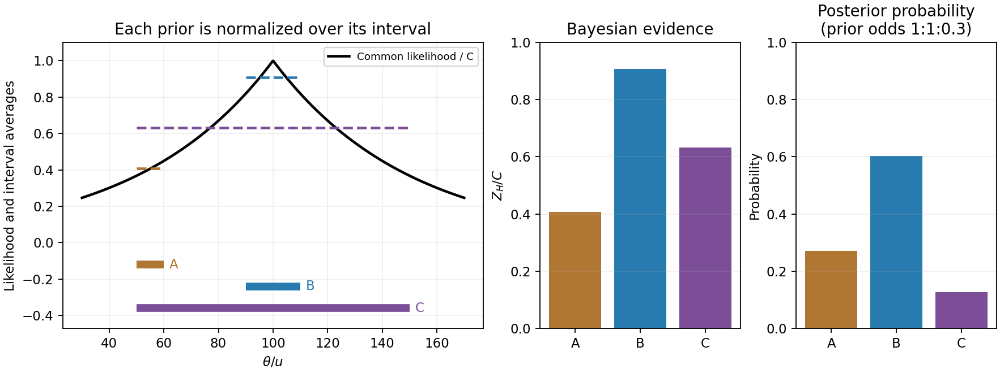

<h1 id="1/solution">Solution</h1>

↑ **Parent:** [1](../1.md)

**Within-model inference.** The data $\mathbf d$ are the measurements, $H$ specifies a [statistical model](../../../../statistical-model-split.md) including its sampling assumptions, and $\theta$ is its unknown parameter or parameter vector. The posterior $p(\theta\mid\mathbf d,H)$ describes parameter uncertainty after the observation. The [likelihood](../../../../likelihood-function.md) $\mathcal L(\theta)=p(\mathbf d\mid\theta,H)$ describes how that observed data set depends on a proposed parameter. The parameter prior $\pi(\theta\mid H)=p(\theta\mid H)$ encodes information before these data. The evidence $Z_H=p(\mathbf d\mid H)$ is the prior predictive [probability density](../../../../probability-density.md) of the data and normalizes the posterior:

$$
\boxed{Z_H=\int\mathcal L(\theta)\pi(\theta\mid H)\,d\theta.}
$$

For continuous observations the [likelihood](../../../../likelihood-function.md) and evidence are densities in data space, rather than [probabilities](../../../../probability.md) of one exact observation. The evidence compares different models only when they use the same data and reference measure.

**Uniform parameter priors.** Normalize each model's top-hat prior, so $\pi_H=1/(\theta_2-\theta_1)$ inside its allowed interval and zero elsewhere. Then

$$
\boxed{Z_H=\frac1{\theta_2-\theta_1}\int_{\theta_1}^{\theta_2}\mathcal L(\theta)\,d\theta.}
$$

Thus evidence is the average [likelihood](../../../../likelihood-function.md) over the allowed parameter range, not its maximum and not the unnormalized area alone. Interpret the supplied measured distribution as proportional to a common [likelihood](../../../../likelihood-function.md), $\mathcal L(\theta)=C\exp[-|100u-\theta|/(50u)]$, where the common constant $C$ cancels in model comparisons. If that distribution were instead a posterior calculated using a nonuniform reference prior, it would first need to be divided by that prior. No such alternative prior is specified here.

**Evidence calculation.** Put $x=\theta/u$. The three integrals, divided by the same $C$, are

$$
\begin{aligned}
Z_A/C&=\frac1{10}\int_{50}^{60}e^{(x-100)/50}dx
=5(e^{-0.8}-e^{-1})=0.407247615,\\
Z_B/C&=\frac1{20}\left[\int_{90}^{100}e^{(x-100)/50}dx+
\int_{100}^{110}e^{-(x-100)/50}dx\right]
=5(1-e^{-0.2})=0.906346235,\\
Z_C/C&=\frac1{100}\left[\int_{50}^{100}e^{(x-100)/50}dx+
\int_{100}^{150}e^{-(x-100)/50}dx\right]
=1-e^{-1}=0.632120559.
\end{aligned}
$$

Consequently the three pairwise [Bayes factors](../../../../bayes-factor.md) may be given as

$$
\boxed{\frac{Z_B}{Z_A}=2.22554,\qquad
\frac{Z_B}{Z_C}=1.43382,\qquad
\frac{Z_C}{Z_A}=1.55218.}
$$

**B has the largest evidence.** Model A is narrow but lies away from the [likelihood](../../../../likelihood-function.md) peak. Model C contains that peak but spreads much of its normalized prior over less well-fitting values. Model B concentrates its parameter prior near the peak and achieves the best average. Width is therefore not a universal penalty by itself: changing an interval can also improve its location. At fixed centre near a localized [likelihood](../../../../likelihood-function.md) peak, extending the interval into poorly fitting values dilutes the evidence.

**[Figure 1](#1/image-original-likelihood-averages-over-the-three-top-hat-prior-intervals-bars-show-evidence-and-separately-prior-weighted-model-probabilities). Original likelihood averages over the three top-hat prior intervals; bars show evidence and separately prior-weighted model probabilities**.

**Between-model prior information.** The supplied $R_A:R_B:R_C=1:1:0.3$ are model prior odds, distinct from each model's uniform parameter prior. They multiply the evidences to give posterior model weights. The corresponding posterior odds are

$$
\boxed{\frac{p(B\mid\mathbf d)}{p(A\mid\mathbf d)}=2.22554,\qquad
\frac{p(B\mid\mathbf d)}{p(C\mid\mathbf d)}=4.77940,\qquad
\frac{p(A\mid\mathbf d)}{p(C\mid\mathbf d)}=2.14752.}
$$

Normalizing these weights gives $p(A\mid\mathbf d)=0.270915$, $p(B\mid\mathbf d)=0.602933$ and $p(C\mid\mathbf d)=0.126152$. **B is preferred with either equal model priors or the stated theoretical prior odds.** Multiplying by $R$ changes posterior odds; it does not redefine the [Bayes factors](../../../../bayes-factor.md).

**Euclidean [luminosity](../../../../luminosity.md) selection.** In a flux-limited catalogue, a source with isotropic [luminosity](../../../../luminosity.md) $L$ is detected out to

$$
r_{\max}=\sqrt{\frac{L}{4\pi f_{\min}}},\qquad
V_{\max}\propto r_{\max}^3\propto L^{3/2}.
$$

A homogeneous Euclidean population with intrinsic [luminosity function](../../../../luminosity-function-astronomy.md) $\varphi(L)$ is sampled approximately as $dN_{\rm det}/dL\propto\varphi(L)L^{3/2}$. Brighter objects occupy a much larger accessible volume and are overrepresented; at a fixed large distance the faint tail is missing entirely. This is [Malmquist bias](../../../../malmquist-bias.md). Using the selected population as if it were representative can bias [luminosity](../../../../luminosity.md) [calibrations](../../../../calibration-differential-geometry.md) or inferred correlations with $\theta$. A selection function, a volume-limited sample, or appropriate accessible-volume weighting can address the sampling effect, subject to completeness assumptions.

The Euclidean derivation concerns flux-limited luminous objects or selected tracers associated with the structures. A [CMB](../../../../cosmic-microwave-background-split.md) temperature map is a diffuse surface-brightness field on a cosmological last-scattering surface: it is not automatically a Euclidean catalogue of identical inverse-square point sources. For a particular CMB-structure catalogue, its actual detection statistic and selection function must be specified before applying this luminosity-weighting law quantitatively.

## ↑ Ancestors (13)

1. [1](../1.md)
2. [Paper 1](../../paper-1-split.md)
3. [2015](../../split.md)
4. [Past exam of the frontiers of Observational Astrophysics course of the University of Cambridge](../../../split.md)
5. [Frontiers of Observational Astrophysics course of the University of Cambridge](../../../../frontiers-of-observational-astrophysics-course-of-the-university-of-cambridge.md)
6. [Physics course of the year 4 of the natural sciences course of the University of Cambridge](../../../../physics-course-of-the-year-4-of-the-natural-sciences-course-of-the-university-of-cambridge.md)
7. [Year 4 of the natural sciences course of the University of Cambridge](../../../../year-4-of-the-natural-sciences-course-of-the-university-of-cambridge.md)
8. [Year of the natural sciences course of the University of Cambridge](../../../../year-of-the-natural-sciences-course-of-the-university-of-cambridge.md)
9. [Natural sciences course of the University of Cambridge](../../../../natural-sciences-course-of-the-university-of-cambridge.md)
10. [Course of the University of Cambridge](../../../../course-of-the-university-of-cambridge.md)
11. [University of Cambridge](../../../../university-of-cambridge-split.md)
12. [List of universities](../../../../list-of-universities.md)
13. [Codex Wiki](../../../../split.md)
