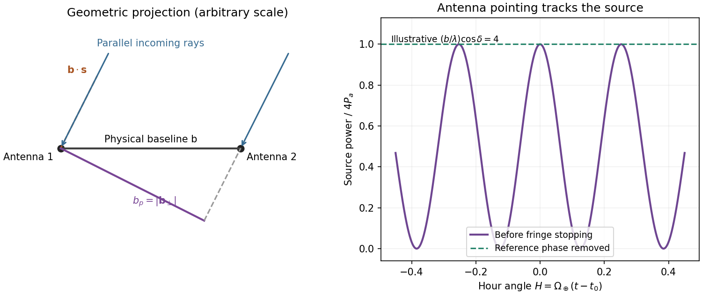
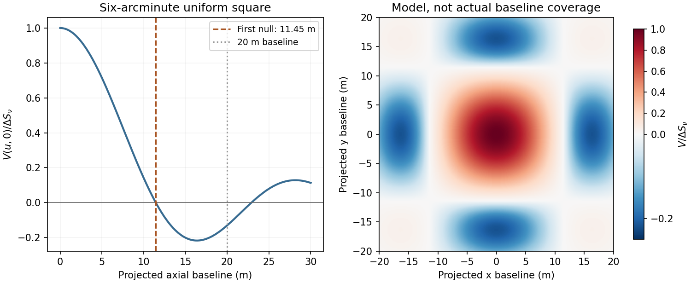

<h1 id="1/solution">Solution</h1>

↑ **Parent:** [1](../1.md)

Choose the baseline vector from the first [antenna](../../../../antenna-radio.md) to the second. Apart from a sign convention for receiver delay, the [geometric delay](../../../../geometric-delay.md) is $\tau_g=\mathbf b\cdot\mathbf s/c$, and the phase difference is $\phi=2\pi\nu\tau_g$. For equal received source powers $P_a$, adding the voltages and averaging over many wave periods gives

$$
P(t)=2P_a\{1+\cos[2\pi\nu\tau_g(t)+\phi_0]\}.
$$

Uncorrelated receiver noise adds a mean level but not the source's coherent cross term. For an east-west baseline and one choice of hour-angle sign, $\tau_g=(b/c)\cos\delta\sin H(t)$. Earth rotation therefore sweeps the phase; locally the fringe [frequency](../../../../frequency.md) is $(b/\lambda)\cos\delta\cos H\,\dot H$. Tracking the [antenna](../../../../antenna-radio.md) pointing keeps the source in the [primary beam](../../../../primary-beam.md). Electronic [fringe stopping](../../../../fringe-stopping.md) is a separate operation: it can remove this phase evolution, making a source at the [phase centre](../../../../phase-centre.md) constant in the corrected [complex visibility](../../../../complex-visibility.md). The oscillating power above is the geometrical fringe before that correction.

**[Figure 1](#1/image-projected-interferometer-baseline-geometric-delay-and-illustrative-fringes-before-electronic-fringe-stopping). Projected interferometer baseline, geometric delay and illustrative fringes before electronic fringe stopping**.

For a small angular displacement $d\theta$ along the projected baseline, $d\phi=2\pi b_p\,d\theta/\lambda$. One full fringe therefore spans **$\Delta\theta\sim\lambda/b_p$**. Here $b_p=|\mathbf b-(\mathbf b\cdot\mathbf s)\mathbf s|$. This is the angular period of the measured Fourier component and the characteristic resolution scale when such long baselines are synthesized; precise beam width and image ambiguity also depend on baseline coverage and weighting. A single pair by itself does not give an unambiguous complete image.

Writing $x=h\nu/(k_BT)$, the expansion $e^x-1=x+O(x^2)$ immediately gives the [Rayleigh-Jeans law](../../../../rayleigh-jeans-law.md),

$$
\boxed{B_\nu\simeq\frac{2k_BT\nu^2}{c^2}\quad(h\nu\ll k_BT).}
$$

The factor two counts the two independent modes of [polarization of waves](../../../../polarization-waves.md). A small brightness-temperature perturbation thus has $\Delta I_\nu=2k_B\nu^2\Delta T_{\rm RJ}/c^2$ in this limit.

Hot intracluster [electrons](../../../../electron.md) inverse-Compton scatter the microwave-background [photons](../../../../photon.md). The scattering [optical depth](../../../../optical-depth.md) is $d\tau=n_e\sigma_T\,dl$ and the characteristic thermal fractional energy transfer is of order $k_BT_e/(m_ec^2)$. The integrated distortion is therefore controlled by

$$
y=\int\frac{k_BT_e}{m_ec^2}n_e\sigma_T\,dl.
$$

Scattering conserves [photon number](../../../../photon-number.md) while shifting [photons](../../../../photon.md) toward higher [frequencies](../../../../frequency.md), giving a low-frequency decrement and a high-frequency increment. Thus the printed estimate correctly gives a negative change of order $yT_{\rm CMB}$. Its numerical coefficient, however, is not the standard Rayleigh-Jeans coefficient. For nonrelativistic [electrons](../../../../electron.md) and small $y$, the [Kompaneets equation](../../../../kompaneets-equation.md) gives $\Delta n=y x^{-2}\partial_x(x^4\partial_x n_0)$. At small $x$, $n_0\simeq1/x$, so $\Delta n\simeq-2y/x$ and

$$
\boxed{\frac{\Delta T_{\rm RJ}}{T_{\rm CMB}}\simeq-2y.}
$$

Equivalently the thermodynamic-temperature spectral factor is $x\coth(x/2)-4\to-2$. The original PDF really prints the estimate with $-y$, not $-2y$; both numerical conventions are retained below. Relativistic corrections at the supplied $T_e$ are small compared with this factor-of-two difference.[abstract and Rayleigh-Jeans limit: the leading coefficient is minus twice the conventional Compton y parameter](../../../../relativistic-corrections-to-the-sunyaev-zel-dovich-effect-by-a-d-challinor-and-a-n-lasenby.md)

The uniform cube has a constant line-of-sight depth $L=6\times10^{22}\,\mathrm m$. Using the supplied cross-section rather than replacing it with a more precise value gives

$$
\tau=n_e\sigma_TL=8.04\times10^{-4},\qquad \frac{k_BT_e}{m_ec^2}=1.01\times10^{-2},\qquad y=8.14\times10^{-6}.
$$

Adopt $T_{\rm CMB}=2.72548\,\mathrm K$, explicitly an external measured constant, not a [temperature](../../../../temperature-split.md) supplied in the question. The values $k_B=1.380649\times10^{-23}\,\mathrm{J\,K^{-1}}$, $c=299792458\,\mathrm{m\,s^{-1}}$ and $m_e\simeq9.10938\times10^{-31}\,\mathrm{kg}$ set the physical units. Hence **the printed relation gives $\Delta T\simeq-22\,\mathrm{\mu K}$; the standard Rayleigh-Jeans result gives $\Delta T\simeq-44\,\mathrm{\mu K}$**. Keeping the answer as $-8.14\times10^{-6}T_{\rm CMB}$, or twice that, avoids needing a numerical background [temperature](../../../../temperature-split.md).[abstract, literature-combined temperature $2.72548\pm0.00057$ K; adopted value rounded only at the end](../../../../the-temperature-of-the-cosmic-microwave-background-by-dale-j-fixsen.md)

The face is a square, so its [solid angle](../../../../solid-angle.md) is $\Omega=(6\pi/10800)^2=3.046\times10^{-6}\,\mathrm{sr}$, not the area of a circular six-arcminute aperture. At $15\,\mathrm{GHz}$,

$$
\Delta S_\nu=\int\Delta I_\nu\,d\Omega\simeq\frac{2k_B\nu^2}{c^2}\Delta T\,\Omega.
$$

Thus **$\Delta S_\nu\simeq-4.67\times10^{-4}\,\mathrm{Jy}=-0.47\,\mathrm{mJy}$ using the printed estimate**, or **$-0.93\,\mathrm{mJy}$ using the standard factor two**. The sign denotes missing brightness relative to the surrounding microwave background. At this [frequency](../../../../frequency.md) $h\nu/(k_BT_{\rm CMB})\simeq0.264$; the exact nonrelativistic spectral intensity differs from the strict Rayleigh-Jeans approximation by about one percent. This precision does not affect the estimates.

For the array noise, the [system temperature](../../../../system-temperature.md) sets the receiver noise scale; let $A_e=\eta_A\pi d^2/4$ be the effective area of each dish, and let $\eta_c$ describe correlation losses. No efficiencies or [polarization of waves](../../../../polarization-waves.md) count are supplied, so first take $\eta_A=\eta_c=1$ and a single independent [polarization of waves](../../../../polarization-waves.md). An unpolarized [point source](../../../../point-source.md) produces [antenna](../../../../antenna-radio.md) [temperature](../../../../temperature-split.md) $T_a=S_\nu A_e/(2k_B)$, and the [system-equivalent flux density](../../../../system-equivalent-flux-density.md) is $\mathrm{SEFD}=2k_BT_{\rm sys}/A_e$. The [interferometric radiometer equation](../../../../interferometric-radiometer-equation.md) gives one baseline an rms flux error $\mathrm{SEFD}/\sqrt{2\Delta\nu t}$. There are $N(N-1)/2=45$ cross-correlation baselines; averaging their independent [thermal noise](../../../../thermal-noise.md) for a [point source](../../../../point-source.md) gives

$$
\sigma_S=\frac{2k_BT_{\rm sys}}{A_e\eta_c\sqrt{n_{\rm pol}N(N-1)\Delta\nu t}}.
$$

The ideal single-dish effective area is $4\pi\,\mathrm{m^2}$, giving $\mathrm{SEFD}=6.59\times10^3\,\mathrm{Jy}$ and

$$
\boxed{\sigma_S\simeq9.0\times10^{-6}\,\mathrm{Jy}=9.0\,\mathrm{\mu Jy}\quad(n_{\rm pol}=1).}
$$

Combining two independent parallel-hand [polarization of waves](../../../../polarization-waves.md) measurements gives $6.3\,\mathrm{\mu Jy}$. Nonunit efficiencies increase these estimates by $1/(\eta_A\eta_c)$. Here signal equal to noise means a weak-source [signal-to-noise ratio](../../../../signal-to-noise-ratio.md) of one after integration; it does not mean equating the source to the entire unaveraged receiver-noise power.[2004 Synthesis Imaging Summer School, slides 6–12 and 20: SEFD, independent baseline noise and single-polarization synthesis-image sensitivity](../../../../sensitivity-by-joan-wrobel.md)

At the band centre, $\lambda=0.01999\,\mathrm m$. Taking a representative maximum projected baseline of $20\,\mathrm m$ gives **$\theta_{\rm res}\sim3.4$ arcminutes**. A corner-to-corner baseline of $20\sqrt2\,\mathrm m$ would give about $2.4$ arcminutes before projection and weighting. The exact [antenna](../../../../antenna-radio.md) locations and source declination are not supplied, so neither a unique [synthesized beam](../../../../synthesized-beam.md) shape nor an exact FWHM is determined. The individual-dish primary-beam scale, roughly $\lambda/4\,\mathrm m\sim17$ arcminutes, is the field of view, not the synthesized resolution.

To extract the cluster signal, retain frequency-resolved [complex visibilities](../../../../complex-visibility.md) and fit an extended SZ template together with contaminating compact sources. For the ideal uniform square centred at the [phase centre](../../../../phase-centre.md) and with a nearly constant [primary beam](../../../../primary-beam.md) across it, the [Fourier transform](../../../../fourier-transform-split.md) is

$$
V(u,v)=\Delta S_\nu\,\operatorname{sinc}(\pi\Theta u)\operatorname{sinc}(\pi\Theta v),\qquad \operatorname{sinc}x=\frac{\sin x}{x},\qquad\Theta=6\ \text{arcminutes in radians}.
$$

This is why the integrated decrement must not be treated as a point-source flux on every baseline. The first axial visibility null occurs at $b=\lambda/\Theta\simeq11.5\,\mathrm m$. Short baselines carry most of the large-scale decrement; the longest baselines are useful for separating unresolved positive radio sources. [natural visibility weighting](../../../../natural-visibility-weighting.md) or a suitable taper gives a clearer extended-source image than emphasizing the longest baselines, while a [visibility-domain matched filter](../../../../visibility-domain-matched-filter.md) uses all samples with weights proportional to template amplitude divided by noise [variance](../../../../variance-split.md). Its amplitude estimate is $\widehat a=\operatorname{Re}(T^\dagger C^{-1}d)/(T^\dagger C^{-1}T)$ for a real template amplitude. A joint fit propagates radio-source uncertainty instead of subtracting exact, noise-free source models.

**[Figure 2](#1/image-normalized-visibilities-of-the-six-arcminute-square-cluster-and-their-suppression-on-long-baselines). Normalized visibilities of the six-arcminute square cluster and their suppression on long baselines**.

Earth-rotation and multifrequency synthesis improve Fourier coverage, but each channel must use its own baseline in [wavelengths](../../../../wavelength.md), [primary beam](../../../../primary-beam.md) and SZ spectrum. Use the longer baselines and spectra to identify variable [point sources](../../../../point-source.md), flag bad data, and test the decrement with time, [antenna](../../../../antenna-radio.md) and [frequency](../../../../frequency.md) splits. Primary-beam and absolute-flux [calibration](../../../../calibration-differential-geometry.md) must be included. Large-scale microwave-background fluctuations and residual ground or atmospheric signals can remain even below the thermal-noise estimate. The narrow low-frequency band alone gives limited separation of SZ and primary microwave-background [temperature](../../../../temperature-split.md) structure. There is no zero-spacing interferometric datum: integrated flux is model dependent unless sufficiently short baselines or additional total-power information are available. Exact cluster detection significance cannot be obtained from the point-source noise alone without the actual projected baseline distribution and weighting.

## ↑ Ancestors (13)

1. [1](../1.md)
2. [Paper 1](../../paper-1-split.md)
3. [2016](../../split.md)
4. [Past exam of the frontiers of Observational Astrophysics course of the University of Cambridge](../../../split.md)
5. [Frontiers of Observational Astrophysics course of the University of Cambridge](../../../../frontiers-of-observational-astrophysics-course-of-the-university-of-cambridge.md)
6. [Physics course of the year 4 of the natural sciences course of the University of Cambridge](../../../../physics-course-of-the-year-4-of-the-natural-sciences-course-of-the-university-of-cambridge.md)
7. [Year 4 of the natural sciences course of the University of Cambridge](../../../../year-4-of-the-natural-sciences-course-of-the-university-of-cambridge.md)
8. [Year of the natural sciences course of the University of Cambridge](../../../../year-of-the-natural-sciences-course-of-the-university-of-cambridge.md)
9. [Natural sciences course of the University of Cambridge](../../../../natural-sciences-course-of-the-university-of-cambridge.md)
10. [Course of the University of Cambridge](../../../../course-of-the-university-of-cambridge.md)
11. [University of Cambridge](../../../../university-of-cambridge-split.md)
12. [List of universities](../../../../list-of-universities.md)
13. [Codex Wiki](../../../../split.md)
