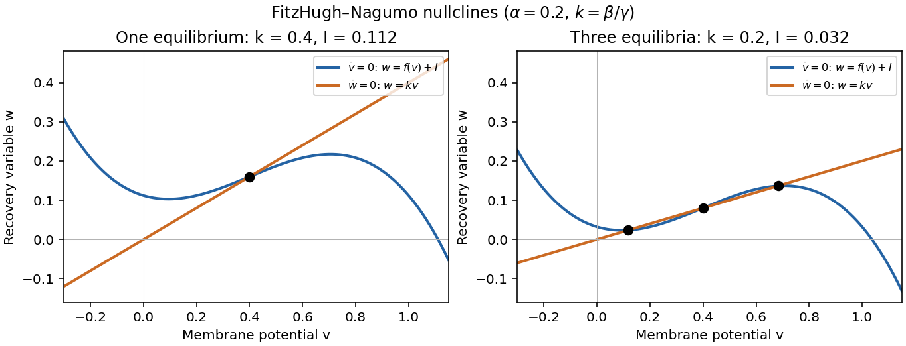
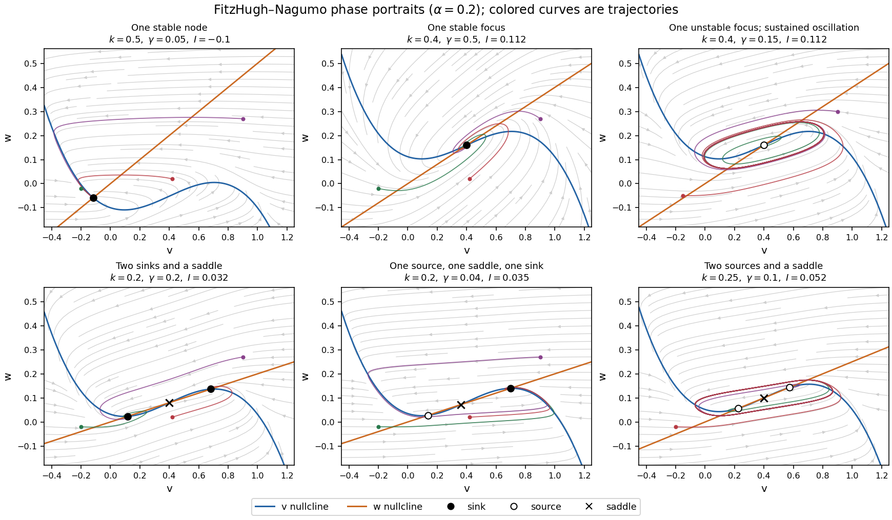
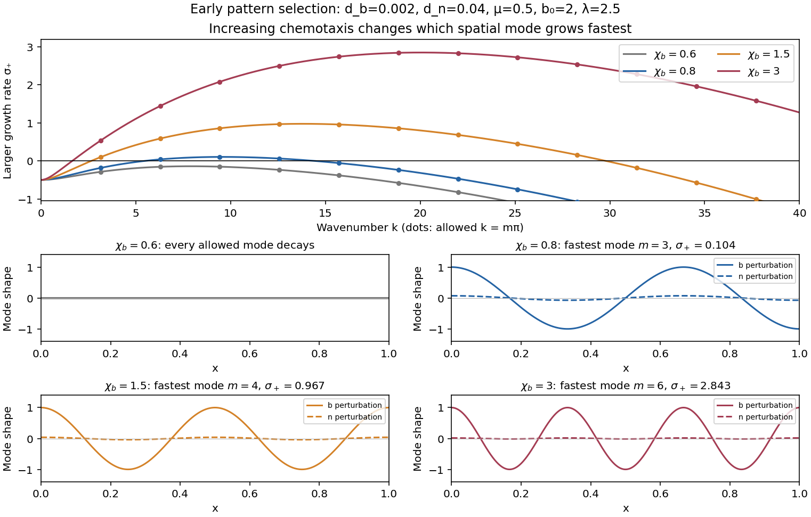

# 2023

↑ **Parent:** [Past exam of the further mathematical biology course of the University of Oxford](../past-exam-of-the-further-mathematical-biology-course-of-the-university-of-oxford.md)

**Table of contents**

- [1](#1)
  - [a](#1/a)
    - [Solution](#1/a/solution)
  - [b](#1/b)
    - [Solution](#1/b/solution)
  - [c](#1/c)
    - [Solution](#1/c/solution)
  - [d](#1/d)
    - [Solution](#1/d/solution)
- [2](#2)
  - [a](#2/a)
    - [i](#2/a/i)
      - [Solution](#2/a/i/solution)
    - [ii](#2/a/ii)
      - [Solution](#2/a/ii/solution)
  - [b](#2/b)
    - [Solution](#2/b/solution)
- [3](#3)
  - [a](#3/a)
    - [Solution](#3/a/solution)
  - [b](#3/b)
    - [Solution](#3/b/solution)
  - [c](#3/c)
    - [Solution](#3/c/solution)
  - [d](#3/d)
    - [Solution](#3/d/solution)

## 1

↑ **Parent:** [2023](2023.md)

<h3 id="1/a">a</h3>

↑ **Parent:** [1](#1)

<h4 id="1/a/solution">Solution</h4>

↑ **Parent:** [A](#1/a)

The quantities $n_i(\tau,t)$ are [cell-cycle age densities](../mathematical-biology.md#cell-cycle-age-density): $n_i(\tau,t)\,d\tau$ counts [biological cells](../biological-cell.md) whose time since entering phase $i$ lies in $[\tau,\tau+d\tau]$. Here $\tau$ is time spent in the current phase, rather than time since birth. In this two-stage approximation to the [cell cycle](../cell-cycle.md), a [biological cell](../biological-cell.md) passes from [G1 phase](../cell-cycle.md#g1-phase) to [G2 phase](../cell-cycle.md#g2-phase), then completes [cell division](../biological-cell.md#cell-division) and produces two daughters entering [G1 phase](../cell-cycle.md#g1-phase).

The time [derivative](../calculus.md#derivative) measures change at fixed phase age. The age [derivative](../calculus.md#derivative) transports [biological cells](../biological-cell.md) towards larger $\tau$ at unit speed, because $d\tau/dt=1$. Thus each equation is an [age-structured population equation](../mathematical-biology.md#age-structured-population-equation). The nonnegative [hazard function](../survival-analysis.md#hazard-function) $\Gamma_i(\tau)$ means that, conditional on still being in phase $i$ at age $\tau$, the probability of leaving during the next $dt$ is $\Gamma_i(\tau)dt+o(dt)$. Its product with $n_i$ is the loss from that phase-age class; it is not an additional death term.

The [boundary condition](../differential-equation.md#boundary-condition) at $\tau=0$ specifies the incoming [flux](../mathematical-physics.md#flux). Every [G1 phase](../cell-cycle.md#g1-phase) exit contributes one entrant to [G2 phase](../cell-cycle.md#g2-phase), whereas every [G2 phase](../cell-cycle.md#g2-phase) exit contributes two entrants to [G1 phase](../cell-cycle.md#g1-phase). The [initial conditions](../differential-equation.md#initial-condition) specify the phase-age composition at $t=0$. Consequently [integration](../integral.md) over phase age gives the useful population balance

$$
\boxed{\frac{d}{dt}(N_1+N_2)=\int_0^\infty\Gamma_2(\tau)n_2(\tau,t)\,d\tau.}
$$

Each completed [cell division](../biological-cell.md#cell-division) increases the total number of [biological cells](../biological-cell.md) by one.

<h3 id="1/b">b</h3>

↑ **Parent:** [1](#1)

<h4 id="1/b/solution">Solution</h4>

↑ **Parent:** [B](#1/b)

The unit integrals of the profiles make $N_i(t)=\int_0^\infty n_i(\tau,t)\,d\tau$ the phase populations, and $f_i$ their normalized [cell-cycle age densities](../mathematical-biology.md#cell-cycle-age-density). Assume the age tails vanish and the following integrals are finite. For a fixed profile define its mean exit [hazard function](../survival-analysis.md#hazard-function) by

$$
\boxed{\Lambda_i=\int_0^\infty\Gamma_i(\tau)f_i(\tau)\,d\tau,\qquad i=1,2.}
$$

These constants have units of inverse time. Integrating the [age-structured population equations](../mathematical-biology.md#age-structured-population-equation) and using the [boundary conditions](../differential-equation.md#boundary-condition) gives

$$
\begin{aligned}
N_1'&=-[n_1(\tau,t)]_0^\infty-\int_0^\infty\Gamma_1n_1\,d\tau
=n_1(0,t)-\Lambda_1N_1,\\
N_2'&=-[n_2(\tau,t)]_0^\infty-\int_0^\infty\Gamma_2n_2\,d\tau
=n_2(0,t)-\Lambda_2N_2.
\end{aligned}
$$

The incoming [fluxes](../mathematical-physics.md#flux) are $n_1(0,t)=2\Lambda_2N_2$ and $n_2(0,t)=\Lambda_1N_1$, so

$$
\boxed{\frac{d}{dt}\begin{pmatrix}N_1\\N_2\end{pmatrix}
=\begin{pmatrix}-\Lambda_1&2\Lambda_2\\\Lambda_1&-\Lambda_2\end{pmatrix}
\begin{pmatrix}N_1\\N_2\end{pmatrix}.}
$$

The [separable-profile closure for an age-structured population](../mathematical-biology.md#separable-profile-closure-for-an-age-structured-population) has a qualification: arbitrary age-dependent [hazard functions](../survival-analysis.md#hazard-function) do not give this constant-coefficient [ordinary differential equation](../differential-equation.md#ordinary-differential-equation) for arbitrary [initial conditions](../differential-equation.md#initial-condition). Without fixed $f_i$, the effective exit rates are $\int\Gamma_i n_i\,d\tau/N_i$ and can vary with time. Moreover, an exact positive [separation of variables](../partial-differential-equation.md#separation-of-variables) with both profiles fixed forces $N_2/N_1$ to be constant through the incoming [fluxes](../mathematical-physics.md#flux), hence selects a common exponential mode. The displayed [ordinary differential equation](../differential-equation.md#ordinary-differential-equation) is the necessary integrated system for such profiles; it is also exact for arbitrary populations when both [hazard functions](../survival-analysis.md#hazard-function) are age independent.

<h3 id="1/c">c</h3>

↑ **Parent:** [1](#1)

<h4 id="1/c/solution">Solution</h4>

↑ **Parent:** [C](#1/c)

Write $A$ for the population [matrix](../vector-space.md#matrix) and assume $\Lambda_1,\Lambda_2>0$. Its [characteristic polynomial](../linear-operator-theory.md#characteristic-polynomial) is

$$
\det(sI-A)=(s+\Lambda_1)(s+\Lambda_2)-2\Lambda_1\Lambda_2
=s^2+(\Lambda_1+\Lambda_2)s-\Lambda_1\Lambda_2.
$$

The two [eigenvalues](../linear-operator-theory.md#eigenvalue) have opposite signs. The [dominant eigenvalue](../linear-operator-theory.md#dominant-eigenvalue) is

$$
\boxed{\mu=\frac{\sqrt{\Lambda_1^2+6\Lambda_1\Lambda_2+\Lambda_2^2}-\Lambda_1-\Lambda_2}{2}>0,}
$$

and the other [eigenvalue](../linear-operator-theory.md#eigenvalue) is $\nu=-(\Lambda_1+\Lambda_2)-\mu<0$. A positive [eigenvector](../linear-operator-theory.md#eigenvector) for $\mu$ satisfies

$$
\boxed{\frac{N_2}{N_1}\longrightarrow\frac{\Lambda_1}{\mu+\Lambda_2}
=\frac{\mu+\Lambda_1}{2\Lambda_2}.}
$$

For any nonzero nonnegative population vector in this constant-coefficient system, the coefficient of the positive [eigenvector](../linear-operator-theory.md#eigenvector) is positive: a positive left [eigenvector](../linear-operator-theory.md#eigenvector) annihilates the other [eigenvector](../linear-operator-theory.md#eigenvector) and has positive pairing with that population vector. Thus $N_i(t)=C_i e^{\mu t}+O(e^{\nu t})$, with $C_i>0$, and $N_i'/N_i\to\mu$. The long-time leading term therefore obeys $N_i'=\mu N_i$.

Substituting that exponential mode into the [age-structured population equation](../mathematical-biology.md#age-structured-population-equation) gives

$$
f_i'(\tau)=-[\mu+\Gamma_i(\tau)]f_i(\tau).
$$

Define the phase-residence [survival function](../survival-analysis.md#survival-function) and its discounted integral by

$$
S_i(\tau)=\exp\left[-\int_0^\tau\Gamma_i(a)\,da\right],\qquad
Z_i(\mu)=\int_0^\infty e^{-\mu a}S_i(a)\,da.
$$

Then the normalized [cell-cycle age densities](../mathematical-biology.md#cell-cycle-age-density) are

$$
\boxed{f_i(\tau)=\frac{e^{-\mu\tau}S_i(\tau)}{Z_i(\mu)},\qquad i=1,2.}
$$

Since [integration](../integral.md) of $f_i'=-(\mu+\Gamma_i)f_i$ gives $f_i(0)=\mu+\Lambda_i$, this is equivalently

$$
\boxed{f_i(\tau)=(\mu+\Lambda_i)\exp\left[-\mu\tau-\int_0^\tau\Gamma_i(a)\,da\right].}
$$

The constants must be consistent with both incoming [fluxes](../mathematical-physics.md#flux). Put

$$
H_i(\mu)=\int_0^\infty\Gamma_i(a)e^{-\mu a}S_i(a)\,da
=1-\mu Z_i(\mu).
$$

The [boundary conditions](../differential-equation.md#boundary-condition) for amplitudes $n_i=e^{\mu t}\phi_i$ give $\phi_1(0)=2H_2\phi_2(0)$ and $\phi_2(0)=H_1\phi_1(0)$. Hence the [Two-stage Euler-Lotka equation](../mathematical-biology.md#two-stage-euler-lotka-equation) is

$$
\boxed{2H_1(\mu)H_2(\mu)=1.}
$$

It determines $\mu$ directly from the [hazard functions](../survival-analysis.md#hazard-function); the formula in terms of $\Lambda_i$ is not permission to choose those constants independently of the profiles. If each phase is eventually left with probability one, $H_i(0)=1$ and $H_i(\mu)$ decreases to zero, giving a unique positive root under the usual finite, non-instantaneous residence-time assumptions. More generally positive growth requires $2H_1(0)H_2(0)>1$. Nonnegative [hazard functions](../survival-analysis.md#hazard-function) alone do not ensure it: if one phase has zero exit [hazard function](../survival-analysis.md#hazard-function), growth cannot have the asserted positive exponent. Convergence of the complete age distribution to these profiles needs the usual mixing assumptions on phase-residence times; the two-dimensional [eigenvalue](../linear-operator-theory.md#eigenvalue) calculation establishes the long-time claim for the fixed-profile system.

<h3 id="1/d">d</h3>

↑ **Parent:** [1](#1)

<h4 id="1/d/solution">Solution</h4>

↑ **Parent:** [D](#1/d)

Because the [hazard functions](../survival-analysis.md#hazard-function) are constant, normalization gives $\Lambda_1=2\alpha$ and $\Lambda_2=3\alpha$. The population [characteristic polynomial](../linear-operator-theory.md#characteristic-polynomial) factors as

$$
s^2+5\alpha s-6\alpha^2=(s-\alpha)(s+6\alpha).
$$

Thus

$$
\boxed{\mu=\alpha,\qquad f_1(\tau)=3\alpha e^{-3\alpha\tau},\qquad f_2(\tau)=4\alpha e^{-4\alpha\tau}.}
$$

These [exponential distributions](../continuous-probability-distribution.md#exponential-distribution) describe ages among currently present [biological cells](../biological-cell.md). Their rates differ from the phase-exit rates because [exponential growth](../calculus.md#exponential-growth) overrepresents younger entrants. The stable phase ratio is $N_2/N_1=1/2$, so the [G1 phase](../cell-cycle.md#g1-phase) and [G2 phase](../cell-cycle.md#g2-phase) fractions approach $2/3$ and $1/3$.

Increasing $\alpha$ rescales all times by $1/\alpha$: the population undergoes faster [exponential growth](../calculus.md#exponential-growth), its [doubling time](../calculus.md#doubling-time) is $\boxed{(\log2)/\alpha}$, and the profile [means](../expected-value.md) $1/(3\alpha)$ and $1/(4\alpha)$ decrease. The phase fractions do not depend on $\alpha$. The population [matrix](../vector-space.md#matrix) has exact solution

$$
\begin{pmatrix}N_1\\N_2\end{pmatrix}
=C e^{\alpha t}\begin{pmatrix}2\\1\end{pmatrix}
+E e^{-6\alpha t}\begin{pmatrix}-3\\2\end{pmatrix},
$$

so population-ratio transients decay relative to the growing term at rate $7\alpha$. This exact population formula does not require initially stationary [cell-cycle age densities](../mathematical-biology.md#cell-cycle-age-density).

## 2

↑ **Parent:** [2023](2023.md)

<h3 id="2/a">a</h3>

↑ **Parent:** [2](#2)

<h4 id="2/a/i">i</h4>

↑ **Parent:** [A](#2/a)

<h5 id="2/a/i/solution">Solution</h5>

↑ **Parent:** [I](#2/a/i)

Put $k=\beta/\gamma$. The [nullclines](../dynamical-systems.md#nullcline) of the space-clamped [FitzHugh-Nagumo model](../mathematical-biology.md#fitzhugh-nagumo-model) are

$$
\dot v=0:\quad w=f(v)+I,\qquad
\dot w=0:\quad w=kv.
$$

The first [nullcline](../dynamical-systems.md#nullcline) is a downward-leading [cubic polynomial](../polynomial.md#cubic-polynomial), shifted vertically by $I$; the second [nullcline](../dynamical-systems.md#nullcline) is a line through the origin with slope $k>0$. Their intersections satisfy

$$
I=h(v),\qquad h(v)=kv-f(v)=v^3-(1+\alpha)v^2+(\alpha+k)v.
$$

Writing $M=(1-\alpha+\alpha^2)/3$, differentiation gives

$$
f'(v)=-3\left(v-\frac{1+\alpha}{3}\right)^2+M,\qquad h'(v)=k-f'(v).
$$

If $k>M$, $h$ increases strictly, so there is exactly one [equilibrium](../dynamical-systems.md#equilibrium-point-of-a-dynamical-system). If $k=M$, $h$ is still strictly increasing, although its [derivative](../calculus.md#derivative) vanishes at one point, so the [equilibrium](../dynamical-systems.md#equilibrium-point-of-a-dynamical-system) is again unique. If $0<k<M$, define

$$
u_\pm=\frac{1+\alpha\pm\sqrt{1-\alpha+\alpha^2-3k}}3,\qquad
I_{\rm low}=h(u_+),\quad I_{\rm high}=h(u_-).
$$

Here $h$ has a local maximum at $u_-$ and a local minimum at $u_+$; therefore

$$
\boxed{\begin{array}{ll}
I_{\rm low}<I<I_{\rm high}:&\text{three distinct equilibria},\\
I<I_{\rm low}\ \text{or}\ I>I_{\rm high}:&\text{one equilibrium}.
\end{array}}
$$

At either endpoint there are two distinct [equilibria](../dynamical-systems.md#equilibrium-point-of-a-dynamical-system), one a double root. These are the [saddle-node bifurcation](../bifurcation-theory.md#saddle-node-bifurcation) boundaries omitted by the generic one-or-three wording. At $k=M$ and $I=h((1+\alpha)/3)$ there is one triple root. This is the [Cubic FitzHugh-Nagumo nullcline criterion](../mathematical-biology.md#cubic-fitzhugh-nagumo-nullcline-criterion).

**[Figure 1](#2/a/i/image-one-and-three-intersections-of-the-fitzhugh-nagumo-model-nullclines). One and three intersections of the FitzHugh-Nagumo model nullclines**.

<h4 id="2/a/ii">ii</h4>

↑ **Parent:** [A](#2/a)

<h5 id="2/a/ii/solution">Solution</h5>

↑ **Parent:** [Ii](#2/a/ii)

At an [equilibrium](../dynamical-systems.md#equilibrium-point-of-a-dynamical-system) $(v_*,kv_*)$, set $p=f'(v_*)$. The [Jacobian matrix](../multivariable-calculus.md#jacobian-matrix), its [trace](../linear-algebra.md#matrix-trace) and its [determinant](../multilinear-algebra.md#determinant) are

$$
J_* =\begin{pmatrix}p&-1\\\beta&-\gamma\end{pmatrix},\qquad
T=p-\gamma,\qquad \Delta=\beta-\gamma p=\gamma(k-p).
$$

The [eigenvalues](../linear-operator-theory.md#eigenvalue) and their [discriminant](../polynomial.md#discriminant) are

$$
s_\pm=\frac{p-\gamma\pm\sqrt{(p+\gamma)^2-4\beta}}2,\qquad
\mathcal D=(p+\gamma)^2-4\beta.
$$

Thus the complete local [linear stability](../dynamical-systems.md#linear-stability) test is

$$
\boxed{\begin{array}{ll}
p>k:&\text{saddle},\\
p<k,\ p<\gamma:&\text{asymptotically stable},\\
\gamma<p<k:&\text{unstable}.
\end{array}}
$$

In the last two cases, $\mathcal D>0$ gives a [node](../dynamical-systems.md#node-dynamical-systems), while $\mathcal D<0$ gives a [focus](../dynamical-systems.md#focus-dynamical-systems); the sign of $T$ distinguishes inward and outward trajectories. At $\mathcal D=0$, a nonzero repeated [eigenvalue](../linear-operator-theory.md#eigenvalue) gives a degenerate [node](../dynamical-systems.md#node-dynamical-systems). At $p=\gamma<k$ the [eigenvalues](../linear-operator-theory.md#eigenvalue) are purely imaginary, so [linear stability analysis](../dynamical-systems.md#linear-stability) alone does not decide [asymptotic stability](../dynamical-systems.md#asymptotic-stability); with the required crossing and nondegeneracy this is a [Hopf bifurcation](../bifurcation-theory.md#hopf-bifurcation). At $p=k$ there is a zero [eigenvalue](../linear-operator-theory.md#eigenvalue), requiring a nonlinear test and generically marking the [saddle-node bifurcation](../bifurcation-theory.md#saddle-node-bifurcation) in the preceding answer.

For a unique simple [equilibrium](../dynamical-systems.md#equilibrium-point-of-a-dynamical-system), $p<k$, so it can be a [sink equilibrium](../dynamical-systems.md#sink-equilibrium) or a [source equilibrium](../dynamical-systems.md#source-equilibrium). The number of [equilibria](../dynamical-systems.md#equilibrium-point-of-a-dynamical-system) alone does not decide [stability](../numerical-analysis.md#stability-of-a-numerical-method). If $k\le\gamma$, the unique simple [equilibrium](../dynamical-systems.md#equilibrium-point-of-a-dynamical-system) is always a [sink equilibrium](../dynamical-systems.md#sink-equilibrium). If $\gamma<k$, it can become a [source equilibrium](../dynamical-systems.md#source-equilibrium) where $\gamma<p<k$. The same conclusion follows particularly simply if $\gamma>M$: the [trace](../linear-algebra.md#matrix-trace) is negative at every nonsaddle [equilibrium](../dynamical-systems.md#equilibrium-point-of-a-dynamical-system).

For three simple [equilibria](../dynamical-systems.md#equilibrium-point-of-a-dynamical-system) ordered by their $v$ coordinates, the middle one has $p>k$ and is a [saddle equilibrium](../dynamical-systems.md#saddle-equilibrium); the two outer ones have $p<k$. When both outer [equilibria](../dynamical-systems.md#equilibrium-point-of-a-dynamical-system) are [sink equilibria](../dynamical-systems.md#sink-equilibrium), each has an attracting neighborhood, giving [bistability](../dynamical-systems.md#bistability). In the usual two-basin portrait, the [stable manifold](../dynamical-systems.md#stable-manifold) of the [saddle equilibrium](../dynamical-systems.md#saddle-equilibrium) separates their basins. Each branch of its [unstable manifold](../dynamical-systems.md#unstable-manifold) initially leaves towards a different side; its eventual destination requires a global argument. If $k\le\gamma$, both outer [equilibria](../dynamical-systems.md#equilibrium-point-of-a-dynamical-system) must be [sink equilibria](../dynamical-systems.md#sink-equilibrium). If $\gamma<k$, either or both outer [equilibria](../dynamical-systems.md#equilibrium-point-of-a-dynamical-system) can instead be [source equilibria](../dynamical-systems.md#source-equilibrium); the same test $p\lessgtr\gamma$ applies separately to each. The three lower panels illustrate all three possibilities up to exchanging left and right.

The arrows in the [phase plane](../dynamical-systems.md#phase-plane) follow directly from the [nullclines](../dynamical-systems.md#nullcline): below $w=f(v)+I$ the horizontal component points right, and above it left; below $w=kv$ the vertical component points up, and above it down. Near a [stable focus](../dynamical-systems.md#stable-spiral) trajectories spiral inward; near an unstable [focus](../dynamical-systems.md#focus-dynamical-systems) they spiral outward. Near a [saddle equilibrium](../dynamical-systems.md#saddle-equilibrium) they approach along its [stable manifold](../dynamical-systems.md#stable-manifold) and leave along its [unstable manifold](../dynamical-systems.md#unstable-manifold). These directions, together with the local tests, determine the sketches.

**[Figure 2](#2/a/ii/image-phase-portraits-of-the-fitzhugh-nagumo-model-with-one-or-three-equilibria-including-changes-of-linear-stability). Phase portraits of the FitzHugh-Nagumo model with one or three equilibria, including changes of linear stability**.

There is also a useful global conclusion when the unique [equilibrium](../dynamical-systems.md#equilibrium-point-of-a-dynamical-system) is a [source equilibrium](../dynamical-systems.md#source-equilibrium). With

$$
E(v,w)=\frac{\beta v^2+w^2}{2},\qquad
\dot E=\beta v f(v)+\beta Iv-\gamma w^2,
$$

the leading term in $v$ is $-\beta v^4$, so sufficiently large ellipses are [trapping regions](../dynamical-systems.md#trapping-region). A small repelling neighborhood of the hyperbolic [source equilibrium](../dynamical-systems.md#source-equilibrium) can be removed to form an invariant annulus. The [Poincaré-Bendixson theorem](../dynamical-systems.md#poincare-bendixson-theorem) then guarantees at least one [periodic orbit](../dynamical-systems.md#periodic-orbit) in that annulus. The numerical sketch illustrates the resulting sustained oscillation; this argument does not assert uniqueness of a [limit cycle](../dynamical-systems.md#limit-cycle). A stable [equilibrium](../dynamical-systems.md#equilibrium-point-of-a-dynamical-system) can instead represent a resting [membrane potential](../membrane-potential.md), with perturbations producing damped relaxation; near a threshold, a sufficiently large perturbation can produce a large excursion before recovery. Global basin boundaries and coexistence of [periodic orbits](../dynamical-systems.md#periodic-orbit) need more information than the number and local [stability](../numerical-analysis.md#stability-of-a-numerical-method) of [equilibria](../dynamical-systems.md#equilibrium-point-of-a-dynamical-system).

<h3 id="2/b">b</h3>

↑ **Parent:** [2](#2)

<h4 id="2/b/solution">Solution</h4>

↑ **Parent:** [B](#2/b)

There is a consistency issue in the printed model. If $w\equiv w_0$ is imposed while retaining its evolution equation, then $0=\beta v-\gamma w_0$ forces $v\equiv\gamma w_0/\beta$. Thus the full two-equation system has no nonconstant [travelling wave](../analysis.md#travelling-wave) with exactly constant $w$. Its constant solution exists only when $I=w_0-f(\gamma w_0/\beta)$. The intended wave calculation must treat the [recovery variable](../mathematical-biology.md#recovery-variable) as externally frozen, leaving the scalar [reaction-diffusion equation](../diffusion-equation.md#reaction-diffusion-system)

$$
v_t=Dv_{xx}+g(v),\qquad g(v)=f(v)+I-w_0.
$$

For this frozen-recovery reduction, let

$$
a_\pm=\frac{1+\alpha\pm\sqrt{1-\alpha+\alpha^2}}3.
$$

The [cubic polynomial](../polynomial.md#cubic-polynomial) $f$ has a local minimum at $a_-$ and a local maximum at $a_+$. Hence the condition

$$
\boxed{w_0-f(a_+)<I<w_0-f(a_-)}
$$

gives three distinct real roots $r_1<r_2<r_3$ of $g$, with

$$
g(v)=-(v-r_1)(v-r_2)(v-r_3).
$$

The outer roots are stable for the scalar spatially uniform dynamics and the middle root is unstable. Seek a [travelling wave](../analysis.md#travelling-wave) $v(x,t)=V(z)$, where $z=x-ct$. The [travelling-wave reduction of a reaction-diffusion system](../analysis.md#travelling-wave-reduction-of-a-reaction-diffusion-system) gives

$$
DV''+cV'-(V-r_1)(V-r_2)(V-r_3)=0.
$$

Let $\delta=r_3-r_1$ and choose

$$
V(z)=r_1+\frac{\delta}{1+\exp[\delta(z-z_0)/\sqrt{2D}]}.
$$

It has $V(-\infty)=r_3$, $V(+\infty)=r_1$ and

$$
V'=-\frac{(V-r_1)(r_3-V)}{\sqrt{2D}},\qquad
V''=\frac{(V-r_1)(r_3-V)(r_1+r_3-2V)}{2D}.
$$

Substitution leaves

$$
(V-r_1)(r_3-V)\left[\frac{r_1+r_3}{2}-r_2-\frac c{\sqrt{2D}}\right]=0.
$$

Consequently the [frozen-recovery cubic front](../mathematical-biology.md#frozen-recovery-cubic-front) is

$$
\boxed{v(x,t)=r_1+\frac{r_3-r_1}{1+\exp\left[\frac{r_3-r_1}{\sqrt{2D}}(x-ct-z_0)\right]},\qquad
c=\sqrt{\frac D2}(r_1+r_3-2r_2).}
$$

Reflection $x\mapsto-x$ reverses the [front](../analysis.md#front-solution) and its speed. A nonzero speed requires $r_2\ne(r_1+r_3)/2$; equality gives a stationary [front](../analysis.md#front-solution) and is the [Maxwell balance for a scalar reaction-diffusion front](../analysis.md#maxwell-balance-for-a-scalar-reaction-diffusion-front). Since the roots sum to $1+\alpha$, this stationary value is $I=w_0-f((1+\alpha)/3)$. For the simple admissible choice $I=w_0$, the roots are $0,\alpha,1$ and

$$
\boxed{V(z)=\frac1{1+e^{(z-z_0)/\sqrt{2D}}},\qquad c=\sqrt{\frac D2}(1-2\alpha).}
$$

This particular [front](../analysis.md#front-solution) moves when $\alpha\ne1/2$. At $\alpha=1/2$, other currents inside the displayed open interval give moving [fronts](../analysis.md#front-solution).

## 3

↑ **Parent:** [2023](2023.md)

<h3 id="3/a">a</h3>

↑ **Parent:** [3](#3)

<h4 id="3/a/solution">Solution</h4>

↑ **Parent:** [A](#3/a)

The [bacteria](../organism.md#bacteria) disperse by [diffusion](../thermodynamics.md#diffusion) with coefficient $D_B$. Their additional [chemotaxis](../mathematical-biology.md#chemotaxis) [flux](../mathematical-physics.md#flux) is

$$
J_{B,\mathrm{chem}}=\frac{\chi_B B}{(N_0+N)^2}N_X.
$$

It points up the [nutrient](../biology.md#nutrient) [concentration](../mathematical-physics.md#concentration) [gradient](../multivariable-calculus.md#gradient), and its negative spatial [derivative](../calculus.md#derivative) enters the balance equation. The positive $N_0$ prevents singular sensitivity at zero [nutrient](../biology.md#nutrient) [concentration](../mathematical-physics.md#concentration); increasing the background [nutrient](../biology.md#nutrient) [concentration](../mathematical-physics.md#concentration) reduces the drift response to a fixed [gradient](../multivariable-calculus.md#gradient). The [logistic growth equation](../mathematical-biology.md#logistic-growth-equation) term $rB(1-B/K)$ represents net reproduction with low-population growth rate $r$ and [carrying capacity](../mathematical-biology.md#carrying-capacity) $K$.

The [nutrient](../biology.md#nutrient) undergoes [diffusion](../thermodynamics.md#diffusion) with coefficient $D_N$. Its production term $aB^2/(B_0^2+B^2)$ is an increasing, bounded response to the [bacteria](../organism.md#bacteria), reaching half its maximum $a$ at $B=B_0$. It has the algebraic form of a [Hill equation](../protein.md#hill-equation) with exponent two; the equation alone does not specify a molecular mechanism. The term $dBN$ removes [nutrient](../biology.md#nutrient) at a rate proportional to both [bacteria](../organism.md#bacteria) abundance and [nutrient](../biology.md#nutrient) [concentration](../mathematical-physics.md#concentration).

The full [fluxes](../mathematical-physics.md#flux) are

$$
\boxed{J_B=-D_B B_X+\frac{\chi_BB}{(N_0+N)^2}N_X,\qquad J_N=-D_NN_X.}
$$

The homogeneous [Neumann boundary conditions](../differential-equation.md#neumann-boundary-condition) make both [fluxes](../mathematical-physics.md#flux) vanish at the endpoints, so neither [bacteria](../organism.md#bacteria) nor [nutrient](../biology.md#nutrient) crosses the boundaries. The [initial conditions](../differential-equation.md#initial-condition) specify their starting spatial distributions. This model includes [nutrient](../biology.md#nutrient) production by [bacteria](../organism.md#bacteria), rather than a separate external supply term.

<h3 id="3/b">b</h3>

↑ **Parent:** [3](#3)

<h4 id="3/b/solution">Solution</h4>

↑ **Parent:** [B](#3/b)

Use $K$ as the population scale, $N_0$ as the [nutrient](../biology.md#nutrient) [concentration](../mathematical-physics.md#concentration) scale, $r^{-1}$ as the time scale, and $L$ as the length scale. The [nondimensionalization](../mathematical-physics.md#nondimensionalization) is

$$
\boxed{B=Kb,\qquad N=N_0n,\qquad T=t/r,\qquad X=Lx.}
$$

For example, the [chemotaxis](../mathematical-biology.md#chemotaxis) term becomes

$$
-\chi_B\partial_X\left(\frac{B}{(N_0+N)^2}N_X\right)
=-\frac{\chi_BK}{N_0L^2}\partial_x\left(\frac b{(1+n)^2}n_x\right).
$$

Dividing the population equation by $rK$ and the [nutrient](../biology.md#nutrient) equation by $rN_0$ gives the requested system with the following six [dimensionless quantities](../physics.md#dimensionless-quantity):

$$
\boxed{d_b=\frac{D_B}{rL^2},\qquad d_n=\frac{D_N}{rL^2},\qquad
\chi_b=\frac{\chi_B}{rL^2N_0},\qquad
\lambda=\frac a{rN_0},\qquad b_0=\frac{B_0}{K},\qquad \mu=\frac{dK}{r}.}
$$

The rescaled domain is $0<x<1$, $t>0$. Its [boundary conditions](../differential-equation.md#boundary-condition) and [initial conditions](../differential-equation.md#initial-condition) are

$$
\boxed{b_x(0,t)=b_x(1,t)=n_x(0,t)=n_x(1,t)=0,}
$$

$$
\boxed{b(x,0)=\frac{B_{\mathrm{initial}}(Lx)}K,\qquad
n(x,0)=\frac{N_{\mathrm{initial}}(Lx)}{N_0},\qquad 0\le x\le1.}
$$

<h3 id="3/c">c</h3>

↑ **Parent:** [3](#3)

<h4 id="3/c/solution">Solution</h4>

↑ **Parent:** [C](#3/c)

For a spatially uniform [steady state](../dynamical-systems.md#steady-state) with nonzero [bacteria](../organism.md#bacteria) abundance, $b(1-b)=0$ forces $b_*=1$. The [nutrient](../biology.md#nutrient) balance then gives

$$
\boxed{(b_*,n_*)=\left(1,\frac{\lambda}{\mu(1+b_0^2)}\right).}
$$

To test spatially uniform [linear stability](../dynamical-systems.md#linear-stability), write

$$
F(b,n)=b(1-b),\qquad G(b,n)=\frac{\lambda b^2}{b_0^2+b^2}-\mu bn.
$$

At the positive [equilibrium](../dynamical-systems.md#equilibrium-point-of-a-dynamical-system), the [Jacobian matrix](../multivariable-calculus.md#jacobian-matrix) is

$$
J_0=\begin{pmatrix}-1&0\\\eta&-\mu\end{pmatrix},\qquad
\eta=\frac{2\lambda b_0^2}{(1+b_0^2)^2}-\mu n_*
=\frac{\lambda(b_0^2-1)}{(1+b_0^2)^2}.
$$

Its [eigenvalues](../linear-operator-theory.md#eigenvalue) are $\boxed{-1,\ -\mu}$, both negative, so the positive [equilibrium](../dynamical-systems.md#equilibrium-point-of-a-dynamical-system) is asymptotically stable against spatially uniform perturbations. This remains true at $\mu=1$, where a repeated [eigenvalue](../linear-operator-theory.md#eigenvalue) may produce a decaying $te^{-t}$ contribution. The printed [stability](../numerical-analysis.md#stability-of-a-numerical-method) claim must be understood in this spatially uniform sense: sufficiently strong [chemotaxis](../mathematical-biology.md#chemotaxis) can destabilize nonuniform perturbations, as the next answer shows.

<h3 id="3/d">d</h3>

↑ **Parent:** [3](#3)

<h4 id="3/d/solution">Solution</h4>

↑ **Parent:** [D](#3/d)

Write $b=1+u$, $n=n_*+v$ and define

$$
\kappa=\frac{\chi_b}{(1+n_*)^2},\qquad
\eta=\frac{\lambda(b_0^2-1)}{(1+b_0^2)^2}.
$$

The first-order perturbation equations are

$$
u_t=d_bu_{xx}-\kappa v_{xx}-u,\qquad
v_t=d_nv_{xx}+\eta u-\mu v.
$$

The homogeneous [Neumann boundary conditions](../differential-equation.md#neumann-boundary-condition) select [Fourier modes](../fourier-analysis.md#fourier-mode) proportional to $\cos(m\pi x)$, with squared [wavenumber](../wave-equation.md#wavenumber) $q_m=(m\pi)^2$ for $m=0,1,\ldots$. For a mode $e^{\sigma t}(U,V)\cos(m\pi x)$, the [eigenvalue](../linear-operator-theory.md#eigenvalue) problem is

$$
\sigma\begin{pmatrix}U\\V\end{pmatrix}
=A(q_m)\begin{pmatrix}U\\V\end{pmatrix},\qquad
A(q)=\begin{pmatrix}-1-d_bq&\kappa q\\\eta&-\mu-d_nq\end{pmatrix}.
$$

Its [trace](../linear-algebra.md#matrix-trace) is $-[1+\mu+(d_b+d_n)q]<0$. Therefore a growing mode exists exactly when its [determinant](../multilinear-algebra.md#determinant) is negative. Set

$$
C=\kappa\eta-d_n-\mu d_b.
$$

The [dispersion relation](../dispersion-relation.md) is

$$
\sigma^2+[1+\mu+(d_b+d_n)q]\sigma+P(q)=0,\qquad
P(q)=d_bd_nq^2-Cq+\mu.
$$

The constant mode has $P(0)=\mu>0$; very short [wavelengths](../wave-equation.md#wavelength) also decay because $P(q)\sim d_bd_nq^2$. For a negative interval at positive $q$, the upward-opening [quadratic polynomial](../polynomial.md#quadratic-polynomial) must have its minimum below zero at positive $q$. This gives

$$
\boxed{\kappa\eta>d_n+\mu d_b+2\sqrt{\mu d_bd_n}
=\left(\sqrt{d_n}+\sqrt{\mu d_b}\right)^2.}
$$

In particular, $\boxed{b_0>1}$ is necessary, since otherwise $\eta\le0$ and every coefficient of $P(q)$ is positive. When $b_0>1$, a locally increased population must increase net [nutrient](../biology.md#nutrient) production, so attraction to that [nutrient](../biology.md#nutrient) reinforces the population increase. This feedback must overcome both [diffusion](../thermodynamics.md#diffusion) and local relaxation. The calculation is an instance of [chemotactic instability with logistic growth and saturating production](../mathematical-biology.md#chemotactic-instability-with-logistic-growth-and-saturating-production).

The displayed continuous-[wavenumber](../wave-equation.md#wavenumber) inequality is necessary on the finite domain, but an allowed mode must actually lie in the unstable band:

$$
q_\pm=\frac{C\pm\sqrt{C^2-4\mu d_bd_n}}{2d_bd_n},\qquad
\boxed{q_-<(m\pi)^2<q_+\quad\text{for some integer }m\ge1.}
$$

Equivalently, the exact discrete threshold is

$$
\boxed{\chi_b>\frac{(1+n_*)^2}{\eta}
\min_{m\ge1}\left[d_n+\mu d_b+d_bd_n(m\pi)^2+\frac{\mu}{(m\pi)^2}\right],\qquad \eta>0.}
$$

Equality gives a marginal zero [eigenvalue](../linear-operator-theory.md#eigenvalue) rather than positive growth. At the unrestricted onset, $q_c=\sqrt{\mu/(d_bd_n)}$, so $k_c=(\mu/(d_bd_n))^{1/4}$. On the finite interval, [Discrete Neumann mode selection](../fourier-analysis.md#discrete-neumann-mode-selection) first destabilizes the mode minimizing the discrete threshold; it need not attain $k_c$ exactly.

To predict the early form of a perturbation, use the larger growth [eigenvalue](../linear-operator-theory.md#eigenvalue)

$$
\boxed{\sigma_+(q)=-\frac{1+\mu+(d_b+d_n)q}{2}
+\frac12\sqrt{[\mu-1+(d_n-d_b)q]^2+4\kappa\eta q}.}
$$

For $\eta>0$, the square root is real. Choose $m_{\rm fast}$ maximizing $\sigma_+(q_m)$ among allowed modes with positive growth. The corresponding perturbation has [wavelength](../wave-equation.md#wavelength) $2/m_{\rm fast}$ in $x$, or $2L/m_{\rm fast}$ in $X$. Its [eigenvector](../linear-operator-theory.md#eigenvector) satisfies

$$
\frac VU=\frac{1+d_bq_m+\sigma_+(q_m)}{\kappa q_m}>0,
$$

so [bacteria](../organism.md#bacteria) and [nutrient](../biology.md#nutrient) peaks initially coincide. A mode with larger $m$ has finer spatial structure. The two signs of $\cos(m\pi x)$ are both allowed, exchanging peaks and troughs.

**[Figure 3](#3/d/image-dispersion-relations-and-early-fourier-modes-as-chemotaxis-strength-changes). Dispersion relations and early Fourier modes as chemotaxis strength changes**.

The illustration holds $d_b=0.002$, $d_n=0.04$, $\mu=0.5$, $b_0=2$ and $\lambda=2.5$ fixed, giving $n_*=1$ and $\eta=0.3$, and varies $\chi_b$. Crossing the discrete threshold makes a nonuniform [Fourier mode](../fourier-analysis.md#fourier-mode) grow; stronger [chemotaxis](../mathematical-biology.md#chemotaxis) widens the unstable band and can favor finer structure. Increasing either [diffusion](../thermodynamics.md#diffusion) coefficient raises the threshold of each fixed mode. Varying $\lambda$ can have a nonmonotone effect: with $s=1+b_0^2$,

$$
\kappa\eta=\frac{\chi_b\lambda(b_0^2-1)}{s^2(1+\lambda/(\mu s))^2}
$$

is maximal at $\lambda=\mu s$, where $n_*=1$. Additional production beyond that point weakens sensitivity enough to reduce this feedback. Changes in $L$ also change the allowed dimensional [wavenumbers](../wave-equation.md#wavenumber) $m\pi/L$ and all three scaled transport coefficients. These are predictions of [linear stability analysis](../dynamical-systems.md#linear-stability): eventual pattern amplitude, competition between growing modes and possible merging require the nonlinear system. The threshold is a necessary condition for spontaneous pattern growth from arbitrarily small perturbations, rather than a claim that every finite-amplitude nonuniform state is excluded below it.

## ↑ Ancestors (9)

1. [Past exam of the further mathematical biology course of the University of Oxford](../past-exam-of-the-further-mathematical-biology-course-of-the-university-of-oxford.md)
2. [Further mathematical biology course of the University of Oxford](../university-of-oxford.md#further-mathematical-biology-course-of-the-university-of-oxford)
3. [Year 3 of the mathematics course of the University of Oxford](../university-of-oxford.md#year-3-of-the-mathematics-course-of-the-university-of-oxford)
4. [Mathematics course of the University of Oxford](../university-of-oxford.md#mathematics-course-of-the-university-of-oxford)
5. [Undergraduate course of the University of Oxford](../university-of-oxford.md#undergraduate-course-of-the-university-of-oxford)
6. [Course of the University of Oxford](../university-of-oxford.md#course-of-the-university-of-oxford)
7. [University of Oxford](../university-of-oxford.md)
8. [List of universities](../README.md#list-of-universities)
9. [Codex Wiki](../README.md)
