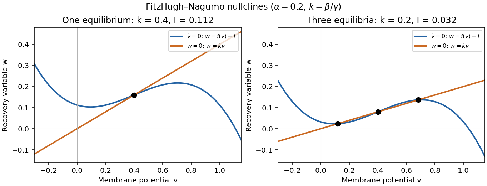

<h1 id="2/a/i/solution">Solution</h1>

↑ **Parent:** [I](../i.md)

Put $k=\beta/\gamma$. The [nullclines](../../../../../nullcline.md) of the space-clamped [FitzHugh-Nagumo model](../../../../../fitzhugh-nagumo-model.md) are

$$
\dot v=0:\quad w=f(v)+I,\qquad
\dot w=0:\quad w=kv.
$$

The first [nullcline](../../../../../nullcline.md) is a downward-leading [cubic polynomial](../../../../../cubic-polynomial.md), shifted vertically by $I$; the second [nullcline](../../../../../nullcline.md) is a line through the origin with slope $k>0$. Their intersections satisfy

$$
I=h(v),\qquad h(v)=kv-f(v)=v^3-(1+\alpha)v^2+(\alpha+k)v.
$$

Writing $M=(1-\alpha+\alpha^2)/3$, differentiation gives

$$
f'(v)=-3\left(v-\frac{1+\alpha}{3}\right)^2+M,\qquad h'(v)=k-f'(v).
$$

If $k>M$, $h$ increases strictly, so there is exactly one [equilibrium](../../../../../equilibrium-point-of-a-dynamical-system.md). If $k=M$, $h$ is still strictly increasing, although its [derivative](../../../../../derivative.md) vanishes at one point, so the [equilibrium](../../../../../equilibrium-point-of-a-dynamical-system.md) is again unique. If $0<k<M$, define

$$
u_\pm=\frac{1+\alpha\pm\sqrt{1-\alpha+\alpha^2-3k}}3,\qquad
I_{\rm low}=h(u_+),\quad I_{\rm high}=h(u_-).
$$

Here $h$ has a local maximum at $u_-$ and a local minimum at $u_+$; therefore

$$
\boxed{\begin{array}{ll}
I_{\rm low}<I<I_{\rm high}:&\text{three distinct equilibria},\\
I<I_{\rm low}\ \text{or}\ I>I_{\rm high}:&\text{one equilibrium}.
\end{array}}
$$

At either endpoint there are two distinct [equilibria](../../../../../equilibrium-point-of-a-dynamical-system.md), one a double root. These are the [saddle-node bifurcation](../../../../../saddle-node-bifurcation.md) boundaries omitted by the generic one-or-three wording. At $k=M$ and $I=h((1+\alpha)/3)$ there is one triple root. This is the [Cubic FitzHugh-Nagumo nullcline criterion](../../../../../cubic-fitzhugh-nagumo-nullcline-criterion.md).

**[Figure 1](#2/a/i/image-one-and-three-intersections-of-the-fitzhugh-nagumo-model-nullclines). One and three intersections of the FitzHugh-Nagumo model nullclines**.

## ↑ Ancestors (13)

1. [I](../i.md)
2. [A](../../a.md)
3. [2](../../../2.md)
4. [2023](../../../../2023-split.md)
5. [Past exam of the further mathematical biology course of the University of Oxford](../../../../split.md)
6. [Further mathematical biology course of the University of Oxford](../../../../../further-mathematical-biology-course-of-the-university-of-oxford.md)
7. [Year 3 of the mathematics course of the University of Oxford](../../../../../year-3-of-the-mathematics-course-of-the-university-of-oxford.md)
8. [Mathematics course of the University of Oxford](../../../../../mathematics-course-of-the-university-of-oxford.md)
9. [Undergraduate course of the University of Oxford](../../../../../undergraduate-course-of-the-university-of-oxford.md)
10. [Course of the University of Oxford](../../../../../course-of-the-university-of-oxford.md)
11. [University of Oxford](../../../../../university-of-oxford-split.md)
12. [List of universities](../../../../../list-of-universities.md)
13. [Codex Wiki](../../../../../split.md)
