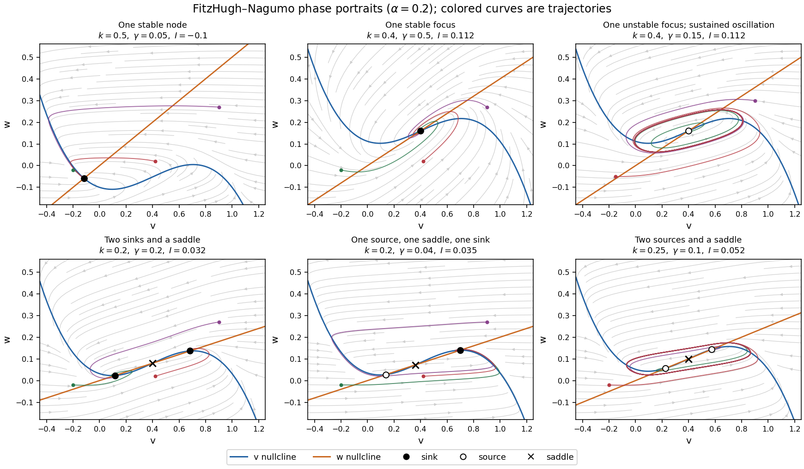

<h1 id="2/a/ii/solution">Solution</h1>

↑ **Parent:** [Ii](../ii.md)

At an [equilibrium](../../../../../equilibrium-point-of-a-dynamical-system.md) $(v_*,kv_*)$, set $p=f'(v_*)$. The [Jacobian matrix](../../../../../jacobian-matrix.md), its [trace](../../../../../matrix-trace.md) and its [determinant](../../../../../determinant.md) are

$$
J_* =\begin{pmatrix}p&-1\\\beta&-\gamma\end{pmatrix},\qquad
T=p-\gamma,\qquad \Delta=\beta-\gamma p=\gamma(k-p).
$$

The [eigenvalues](../../../../../eigenvalue.md) and their [discriminant](../../../../../discriminant.md) are

$$
s_\pm=\frac{p-\gamma\pm\sqrt{(p+\gamma)^2-4\beta}}2,\qquad
\mathcal D=(p+\gamma)^2-4\beta.
$$

Thus the complete local [linear stability](../../../../../linear-stability.md) test is

$$
\boxed{\begin{array}{ll}
p>k:&\text{saddle},\\
p<k,\ p<\gamma:&\text{asymptotically stable},\\
\gamma<p<k:&\text{unstable}.
\end{array}}
$$

In the last two cases, $\mathcal D>0$ gives a [node](../../../../../node-dynamical-systems.md), while $\mathcal D<0$ gives a [focus](../../../../../focus-dynamical-systems.md); the sign of $T$ distinguishes inward and outward trajectories. At $\mathcal D=0$, a nonzero repeated [eigenvalue](../../../../../eigenvalue.md) gives a degenerate [node](../../../../../node-dynamical-systems.md). At $p=\gamma<k$ the [eigenvalues](../../../../../eigenvalue.md) are purely imaginary, so [linear stability analysis](../../../../../linear-stability.md) alone does not decide [asymptotic stability](../../../../../asymptotic-stability.md); with the required crossing and nondegeneracy this is a [Hopf bifurcation](../../../../../hopf-bifurcation.md). At $p=k$ there is a zero [eigenvalue](../../../../../eigenvalue.md), requiring a nonlinear test and generically marking the [saddle-node bifurcation](../../../../../saddle-node-bifurcation.md) in the preceding answer.

For a unique simple [equilibrium](../../../../../equilibrium-point-of-a-dynamical-system.md), $p<k$, so it can be a [sink equilibrium](../../../../../sink-equilibrium.md) or a [source equilibrium](../../../../../source-equilibrium.md). The number of [equilibria](../../../../../equilibrium-point-of-a-dynamical-system.md) alone does not decide [stability](../../../../../stability-of-a-numerical-method.md). If $k\le\gamma$, the unique simple [equilibrium](../../../../../equilibrium-point-of-a-dynamical-system.md) is always a [sink equilibrium](../../../../../sink-equilibrium.md). If $\gamma<k$, it can become a [source equilibrium](../../../../../source-equilibrium.md) where $\gamma<p<k$. The same conclusion follows particularly simply if $\gamma>M$: the [trace](../../../../../matrix-trace.md) is negative at every nonsaddle [equilibrium](../../../../../equilibrium-point-of-a-dynamical-system.md).

For three simple [equilibria](../../../../../equilibrium-point-of-a-dynamical-system.md) ordered by their $v$ coordinates, the middle one has $p>k$ and is a [saddle equilibrium](../../../../../saddle-equilibrium.md); the two outer ones have $p<k$. When both outer [equilibria](../../../../../equilibrium-point-of-a-dynamical-system.md) are [sink equilibria](../../../../../sink-equilibrium.md), each has an attracting neighborhood, giving [bistability](../../../../../bistability.md). In the usual two-basin portrait, the [stable manifold](../../../../../stable-manifold.md) of the [saddle equilibrium](../../../../../saddle-equilibrium.md) separates their basins. Each branch of its [unstable manifold](../../../../../unstable-manifold.md) initially leaves towards a different side; its eventual destination requires a global argument. If $k\le\gamma$, both outer [equilibria](../../../../../equilibrium-point-of-a-dynamical-system.md) must be [sink equilibria](../../../../../sink-equilibrium.md). If $\gamma<k$, either or both outer [equilibria](../../../../../equilibrium-point-of-a-dynamical-system.md) can instead be [source equilibria](../../../../../source-equilibrium.md); the same test $p\lessgtr\gamma$ applies separately to each. The three lower panels illustrate all three possibilities up to exchanging left and right.

The arrows in the [phase plane](../../../../../phase-plane.md) follow directly from the [nullclines](../../../../../nullcline.md): below $w=f(v)+I$ the horizontal component points right, and above it left; below $w=kv$ the vertical component points up, and above it down. Near a [stable focus](../../../../../stable-spiral.md) trajectories spiral inward; near an unstable [focus](../../../../../focus-dynamical-systems.md) they spiral outward. Near a [saddle equilibrium](../../../../../saddle-equilibrium.md) they approach along its [stable manifold](../../../../../stable-manifold.md) and leave along its [unstable manifold](../../../../../unstable-manifold.md). These directions, together with the local tests, determine the sketches.

**[Figure 2](#2/a/ii/image-phase-portraits-of-the-fitzhugh-nagumo-model-with-one-or-three-equilibria-including-changes-of-linear-stability). Phase portraits of the FitzHugh-Nagumo model with one or three equilibria, including changes of linear stability**.

There is also a useful global conclusion when the unique [equilibrium](../../../../../equilibrium-point-of-a-dynamical-system.md) is a [source equilibrium](../../../../../source-equilibrium.md). With

$$
E(v,w)=\frac{\beta v^2+w^2}{2},\qquad
\dot E=\beta v f(v)+\beta Iv-\gamma w^2,
$$

the leading term in $v$ is $-\beta v^4$, so sufficiently large ellipses are [trapping regions](../../../../../trapping-region.md). A small repelling neighborhood of the hyperbolic [source equilibrium](../../../../../source-equilibrium.md) can be removed to form an invariant annulus. The [Poincaré-Bendixson theorem](../../../../../poincare-bendixson-theorem.md) then guarantees at least one [periodic orbit](../../../../../periodic-orbit.md) in that annulus. The numerical sketch illustrates the resulting sustained oscillation; this argument does not assert uniqueness of a [limit cycle](../../../../../limit-cycle.md). A stable [equilibrium](../../../../../equilibrium-point-of-a-dynamical-system.md) can instead represent a resting [membrane potential](../../../../../membrane-potential-split.md), with perturbations producing damped relaxation; near a threshold, a sufficiently large perturbation can produce a large excursion before recovery. Global basin boundaries and coexistence of [periodic orbits](../../../../../periodic-orbit.md) need more information than the number and local [stability](../../../../../stability-of-a-numerical-method.md) of [equilibria](../../../../../equilibrium-point-of-a-dynamical-system.md).

## ↑ Ancestors (13)

1. [Ii](../ii.md)
2. [A](../../a.md)
3. [2](../../../2.md)
4. [2023](../../../../2023-split.md)
5. [Past exam of the further mathematical biology course of the University of Oxford](../../../../split.md)
6. [Further mathematical biology course of the University of Oxford](../../../../../further-mathematical-biology-course-of-the-university-of-oxford.md)
7. [Year 3 of the mathematics course of the University of Oxford](../../../../../year-3-of-the-mathematics-course-of-the-university-of-oxford.md)
8. [Mathematics course of the University of Oxford](../../../../../mathematics-course-of-the-university-of-oxford.md)
9. [Undergraduate course of the University of Oxford](../../../../../undergraduate-course-of-the-university-of-oxford.md)
10. [Course of the University of Oxford](../../../../../course-of-the-university-of-oxford.md)
11. [University of Oxford](../../../../../university-of-oxford-split.md)
12. [List of universities](../../../../../list-of-universities.md)
13. [Codex Wiki](../../../../../split.md)
