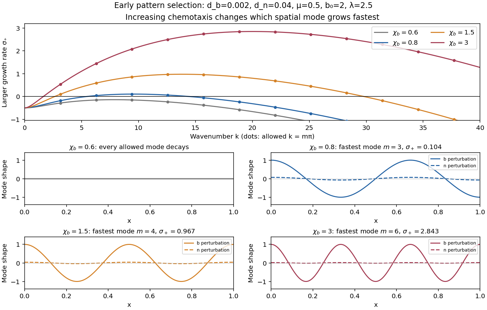

<h1 id="3/d/solution">Solution</h1>

↑ **Parent:** [D](../d.md)

Write $b=1+u$, $n=n_*+v$ and define

$$
\kappa=\frac{\chi_b}{(1+n_*)^2},\qquad
\eta=\frac{\lambda(b_0^2-1)}{(1+b_0^2)^2}.
$$

The first-order perturbation equations are

$$
u_t=d_bu_{xx}-\kappa v_{xx}-u,\qquad
v_t=d_nv_{xx}+\eta u-\mu v.
$$

The homogeneous [Neumann boundary conditions](../../../../neumann-boundary-condition.md) select [Fourier modes](../../../../fourier-mode.md) proportional to $\cos(m\pi x)$, with squared [wavenumber](../../../../wavenumber.md) $q_m=(m\pi)^2$ for $m=0,1,\ldots$. For a mode $e^{\sigma t}(U,V)\cos(m\pi x)$, the [eigenvalue](../../../../eigenvalue.md) problem is

$$
\sigma\begin{pmatrix}U\\V\end{pmatrix}
=A(q_m)\begin{pmatrix}U\\V\end{pmatrix},\qquad
A(q)=\begin{pmatrix}-1-d_bq&\kappa q\\\eta&-\mu-d_nq\end{pmatrix}.
$$

Its [trace](../../../../matrix-trace.md) is $-[1+\mu+(d_b+d_n)q]<0$. Therefore a growing mode exists exactly when its [determinant](../../../../determinant.md) is negative. Set

$$
C=\kappa\eta-d_n-\mu d_b.
$$

The [dispersion relation](../../../../dispersion-relation-split.md) is

$$
\sigma^2+[1+\mu+(d_b+d_n)q]\sigma+P(q)=0,\qquad
P(q)=d_bd_nq^2-Cq+\mu.
$$

The constant mode has $P(0)=\mu>0$; very short [wavelengths](../../../../wavelength.md) also decay because $P(q)\sim d_bd_nq^2$. For a negative interval at positive $q$, the upward-opening [quadratic polynomial](../../../../quadratic-polynomial.md) must have its minimum below zero at positive $q$. This gives

$$
\boxed{\kappa\eta>d_n+\mu d_b+2\sqrt{\mu d_bd_n}
=\left(\sqrt{d_n}+\sqrt{\mu d_b}\right)^2.}
$$

In particular, $\boxed{b_0>1}$ is necessary, since otherwise $\eta\le0$ and every coefficient of $P(q)$ is positive. When $b_0>1$, a locally increased population must increase net [nutrient](../../../../nutrient.md) production, so attraction to that [nutrient](../../../../nutrient.md) reinforces the population increase. This feedback must overcome both [diffusion](../../../../diffusion.md) and local relaxation. The calculation is an instance of [chemotactic instability with logistic growth and saturating production](../../../../chemotactic-instability-with-logistic-growth-and-saturating-production.md).

The displayed continuous-[wavenumber](../../../../wavenumber.md) inequality is necessary on the finite domain, but an allowed mode must actually lie in the unstable band:

$$
q_\pm=\frac{C\pm\sqrt{C^2-4\mu d_bd_n}}{2d_bd_n},\qquad
\boxed{q_-<(m\pi)^2<q_+\quad\text{for some integer }m\ge1.}
$$

Equivalently, the exact discrete threshold is

$$
\boxed{\chi_b>\frac{(1+n_*)^2}{\eta}
\min_{m\ge1}\left[d_n+\mu d_b+d_bd_n(m\pi)^2+\frac{\mu}{(m\pi)^2}\right],\qquad \eta>0.}
$$

Equality gives a marginal zero [eigenvalue](../../../../eigenvalue.md) rather than positive growth. At the unrestricted onset, $q_c=\sqrt{\mu/(d_bd_n)}$, so $k_c=(\mu/(d_bd_n))^{1/4}$. On the finite interval, [Discrete Neumann mode selection](../../../../discrete-neumann-mode-selection.md) first destabilizes the mode minimizing the discrete threshold; it need not attain $k_c$ exactly.

To predict the early form of a perturbation, use the larger growth [eigenvalue](../../../../eigenvalue.md)

$$
\boxed{\sigma_+(q)=-\frac{1+\mu+(d_b+d_n)q}{2}
+\frac12\sqrt{[\mu-1+(d_n-d_b)q]^2+4\kappa\eta q}.}
$$

For $\eta>0$, the square root is real. Choose $m_{\rm fast}$ maximizing $\sigma_+(q_m)$ among allowed modes with positive growth. The corresponding perturbation has [wavelength](../../../../wavelength.md) $2/m_{\rm fast}$ in $x$, or $2L/m_{\rm fast}$ in $X$. Its [eigenvector](../../../../eigenvector.md) satisfies

$$
\frac VU=\frac{1+d_bq_m+\sigma_+(q_m)}{\kappa q_m}>0,
$$

so [bacteria](../../../../bacteria.md) and [nutrient](../../../../nutrient.md) peaks initially coincide. A mode with larger $m$ has finer spatial structure. The two signs of $\cos(m\pi x)$ are both allowed, exchanging peaks and troughs.

**[Figure 3](#3/d/image-dispersion-relations-and-early-fourier-modes-as-chemotaxis-strength-changes). Dispersion relations and early Fourier modes as chemotaxis strength changes**.

The illustration holds $d_b=0.002$, $d_n=0.04$, $\mu=0.5$, $b_0=2$ and $\lambda=2.5$ fixed, giving $n_*=1$ and $\eta=0.3$, and varies $\chi_b$. Crossing the discrete threshold makes a nonuniform [Fourier mode](../../../../fourier-mode.md) grow; stronger [chemotaxis](../../../../chemotaxis.md) widens the unstable band and can favor finer structure. Increasing either [diffusion](../../../../diffusion.md) coefficient raises the threshold of each fixed mode. Varying $\lambda$ can have a nonmonotone effect: with $s=1+b_0^2$,

$$
\kappa\eta=\frac{\chi_b\lambda(b_0^2-1)}{s^2(1+\lambda/(\mu s))^2}
$$

is maximal at $\lambda=\mu s$, where $n_*=1$. Additional production beyond that point weakens sensitivity enough to reduce this feedback. Changes in $L$ also change the allowed dimensional [wavenumbers](../../../../wavenumber.md) $m\pi/L$ and all three scaled transport coefficients. These are predictions of [linear stability analysis](../../../../linear-stability.md): eventual pattern amplitude, competition between growing modes and possible merging require the nonlinear system. The threshold is a necessary condition for spontaneous pattern growth from arbitrarily small perturbations, rather than a claim that every finite-amplitude nonuniform state is excluded below it.

## ↑ Ancestors (12)

1. [D](../d.md)
2. [3](../../3.md)
3. [2023](../../../2023-split.md)
4. [Past exam of the further mathematical biology course of the University of Oxford](../../../split.md)
5. [Further mathematical biology course of the University of Oxford](../../../../further-mathematical-biology-course-of-the-university-of-oxford.md)
6. [Year 3 of the mathematics course of the University of Oxford](../../../../year-3-of-the-mathematics-course-of-the-university-of-oxford.md)
7. [Mathematics course of the University of Oxford](../../../../mathematics-course-of-the-university-of-oxford.md)
8. [Undergraduate course of the University of Oxford](../../../../undergraduate-course-of-the-university-of-oxford.md)
9. [Course of the University of Oxford](../../../../course-of-the-university-of-oxford.md)
10. [University of Oxford](../../../../university-of-oxford-split.md)
11. [List of universities](../../../../list-of-universities.md)
12. [Codex Wiki](../../../../split.md)
