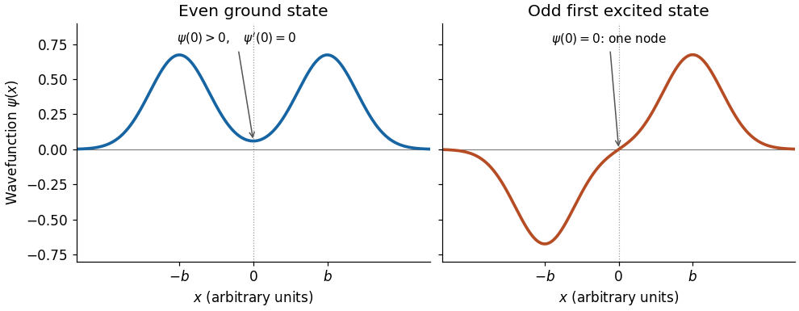

# 2023

↑ **Parent:** [Past exam of the further quantum theory course of the University of Oxford](../past-exam-of-the-further-quantum-theory-course-of-the-university-of-oxford.md)

Solutions to all three questions of the [Further quantum theory course of the University of Oxford](../university-of-oxford.md#further-quantum-theory-course-of-the-university-of-oxford) Part B examination, held on 29 May 2023. Source: [original released PDF, bundle pages 268–271; paper pages 1–4](https://www.whatdotheyknow.com/request/request_for_mathematics_examinat/response/3129786/attach/3/FOI%20202507%20740%20Data.pdf#page=268). In question 2 the paper defines $k=\sqrt{2mE}$, a [momentum](../momentum.md); the corresponding [wavenumber](../wave-equation.md#wavenumber) is $q=k/\hbar$. Keeping these distinct retains the paper's convention without setting the [reduced Planck constant](../quantum-mechanics.md#reduced-planck-constant) to one.

**Table of contents**

- [1](#1)
  - [a](#1/a)
    - [Solution](#1/a/solution)
  - [b](#1/b)
    - [Solution](#1/b/solution)
  - [c](#1/c)
    - [Solution](#1/c/solution)
  - [d](#1/d)
    - [Solution](#1/d/solution)
  - [e](#1/e)
    - [Solution](#1/e/solution)
- [2](#2)
  - [a](#2/a)
    - [Solution](#2/a/solution)
  - [b](#2/b)
    - [Solution](#2/b/solution)
  - [c](#2/c)
    - [Solution](#2/c/solution)
  - [d](#2/d)
    - [Solution](#2/d/solution)
  - [e](#2/e)
    - [Solution](#2/e/solution)
- [3](#3)
  - [a](#3/a)
    - [i](#3/a/i)
      - [Solution](#3/a/i/solution)
    - [ii](#3/a/ii)
      - [Solution](#3/a/ii/solution)
    - [iii](#3/a/iii)
      - [Solution](#3/a/iii/solution)
  - [b](#3/b)
    - [Solution](#3/b/solution)
  - [c](#3/c)
    - [Solution](#3/c/solution)
  - [d](#3/d)
    - [Solution](#3/d/solution)
  - [e](#3/e)
    - [Solution](#3/e/solution)

## 1

↑ **Parent:** [2023](2023.md)

<h3 id="1/a">a</h3>

↑ **Parent:** [1](#1)

<h4 id="1/a/solution">Solution</h4>

↑ **Parent:** [A](#1/a)

An [irreducible spin representation](../angular-momentum-operator.md#irreducible-spin-representation) is a nonzero [Hilbert space](../hilbert-space.md) with no proper nonzero closed [invariant subspace](../representation-theory.md#invariant-subspace) under all three [angular momentum operators](../angular-momentum-operator.md). Equivalently, the associated [unitary representation](../representation-theory.md#unitary-representation) of [SU(2)](../topological-group.md#su-2-group) cannot be decomposed into two nonzero orthogonal invariant pieces. The irreducible possibilities are labelled by a [spin](../angular-momentum-operator.md#spin) $j\in\{0,\tfrac12,1,\tfrac32,\ldots\}$ and have [dimension](../vector-space.md#dimension-vector-space) $2j+1$.

Choose an [orthonormal basis](../inner-product.md#orthonormal-basis) $|j,m_s\rangle$, with $m_s=-j,-j+1,\ldots,j$. The [angular momentum commutation relations](../angular-momentum-operator.md#angular-momentum-commutation-relations) imply $[\mathbf S^2,S_i]=0$, $[S_3,S_\pm]=\pm\hbar S_\pm$, $[S_+,S_-]=2\hbar S_3$, and $S_+^\dagger=S_-$. The complete action is

$$
\boxed{\begin{aligned}
\mathbf S^2|j,m_s\rangle&=\hbar^2j(j+1)|j,m_s\rangle,\\
S_3|j,m_s\rangle&=\hbar m_s|j,m_s\rangle,\\
S_\pm|j,m_s\rangle&=\hbar\sqrt{(j\mp m_s)(j\pm m_s+1)}\,|j,m_s\pm1\rangle.
\end{aligned}}
$$

In particular, the [spin raising operator](../angular-momentum-operator.md#spin-raising-operator) annihilates $|j,j\rangle$ and the [spin lowering operator](../angular-momentum-operator.md#spin-lowering-operator) annihilates $|j,-j\rangle$. The coefficient follows by taking the squared [norm](../normed-vector-space.md#norm) and using $S_\mp S_\pm=\mathbf S^2-S_3^2\mp\hbar S_3$. Thus the [ladder operators](../semisimple-lie-algebra.md#ladder-operator) connect every member of the [basis](../vector-space.md#basis), while terminating at its two endpoints.

<h3 id="1/b">b</h3>

↑ **Parent:** [1](#1)

<h4 id="1/b/solution">Solution</h4>

↑ **Parent:** [B](#1/b)

On the [tensor product](../multilinear-algebra.md#tensor-product) of spins $j_1$ and $j_2$, the combined [angular momentum operator](../angular-momentum-operator.md) is $\mathbf J=\mathbf S^{(1)}\otimes I+I\otimes\mathbf S^{(2)}$. The [Clebsch-Gordan decomposition](../angular-momentum-operator.md#clebsch-gordan-decomposition) is

$$
\boxed{\mathcal H_{j_1}\otimes\mathcal H_{j_2}\cong\bigoplus_{J=|j_1-j_2|}^{j_1+j_2}\mathcal H_J,}
$$

where $J$ increases by one and each [irreducible spin representation](../angular-momentum-operator.md#irreducible-spin-representation) occurs once. The [dimensions](../vector-space.md#dimension-vector-space) agree: $\sum_J(2J+1)=(2j_1+1)(2j_2+1)$.

The uncoupled [orthonormal basis](../inner-product.md#orthonormal-basis) diagonalizes $S_3^{(1)},S_3^{(2)}$; the coupled [orthonormal basis](../inner-product.md#orthonormal-basis) diagonalizes $\mathbf J^2,J_3$. The [Clebsch-Gordan coefficients](../representation-theory.md#clebsch-gordan-coefficients) are their change-of-[basis](../vector-space.md#basis) entries, with convention

$$
|J,M\rangle=\sum_{m_1,m_2}C_{j_1,j_2}(J,M;m_1,m_2)\,|j_1,m_1\rangle\otimes|j_2,m_2\rangle.
$$

They vanish unless $m_1+m_2=M$. Since both [bases](../vector-space.md#basis) are orthonormal, this change-of-[basis](../vector-space.md#basis) [matrix](../vector-space.md#matrix) obeys [unitarity](../vector-space.md#unitary-operator). Overall phases of the coupled [basis](../vector-space.md#basis) vectors are fixed by a convention and do not change the [energy eigenvalues](../energy-eigenvalue.md).

<h3 id="1/c">c</h3>

↑ **Parent:** [1](#1)

<h4 id="1/c/solution">Solution</h4>

↑ **Parent:** [C](#1/c)

Write $|\uparrow\rangle,|\downarrow\rangle$ for the two $S_3$ [eigenstates](../energy-eigenvalue.md#eigenstate), of [eigenvalues](../linear-operator-theory.md#eigenvalue) $\pm\hbar/2$. The [spin-spin interaction](../angular-momentum-operator.md#spin-spin-interaction) can be evaluated using

$$
\mathbf S^{(1)}\cdot\mathbf S^{(2)}=S_3^{(1)}S_3^{(2)}+\frac12\left(S_+^{(1)}S_-^{(2)}+S_-^{(1)}S_+^{(2)}\right).
$$

For $|\beta|\gg|\alpha|$, take $H_0=\beta(S_3^{(1)}-S_3^{(2)})/\hbar$ and $V=\alpha\mathbf S^{(1)}\cdot\mathbf S^{(2)}/\hbar^2$. The unperturbed [energy eigenvalues](../energy-eigenvalue.md) are $\beta,-\beta,0,0$ on $|\uparrow\downarrow\rangle,|\downarrow\uparrow\rangle,|\uparrow\uparrow\rangle,|\downarrow\downarrow\rangle$, respectively. For an isolated normalized [energy eigenstate](../energy-eigenvalue.md#energy-eigenstate) $|n\rangle$, [first-order nondegenerate perturbation theory](../quantum-mechanics.md#first-order-nondegenerate-perturbation-theory) gives $\Delta E_n^{(1)}=\langle n|V|n\rangle$. The two antiparallel [spins](../angular-momentum-operator.md#spin) have expectation $-\alpha/4$, so

$$
\boxed{E_{\uparrow\downarrow}=\beta-\frac\alpha4+O(\alpha^2/|\beta|),\qquad E_{\downarrow\uparrow}=-\beta-\frac\alpha4+O(\alpha^2/|\beta|).}
$$

For the zero-[energy](../energy.md) [degenerate eigenspace](../linear-operator-theory.md#degenerate-eigenspace), [degenerate perturbation theory](../quantum-mechanics.md#degenerate-perturbation-theory) requires diagonalizing the restriction of $V$. On the ordered [basis](../vector-space.md#basis) $(|\uparrow\uparrow\rangle,|\downarrow\downarrow\rangle)$ it is $(\alpha/4)I$: the [ladder operators](../semisimple-lie-algebra.md#ladder-operator) cannot take one parallel state to the other. Indeed neither parallel state couples to anything else under $H$, so **the remaining two levels are exactly $\alpha/4$**, retaining their twofold [quantum degeneracy](../quantum-mechanics.md#degenerate-energy-levels).

For $|\alpha|\gg|\beta|$, take $H_0=\alpha\mathbf S^{(1)}\cdot\mathbf S^{(2)}/\hbar^2$ and $V=\beta D$, where $D=(S_3^{(1)}-S_3^{(2)})/\hbar$. The [spin-one-half triplet state](../angular-momentum-operator.md#spin-one-half-triplet-state) [basis](../vector-space.md#basis) and [spin-one-half singlet state](../angular-momentum-operator.md#spin-one-half-singlet-state) are

$$
|t_+\rangle=|\uparrow\uparrow\rangle,\quad |t_0\rangle=\frac{|\uparrow\downarrow\rangle+|\downarrow\uparrow\rangle}{\sqrt2},\quad |t_-\rangle=|\downarrow\downarrow\rangle,\quad |s\rangle=\frac{|\uparrow\downarrow\rangle-|\downarrow\uparrow\rangle}{\sqrt2}.
$$

The identity $\mathbf S^{(1)}\cdot\mathbf S^{(2)}=(\mathbf J^2-3\hbar^2/2)/2$ gives unperturbed [energy eigenvalues](../energy-eigenvalue.md) $E_t^{(0)}=\alpha/4$ and $E_s^{(0)}=-3\alpha/4$. Direct action gives

$$
D|t_\pm\rangle=0,\qquad D|t_0\rangle=|s\rangle,\qquad D|s\rangle=|t_0\rangle.
$$

Consequently the restriction of $V$ to the entire triplet [degenerate eigenspace](../linear-operator-theory.md#degenerate-eigenspace) is zero, so no first-order splitting is missed. The singlet expectation is also zero. In [second-order nondegenerate perturbation theory](../quantum-mechanics.md#second-order-nondegenerate-perturbation-theory), $\Delta E_n^{(2)}=\sum_{r\ne n}|\langle r|V|n\rangle|^2/(E_n^{(0)}-E_r^{(0)})$. Within the triplet, the corresponding second-order effective [matrix](../vector-space.md#matrix) is $\beta^2|t_0\rangle\langle t_0|/\alpha$, already diagonal in this [basis](../vector-space.md#basis). Thus, through second order,

$$
\boxed{E_{t_\pm}=\frac\alpha4,\qquad E_{t_0}=\frac\alpha4+\frac{\beta^2}{\alpha},\qquad E_s=-\frac{3\alpha}{4}-\frac{\beta^2}{\alpha}.}
$$

The last two expressions have higher corrections beginning at $O(\beta^4/|\alpha|^3)$, as the exact calculation in part (d) also verifies. For positive $\alpha$, coupling to the lower singlet raises the triplet's $M=0$ level and lowers the singlet; the signs are precisely the [energy](../energy.md) denominators above.

<h3 id="1/d">d</h3>

↑ **Parent:** [1](#1)

<h4 id="1/d/solution">Solution</h4>

↑ **Parent:** [D](#1/d)

In the ordered product [basis](../vector-space.md#basis) $(|\uparrow\uparrow\rangle,|\uparrow\downarrow\rangle,|\downarrow\uparrow\rangle,|\downarrow\downarrow\rangle)$, the [Hamiltonian operator](../quantum-system.md#hamiltonian-quantum-mechanics) has [matrix](../vector-space.md#matrix)

$$
H=\begin{pmatrix}
\alpha/4&0&0&0\\
0&-\alpha/4+\beta&\alpha/2&0\\
0&\alpha/2&-\alpha/4-\beta&0\\
0&0&0&\alpha/4
\end{pmatrix}.
$$

The middle block has [characteristic polynomial](../linear-operator-theory.md#characteristic-polynomial) $(E+\alpha/4)^2-\beta^2-\alpha^2/4$. Hence the exact [energy eigenvalues](../energy-eigenvalue.md) are

$$
\boxed{\frac\alpha4\quad\text{(twice)},\qquad E_\pm=-\frac\alpha4\pm\sqrt{\beta^2+\frac{\alpha^2}{4}}.}
$$

This is the [Two-spin Heisenberg Hamiltonian in an opposing longitudinal field](../angular-momentum-operator.md#two-spin-heisenberg-hamiltonian-in-an-opposing-longitudinal-field), with its interaction and field parameters rescaled to the paper's units. For positive $\beta$ and $|\alpha|\ll\beta$, the [Taylor expansion](../calculus.md#taylor-expansion) gives

$$
E_\pm=-\frac\alpha4\pm\left(\beta+\frac{\alpha^2}{8\beta}+O(\alpha^4/\beta^3)\right),
$$

which agrees with the first-order result of part (c). For positive $\alpha$ and $|\beta|\ll\alpha$,

$$
E_+=\frac\alpha4+\frac{\beta^2}{\alpha}+O(\beta^4/\alpha^3),\qquad E_-=-\frac{3\alpha}{4}-\frac{\beta^2}{\alpha}+O(\beta^4/\alpha^3).
$$

These agree with the second-order triplet and singlet results. If $\alpha<0$, their association with the signs $\pm$ reverses; if $\beta<0$, the two antiparallel product-state labels reverse. The unordered exact [spectrum](../linear-operator-theory.md#spectrum-functional-analysis) and the perturbative expressions with their signed denominators remain valid.

<h3 id="1/e">e</h3>

↑ **Parent:** [1](#1)

<h4 id="1/e/solution">Solution</h4>

↑ **Parent:** [E](#1/e)

Let $X$ exchange the two equal-[spin](../angular-momentum-operator.md#spin) factors, so $X^\dagger=X=X^{-1}$. For the unperturbed [Hamiltonian operator](../quantum-system.md#hamiltonian-quantum-mechanics), [addition of angular momentum](../angular-momentum-operator.md#addition-of-angular-momentum) gives

$$
E_J^{(0)}=\frac\alpha2\bigl[J(J+1)-2j(j+1)\bigr],\qquad J=0,1,\ldots,2j.
$$

For nonzero $\alpha$, different $J$ have distinct [energy eigenvalues](../energy-eigenvalue.md), while each [eigenspace](../linear-operator-theory.md#eigenspace) has the $2J+1$ values of $M$. The stated symmetry of the [Clebsch-Gordan coefficients](../representation-theory.md#clebsch-gordan-coefficients) gives the [exchange parity of two coupled identical spins](../angular-momentum-operator.md#exchange-parity-of-two-coupled-identical-spins):

$$
X|J,M\rangle=(-1)^{2j-J}|J,M\rangle.
$$

However, $D=(S_3^{(1)}-S_3^{(2)})/\hbar$ changes sign: $XDX=-D$. For any two [basis](../vector-space.md#basis) vectors in the same $J$ [eigenspace](../linear-operator-theory.md#eigenspace), insertion of $X^2=I$ therefore gives

$$
\langle J,M|D|J,M'\rangle=(-1)^{2(2j-J)}\langle J,M|XDX|J,M'\rangle=-\langle J,M|D|J,M'\rangle=0.
$$

Thus the entire projected perturbation $P_J\beta DP_J$ is zero, including its off-diagonal [matrix elements](../vector-space.md#matrix-element). [Degenerate perturbation theory](../quantum-mechanics.md#degenerate-perturbation-theory) now proves that every first-order-in-$\beta$ [energy](../energy.md) correction vanishes. This is [first-order cancellation for an exchange-odd perturbation](../quantum-mechanics.md#first-order-cancellation-for-an-exchange-odd-perturbation); checking only the individual diagonal expectations would not by itself settle a degenerate problem.

## 2

↑ **Parent:** [2023](2023.md)

<h3 id="2/a">a</h3>

↑ **Parent:** [2](#2)

<h4 id="2/a/solution">Solution</h4>

↑ **Parent:** [A](#2/a)

For $E>0$, put $k=\sqrt{2mE}$ and $q=k/\hbar>0$. Outside the support of the [potential energy](../energy.md#potential-energy), a [generalized eigenfunction](../linear-operator-theory.md#generalized-eigenfunction) of the [Hamiltonian operator](../quantum-system.md#hamiltonian-quantum-mechanics) has the [plane wave](../wave-function.md#plane-wave) form

$$
\psi(x)=\begin{cases}A e^{iqx}+B e^{-iqx},&x<-R_0,\\C e^{iqx}+D e^{-iqx},&x>R_0.\end{cases}
$$

Here $R_0$ denotes the support radius, to distinguish it from the [quantum reflection probability](../quantum-scattering.md#quantum-reflection-probability) $R$. The [momenta](../momentum.md) are $\pm k$ and the [velocities](../classical-mechanics.md#velocity) are $\pm k/m$. Thus $A,D$ describe incoming [scattering channels](../quantum-scattering.md#scattering-channel) from the left and right, and $B,C$ describe outgoing [scattering channels](../quantum-scattering.md#scattering-channel) towards the left and right. These [energy eigenfunctions](../energy-eigenvalue.md#energy-eigenfunction) are not [square-integrable functions](../measure-theory.md#square-integrable-function); normalizable incoming [wave packets](../dispersion-relation.md#wave-packet) are formed by superposition over [energy](../energy.md), and their passage through the interaction region gives the physical [quantum scattering](../quantum-scattering.md) experiment.

For incidence from the left, normalize $A=1,D=0$ and write $B=r_L,C=t_L$. The [quantum reflection amplitude](../quantum-scattering.md#quantum-reflection-amplitude) is $r_L$ and the [transmission amplitude](../quantum-scattering.md#transmission-amplitude) is $t_L$. The ratios of outgoing to incident [probability currents](../wave-function.md#probability-current) define

$$
\boxed{R=|r_L|^2,\qquad T=|t_L|^2.}
$$

No extra [velocity](../classical-mechanics.md#velocity) ratio occurs because both exterior regions have the same [potential energy](../energy.md#potential-energy) and [mass](../classical-mechanics.md#mass). The [scattering matrix](../quantum-scattering.md#s-matrix), with a fixed choice of channel order, is

$$
\boxed{\begin{pmatrix}B\\C\end{pmatrix}=S(q)\begin{pmatrix}A\\D\end{pmatrix},\qquad S(q)=\begin{pmatrix}r_L&t_R\\t_L&r_R\end{pmatrix}.}
$$

Its first and second columns are the responses to unit incidence from the left and right, respectively. For a reflection-symmetric [potential energy](../energy.md#potential-energy), these conventions give $r_L=r_R=r$ and $t_L=t_R=t$.

<h3 id="2/b">b</h3>

↑ **Parent:** [2](#2)

<h4 id="2/b/solution">Solution</h4>

↑ **Parent:** [B](#2/b)

For a real [potential energy](../energy.md#potential-energy) and a [stationary state](../quantum-system.md#stationary-state), the [probability current](../wave-function.md#probability-current) is

$$
j(x)=\frac{\hbar}{2mi}\bigl(\psi^*\psi'-\psi\psi'^*\bigr)=\frac\hbar m\operatorname{Im}(\psi^*\psi').
$$

The time-independent [Schrödinger equation](../mathematical-physics.md#schrodinger-equation) gives $\psi''=2m(V-E)\psi/\hbar^2$, so $j'=\hbar\operatorname{Im}(\psi^*\psi'')/m=0$. In an exterior [plane wave](../wave-function.md#plane-wave) superposition, interference terms contribute no current and

$$
j_{\rm left}=\frac{k}{m}(|A|^2-|B|^2),\qquad j_{\rm right}=\frac{k}{m}(|C|^2-|D|^2).
$$

Consequently $|A|^2+|D|^2=|B|^2+|C|^2$ for every choice of incoming amplitudes. If $u=(A,D)^T$, this says $u^\dagger(I-S^\dagger S)u=0$ for every complex [vector](../vector-space.md#vector) $u$. Since $I-S^\dagger S$ is [Hermitian](../hilbert-space.md#hermitian-operator), vanishing of its [quadratic form](../quadratic-form.md) implies that the [matrix](../vector-space.md#matrix) itself vanishes. Therefore

$$
\boxed{S^\dagger S=I,\qquad R+T=1.}
$$

The second identity follows by choosing $u=(1,0)^T$. Since $S$ is a square [matrix](../vector-space.md#matrix), the first also implies $SS^\dagger=I$, proving [unitarity](../vector-space.md#unitary-operator). A real [delta potential](../quantum-mechanics.md#delta-potential) preserves this proof: continuity of $\psi$ and the real derivative jump make the current continuous across the interaction point.

<h3 id="2/c">c</h3>

↑ **Parent:** [2](#2)

<h4 id="2/c/solution">Solution</h4>

↑ **Parent:** [C](#2/c)

Assume $a>0$ and put $\mu=mg/\hbar^2$, $q=k/\hbar$, and $\gamma=\mu/q$. At a [delta potential](../quantum-mechanics.md#delta-potential) located at $x_0$, integration of the [Schrödinger equation](../mathematical-physics.md#schrodinger-equation) gives the matching conditions

$$
\psi(x_0^+)=\psi(x_0^-),\qquad \psi'(x_0^+)-\psi'(x_0^-)=2\mu\psi(x_0).
$$

Writing the adjacent [plane wave](../wave-function.md#plane-wave) coefficients as $(A_L,B_L)$ and $(A_R,B_R)$ gives

$$
(A_R-A_L)e^{iqx_0}+(B_R-B_L)e^{-iqx_0}=0,
$$

$$
iq\bigl[(A_R-A_L)e^{iqx_0}-(B_R-B_L)e^{-iqx_0}\bigr]=2\mu(A_Le^{iqx_0}+B_Le^{-iqx_0}).
$$

Solving these two linear equations yields the [transfer matrix of a delta potential](../quantum-mechanics.md#transfer-matrix-of-a-delta-potential):

$$
\begin{pmatrix}A_R\\B_R\end{pmatrix}=D(x_0)\begin{pmatrix}A_L\\B_L\end{pmatrix},\qquad D(x_0)=\begin{pmatrix}1-i\gamma&-i\gamma e^{-2iqx_0}\\i\gamma e^{2iqx_0}&1+i\gamma\end{pmatrix},\qquad\det D(x_0)=1.
$$

For the [symmetric double-delta potential](../quantum-mechanics.md#symmetric-double-delta-potential), use separate [plane wave](../wave-function.md#plane-wave) pairs in $x<-a$, $-a<x<a$, and $x>a$. Successive matching gives $M=D(a)D(-a)$ between the two exterior pairs. For real $q$, multiplication gives

$$
M=\begin{pmatrix}d^*&-iF\\iF&d\end{pmatrix},\qquad d=(1+i\gamma)^2+\gamma^2e^{4iqa},\qquad F=2\gamma\bigl[\cos(2qa)+\gamma\sin(2qa)\bigr].
$$

The [determinant](../multilinear-algebra.md#determinant) identity $\det M=1$ reads $|d|^2-F^2=1$. Left incidence means $(t,0)^T=M(1,r)^T$, whence

$$
\boxed{t=\frac1d=\frac{q^2}{(q+i\mu)^2+\mu^2e^{4iqa}},\qquad r=-\frac{iF}{d}.}
$$

Here the first relation also follows from $t=M_{11}-M_{12}M_{21}/M_{22}=\det M/M_{22}$. Therefore the requested [transmission probability](../quantum-scattering.md#transmission-probability) and [quantum reflection probability](../quantum-scattering.md#quantum-reflection-probability), as functions of the printed [momentum](../momentum.md) $k$, are

$$
\boxed{T(k)=\frac{1}{1+F(k)^2},\qquad R(k)=\frac{F(k)^2}{1+F(k)^2},\quad F(k)=\frac{2\mu\hbar}{k}\left[\cos\frac{2ka}{\hbar}+\frac{\mu\hbar}{k}\sin\frac{2ka}{\hbar}\right].}
$$

They obey $R+T=1$. As checks, $g=0$ gives $T=1$, and the coincident limit $a\to0$ gives $T=q^2/(q^2+4\mu^2)$, the answer for a single [delta potential](../quantum-mechanics.md#delta-potential) of strength $2g$.

<h3 id="2/d">d</h3>

↑ **Parent:** [2](#2)

<h4 id="2/d/solution">Solution</h4>

↑ **Parent:** [D](#2/d)

Continue the [transmission amplitude](../quantum-scattering.md#transmission-amplitude) to complex [wavenumber](../wave-equation.md#wavenumber) $q=i\kappa$ with $\kappa>0$, equivalently complex [momentum](../momentum.md) $k=i\hbar\kappa$. Then $E=-\hbar^2\kappa^2/(2m)<0$. In the left exterior region the $A$ term grows at negative infinity and the $B$ term decays; in the right exterior region the $D$ term grows and the $C$ term decays. A [bound state](../quantum-system.md#bound-state) thus requires $A=D=0$, with nonzero $B,C$. The [transfer matrix](../combinatorics.md#transfer-matrix) relation gives $M_{22}(i\kappa)=0$. Equivalently, a zero of the incoming coefficient is a [bound-state pole](../quantum-scattering.md#bound-state-pole-of-the-scattering-amplitude) of $t(q)$, whose numerator is nonzero at $q=i\kappa$.

The [denominator](../number-theory.md#denominator) found in part (c) gives

$$
0=(i\kappa+i\mu)^2+\mu^2e^{-4a\kappa}=-(\kappa+\mu)^2+\mu^2e^{-4a\kappa}.
$$

Factorization produces two branches. To identify their [parity](../quantum-mechanics.md#parity), use an even interior [wavefunction](../wave-function.md) $A\cosh(\kappa x)$ or an odd interior [wavefunction](../wave-function.md) $A\sinh(\kappa x)$ for $|x|<a$, joined to a decaying exterior [wavefunction](../wave-function.md) at $a$. Continuity and the derivative jump give, respectively,

$$
-\kappa\bigl[1+\tanh(\kappa a)\bigr]=2\mu,\qquad -\kappa\bigl[1+\coth(\kappa a)\bigr]=2\mu.
$$

Rearrangement gives the implicit [energy eigenvalue](../energy-eigenvalue.md) equations

$$
\boxed{\kappa_{\rm even}=-\mu(1+e^{-2a\kappa_{\rm even}}),\qquad \kappa_{\rm odd}=-\mu(1-e^{-2a\kappa_{\rm odd}}),\qquad E_{\rm even,odd}=-\frac{\hbar^2\kappa_{\rm even,odd}^2}{2m}.}
$$

Only strictly positive [equation roots](../polynomial.md#root-of-an-equation) $\kappa$ are retained. With $\nu=-\mu>0$, the even [equation root](../polynomial.md#root-of-an-equation) lies above $\nu$ and the odd [equation root](../polynomial.md#root-of-an-equation), when it exists, lies below $\nu$, so the even [bound state](../quantum-system.md#bound-state) has lower [energy](../energy.md). The formal zero [equation root](../polynomial.md#root-of-an-equation) in the odd equation does not itself establish a [normalizable wavefunction](../wave-function.md#normalizable-wavefunction).

<h3 id="2/e">e</h3>

↑ **Parent:** [2](#2)

<h4 id="2/e/solution">Solution</h4>

↑ **Parent:** [E](#2/e)

For $g\geq0$, the [Hamiltonian operator](../quantum-system.md#hamiltonian-quantum-mechanics) is nonnegative: its [quadratic form](../quadratic-form.md) is $\hbar^2\int|\psi'|^2dx/(2m)+g(|\psi(a)|^2+|\psi(-a)|^2)\geq0$. Thus it has no negative-[energy](../energy.md) [bound states](../quantum-system.md#bound-state). A nonnegative-[energy](../energy.md) exterior [wavefunction](../wave-function.md) cannot be square integrable unless it vanishes identically, so there are no other [bound states](../quantum-system.md#bound-state) either.

For $g<0$, set $\nu=-mg/\hbar^2>0$. The even equation is the zero of $f(\kappa)=\nu(1+e^{-2a\kappa})-\kappa$. Since $f(0)=2\nu>0$, $f(\kappa)\to-\infty$ and $f'(\kappa)=-2a\nu e^{-2a\kappa}-1<0$, the [intermediate value theorem](../calculus.md#intermediate-value-theorem) and strict [monotonicity](../calculus.md#monotonic-function) give exactly one positive [equation root](../polynomial.md#root-of-an-equation).

The odd equation is the zero of $h(\kappa)=\nu(1-e^{-2a\kappa})-\kappa$. Here $h(0)=0$, $h'(0)=2a\nu-1$, $h''(\kappa)=-4a^2\nu e^{-2a\kappa}<0$, and $h(\kappa)\to-\infty$. If $2a\nu\leq1$, strict [concavity](../real-analysis.md#concave-function) makes $h(\kappa)<0$ for every $\kappa>0$. If $2a\nu>1$, $h$ initially increases, has exactly one maximum, and then decreases through zero exactly once. This proves the [bound-state count of an attractive symmetric double-delta potential](../quantum-mechanics.md#bound-state-count-of-an-attractive-symmetric-double-delta-potential):

$$
\boxed{N(g)=\begin{cases}
0,&g\geq0,\\
1,&-\dfrac{\hbar^2}{2ma}\leq g<0,\\
2,&g<-\dfrac{\hbar^2}{2ma}.
\end{cases}}
$$

At the threshold $g=-\hbar^2/(2ma)$, the odd zero-[energy](../energy.md) solution is proportional to $x$ inside $(-a,a)$ and to $a\operatorname{sgn}x$ outside. It is bounded but not a [square-integrable function](../measure-theory.md#square-integrable-function), so it is a [zero-energy scattering resonance](../quantum-scattering.md#zero-energy-scattering-resonance) rather than a second [bound state](../quantum-system.md#bound-state). Each negative-[energy](../energy.md) [bound state](../quantum-system.md#bound-state) is either even or odd by [nondegeneracy of one-dimensional bound states](../mathematical-physics.md#nondegeneracy-of-one-dimensional-bound-states); the two branches above exhaust the count.

## 3

↑ **Parent:** [2023](2023.md)

<h3 id="3/a">a</h3>

↑ **Parent:** [3](#3)

<h4 id="3/a/i">i</h4>

↑ **Parent:** [A](#3/a)

<h5 id="3/a/i/solution">Solution</h5>

↑ **Parent:** [I](#3/a/i)

In the central [classically forbidden region](../mathematical-physics.md#classically-forbidden-region), define the positive decay [momentum](../momentum.md) $\chi(x)=\sqrt{2m[V(x)-E]}$ and the [dimensionless](../physics.md#dimensionless-quantity) [action integral](../hamiltonian-mechanics.md#action-integral) $K(x)=\hbar^{-1}\int_x^{x_1}\chi(y)\,dy$. The general leading [WKB approximation](../analysis.md#wkb-approximation) is

$$
\boxed{\psi_{\rm I}(x)\simeq\frac{A e^{K(x)}+B e^{-K(x)}}{\sqrt{\chi(x)}},\qquad 0<x<x_1.}
$$

Both coefficients are allowed: this interval has finite length, so the exponential that grows towards the barrier centre cannot be discarded by a condition at infinity. The [WKB validity condition](../analysis.md#wkb-validity-condition) holds away from the [classical turning point](../analysis.md#classical-turning-point) $x_1$; a local [Airy function](../linear-ordinary-differential-equation.md#airy-function) solution supplies its continuation there.

<h4 id="3/a/ii">ii</h4>

↑ **Parent:** [A](#3/a)

<h5 id="3/a/ii/solution">Solution</h5>

↑ **Parent:** [Ii](#3/a/ii)

In the right-hand [classically allowed region](../mathematical-physics.md#classically-allowed-region), put $p(x)=\sqrt{2m[E-V(x)]}$ and $s(x)=\hbar^{-1}\int_{x_1}^xp(y)\,dy$. A convenient form of the general [WKB approximation](../analysis.md#wkb-approximation) is

$$
\boxed{\psi_{\rm II}(x)\simeq\frac{C\cos(s(x)+\pi/4)+D\sin(s(x)+\pi/4)}{\sqrt{p(x)}},\qquad x_1<x<x_2.}
$$

The phase origin $\pi/4$ is a choice of [basis](../vector-space.md#basis) for the two oscillatory solutions, anticipating the [Airy turning-point connection formula](../analysis.md#airy-turning-point-connection-formula). Equivalently, one may use independent $e^{is}$ and $e^{-is}$ branches. The coefficients have not yet been related to those in either forbidden region.

<h4 id="3/a/iii">iii</h4>

↑ **Parent:** [A](#3/a)

<h5 id="3/a/iii/solution">Solution</h5>

↑ **Parent:** [Iii](#3/a/iii)

Beyond the outer [classical turning point](../analysis.md#classical-turning-point), let $\chi(x)=\sqrt{2m[V(x)-E]}$ and $U(x)=\hbar^{-1}\int_{x_2}^x\chi(y)\,dy$. The [bound state](../quantum-system.md#bound-state) condition removes the growing branch at positive infinity, leaving

$$
\boxed{\psi_{\rm III}(x)\simeq\frac{F e^{-U(x)}}{\sqrt{\chi(x)}},\qquad x>x_2.}
$$

Here $F$ is an arbitrary common amplitude pending the matching and [wavefunction normalization](../wave-function.md#wavefunction-normalization). For the confining [potential energy](../energy.md#potential-energy) in the native diagram, the decaying branch gives the required exterior [square-integrable function](../measure-theory.md#square-integrable-function).

<h3 id="3/b">b</h3>

↑ **Parent:** [3](#3)

<h4 id="3/b/solution">Solution</h4>

↑ **Parent:** [B](#3/b)

The [WKB approximation](../analysis.md#wkb-approximation) fails at a simple [classical turning point](../analysis.md#classical-turning-point) $x_t$, because $p(x_t)=0$ makes its amplitude singular and violates the [WKB validity condition](../analysis.md#wkb-validity-condition). Locally replace $V(x)-E$ by $V'(x_t)(x-x_t)$. For a forbidden region on the right, $V'(x_t)>0$ and the rescaled coordinate $z=[2mV'(x_t)/\hbar^2]^{1/3}(x-x_t)$ changes the time-independent [Schrödinger equation](../mathematical-physics.md#schrodinger-equation) into the [Airy ordinary differential equation](../linear-ordinary-differential-equation.md#airy-ordinary-differential-equation) $\psi_{zz}-z\psi=0$. Reversing the coordinate handles a forbidden region on the left.

The two independent [Airy functions](../linear-ordinary-differential-equation.md#airy-function) have asymptotic forms, for $z,w>0$,

$$
\begin{aligned}
\operatorname{Ai}(z)&\sim\frac{z^{-1/4}}{2\sqrt\pi}e^{-2z^{3/2}/3},&\operatorname{Bi}(z)&\sim\frac{z^{-1/4}}{\sqrt\pi}e^{2z^{3/2}/3},\\
\operatorname{Ai}(-w)&\sim\frac{w^{-1/4}}{\sqrt\pi}\sin(2w^{3/2}/3+\pi/4),&\operatorname{Bi}(-w)&\sim\frac{w^{-1/4}}{\sqrt\pi}\cos(2w^{3/2}/3+\pi/4).
\end{aligned}
$$

Match these to the [WKB approximation](../analysis.md#wkb-approximation) in an overlap region where the linearization of the [potential energy](../energy.md#potential-energy) and the large-argument [asymptotic expansions](../asymptotic-expansion.md) both apply. If $K_t=\hbar^{-1}|\int_{x_t}^x\chi\,dx|$ on the forbidden side and $s_t=\hbar^{-1}|\int_{x_t}^xp\,dx|$ on the allowed side, the [Airy turning-point connection formula](../analysis.md#airy-turning-point-connection-formula) is

$$
\boxed{\frac{B}{\sqrt\chi}e^{-K_t}\ \longleftrightarrow\ \frac{2B}{\sqrt p}\sin(s_t+\pi/4),\qquad\frac{A}{\sqrt\chi}e^{K_t}\ \longleftrightarrow\ \frac{A}{\sqrt p}\cos(s_t+\pi/4).}
$$

Thus a decaying exponential acquires a factor two in its allowed-side amplitude, whereas a growing exponential does not. The phase convention uses positive integrals measured away from the [classical turning point](../analysis.md#classical-turning-point), so it applies at both ends of the well without an extra orientation sign. These are leading semiclassical matching rules for simple, separated [classical turning points](../analysis.md#classical-turning-point).

<h3 id="3/c">c</h3>

↑ **Parent:** [3](#3)

<h4 id="3/c/solution">Solution</h4>

↑ **Parent:** [C](#3/c)

Use the amplitudes and positive [action integrals](../hamiltonian-mechanics.md#action-integral) of part (a), and define the right-well phase

$$
\theta(E)=\frac1\hbar\int_{x_1(E)}^{x_2(E)}p(x)\,dx.
$$

Matching at the inner [classical turning point](../analysis.md#classical-turning-point) gives $C=A$, $D=2B$. Matching the exterior decaying [wavefunction](../wave-function.md) at the outer [classical turning point](../analysis.md#classical-turning-point) gives

$$
\psi_{\rm II}(x)\simeq\frac{2F}{\sqrt{p(x)}}\sin\left(\frac1\hbar\int_x^{x_2}p(y)\,dy+\frac\pi4\right)=\frac{2F}{\sqrt{p(x)}}\sin(\theta-s(x)+\pi/4).
$$

The [trigonometric identity](../geometry-and-topology.md#trigonometric-identity)

$$
\sin(\theta-s+\pi/4)=\cos\theta\cos(s+\pi/4)+\sin\theta\sin(s+\pi/4)
$$

therefore yields

$$
\boxed{A=C=2F\cos\theta,\qquad B=F\sin\theta,\qquad D=2F\sin\theta.}
$$

All three pieces on $x>0$ are now fixed up to $E$ and $F$:

$$
\psi_R(x)\simeq\begin{cases}
\dfrac{F}{\sqrt{\chi(x)}}\bigl[2\cos\theta\,e^{K(x)}+\sin\theta\,e^{-K(x)}\bigr],&0<x<x_1,\\
\dfrac{2F}{\sqrt{p(x)}}\sin(\theta-s(x)+\pi/4),&x_1<x<x_2,\\
\dfrac{F}{\sqrt{\chi(x)}}e^{-U(x)},&x>x_2.
\end{cases}
$$

The [Airy function](../linear-ordinary-differential-equation.md#airy-function) descriptions replace the apparent singularities at the [classical turning points](../analysis.md#classical-turning-point). For the permitted [energy eigenvalues](../energy-eigenvalue.md), part (d) extends this right-hand [wavefunction](../wave-function.md) to the left by even or odd [parity](../quantum-mechanics.md#parity); $F$ is then determined by [wavefunction normalization](../wave-function.md#wavefunction-normalization). At arbitrary $E$, the decaying right-hand solution instead has a unique continuation by the [Schrödinger equation](../mathematical-physics.md#schrodinger-equation), which need not decay at negative infinity.

<h3 id="3/d">d</h3>

↑ **Parent:** [3](#3)

<h4 id="3/d/solution">Solution</h4>

↑ **Parent:** [D](#3/d)

For $V(-x)=V(x)$, the [parity operator](../quantum-mechanics.md#parity-operator) $P\psi(x)=\psi(-x)$ commutes with the [Hamiltonian operator](../quantum-system.md#hamiltonian-quantum-mechanics). Also $P^2=I$, so its [eigenvalues](../linear-operator-theory.md#eigenvalue) are $\pm1$ and the [energy eigenspaces](../energy-eigenvalue.md#energy-eigenspace) admit a [basis](../vector-space.md#basis) of definite [parity](../quantum-mechanics.md#parity). More strongly, [nondegeneracy of one-dimensional bound states](../mathematical-physics.md#nondegeneracy-of-one-dimensional-bound-states) says that each [bound state](../quantum-system.md#bound-state) [energy](../energy.md) here is nondegenerate: the [Wronskian](../linear-ordinary-differential-equation.md#wronskian) of two solutions at the same [energy](../energy.md) is constant by the [Schrödinger equation](../mathematical-physics.md#schrodinger-equation), and decay at infinity makes it zero, forcing linear dependence. Thus each [bound state](../quantum-system.md#bound-state) itself is even or odd.

An [even function](../calculus.md#even-function) obeys the [Neumann boundary condition](../differential-equation.md#neumann-boundary-condition) $\psi'(0)=0$; an [odd function](../calculus.md#odd-function) obeys the [Dirichlet boundary condition](../differential-equation.md#dirichlet-boundary-condition) $\psi(0)=0$. Write

$$
K_0=\frac1\hbar\int_0^{x_1}\chi(x)\,dx,\qquad \phi(E)=2K_0=\frac1\hbar\int_{-x_1(E)}^{x_1(E)}\sqrt{2m[V(x)-E]}\,dx.
$$

Smooth reflection symmetry gives $\chi'(0)=0$, while $K'(0)=-\chi(0)/\hbar$. Hence, for the central [WKB approximation](../analysis.md#wkb-approximation) from part (c),

$$
\psi_R(0)\simeq\frac{F}{\sqrt{\chi(0)}}\bigl[2\cos\theta\,e^{K_0}+\sin\theta\,e^{-K_0}\bigr],
$$

$$
\psi_R'(0)\simeq\frac{F\sqrt{\chi(0)}}\hbar\bigl[-2\cos\theta\,e^{K_0}+\sin\theta\,e^{-K_0}\bigr].
$$

The two [boundary conditions](../differential-equation.md#boundary-condition) consequently give the [WKB quantization condition for a symmetric double well](../analysis.md#wkb-quantization-condition-for-a-symmetric-double-well):

$$
\boxed{\tan\theta(E)=C_\pm e^{\phi(E)},\qquad C_+=2\ \text{for even parity},\qquad C_-=-2\ \text{for odd parity}.}
$$

The full [wavefunction](../wave-function.md) is $\psi_+(x)=\psi_R(|x|)$ in the even case and $\psi_-(x)=\operatorname{sgn}(x)\psi_R(|x|)$ in the odd case, with the value at zero fixed continuously. The relevant [boundary condition](../differential-equation.md#boundary-condition) makes these extensions differentiable at zero. Both [action integrals](../hamiltonian-mechanics.md#action-integral) $\theta,\phi$ depend on $E$ through the integrands and the [classical turning points](../analysis.md#classical-turning-point).

<h3 id="3/e">e</h3>

↑ **Parent:** [3](#3)

<h4 id="3/e/solution">Solution</h4>

↑ **Parent:** [E](#3/e)

A tall, broad central [potential barrier](../quantum-mechanics.md#potential-barrier) has $\phi\gg1$. Let $\sigma=+1$ denote even [parity](../quantum-mechanics.md#parity) and $\sigma=-1$ odd [parity](../quantum-mechanics.md#parity), and write $\theta=(n+\tfrac12)\pi+\delta_\sigma$, where $n=0,1,\ldots$. Since $\tan[(n+\tfrac12)\pi+\delta]=-\cot\delta$, the condition in part (d) gives

$$
\delta_\sigma=-\sigma\arctan\left(\frac12e^{-\phi}\right)=-\frac\sigma2e^{-\phi}+O(e^{-3\phi}).
$$

Thus the leading correction to the isolated-well [Bohr-Sommerfeld quantization condition](../quantum-mechanics.md#bohr-sommerfeld-quantization) is

$$
\boxed{\int_{x_1}^{x_2}p(x)\,dx=\pi\hbar\left(n+\frac12\right)-\sigma\frac\hbar2\exp\left[-\frac1\hbar\int_{-x_1}^{x_1}\chi(x)\,dx\right]+O(\hbar e^{-3\phi}).}
$$

This is an implicit condition, with all [action integrals](../hamiltonian-mechanics.md#action-integral) evaluated at the corrected [energy](../energy.md). To convert it into an explicit leading [energy](../energy.md) correction, let $E_n^{(0)}$ solve $\theta(E_n^{(0)})=(n+\tfrac12)\pi$ and define the full classical [oscillation period](../classical-mechanics.md#period-of-an-oscillation) in one well by $\mathcal T(E)=2m\int_{x_1}^{x_2}dx/p(x)$. Differentiation of the [action integral](../hamiltonian-mechanics.md#action-integral) has no endpoint terms because $p(x_1)=p(x_2)=0$, and gives

$$
\theta'(E)=\frac m\hbar\int_{x_1}^{x_2}\frac{dx}{p(x)}=\frac{\mathcal T(E)}{2\hbar}>0.
$$

Consequently, to leading exponentially small order within the [WKB approximation](../analysis.md#wkb-approximation),

$$
\boxed{E_{n,\sigma}\simeq E_n^{(0)}-\sigma\frac{\hbar}{\mathcal T(E_n^{(0)})}e^{-\phi(E_n^{(0)})},\qquad E_{n,-}-E_{n,+}\simeq\frac{2\hbar}{\mathcal T(E_n^{(0)})}e^{-\phi(E_n^{(0)})}.}
$$

The even member lies below its odd partner. For an approximately [harmonic oscillator](../classical-mechanics.md#simple-harmonic-motion) well, $\mathcal T\simeq2\pi/\omega$, giving the familiar [double-well tunneling splitting](../quantum-mechanics.md#double-well-tunneling-splitting) $\Delta E\simeq(\hbar\omega/\pi)e^{-\phi}$. The explicit [energy](../energy.md) formula retains only its leading exponential correction; varying $\phi$ and $\theta'$ with the shifted [energy](../energy.md) also contributes at higher orders.

The [ground state](../quantum-mechanics.md#ground-state) has an even, everywhere same-sign [wavefunction](../wave-function.md) with a peak in each well and a small nonzero value beneath the central [potential barrier](../quantum-mechanics.md#potential-barrier). Its derivative vanishes at zero. The first [excited state](../energy-eigenvalue.md#excited-state) is odd, has opposite-sign lobes in the two wells, and has exactly one interior [node of a wavefunction](../wave-function.md#node-of-a-wavefunction), at zero. Both [wavefunctions](../wave-function.md) decay outside the wells. In terms of localized normalized [wavefunctions](../wave-function.md) $\varphi_L,\varphi_R$, with overlap $s=\langle\varphi_L|\varphi_R\rangle$, their qualitative shapes are the [lowest parity states of a symmetric double well](../quantum-mechanics.md#lowest-parity-states-of-a-symmetric-double-well):

$$
\psi_{\rm ground}\simeq\frac{\varphi_L+\varphi_R}{\sqrt{2(1+s)}},\qquad \psi_{\rm first}\simeq\frac{\varphi_R-\varphi_L}{\sqrt{2(1-s)}}.
$$

The overall sign of the odd [wavefunction](../wave-function.md) is arbitrary. The sketch uses localized Gaussian profiles to show the [parity](../quantum-mechanics.md#parity) and the central [node of a wavefunction](../wave-function.md#node-of-a-wavefunction), rather than claiming exact [energy eigenfunctions](../energy-eigenvalue.md#energy-eigenfunction) for an unspecified [potential energy](../energy.md#potential-energy).

**[Figure 1](#3/e/image-qualitative-even-ground-state-and-odd-first-excited-state-wavefunctions-of-a-symmetric-double-well). Qualitative even ground-state and odd first-excited-state wavefunctions of a symmetric double well**.

## ↑ Ancestors (9)

1. [Past exam of the further quantum theory course of the University of Oxford](../past-exam-of-the-further-quantum-theory-course-of-the-university-of-oxford.md)
2. [Further quantum theory course of the University of Oxford](../university-of-oxford.md#further-quantum-theory-course-of-the-university-of-oxford)
3. [Year 3 of the mathematics course of the University of Oxford](../university-of-oxford.md#year-3-of-the-mathematics-course-of-the-university-of-oxford)
4. [Mathematics course of the University of Oxford](../university-of-oxford.md#mathematics-course-of-the-university-of-oxford)
5. [Undergraduate course of the University of Oxford](../university-of-oxford.md#undergraduate-course-of-the-university-of-oxford)
6. [Course of the University of Oxford](../university-of-oxford.md#course-of-the-university-of-oxford)
7. [University of Oxford](../university-of-oxford.md)
8. [List of universities](../README.md#list-of-universities)
9. [Codex Wiki](../README.md)
