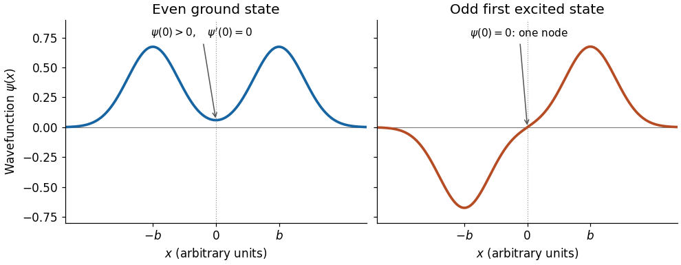

<h1 id="3/e/solution">Solution</h1>

↑ **Parent:** [E](../e.md)

A tall, broad central [potential barrier](../../../../potential-barrier.md) has $\phi\gg1$. Let $\sigma=+1$ denote even [parity](../../../../parity.md) and $\sigma=-1$ odd [parity](../../../../parity.md), and write $\theta=(n+\tfrac12)\pi+\delta_\sigma$, where $n=0,1,\ldots$. Since $\tan[(n+\tfrac12)\pi+\delta]=-\cot\delta$, the condition in part (d) gives

$$
\delta_\sigma=-\sigma\arctan\left(\frac12e^{-\phi}\right)=-\frac\sigma2e^{-\phi}+O(e^{-3\phi}).
$$

Thus the leading correction to the isolated-well [Bohr-Sommerfeld quantization condition](../../../../bohr-sommerfeld-quantization.md) is

$$
\boxed{\int_{x_1}^{x_2}p(x)\,dx=\pi\hbar\left(n+\frac12\right)-\sigma\frac\hbar2\exp\left[-\frac1\hbar\int_{-x_1}^{x_1}\chi(x)\,dx\right]+O(\hbar e^{-3\phi}).}
$$

This is an implicit condition, with all [action integrals](../../../../action-integral.md) evaluated at the corrected [energy](../../../../energy-split.md). To convert it into an explicit leading [energy](../../../../energy-split.md) correction, let $E_n^{(0)}$ solve $\theta(E_n^{(0)})=(n+\tfrac12)\pi$ and define the full classical [oscillation period](../../../../period-of-an-oscillation.md) in one well by $\mathcal T(E)=2m\int_{x_1}^{x_2}dx/p(x)$. Differentiation of the [action integral](../../../../action-integral.md) has no endpoint terms because $p(x_1)=p(x_2)=0$, and gives

$$
\theta'(E)=\frac m\hbar\int_{x_1}^{x_2}\frac{dx}{p(x)}=\frac{\mathcal T(E)}{2\hbar}>0.
$$

Consequently, to leading exponentially small order within the [WKB approximation](../../../../wkb-approximation.md),

$$
\boxed{E_{n,\sigma}\simeq E_n^{(0)}-\sigma\frac{\hbar}{\mathcal T(E_n^{(0)})}e^{-\phi(E_n^{(0)})},\qquad E_{n,-}-E_{n,+}\simeq\frac{2\hbar}{\mathcal T(E_n^{(0)})}e^{-\phi(E_n^{(0)})}.}
$$

The even member lies below its odd partner. For an approximately [harmonic oscillator](../../../../simple-harmonic-motion.md) well, $\mathcal T\simeq2\pi/\omega$, giving the familiar [double-well tunneling splitting](../../../../double-well-tunneling-splitting.md) $\Delta E\simeq(\hbar\omega/\pi)e^{-\phi}$. The explicit [energy](../../../../energy-split.md) formula retains only its leading exponential correction; varying $\phi$ and $\theta'$ with the shifted [energy](../../../../energy-split.md) also contributes at higher orders.

The [ground state](../../../../ground-state.md) has an even, everywhere same-sign [wavefunction](../../../../wave-function-split.md) with a peak in each well and a small nonzero value beneath the central [potential barrier](../../../../potential-barrier.md). Its derivative vanishes at zero. The first [excited state](../../../../excited-state.md) is odd, has opposite-sign lobes in the two wells, and has exactly one interior [node of a wavefunction](../../../../node-of-a-wavefunction.md), at zero. Both [wavefunctions](../../../../wave-function-split.md) decay outside the wells. In terms of localized normalized [wavefunctions](../../../../wave-function-split.md) $\varphi_L,\varphi_R$, with overlap $s=\langle\varphi_L|\varphi_R\rangle$, their qualitative shapes are the [lowest parity states of a symmetric double well](../../../../lowest-parity-states-of-a-symmetric-double-well.md):

$$
\psi_{\rm ground}\simeq\frac{\varphi_L+\varphi_R}{\sqrt{2(1+s)}},\qquad \psi_{\rm first}\simeq\frac{\varphi_R-\varphi_L}{\sqrt{2(1-s)}}.
$$

The overall sign of the odd [wavefunction](../../../../wave-function-split.md) is arbitrary. The sketch uses localized Gaussian profiles to show the [parity](../../../../parity.md) and the central [node of a wavefunction](../../../../node-of-a-wavefunction.md), rather than claiming exact [energy eigenfunctions](../../../../energy-eigenfunction.md) for an unspecified [potential energy](../../../../potential-energy.md).

**[Figure 1](#3/e/image-qualitative-even-ground-state-and-odd-first-excited-state-wavefunctions-of-a-symmetric-double-well). Qualitative even ground-state and odd first-excited-state wavefunctions of a symmetric double well**.

## ↑ Ancestors (12)

1. [E](../e.md)
2. [3](../../3.md)
3. [2023](../../../2023-split.md)
4. [Past exam of the further quantum theory course of the University of Oxford](../../../split.md)
5. [Further quantum theory course of the University of Oxford](../../../../further-quantum-theory-course-of-the-university-of-oxford.md)
6. [Year 3 of the mathematics course of the University of Oxford](../../../../year-3-of-the-mathematics-course-of-the-university-of-oxford.md)
7. [Mathematics course of the University of Oxford](../../../../mathematics-course-of-the-university-of-oxford.md)
8. [Undergraduate course of the University of Oxford](../../../../undergraduate-course-of-the-university-of-oxford.md)
9. [Course of the University of Oxford](../../../../course-of-the-university-of-oxford.md)
10. [University of Oxford](../../../../university-of-oxford-split.md)
11. [List of universities](../../../../list-of-universities.md)
12. [Codex Wiki](../../../../split.md)
