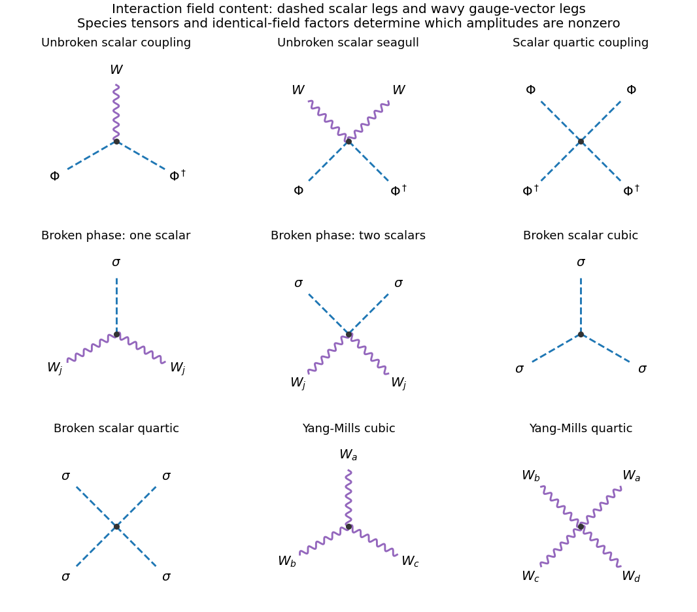

# Paper 1

↑ **Parent:** [2012](../2012.md)

Source: [Cambridge examination PDF, physical pages 474–476; printed paper 225](https://www.whatdotheyknow.com/request/natural_science_tripos_physics_e_2/response/2340776/attach/2/FOI%202023%20399%20Zahid%20materials.pdf?cookie_passthrough=1).

**Table of contents**

- [1](#1)
  - [a](#1/a)
    - [Solution](#1/a/solution)
  - [b](#1/b)
    - [Solution](#1/b/solution)
  - [Solution](#1/solution)
- [2](#2)
  - [Solution](#2/solution)
- [3](#3)
  - [a](#3/a)
    - [Solution](#3/a/solution)
  - [b](#3/b)
    - [Solution](#3/b/solution)
  - [c](#3/c)
    - [Solution](#3/c/solution)

## 1

↑ **Parent:** [Paper 1](paper-1.md)

<h3 id="1/a">a</h3>

↑ **Parent:** [1](#1)

<h4 id="1/a/solution">Solution</h4>

↑ **Parent:** [A](#1/a)

Assume $\lambda>0$ so that the [Higgs potential](../../standard-model.md#higgs-field-potential) is bounded below, and work at tree level in four spacetime dimensions with metric $(+---)$. For $\mu^2>0$, the minimum is $\Phi=0$. The quadratic terms describe **three massless gauge [bosons](../../tensor-product-of-quantum-systems.md#boson) and two complex scalars of [mass](../../classical-mechanics.md#mass) $\sqrt{\mu^2}$**, equivalently four real scalar degrees of freedom. These are the perturbative particle masses about this vacuum, without a claim about the nonperturbative asymptotic spectrum of an interacting non-Abelian theory.

Expanding the [gauge covariant derivative](../../relativistic-quantum-field.md#gauge-covariant-derivative) with $T_j=\tau_j/2$ gives the interaction terms

$$
\mathcal L_{\rm int}=
\frac{ig}{2}W_j^\mu\big[(\partial_\mu\Phi^\dagger)\tau_j\Phi-\Phi^\dagger\tau_j\partial_\mu\Phi\big]
+\frac{g^2}{4}\Phi^\dagger\Phi\,W_j^\mu W_{j\mu}
-\lambda(\Phi^\dagger\Phi)^2.
$$

In the second term, the antisymmetric part of $\tau_j\tau_k$ vanishes against the symmetric gauge-field product. The corresponding [Feynman diagram](../../perturbative-quantum-field-theory.md#feynman-diagram) vertices have one vector and a scalar–antiscalar pair, two vectors and a scalar–antiscalar pair, or four scalar legs with two particles and two [antiparticles](../../relativistic-quantum-field.md#antiparticle). The first vertex carries a [momentum](../../momentum.md) difference from its [derivative](../../calculus.md#derivative). The Pauli matrix in it determines which doublet components couple; the two-vector scalar vertex is proportional to $\delta_{jk}$. There is no cubic scalar interaction about the zero-field vacuum.

**[Figure 1](#1/a/image-scalar-and-gauge-interaction-vertices-before-and-after-the-higgs-field-acquires-its-vacuum-value). Scalar and gauge interaction vertices before and after the Higgs field acquires its vacuum value**.

<h3 id="1/b">b</h3>

↑ **Parent:** [1](#1)

<h4 id="1/b/solution">Solution</h4>

↑ **Parent:** [B](#1/b)

For $\mu^2<0$, minimize the [Higgs potential](../../standard-model.md#higgs-field-potential) to obtain $v^2=-\mu^2/\lambda$. In [unitary gauge](../../standard-model.md#unitary-gauge), the physical scalar fluctuation is real and

$$
\mathcal L_\Phi=\frac12(\partial\sigma)^2
+\frac{g^2}{8}(v+\sigma)^2W_j^\mu W_{j\mu}
-\frac12(2\lambda v^2)\sigma^2-\lambda v\sigma^3-\frac\lambda4\sigma^4+\text{constant}.
$$

Comparing with $m_W^2W_j^\mu W_{j\mu}/2$ and $-m_\sigma^2\sigma^2/2$ gives

$$
\boxed{m_{W_1}=m_{W_2}=m_{W_3}=gv/2,\qquad m_\sigma=\sqrt{2\lambda}\,v=\sqrt{-2\mu^2}.}
$$

All three gauge generators are broken by this complex doublet; this pure SU(2) model has no surviving massless [photon](../../quantum-mechanics.md#photon). Three scalar angular degrees of freedom supply the longitudinal vector [polarizations](../../wave.md#polarization-waves), leaving one real [Higgs boson](../../standard-model.md#higgs-boson). The count is $3\times2+4=3\times3+1=10$. The corresponding fundamental-doublet example also appears in [Gauge Theory by David Tong](../../physics-bibliography.md#gauge-theory-by-david-tong).[Section 2.7, example “SU(2) with Fundamental Matter”, Higgs-phase spectrum](../../physics-bibliography.md#gauge-theory-by-david-tong)

The remaining interactions are $g^2v\sigma W_jW_j/4$, $g^2\sigma^2W_jW_j/8$, $-\lambda v\sigma^3$ and $-\lambda\sigma^4/4$. They give vertices with two equal-species vector legs and one or two scalar legs, or three or four scalar legs, as drawn above. The coefficients in the Lagrangian must be differentiated with respect to identical fields when obtaining fully normalized [Feynman rules](../../perturbative-quantum-field-theory.md#feynman-rules); the written coefficients alone are not all the vertex factors.

<h3 id="1/solution">Solution</h3>

↑ **Parent:** [1](#1)

The [gauge fields](../../relativistic-quantum-field.md#gauge-field) require their own [Yang-Mills Lagrangian](../../relativistic-quantum-field.md#yang-mills-lagrangian), $-W^a_{\mu\nu}W^{a\mu\nu}/4$. The non-Abelian field strength contains a term quadratic in the gauge potentials, so squaring it produces **three-vector and four-vector self-interaction vertices**, with [derivative](../../calculus.md#derivative) [momentum](../../momentum.md) factors in the cubic vertex and SU(2) structure constants in both. They exist in either scalar phase and must be added to the scalar-generated vertices. A gauge-fixed quantum calculation also has gauge-fixing and, where applicable, ghost terms; those are not extra physical [boson](../../tensor-product-of-quantum-systems.md#boson) species.

For $\mu^2>0$, the global phase transformation $\Phi\mapsto e^{i\alpha}\Phi$ leaves both the scalar potential and the covariant [kinetic term](../../classical-field-theory.md#kinetic-term) unchanged while leaving $W_j$ fixed. Its [Noether charge](../../classical-field-theory.md#noether-charge) counts scalar particles minus [antiparticles](../../relativistic-quantum-field.md#antiparticle). Thus $\phi_a\phi_b\to\phi_a\phi_b$ and $\phi_a\phi_a^*\to W_3W_3$ are compatible with this charge, whereas $\phi_a\phi_b\to W_jW_k$ is forbidden: its initial charge is two and final charge zero. Charge conservation is necessary, not sufficient, for a particular amplitude to be nonzero; other [quantum numbers](../../quantum-system.md#quantum-number) and kinematics still apply.

After adding the [hypercharge](../../standard-model.md#hypercharge) field, the neutral-vector [mass](../../classical-mechanics.md#mass) term becomes

$$
\frac{v^2}{8}(gW_3-g'B)^2.
$$

Its [mass](../../classical-mechanics.md#mass) matrix has zero determinant. With $G=\sqrt{g^2+g'^2}$, the orthonormal combinations are

$$
\boxed{A=\frac{g'W_3+gB}{G},\quad m_A=0;\qquad
Z=\frac{gW_3-g'B}{G},\quad m_Z=Gv/2.}
$$

The unbroken generator is [electric charge](../../electric-charge.md), $Q=T_3+Y/2$, because the lower doublet component has $T_3=-1/2$ and $Y=1$. The charged combinations $W^\pm=(W_1\mp iW_2)/\sqrt2$ keep [mass](../../classical-mechanics.md#mass) $gv/2$.

The observed charged [weak interaction](../../standard-model.md#weak-interaction) couples left-chiral [fermions](../../tensor-product-of-quantum-systems.md#fermion) within SU(2) doublets. In the [Standard Model](../../standard-model.md), $Q_L=(u_L,d_L)$ and $L_L=(\nu_L,e_L)$ are doublets, while $u_R,d_R,e_R$ are singlets. A vectorlike assignment would also give right-handed charged weak currents, contrary to this observed chiral structure. Once the measured [electric charges](../../electric-charge.md) are specified, $Y=2(Q-T_3)$ fixes

$$
\begin{array}{c|rrrrrr}
\text{multiplet}&Q_L&u_R&d_R&L_L&e_R&\Phi\\\hline
Y&1/3&4/3&-2/3&-1&-2&1
\end{array}.
$$

An optional [right-handed neutrino](../../standard-model.md#right-handed-neutrino) is a singlet with $Y=0$. Conjugate left-chiral fields have the opposite [hypercharges](../../standard-model.md#hypercharge) to these right-chiral fields. These assignments permit gauge-invariant [Yukawa interactions](../../standard-model.md#yukawa-interaction); they are not obtained by assigning one common [hypercharge](../../standard-model.md#hypercharge) to every [chirality](../../relativistic-quantum-field.md#chirality-physics).

## 2

↑ **Parent:** [Paper 1](paper-1.md)

<h3 id="2/solution">Solution</h3>

↑ **Parent:** [2](#2)

Write $C_{ikjl}=\sum_aT^a_{ik}T^a_{jl}$. Hermiticity converts its complex-conjugate factors into $T^b_{ki}T^b_{lj}$. Summing all external colors therefore gives

$$
\sum_{i,j,k,l}|C_{ikjl}|^2
=\sum_{a,b}\operatorname{Tr}(T^aT^b)\operatorname{Tr}(T^aT^b)
=\frac14\sum_{a,b}\delta^{ab}\delta^{ab}=\boxed{2},
$$

since SU(3) has eight generators. This is a sum, before averaging the nine equally populated incoming color states.

For the [spinor](../../algebra-over-a-field.md#spinor) current, use $\bar u=u^\dagger\gamma^0$, $(\gamma^0)^2=1$ and the stated gamma-matrix adjoint identity:

$$
\begin{aligned}
[\bar u_3\gamma^\mu u_1]^*
&=u_1^\dagger(\gamma^\mu)^\dagger\gamma^0u_3\\
&=u_1^\dagger\gamma^0\gamma^\mu\gamma^0\gamma^0u_3
=\bar u_1\gamma^\mu u_3.
\end{aligned}
$$

The [spin sum](../../relativistic-quantum-field.md#spin-sum) completeness relation then closes each product of currents into a [trace](../../linear-algebra.md#matrix-trace). Averaging two spins for each incoming [quark](../../standard-model.md#quark), in addition to nine incoming colors, gives

$$
\overline{|\mathcal M|^2}=\frac{2}{9\times4}\frac{g_s^4}{t^2}
\operatorname{Tr}(\not{p}_3\gamma^\mu\not{p}_1\gamma^\nu)
\operatorname{Tr}(\not{p}_4\gamma_\mu\not{p}_2\gamma_\nu),\qquad t=q^2.
$$

The factor is $1/18$, rather than $2/9$: the latter omits the initial spin average.

To derive the four-[gamma matrix](../../algebra-over-a-field.md#gamma-matrices) [trace](../../linear-algebra.md#matrix-trace), first anticommutation and cyclicity give $\operatorname{Tr}(\gamma^\alpha\gamma^\beta)=4g^{\alpha\beta}$, with $\operatorname{Tr}1=4$. If $T=\operatorname{Tr}(\gamma^\lambda\gamma^\mu\gamma^\sigma\gamma^\nu)$, move $\gamma^\lambda$ successively through the next three matrices. The last term is $-T$ by cyclicity, so

$$
2T=2g^{\lambda\mu}\operatorname{Tr}(\gamma^\sigma\gamma^\nu)
-2g^{\lambda\sigma}\operatorname{Tr}(\gamma^\mu\gamma^\nu)
+2g^{\lambda\nu}\operatorname{Tr}(\gamma^\mu\gamma^\sigma).
$$

Substitution yields

$$
\boxed{T=4(g^{\lambda\mu}g^{\sigma\nu}-g^{\lambda\sigma}g^{\mu\nu}+g^{\lambda\nu}g^{\mu\sigma}).}
$$

Consequently the first [momentum](../../momentum.md) [trace](../../linear-algebra.md#matrix-trace) is $4(p_3^\mu p_1^\nu+p_3^\nu p_1^\mu-g^{\mu\nu}p_3\cdot p_1)$. Contracting both [traces](../../linear-algebra.md#matrix-trace) gives

$$
32[(p_3\cdot p_4)(p_1\cdot p_2)+(p_3\cdot p_2)(p_1\cdot p_4)]
=8(s^2+u^2).
$$

Here $s=(p_1+p_2)^2$, $u=(p_1-p_4)^2$ and all external masses vanish. Thus the [distinct-flavor quark scattering color factor](../../standard-model.md#distinct-flavor-quark-scattering-color-factor) gives

$$
\boxed{\overline{|\mathcal M|^2}=\frac49g_s^4\frac{s^2+u^2}{t^2}
=\frac{4g_s^4}{9}\frac{4+(1+\cos\theta^*)^2}{(1-\cos\theta^*)^2}.}
$$

We used $t=-s(1-\cos\theta^*)/2$ and $u=-s(1+\cos\theta^*)/2$. The forward divergence reflects massless $t$-channel exchange in this parton-level tree approximation; it is not an unrestricted prediction for an experimentally resolved jet [cross section](../../physics.md#cross-section-physics).

Finally, completeness of the SU(3) generators gives the [fundamental-generator Fierz identity](../../topological-group.md#fundamental-generator-fierz-identity)

$$
C_{ikjl}=\frac12\left(\delta_{il}\delta_{jk}-\frac13\delta_{ik}\delta_{jl}\right).
$$

For each distinct pair $i\ne j$, the allowed final colors are either $k=i,l=j$, with coefficient $-1/6$, or $k=j,l=i$, with coefficient $1/2$. If $i=j$, only $k=l=i$ is nonzero, with coefficient $1/3$. These are **15 ordered configurations**: six unchanged-color cases, six exchanged-color cases and three all-equal cases. Their squared coefficients sum to $6/36+6/4+3/9=2$, independently checking the first result. Flavor remains tied to each external line; exchanging colors does not exchange the up and down [quark](../../standard-model.md#quark) species.

## 3

↑ **Parent:** [Paper 1](paper-1.md)

<h3 id="3/a">a</h3>

↑ **Parent:** [3](#3)

<h4 id="3/a/solution">Solution</h4>

↑ **Parent:** [A](#3/a)

A bare [Dirac mass](../../relativistic-quantum-field.md#dirac-mass-term) couples left and right [chirality](../../relativistic-quantum-field.md#chirality-physics), so the distinct electroweak representations prevent writing it as a gauge-invariant term before symmetry breaking. Instead the [Yukawa interactions](../../standard-model.md#yukawa-interaction) are

$$
\mathcal L_Y=-\bar Q_LY_dd_R\Phi-\bar Q_LY_uu_R\widetilde\Phi
-\bar L_LY_ee_R\Phi+\text{Hermitian conjugate},\qquad
\widetilde\Phi=i\tau_2\Phi^*.
$$

Weak indices are contracted to singlets. Substituting the vacuum value gives [mass](../../classical-mechanics.md#mass) matrices $M_f=Y_fv/\sqrt2$ and a physical Higgs coupling $-\bar f_LM_ff_R\sigma/v$ plus its conjugate. Biunitary diagonalization defines [mass](../../classical-mechanics.md#mass) eigenstates; a mismatch between the up- and down-quark left rotations appears in the [CKM matrix](../../standard-model.md#cabibbo-kobayashi-maskawa-matrix). Gauge-boson masses arise from the Higgs [kinetic term](../../classical-field-theory.md#kinetic-term), whereas these [fermion](../../tensor-product-of-quantum-systems.md#fermion) masses arise from the Yukawa term.

With only the minimal field content there is no [right-handed neutrino](../../standard-model.md#right-handed-neutrino), so no renormalizable neutrino Yukawa term. Adding a gauge-singlet $N_R$ permits both a Dirac scale $m_D=y_\nu v/\sqrt2$ and a Majorana scale $M_R$. For one family the symmetric [mass](../../classical-mechanics.md#mass) matrix in a left-chiral basis is

$$
\begin{pmatrix}0&m_D\\m_D&M_R\end{pmatrix}.
$$

Its signed [eigenvalues](../../linear-operator-theory.md#eigenvalue) are $(M_R\pm\sqrt{M_R^2+4m_D^2})/2$. Rephasing gives positive physical masses, and for $|M_R|\gg|m_D|$ the [seesaw mechanism](../../standard-model.md#seesaw-mechanism) yields

$$
\boxed{m_{\rm light}\simeq |m_D|^2/|M_R|,\qquad m_{\rm heavy}\simeq |M_R|.}
$$

For $m_D\sim100\,\mathrm{GeV}$ and $M_R\sim10^{14}\,\mathrm{GeV}$, the light scale is about $0.1\,\mathrm{eV}$. Integrating out the heavy state generates the dimension-five [Weinberg operator](../../standard-model.md#weinberg-operator), whose Higgs vacuum insertion gives the same suppression. Alternatively a Dirac neutrino can have a very small [Yukawa coupling](../../standard-model.md#yukawa-interaction) with [lepton](../../standard-model.md#lepton) number conserved. A tiny observed neutrino [mass](../../classical-mechanics.md#mass) does not by itself distinguish these mechanisms.

<h3 id="3/b">b</h3>

↑ **Parent:** [3](#3)

<h4 id="3/b/solution">Solution</h4>

↑ **Parent:** [B](#3/b)

In units $\hbar=c=1$, a dimensionless [action](../../lagrangian-mechanics.md#action) fixes $[\mathcal L]=4$. Canonical [kinetic terms](../../classical-field-theory.md#kinetic-term) then give $[\phi]=[A_\mu]=1$, $[\psi]=3/2$ and $[\partial_\mu]=1$. If an interaction operator has dimension $d_v$, its coefficient has [mass dimension](../../perturbative-quantum-field-theory.md#mass-dimension) $[g_v]=4-d_v$. Thus scalar quartic, Yukawa and [gauge couplings](../../relativistic-quantum-field.md#gauge-coupling) are dimensionless; a scalar cubic coupling has dimension one, a four-fermion coupling has dimension minus two, and the Weinberg coefficient has dimension minus one. These are engineering dimensions; anomalous scaling is an additional quantum effect.

For a connected graph with $L$ independent loop momenta, $I_B$ [boson](../../tensor-product-of-quantum-systems.md#boson) lines, $I_F$ [fermion](../../tensor-product-of-quantum-systems.md#fermion) lines and $r_v$ [derivatives](../../calculus.md#derivative) at vertex $v$, ordinary covariant-gauge ultraviolet counting gives the [superficial degree of divergence](../../perturbative-quantum-field-theory.md#superficial-degree-of-divergence)

$$
D=4L-2I_B-I_F+\sum_vr_v
=4-E_B-\frac32E_F-\sum_v[g_v].
$$

The second form follows from $L=I_B+I_F-V+1$ and counting field ends at vertices. It presumes the canonical large-momentum propagators; unitary-gauge vector propagators can obscure the cancellations of a renormalizable gauge theory. A nonnegative $D$ signals a possible overall [ultraviolet divergence](../../perturbative-quantum-field-theory.md#ultraviolet-divergence), not proof of one. Symmetries can cancel it, while a graph with $D<0$ can still contain divergent subgraphs.

With only operators of dimension at most four, increasing the vertex count does not require [counterterms](../../perturbative-quantum-field-theory.md#counterterm) of unbounded dimension. Subject to the necessary symmetry identities and absence of gauge anomalies, scalar quartic theory, Yukawa theories and the [Standard Model](../../standard-model.md) are perturbatively renormalizable when all required interactions are included. In particular, coupling a scalar to other fields can require a scalar quartic [counterterm](../../perturbative-quantum-field-theory.md#counterterm) even if its coefficient was initially set to zero. The [Higgs mechanism](../../standard-model.md#higgs-mechanism) does not destroy renormalizability of the underlying anomaly-free gauge theory.

By contrast, repeated insertions of the dimension-six [Fermi interaction](../../quantum-field-theory.md#fermi-interaction) or a dimension-five operator allow increasingly high-dimensional [counterterms](../../perturbative-quantum-field-theory.md#counterterm). Such terms are useful in an [effective field theory](../../quantum-field-theory.md#effective-field-theory) with a stated expansion in [energy](../../energy.md) over a high scale; nonrenormalizable does not mean unpredictive at a fixed order. A scalar $\phi^6$ interaction and perturbative Einstein gravity in four dimensions provide other examples. Renormalizability also does not assert small coupling at every scale or a complete ultraviolet theory.

<h3 id="3/c">c</h3>

↑ **Parent:** [3](#3)

<h4 id="3/c/solution">Solution</h4>

↑ **Parent:** [C](#3/c)

The [SU(5) grand unified theory](../../perturbative-quantum-field-theory.md#su-5-grand-unified-theory) embeds the strong and electroweak groups in a single simple gauge group. Its 24 gauge generators contain the eight [gluons](../../standard-model.md#gluon), three weak generators and one [hypercharge](../../standard-model.md#hypercharge) generator, plus twelve additional generators connecting color and weak directions. A common [gauge coupling](../../relativistic-quantum-field.md#gauge-coupling) applies at the unification scale with the properly normalized [hypercharge](../../standard-model.md#hypercharge) generator; low-energy couplings differ through their [renormalization group](../../critical-phenomenon.md#renormalization-group) evolution.

Using left-chiral fields throughout, one [Standard Model](../../standard-model.md) generation fits into

$$
\overline{\mathbf5}=(d_R^c,L_L),\qquad
\mathbf{10}=(Q_L,u_R^c,e_R^c).
$$

The dimensions are $3+2=5$ and $6+3+1=10$, so no [right-handed neutrino](../../standard-model.md#right-handed-neutrino) is required in these multiplets. A singlet neutrino can be added. A suitable adjoint scalar vacuum breaks SU(5) to the [Standard Model](../../standard-model.md) subgroup; a fundamental scalar contains an electroweak doublet and a colored triplet. The extra heavy vector [bosons](../../tensor-product-of-quantum-systems.md#boson) can mediate transitions between [quarks](../../standard-model.md#quark) and [leptons](../../standard-model.md#lepton), hence [proton decay](../../standard-model.md#proton-decay) in the minimal model. This is a proposed unification, not an experimentally established identification of new particles.

The [hierarchy problem](../../standard-model.md#hierarchy-problem) concerns keeping an elementary weak-scale scalar light in the presence of much heavier physical scales. A heavy state coupled to it generically induces a threshold correction of order $\delta m_H^2\sim cM^2/(16\pi^2)$, with $c$ a product of couplings. Without protection, a weak-scale result then needs cancellation against a much larger parameter. In SU(5), this is sharpened by [doublet-triplet splitting](../../perturbative-quantum-field-theory.md#doublet-triplet-splitting): the electroweak doublet must stay light while its colored partner must be sufficiently heavy to avoid rapid [proton decay](../../standard-model.md#proton-decay). Choosing a small tree-level doublet [mass](../../classical-mechanics.md#mass) is not by itself a mechanism protecting it from subsequent heavy-particle corrections. [Supersymmetry](../../supersymmetry.md) and other proposals change this protection problem, but the minimal SU(5) embedding alone does not solve it.

## ↑ Ancestors (11)

1. [2012](../2012.md)
2. [Past exam of the gauge field theory course of the University of Cambridge](../../past-exam-of-the-gauge-field-theory-course-of-the-university-of-cambridge.md)
3. [Gauge Field Theory course of the University of Cambridge](../../university-of-cambridge.md#gauge-field-theory-course-of-the-university-of-cambridge)
4. [Physics course of the year 4 of the natural sciences course of the University of Cambridge](../../university-of-cambridge.md#physics-course-of-the-year-4-of-the-natural-sciences-course-of-the-university-of-cambridge)
5. [Year 4 of the natural sciences course of the University of Cambridge](../../university-of-cambridge.md#year-4-of-the-natural-sciences-course-of-the-university-of-cambridge)
6. [Year of the natural sciences course of the University of Cambridge](../../university-of-cambridge.md#year-of-the-natural-sciences-course-of-the-university-of-cambridge)
7. [Natural sciences course of the University of Cambridge](../../university-of-cambridge.md#natural-sciences-course-of-the-university-of-cambridge)
8. [Course of the University of Cambridge](../../university-of-cambridge.md#course-of-the-university-of-cambridge)
9. [University of Cambridge](../../university-of-cambridge.md)
10. [List of universities](../../README.md#list-of-universities)
11. [Codex Wiki](../../README.md)
