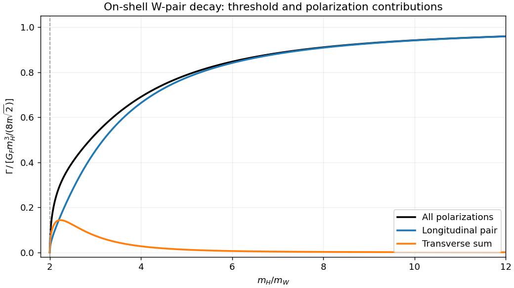

# Paper 1

↑ **Parent:** [2013](../2013.md)

Original public paper: [Physical PDF pages 578–580](https://www.whatdotheyknow.com/request/natural_science_tripos_physics_e_2/response/2340776/attach/2/FOI%202023%20399%20Zahid%20materials.pdf?cookie_passthrough=1#page=578). All three questions and all listed interactions are covered.

**Table of contents**

- [1](#1)
  - [Solution](#1/solution)
  - [i](#1/i)
    - [Solution](#1/i/solution)
  - [ii](#1/ii)
    - [Solution](#1/ii/solution)
- [2](#2)
  - [Solution](#2/solution)
- [3](#3)
  - [Solution](#3/solution)
  - [a](#3/a)
    - [Solution](#3/a/solution)
  - [b](#3/b)
    - [Solution](#3/b/solution)
  - [c](#3/c)
    - [Solution](#3/c/solution)
  - [d](#3/d)
    - [Solution](#3/d/solution)
  - [e](#3/e)
    - [Solution](#3/e/solution)
  - [Solution (Fermi interaction)](#3/solution-fermi-interaction)

## 1

↑ **Parent:** [Paper 1](paper-1.md)

<h3 id="1/solution">Solution</h3>

↑ **Parent:** [1](#1)

Use [natural units](../../mathematical-physics.md#natural-units) and the [Minkowski metric](../../special-relativity.md#minkowski-metric) $g_{\mu\nu}=\operatorname{diag}(1,-1,-1,-1)$. Varying the [Proca action](../../electromagnetism.md#proca-action) with respect to $A_\nu$ gives $\partial\mathcal L/\partial A_\nu=m^2A^\nu$ and $\partial\mathcal L/\partial(\partial_\mu A_\nu)=-F^{\mu\nu}$. The [Euler-Lagrange equation](../../analysis.md#euler-lagrange-equation) is therefore

$$
\boxed{\partial_\mu F^{\mu\nu}+m^2A^\nu=0.}
$$

Taking a divergence annihilates the antisymmetric field strength, since commuting derivatives are symmetric in their indices. For $m\ne0$ this gives the [Lorenz constraint in Proca theory](../../electromagnetism.md#lorenz-constraint-in-proca-theory) $\partial_\nu A^\nu=0$, and hence $(\Box+m^2)A^\nu=0$. The constraint follows from dynamics; it is not an additional [gauge fixing](../../relativistic-quantum-field.md#gauge-fixing) condition for this massive theory.

For four-[momentum](../../momentum.md) $p^\mu=(E,0,0,p)$, [longitudinal polarization of a massive vector boson](../../relativistic-quantum-field.md#longitudinal-polarization-of-a-massive-vector-boson) lies in the time–$z$ plane, has $p\cdot\varepsilon=0$ and is normalized by $\varepsilon\cdot\varepsilon=-1$. Taking

$$
\boxed{\varepsilon_L^\mu=\frac1m(p,0,0,E)}
$$

satisfies both requirements because $E^2-p^2=m^2$. It can also be obtained by boosting the rest-frame unit spatial [polarization](../../wave.md#polarization-waves) along the direction of motion. Together with two transverse [polarizations](../../wave.md#polarization-waves) it gives the three physical spin states of a massive [spin](../../angular-momentum-operator.md#spin) one particle.

In the [Higgs boson](../../standard-model.md#higgs-boson) rest frame, choose $p^\mu=(E,0,0,p^*)$ and $p'^\mu=(E,0,0,-p^*)$, with $E=m_H/2$ and $p^{*2}=m_H^2/4-m_W^2$. Consistent normalized longitudinal [polarization vectors](../../relativistic-quantum-field.md#polarization-vector) are

$$
\varepsilon_L(p)=\frac1{m_W}(p^*,0,0,E),\qquad
\varepsilon_L(p')=\frac1{m_W}(p^*,0,0,-E).
$$

Their Lorentz contraction is $(p^{*2}+E^2)/m_W^2=(2p^{*2}+m_W^2)/m_W^2$. The [Higgs boson coupling to W bosons](../../standard-model.md#higgs-boson-coupling-to-w-bosons) consequently gives

$$
|\mathcal M_{LL}|^2=\frac{v^2g^4}{4m_W^4}(2p^{*2}+m_W^2)^2
=\frac{m_H^4}{v^2}(1-2x)^2,\qquad x=\frac{m_W^2}{m_H^2}.
$$

Using the [two-body Lorentz-invariant phase space](../../relativistic-quantum-field.md#two-body-lorentz-invariant-phase-space), $p^*=m_H\sqrt{1-4x}/2$ and $v^{-2}=\sqrt2G_F$ yields the longitudinal partial [decay width](../../relativistic-quantum-field.md#decay-width)

$$
\boxed{\Gamma(H\to W_L^+W_L^-)=\frac{G_Fm_H^3}{8\pi\sqrt2}\sqrt{1-4x}\,(1-2x)^2,\qquad m_H>2m_W.}
$$

The charged [W bosons](../../standard-model.md#w-boson) are distinguishable, so there is no identical-particle factor of $1/2$. This expression includes the entire angular phase space but only the specified longitudinal final [polarizations](../../wave.md#polarization-waves). The [Higgs decay to two W bosons](../../standard-model.md#higgs-decay-to-two-w-bosons) summed over all [polarizations](../../wave.md#polarization-waves) instead has the factor $1-4x+12x^2$; the additional transverse contribution is $8x^2$. At $m_H\gg m_W$ the longitudinal channel dominates and the leading width grows as $G_Fm_H^3$.

**[Figure 1](#1/image-on-shell-higgs-decay-longitudinal-and-transverse-contributions-to-the-w-pair-width). On-shell Higgs decay: longitudinal and transverse contributions to the W-pair width**.

<h3 id="1/i">i</h3>

↑ **Parent:** [1](#1)

<h4 id="1/i/solution">Solution</h4>

↑ **Parent:** [I](#1/i)

Below $m_H=2m_W$, the on-shell two-body [decay channel](../../physics.md#decay-channel) is kinematically closed. An imaginary $p^*$ in the preceding formula is therefore a sign that this formula no longer applies. Slightly below threshold, the physical process can instead contain an on-shell [W boson](../../standard-model.md#w-boson) and an off-shell one, $H\to WW^*\to Wf\bar f'$, followed by decay of the remaining [W boson](../../standard-model.md#w-boson). Its rate requires the virtual-vector [propagator](../../quantum-field-theory.md#propagator), its allowed fermionic decay channels and the corresponding multiparticle [Lorentz-invariant phase space](../../relativistic-quantum-field.md#lorentz-invariant-phase-space). The nonzero [decay width](../../relativistic-quantum-field.md#decay-width) of the [W boson](../../standard-model.md#w-boson) smooths the idealized threshold. A polarization-resolved rate for two on-shell longitudinal vectors must not be analytically continued and treated as that multiparticle rate.

<h3 id="1/ii">ii</h3>

↑ **Parent:** [1](#1)

<h4 id="1/ii/solution">Solution</h4>

↑ **Parent:** [Ii](#1/ii)

In the stronger limit $m_H\ll m_W$, both intermediate [W bosons](../../standard-model.md#w-boson) must be virtual. Their heavy propagators suppress the four-fermion [decay amplitude](../../relativistic-quantum-field.md#decay-amplitude), while the small available [phase space](../../hamiltonian-mechanics.md#phase-space) suppresses its rate further. At energies small compared with $m_W$, integrating out the two vectors gives a local interaction proportional to $G_FH J_\mu^+J^{-\mu}/v$. Its dimension-seven coefficient implies a rate of order $G_F^3m_H^7$ when all four final [fermions](../../tensor-product-of-quantum-systems.md#fermion) can be treated as massless, with channel-dependent constants. This is a low-energy scaling statement, not the on-shell longitudinal-width formula. Other accessible [Higgs boson](../../standard-model.md#higgs-boson) decay channels, such as a pair of [fermions](../../tensor-product-of-quantum-systems.md#fermion) or loop-induced two-[photon](../../quantum-mechanics.md#photon) decay, must then be compared using their actual masses and couplings.

## 2

↑ **Parent:** [Paper 1](paper-1.md)

<h3 id="2/solution">Solution</h3>

↑ **Parent:** [2](#2)

The [Standard Model](../../standard-model.md) uses the local [gauge group](../../relativistic-quantum-field.md#gauge-group) $SU(3)_c\times SU(2)_L\times U(1)_Y$. Its [Higgs field](../../standard-model.md#higgs-field) is a complex [Higgs doublet](../../standard-model.md#higgs-field) of [hypercharge](../../standard-model.md#hypercharge) $Y=1/2$. A bare [mass](../../classical-mechanics.md#mass) term for a weak [gauge boson](../../relativistic-quantum-field.md#gauge-boson), or for a charged [fermion](../../tensor-product-of-quantum-systems.md#fermion) joining inequivalent left- and right-handed gauge representations, would not respect the unbroken electroweak construction. Instead introduce a gauge-invariant [Higgs potential](../../standard-model.md#higgs-field-potential)

$$
V(\Phi)=-\mu^2\Phi^\dagger\Phi+\lambda(\Phi^\dagger\Phi)^2,\qquad\lambda>0,\quad\mu^2>0.
$$

Its minima satisfy $\Phi^\dagger\Phi=v^2/2$, $v^2=\mu^2/\lambda$. Choosing a representative $\langle\Phi\rangle=(0,v)^T/\sqrt2$ leaves $Q=T_3+Y$ unbroken. In this description [electroweak symmetry breaking](../../standard-model.md#electroweak-symmetry-breaking) is $SU(2)_L\times U(1)_Y\to U(1)_{\rm em}$; the underlying local [gauge symmetry](../../relativistic-quantum-field.md#gauge-invariance) remains a redundancy of the theory. A vacuum representative is not a physical explicit violation of gauge invariance.

In [unitary gauge](../../standard-model.md#unitary-gauge), write $\Phi=(0,v+H)^T/\sqrt2$. The [gauge-covariant kinetic term](../../classical-field-theory.md#gauge-covariant-kinetic-term) $|D_\mu\Phi|^2$ produces

$$
m_W=\frac{gv}{2},\qquad m_Z=\frac{v}{2}\sqrt{g^2+g'^2},\qquad m_\gamma=0,
$$

with $\tan\theta_W=g'/g$ and $e=g\sin\theta_W$. Three angular scalar directions supply the [longitudinal gauge-boson polarizations](../../relativistic-quantum-field.md#longitudinal-polarization-of-a-massive-vector-boson) of $W^+,W^-,Z$, while one real radial [Higgs boson](../../standard-model.md#higgs-boson) survives with $m_H^2=2\lambda v^2$. Counting physical [degrees of freedom](../../classical-mechanics.md#degree-of-freedom) checks the [Higgs mechanism](../../standard-model.md#higgs-mechanism): the electroweak gauge sector and scalar doublet have $4\times2+4=12$ before the rearrangement and $3\times3+2+1=12$ afterwards.

The [Higgs potential](../../standard-model.md#higgs-field-potential) also fixes the scalar self-interactions:

$$
V=\text{constant}+\frac{m_H^2}{2}H^2+\frac{m_H^2}{2v}H^3+\frac{m_H^2}{8v^2}H^4.
$$

The color gauge group is unbroken, so [gluons](../../standard-model.md#gluon) remain massless. The same electroweak kinetic term fixes

$$
\mathcal L\supset\frac{2m_W^2}{v}HW_\mu^+W^{-\mu}+\frac{m_Z^2}{v}HZ_\mu Z^\mu
+\frac{m_W^2}{v^2}H^2W_\mu^+W^{-\mu}+\frac{m_Z^2}{2v^2}H^2Z_\mu Z^\mu.
$$

Gauge-invariant [Yukawa couplings](../../standard-model.md#yukawa-interaction) such as $-y_d\bar Q_L\Phi d_R-y_u\bar Q_L\widetilde\Phi u_R+\mathrm{h.c.}$ give $m_f=y_fv/\sqrt2$ and the physical coupling $-m_fH\bar f f/v$. These relations predict stronger Higgs couplings to heavier massive particles; they do not determine the Yukawa parameters themselves. The minimal [Standard Model](../../standard-model.md) does not supply observed neutrino masses. The surviving [Higgs boson](../../standard-model.md#higgs-boson) is neutral and has [spin](../../angular-momentum-operator.md#spin) zero; its [mass](../../classical-mechanics.md#mass) and self-coupling are tied to the curvature of the [Higgs potential](../../standard-model.md#higgs-field-potential), not fixed by the gauge couplings alone. Higgs exchange also provides the [Higgs cancellation in longitudinal vector scattering](../../standard-model.md#higgs-cancellation-in-longitudinal-vector-scattering), maintaining the required high-energy behavior of weak amplitudes.

At a proton collider, important production mechanisms are [gluon-fusion Higgs production](../../standard-model.md#gluon-fusion-higgs-production) through a heavy-quark loop, [vector-boson fusion](../../standard-model.md#vector-boson-fusion) with two outgoing quark jets, associated $WH$ or $ZH$ production, and production with a [top quark](../../standard-model.md#top-quark) pair. At an [electron](../../physics.md#electron)–positron collider, [Higgsstrahlung](../../standard-model.md#higgsstrahlung) $e^+e^-\to ZH$ is a clean example. Tree-level decays include [Higgs decay to a fermion pair](../../standard-model.md#higgs-decay-to-a-fermion-pair) and, when allowed, [Higgs decay to two W bosons](../../standard-model.md#higgs-decay-to-two-w-bosons) or [Higgs decay to two Z bosons](../../standard-model.md#higgs-decay-to-two-z-bosons). Below an on-shell vector-pair threshold, one or both vectors can be virtual. The $gg$ and $\gamma\gamma$ channels arise through loops; neutral colorless $H$ has no corresponding direct tree-level gauge coupling. Rates and [branching fractions](../../relativistic-quantum-field.md#branching-fraction) depend on both couplings and kinematics, so “heaviest available particle” is a guide rather than a complete rule.

The [Higgs boson discovery in 2012](../../standard-model.md#higgs-boson-discovery-in-2012) supplied an experimental test. The [ATLAS experiment](../../particle-accelerator.md#atlas-experiment) and [CMS experiment](../../particle-accelerator.md#compact-muon-solenoid) reconstructed two-[photon](../../quantum-mechanics.md#photon) and four-lepton [invariant masses](../../special-relativity.md#invariant-mass) in [Large Hadron Collider](../../particle-accelerator.md#large-hadron-collider) proton collisions. [Electromagnetic calorimeters](../../particle-detection.md#electromagnetic-calorimeter) measure [photon](../../quantum-mechanics.md#photon) energies, while tracking and muon systems identify charged leptons; narrow reconstructed peaks can be distinguished from smooth backgrounds with control samples and a likelihood analysis. The ATLAS discovery paper reported a new resonance near $126.5\,\mathrm{GeV}$. An observed [mass](../../classical-mechanics.md#mass) peak supports the existence of a new state; production channels, decay rates and angular distributions test whether it has the particular Higgs couplings and quantum numbers.[abstract; Sections 2, 6–7 and 9](../../physics-bibliography.md#observation-of-a-new-particle-in-the-search-for-the-standard-model-higgs-boson-with-the-atlas-detector-at-the-lhc-by-atlas-collaboration)

Finally, the [hierarchy problem](../../standard-model.md#hierarchy-problem) asks why the electroweak scalar [mass](../../classical-mechanics.md#mass) scale remains much smaller than a putative heavy physical scale without delicate cancellations. A cutoff estimate suggests corrections $\delta m_H^2\sim\Lambda^2/(16\pi^2)$ times couplings, but the quadratic cutoff term itself depends on the regularization convention. The physical concern persists when a heavy state of [mass](../../classical-mechanics.md#mass) $M$ couples to the [Higgs field](../../standard-model.md#higgs-field) and produces threshold corrections of order its coupling times $M^2/(16\pi^2)$. Matching a much smaller Higgs [mass](../../classical-mechanics.md#mass) may then require cancellation between independent parameters. Supersymmetry, compositeness and other protective structures propose different resolutions; [renormalizability](../../perturbative-quantum-field-theory.md#renormalizable-quantum-field-theory) of the [Standard Model](../../standard-model.md) does not by itself resolve this sensitivity or establish that new particles must occur at one particular [mass](../../classical-mechanics.md#mass).

## 3

↑ **Parent:** [Paper 1](paper-1.md)

<h3 id="3/solution">Solution</h3>

↑ **Parent:** [3](#3)

Interactions produce [Feynman diagrams](../../perturbative-quantum-field-theory.md#feynman-diagram) with internal lines whose independent [loop momenta](../../perturbative-quantum-field-theory.md#loop-momentum) are integrated without an upper bound. Their large-momentum contributions can have an [ultraviolet divergence](../../perturbative-quantum-field-theory.md#ultraviolet-divergence). Two explicit examples in a scalar quartic theory are a one-loop [tadpole diagram](../../perturbative-quantum-field-theory.md#tadpole-diagram) contributing to the two-point function and a one-loop four-point [bubble diagram](../../perturbative-quantum-field-theory.md#bubble-diagram). After a [Wick rotation](../../perturbative-quantum-field-theory.md#wick-rotation), a spherical cutoff $\Lambda$ gives the representative integrals

$$
I_1=\int_{|k_E|<\Lambda}\frac{d^4k_E}{(2\pi)^4}\frac1{k_E^2+m^2}
=\frac1{16\pi^2}\left[\Lambda^2-m^2\ln\left(1+\frac{\Lambda^2}{m^2}\right)\right],
$$

$$
I_2(0)=\int_{|k_E|<\Lambda}\frac{d^4k_E}{(2\pi)^4}\frac1{(k_E^2+m^2)^2}
=\frac1{16\pi^2}\left[\ln\left(1+\frac{\Lambda^2}{m^2}\right)+\frac{m^2}{\Lambda^2+m^2}-1\right].
$$

Combinatorial factors and couplings multiply these integrals in a particular diagram. The first is quadratically divergent by cutoff [power counting](../../perturbative-quantum-field-theory.md#power-counting-in-quantum-field-theory); the second is logarithmically divergent. Other schemes package the divergent pieces differently.

In [renormalization](../../perturbative-quantum-field-theory.md#renormalization), introduce a [regularization](../../statistical-learning.md#regularization), separate bare parameters into renormalized parameters and [counterterms](../../perturbative-quantum-field-theory.md#counterterm), and fix the latter by stated normalization conditions. Local divergent pieces of the scalar two- and four-point functions are absorbed into [mass](../../classical-mechanics.md#mass), field normalization and quartic-coupling counterterms, with all other operators allowed by the chosen symmetries included as needed. A perturbatively [renormalizable quantum field theory](../../perturbative-quantum-field-theory.md#renormalizable-quantum-field-theory) requires this finite counterterm family to remain closed at all orders. It does not require every individual bare diagram to be finite. For [gauge theories](../../classical-field-theory.md#gauge-theory), identities expressing gauge symmetry and absence of a [gauge anomaly](../../relativistic-quantum-field.md#gauge-anomaly) are essential in addition to superficial counting.

The [action](../../lagrangian-mechanics.md#action) is dimensionless in [natural units](../../mathematical-physics.md#natural-units), so in four spacetime dimensions $[\mathcal L]=4$ and $[\partial_\mu]=1$. The [engineering dimensions of relativistic fields](../../perturbative-quantum-field-theory.md#engineering-dimensions-of-relativistic-fields) follow from matching the free kinetic terms:

$$
2[\phi]+2=4,\qquad2[\psi]+1=4,\qquad2[A_\mu]+2=4,
$$

and hence

$$
\boxed{[\phi]=1,\qquad[\psi]=\frac32,\qquad[A_\mu]=1.}
$$

For a local operator $\mathcal O$ of [mass dimension](../../perturbative-quantum-field-theory.md#mass-dimension) $d_\mathcal O$, its coupling has dimension $4-d_\mathcal O$. Operators with dimension at most four are candidates for ordinary perturbative power-counting renormalizability. This test presupposes consistent kinetic terms, symmetries and the full set of induced counterterms; it is not a proof of physical consistency for an arbitrary vector interaction.

<h3 id="3/a">a</h3>

↑ **Parent:** [3](#3)

<h4 id="3/a/solution">Solution</h4>

↑ **Parent:** [A](#3/a)

The operator $(\phi^\dagger\phi)^2$ has [mass dimension](../../perturbative-quantum-field-theory.md#mass-dimension) four, so $[\lambda]=0$. It is a **power-counting renormalizable scalar quartic interaction**. It describes scalar self-interactions, including the quartic term in the [Higgs potential](../../standard-model.md#higgs-field-potential) for the appropriate scalar representation. Its sign in the potential must be chosen for a stable large-field theory; dimension counting alone does not ensure stability.

<h3 id="3/b">b</h3>

↑ **Parent:** [3](#3)

<h4 id="3/b/solution">Solution</h4>

↑ **Parent:** [B](#3/b)

The operator $(\phi^\dagger+\phi)\bar\psi\psi$ has [mass dimension](../../perturbative-quantum-field-theory.md#mass-dimension) $1+3=4$, so $[g]=0$. It is a **power-counting renormalizable Yukawa interaction** between a real scalar combination and a [fermion](../../tensor-product-of-quantum-systems.md#fermion) bilinear. A scalar [vacuum expectation value](../../quantum-field-theory.md#vacuum-expectation-value) contributes to a [Dirac mass term](../../relativistic-quantum-field.md#dirac-mass-term); its fluctuations couple to the [fermion](../../tensor-product-of-quantum-systems.md#fermion) pair. This is a schematic scalar–[fermion](../../tensor-product-of-quantum-systems.md#fermion) theory. In a chiral [gauge theory](../../classical-field-theory.md#gauge-theory), representations must be combined gauge-invariantly, as in the [Standard Model](../../standard-model.md) Higgs–[fermion](../../tensor-product-of-quantum-systems.md#fermion) interactions. Without additional protecting symmetries, all allowed scalar counterterms must be included as well.

<h3 id="3/c">c</h3>

↑ **Parent:** [3](#3)

<h4 id="3/c/solution">Solution</h4>

↑ **Parent:** [C](#3/c)

The operator $\phi^\dagger\phi\bar\psi\psi$ has [mass dimension](../../perturbative-quantum-field-theory.md#mass-dimension) $2+3=5$, giving $[g]=-1$. It is **not power-counting renormalizable** as a fundamental interaction treated to arbitrary [energy](../../energy.md). It is a perfectly usable dimension-five [effective operator](../../quantum-field-theory.md#effective-operator) below its suppression scale. Successive orders in that [effective field theory](../../quantum-field-theory.md#effective-field-theory) require a derivative and operator expansion rather than one finite set of parameters valid at every order.

<h3 id="3/d">d</h3>

↑ **Parent:** [3](#3)

<h4 id="3/d/solution">Solution</h4>

↑ **Parent:** [D](#3/d)

The operator $A^\mu\bar\psi\gamma_\mu\psi$ has [mass dimension](../../perturbative-quantum-field-theory.md#mass-dimension) $1+3=4$, so $[e]=0$. It is the **renormalizable electromagnetic current coupling** when completed as [quantum electrodynamics](../../perturbative-quantum-field-theory.md#quantum-electrodynamics): a massless Abelian [gauge field](../../relativistic-quantum-field.md#gauge-field) couples minimally to the conserved Dirac current, with consistent [gauge fixing](../../relativistic-quantum-field.md#gauge-fixing) and [Ward identities](../../perturbative-quantum-field-theory.md#ward-identity). Indeed, replacing $\partial_\mu$ by a [gauge covariant derivative](../../relativistic-quantum-field.md#gauge-covariant-derivative) in the [Dirac equation](../../relativistic-quantum-field.md#dirac-equation) produces this interaction. The gauge structure, rather than dimension counting alone, ensures the necessary cancellations.[§6.3.1, coupling the electromagnetic field to fermions](../../physics-bibliography.md#quantum-field-theory-by-david-tong)

<h3 id="3/e">e</h3>

↑ **Parent:** [3](#3)

<h4 id="3/e/solution">Solution</h4>

↑ **Parent:** [E](#3/e)

The operator $A^\mu\bar\psi\partial_\mu\psi$ has [mass dimension](../../perturbative-quantum-field-theory.md#mass-dimension) $1+3+1=5$, so $[e]=-1$. It is **not power-counting renormalizable**. Hermiticity may require a suitable conjugate or a symmetrized derivative, and electromagnetic gauge invariance would require a further consistent completion; neither repair changes its engineering dimension. Such derivative interactions can occur in an [effective field theory](../../quantum-field-theory.md#effective-field-theory), subject to its symmetries and operator redundancies.

<h3 id="3/solution-fermi-interaction">Solution (Fermi interaction)</h3>

↑ **Parent:** [3](#3)

Each Dirac current $\bar\psi\gamma^\mu\psi$ has [mass dimension](../../perturbative-quantum-field-theory.md#mass-dimension) three, so their product has dimension six. Its coefficient therefore has dimension $-2$:

$$
\boxed{[G_F]=-2.}
$$

The [Fermi interaction](../../quantum-field-theory.md#fermi-interaction) is **not power-counting renormalizable**, but its success at low energies is explained by [effective field theory](../../quantum-field-theory.md#effective-field-theory). Exchange of a heavy [W boson](../../standard-model.md#w-boson) between the appropriate chiral weak currents has a propagator that expands as $1/(m_W^2-q^2)=m_W^{-2}[1+q^2/m_W^2+\cdots]$. The leading term is a local four-fermion interaction and further terms are suppressed by powers of $q^2/m_W^2$. The complete spontaneously broken electroweak [gauge theory](../../classical-field-theory.md#gauge-theory) resolves the pointlike approximation at higher energies. The source's vector-current product illustrates the operator dimension; the actual weak interaction also has its specific flavors and chiral structure.

## ↑ Ancestors (11)

1. [2013](../2013.md)
2. [Past exam of the gauge field theory course of the University of Cambridge](../../past-exam-of-the-gauge-field-theory-course-of-the-university-of-cambridge.md)
3. [Gauge Field Theory course of the University of Cambridge](../../university-of-cambridge.md#gauge-field-theory-course-of-the-university-of-cambridge)
4. [Physics course of the year 4 of the natural sciences course of the University of Cambridge](../../university-of-cambridge.md#physics-course-of-the-year-4-of-the-natural-sciences-course-of-the-university-of-cambridge)
5. [Year 4 of the natural sciences course of the University of Cambridge](../../university-of-cambridge.md#year-4-of-the-natural-sciences-course-of-the-university-of-cambridge)
6. [Year of the natural sciences course of the University of Cambridge](../../university-of-cambridge.md#year-of-the-natural-sciences-course-of-the-university-of-cambridge)
7. [Natural sciences course of the University of Cambridge](../../university-of-cambridge.md#natural-sciences-course-of-the-university-of-cambridge)
8. [Course of the University of Cambridge](../../university-of-cambridge.md#course-of-the-university-of-cambridge)
9. [University of Cambridge](../../university-of-cambridge.md)
10. [List of universities](../../README.md#list-of-universities)
11. [Codex Wiki](../../README.md)
