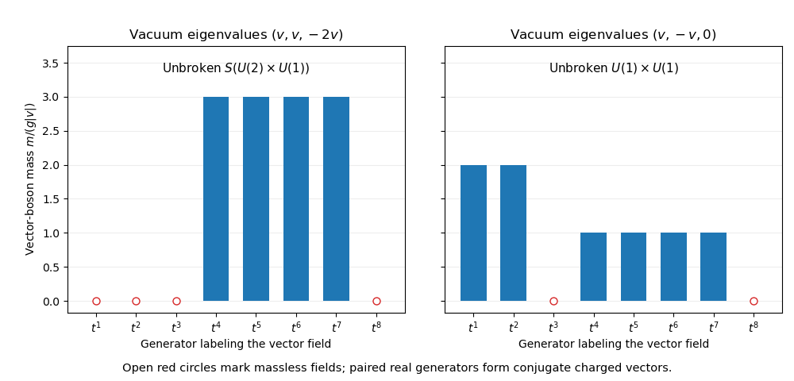

# Paper 1

↑ **Parent:** [2014](../2014.md)

Original public paper: [Physical PDF pages 672–675](https://www.whatdotheyknow.com/request/natural_science_tripos_physics_e_2/response/2340776/attach/2/FOI%202023%20399%20Zahid%20materials.pdf?cookie_passthrough=1#page=672). Both adjoint-vacuum cases, the decay calculation and all three optional notes are covered. Natural units $\hbar=c=1$ and the metric $(+---)$ are used.

**Table of contents**

- [1](#1)
  - [Solution](#1/solution)
  - [i](#1/i)
    - [Solution](#1/i/solution)
  - [ii](#1/ii)
    - [Solution](#1/ii/solution)
- [2](#2)
  - [Solution](#2/solution)
- [3](#3)
  - [a](#3/a)
    - [Solution](#3/a/solution)
  - [b](#3/b)
    - [Solution](#3/b/solution)
  - [c](#3/c)
    - [Solution](#3/c/solution)

## 1

↑ **Parent:** [Paper 1](paper-1.md)

<h3 id="1/solution">Solution</h3>

↑ **Parent:** [1](#1)

In [spontaneous symmetry breaking](../../quantum-field-theory.md#spontaneous-symmetry-breaking), the [action](../../lagrangian-mechanics.md#action) respects a [symmetry](../../physics.md#symmetry-physics) while a selected [vacuum state](../../quantum-field-theory.md#vacuum-state) is invariant only under a proper [subgroup](../../group.md#subgroup). A nonzero [vacuum expectation value](../../quantum-field-theory.md#vacuum-expectation-value) can identify that choice. For a local [gauge theory](../../classical-field-theory.md#gauge-theory), gauge transformations are redundancies rather than transformations between physically different states; a gauge-fixed scalar expectation value describes the [Higgs mechanism](../../standard-model.md#higgs-mechanism) and its massive excitations. It should not be interpreted as breaking an observable local redundancy.

Write the [adjoint scalar field](../../classical-field-theory.md#adjoint-scalar-field) as $\Phi=\Phi_0+\varphi$, with Hermitian [gauge generators](../../relativistic-quantum-field.md#gauge-generator) normalized by $\operatorname{tr}(t^at^b)=\delta^{ab}/2$. Since $\Phi_0$ is constant, the part of the [covariant derivative](../../general-relativity.md#covariant-derivative) linear in the [gauge field](../../relativistic-quantum-field.md#gauge-field) is $D_\mu\Phi_0=igA_\mu^a[t^a,\Phi_0]$. Both $t^a$ and $\Phi_0$ are Hermitian, so their [commutator](../../lie-algebra.md#commutator) is anti-Hermitian. The scalar kinetic term therefore contributes

$$
\mathcal L_{\rm mass}
=-g^2A_\mu^aA^{b\mu}\operatorname{tr}([t^a,\Phi_0][t^b,\Phi_0])
=\frac12A_\mu^a(m^2)^{ab}A^{b\mu}.
$$

Matching coefficients gives the [adjoint scalar gauge-boson mass matrix](../../relativistic-quantum-field.md#adjoint-scalar-gauge-boson-mass-matrix)

$$
\boxed{(m^2)^{ab}=-2g^2\operatorname{tr}([t^a,\Phi_0][t^b,\Phi_0]).}
$$

It is positive semidefinite: for real coefficients $x_a$, its [quadratic form](../../quadratic-form.md) is $2g^2\operatorname{tr}(C^\dagger C)\ge0$, where $C=[x_at^a,\Phi_0]$. Its null space consists of generators commuting with the vacuum, the [Lie algebra](../../lie-algebra.md) of its [centralizer](../../group-action.md#centralizer).

For a diagonal vacuum $\Phi_0=\operatorname{diag}(\lambda_1,\lambda_2,\lambda_3)$, the [matrix unit](../../vector-space.md#matrix-unit) $E_{ij}$ obeys $[E_{ij},\Phi_0]=(\lambda_j-\lambda_i)E_{ij}$. The two normalized Hermitian generators built from $E_{ij},E_{ji}$ each acquire

$$
m_{ij}^2=g^2(\lambda_i-\lambda_j)^2.
$$

The diagonal generators $t^3,t^8$ commute with every such vacuum and remain massless. Orthogonality of these root generators also shows that the [mass](../../classical-mechanics.md#mass) matrix is diagonal in the supplied [Gell-Mann matrices](../../algebra.md#gell-mann-matrices) basis. Take $g>0$ and $v\ne0$ below; $v=0$ restores the full [SU(3)](../../topological-group.md#su-3-group) group.

<h3 id="1/i">i</h3>

↑ **Parent:** [1](#1)

<h4 id="1/i/solution">Solution</h4>

↑ **Parent:** [I](#1/i)

For eigenvalues $(v,v,-2v)$, the first two entries coincide. Consequently the $12$ generators $t^1,t^2$, as well as $t^3,t^8$, commute with the vacuum. The $13$ and $23$ eigenvalue differences both have magnitude $3|v|$, giving

$$
\boxed{m_{1,2,3,8}=0,\qquad m_{4,5,6,7}=3g|v|.}
$$

There are four massless and four massive [gauge bosons](../../relativistic-quantum-field.md#gauge-boson). The [centralizer of a Hermitian matrix in SU(n)](../../group-action.md#centralizer-of-a-hermitian-matrix-in-su-n) preserves the degenerate two-dimensional [eigenspace](../../linear-operator-theory.md#eigenspace), so the unbroken group is

$$
\boxed{H=S(U(2)\times U(1))\cong\frac{SU(2)\times U(1)}{\mathbb Z_2}\cong U(2).}
$$

At the [Lie algebra](../../lie-algebra.md) level this is $\mathfrak{su}(2)\oplus\mathfrak u(1)$, generated by $t^{1,2,3}$ and $t^8$. The finite quotient specifies the actual subgroup inside [SU(3)](../../topological-group.md#su-3-group); simply writing $SU(2)\times U(1)$ suppresses that global identification. The four real massive fields combine into a complex [SU(2)](../../topological-group.md#su-2-group) doublet and its conjugate. Unbroken [SU(2)](../../topological-group.md#su-2-group) rotations relate its two components, explaining the equal masses of the $13$ and $23$ sectors in this [SU(3) gauge theory with an adjoint Higgs field](../../relativistic-quantum-field.md#su-3-gauge-theory-with-an-adjoint-higgs-field).

<h3 id="1/ii">ii</h3>

↑ **Parent:** [1](#1)

<h4 id="1/ii/solution">Solution</h4>

↑ **Parent:** [Ii](#1/ii)

For eigenvalues $(v,-v,0)$, all entries are distinct. The $12$ difference has magnitude $2|v|$, while both the $13$ and $23$ differences have magnitude $|v|$. The [adjoint scalar gauge-boson mass matrix](../../relativistic-quantum-field.md#adjoint-scalar-gauge-boson-mass-matrix) therefore gives

$$
\boxed{m_{3,8}=0,\qquad m_{1,2}=2g|v|,\qquad m_{4,5,6,7}=g|v|.}
$$

Only the two diagonal generators commute with the vacuum. Its unbroken group is the [maximal torus](../../lie-theory.md#maximal-torus)

$$
\boxed{H=\{\operatorname{diag}(e^{i\alpha},e^{i\beta},e^{-i(\alpha+\beta)})\}\cong U(1)\times U(1).}
$$

The two real fields belonging to each $ij$ pair combine into oppositely charged conjugate vector states with equal [mass](../../classical-mechanics.md#mass). The further equality between the $13$ and $23$ masses comes from the equally spaced vacuum eigenvalues; the surviving Abelian group alone does not [force](../../force.md) distinct root-charge sectors to have equal masses. Thus a fourfold massive degeneracy occurs in both examples, but its relation to the unbroken continuous [symmetry](../../physics.md#symmetry-physics) differs. The scalar potential has not been specified, so no additional symmetry of that potential or physical scalar [mass](../../classical-mechanics.md#mass) spectrum can be inferred.

**[Figure 1](#1/ii/image-gauge-boson-masses-for-two-diagonal-su-3-adjoint-vacua). Gauge-boson masses for two diagonal SU(3) adjoint vacua**.

## 2

↑ **Parent:** [Paper 1](paper-1.md)

<h3 id="2/solution">Solution</h3>

↑ **Parent:** [2](#2)

The [Standard Model](../../standard-model.md) is a [chiral gauge theory](../../classical-field-theory.md#chiral-gauge-theory): left-chiral quarks and leptons form [SU(2)](../../topological-group.md#su-2-group) weak doublets, while the corresponding right-chiral charged fields are weak singlets. The covariant kinetic term contains $g_W\bar Q_L\gamma^\mu t^aQ_LW_\mu^a$. With $W^\pm=(W^1\mp iW^2)/\sqrt2$, its off-diagonal generators give the [weak charged current](../../standard-model.md#charged-current)

$$
\mathcal L_{\rm cc}\supset\frac{g_W}{\sqrt2}\bar b_L\gamma^\mu V_{tb}^*t_LW_\mu^-
+\mathrm{h.c.}
=\frac{g_W}{2\sqrt2}\bar b\gamma^\mu(1-\gamma^5)V_{tb}^*tW_\mu^-+\mathrm{h.c.}
$$

An overall interaction sign depends on the convention for the [covariant derivative](../../general-relativity.md#covariant-derivative) and has no effect on this decay rate. The [chiral projector](../../relativistic-quantum-field.md#chiral-projector) $P_L=(1-\gamma^5)/2$ explains the vector-minus-axial combination. The [Cabibbo-Kobayashi-Maskawa matrix](../../standard-model.md#cabibbo-kobayashi-maskawa-matrix) comes from the different left-handed rotations that diagonalize up- and down-type [fermion mass matrices](../../standard-model.md#fermion-mass-matrix). Set $V_{tb}=1$ and $m_b=0$ as stipulated.

Let $P_{\mu\nu}=-g_{\mu\nu}+p_{3\mu}p_{3\nu}/m_W^2$, the [massive vector polarization sum](../../relativistic-quantum-field.md#polarization-sum-for-a-massive-vector-boson). Sum over final spins and average over the two equally populated initial [top quark](../../standard-model.md#top-quark) spins. The [fermion spin sum](../../relativistic-quantum-field.md#fermion-spin-sum) and the [Dirac adjoint](../../relativistic-quantum-field.md#dirac-adjoint) of the vertex give

$$
\overline{|\mathcal M|^2}
=\frac{g_W^2}{16}P_{\mu\nu}\operatorname{tr}
\left[\not p_2\gamma^\mu(1-\gamma^5)(\not p_1+m_t)\gamma^\nu(1-\gamma^5)\right].
$$

The $m_t$ term vanishes because $(1-\gamma^5)\gamma^\nu(1-\gamma^5)=0$. Anticommuting $\gamma^5$ through the remaining [gamma matrices](../../algebra-over-a-field.md#gamma-matrices), using $(1-\gamma^5)^2=2(1-\gamma^5)$, then using cyclicity of the [matrix trace](../../linear-algebra.md#matrix-trace) and the symmetry of $P_{\mu\nu}$ yields

$$
\boxed{\overline{|\mathcal M|^2}
=\frac{g_W^2}{8}P_{\mu\nu}\operatorname{tr}
\left[(1-\gamma^5)\not p_1\gamma^\mu\not p_2\gamma^\nu\right].}
$$

The extra factor two from the chiral algebra compensates the initial spin-average factor. The term with $\gamma^5$ is antisymmetric in $\mu,\nu$ and vanishes upon contraction with $P_{\mu\nu}$. The remaining [gamma-matrix trace](../../relativistic-quantum-field.md#gamma-matrix-trace) is

$$
4\left[p_1^\mu p_2^\nu+p_1^\nu p_2^\mu-(p_1\cdot p_2)g^{\mu\nu}\right].
$$

Its contraction gives

$$
\overline{|\mathcal M|^2}
=\frac{g_W^2}{2}(p_1\cdot p_2)
+\frac{g_W^2}{m_W^2}(p_1\cdot p_3)(p_2\cdot p_3).
$$

Here $p_1=p_2+p_3$, $p_1^2=m_t^2$, $p_2^2=0$ and $p_3^2=m_W^2$, so

$$
p_1\cdot p_2=p_2\cdot p_3=\frac{m_t^2-m_W^2}{2},\qquad
p_1\cdot p_3=\frac{m_t^2+m_W^2}{2}.
$$

Therefore

$$
\overline{|\mathcal M|^2}
=\frac{g_W^2}{4m_W^2}(m_t^2-m_W^2)(m_t^2+2m_W^2).
$$

The [two-body Lorentz-invariant phase space](../../relativistic-quantum-field.md#two-body-lorentz-invariant-phase-space) has rest-frame [momentum](../../momentum.md) $p^*=(m_t^2-m_W^2)/(2m_t)$. Substitution into $\Gamma=p^*\overline{|\mathcal M|^2}/(8\pi m_t^2)$ gives the [two-body top-quark decay width](../../standard-model.md#two-body-top-quark-decay-width)

$$
\boxed{\Gamma(t\to bW^+)
=\frac{g_W^2m_t^3}{64\pi m_W^2}
\left(1-\frac{m_W^2}{m_t^2}\right)^2
\left(1+2\frac{m_W^2}{m_t^2}\right).}
$$

The squared threshold factor combines the vanishing final [momentum](../../momentum.md) with the corresponding kinematic factor in the squared [scattering amplitude](../../quantum-scattering.md#scattering-amplitude). The longitudinal [W boson](../../standard-model.md#w-boson) [polarization](../../wave.md#polarization-waves) contributes the high-mass enhancement proportional to $m_t^3/m_W^2$. The result is at tree level, for an on-shell [W boson](../../standard-model.md#w-boson) and $m_t>m_W$; finite bottom [mass](../../classical-mechanics.md#mass) and [radiative corrections](../../perturbative-quantum-field-theory.md#radiative-correction) change it. Restoring quark mixing multiplies the width by $|V_{tb}|^2$.

## 3

↑ **Parent:** [Paper 1](paper-1.md)

<h3 id="3/a">a</h3>

↑ **Parent:** [3](#3)

<h4 id="3/a/solution">Solution</h4>

↑ **Parent:** [A](#3/a)

A relativistic [quantum field](../../quantum-field-theory.md#quantum-field) describes both creation and annihilation of excitations; a one-particle [wavefunction](../../wave-function.md) alone is insufficient when interactions can change particle number. For a free [complex scalar field](../../scalar-field-theory.md#complex-scalar-field), one conventional [mode expansion of a free field](../../quantum-field-theory.md#mode-expansion-of-a-free-field) is

$$
\phi(x)=\int\frac{d^3p}{(2\pi)^3\sqrt{2E_{\mathbf p}}}
\left[a_{\mathbf p}e^{-ip\cdot x}+b_{\mathbf p}^\dagger e^{ip\cdot x}\right],
\qquad E_{\mathbf p}=\sqrt{\mathbf p^2+m^2}.
$$

The apparently negative-frequency term creates a positive-energy [antiparticle](../../relativistic-quantum-field.md#antiparticle); it is not a physical particle of unbounded negative [energy](../../energy.md). The normal-ordered [Hamiltonian](../../hamiltonian-mechanics.md#hamiltonian) and conserved global phase charge have the forms

$$
H=\int\frac{d^3p}{(2\pi)^3}E_{\mathbf p}
(a_{\mathbf p}^\dagger a_{\mathbf p}+b_{\mathbf p}^\dagger b_{\mathbf p}),\qquad
Q=q\int\frac{d^3p}{(2\pi)^3}
(a_{\mathbf p}^\dagger a_{\mathbf p}-b_{\mathbf p}^\dagger b_{\mathbf p}).
$$

Particles and antiparticles have equal [mass](../../classical-mechanics.md#mass) and opposite additive internal charges. Including both [frequency](../../wave.md#frequency) sectors is also essential to the local field commutator: the positive- and negative-frequency terms combine so that spacelike-separated scalar observables commute, respecting [microcausality](../../relativistic-quantum-field.md#microcausality).

A [Dirac field](../../relativistic-quantum-field.md#dirac-field) similarly contains particle [annihilation operators](../../quantum-harmonic-oscillator.md#annihilation-operator) multiplying $u$ spinors and antiparticle [creation operators](../../quantum-harmonic-oscillator.md#creation-operator) multiplying $v$ spinors. Its [canonical anticommutation relations](../../supersymmetric-quantum-mechanics.md#canonical-anticommutation-relations) implement [Fermi-Dirac statistics](../../tensor-product-of-quantum-systems.md#fermi-dirac-statistics), whereas scalar modes use commutators and [Bose-Einstein statistics](../../quantum-ideal-gas-statistics.md#bose-einstein-statistics). These assignments are tied to the [Spin-statistics theorem](../../tensor-product-of-quantum-systems.md#spin-statistics-theorem) under the usual relativistic locality and positivity assumptions. Conserved charge constrains particle creation and annihilation, but particle and antiparticle numbers need not be separately conserved in an interacting theory.

An antiparticle need not be a distinct species. A neutral [real scalar field](../../scalar-field-theory.md#real-scalar-field) is self-conjugate; the [photon](../../quantum-mechanics.md#photon) is also its own antiparticle. A [Majorana fermion](../../relativistic-quantum-field.md#majorana-spinor) obeys a self-conjugacy condition and cannot carry an unbroken additive charge that distinguishes it from its antiparticle. Electric neutrality alone does not [force](../../force.md) self-conjugacy when other conserved quantum numbers distinguish the states.

<h3 id="3/b">b</h3>

↑ **Parent:** [3](#3)

<h4 id="3/b/solution">Solution</h4>

↑ **Parent:** [B](#3/b)

Loop corrections in [perturbative quantum field theory](../../perturbative-quantum-field-theory.md) integrate over unbounded internal [four-momentum](../../special-relativity.md#four-momentum). For example, after a [Wick rotation](../../perturbative-quantum-field-theory.md#wick-rotation), a four-dimensional integral with large-momentum behavior

$$
\int^\Lambda\frac{d^4k_E}{(k_E^2+m^2)^2}
\sim\int^\Lambda\frac{dk_E}{k_E}
$$

has a logarithmic [ultraviolet divergence](../../perturbative-quantum-field-theory.md#ultraviolet-divergence). This is sensitivity to short distances, distinct from a possible low-momentum [infrared divergence](../../quantum-field-theory.md#infrared-divergence).

[Regularization in quantum field theory](../../perturbative-quantum-field-theory.md#regularization-in-quantum-field-theory) first makes the expression mathematically well defined, for example with a cutoff $\Lambda$ or [dimensional regularization](../../perturbative-quantum-field-theory.md#dimensional-regularization) in $d=4-2\epsilon$. A regulator is an intermediate prescription rather than a measured physical parameter; a hard [momentum](../../momentum.md) cutoff can obscure gauge identities, so their preservation or restoration must be checked. Introduce bare fields and parameters, such as $\phi_0=Z_\phi^{1/2}\phi$, and split the regulated [Lagrangian density](../../classical-field-theory.md#lagrangian-density) into a renormalized part and local [counterterms](../../perturbative-quantum-field-theory.md#counterterm). For instance, [wavefunction](../../wave-function.md), [mass](../../classical-mechanics.md#mass) and coupling counterterms cancel the corresponding divergent parts of Green functions order by order.

[Renormalization conditions](../../perturbative-quantum-field-theory.md#renormalization-condition) fix finite parameters through specified observables or a subtraction prescription. Once these physical inputs are held fixed, predictions must not depend on the arbitrary regulator. In a [renormalizable quantum field theory](../../perturbative-quantum-field-theory.md#renormalizable-quantum-field-theory), a finite set of operator coefficients suffices to absorb ultraviolet divergences at every perturbative order, with the allowed structures constrained by the theory's [symmetries](../../physics.md#symmetry-physics). Gauge theories impose relations among counterterms through identities such as the [Ward-Takahashi identity](../../perturbative-quantum-field-theory.md#ward-identity); one cannot choose every diagram's subtraction independently.

The remaining dependence on a chosen [renormalization scale](../../perturbative-quantum-field-theory.md#renormalization-scale) describes [running couplings](../../perturbative-quantum-field-theory.md#running-coupling) and is organized by the [renormalization group](../../critical-phenomenon.md#renormalization-group). An [effective field theory](../../quantum-field-theory.md#effective-field-theory) can instead include higher-dimension operators suppressed by a high scale. Infinitely many are allowed in principle, but only finitely many contribute at a fixed accuracy in the low-energy expansion. Renormalization is therefore a controlled relation between parameters and predictions at different scales, rather than an instruction to discard every infinity without fixing physical inputs.

<h3 id="3/c">c</h3>

↑ **Parent:** [3](#3)

<h4 id="3/c/solution">Solution</h4>

↑ **Parent:** [C](#3/c)

The left- and right-chiral components of a charged [Standard Model fermion](../../standard-model.md#standard-model-fermion) transform in different electroweak [group representations](../../representation-theory.md#group-representation). A bare [Dirac mass term](../../relativistic-quantum-field.md#dirac-mass-term) $-m\bar f_Lf_R+\mathrm{h.c.}$ is therefore not invariant under the full electroweak [gauge group](../../relativistic-quantum-field.md#gauge-group). The [Higgs doublet](../../standard-model.md#higgs-field) supplies the missing transformation properties. With $\widetilde H=i\sigma_2H^*$, the gauge-invariant [Yukawa interactions](../../standard-model.md#yukawa-interaction) are

$$
\mathcal L_Y=-\bar Q_LY_dHd_R-\bar Q_LY_u\widetilde H u_R
-\bar L_LY_eHe_R+\mathrm{h.c.},
$$

where each $Y_f$ is a flavor-space [Yukawa matrix](../../standard-model.md#yukawa-matrix). For example, hypercharges in the down-quark term add to $-1/6+1/2-1/3=0$, while those in the up-quark term add to $-1/6-1/2+2/3=0$. Thus the Higgs and conjugate Higgs are required in different terms.

After [electroweak symmetry breaking](../../standard-model.md#electroweak-symmetry-breaking), choose [unitary gauge](../../standard-model.md#unitary-gauge) with $H=(0,(v+h)/\sqrt2)^T$. The [fermion mass matrices](../../standard-model.md#fermion-mass-matrix) become

$$
\boxed{M_d=\frac{v}{\sqrt2}Y_d,\qquad M_u=\frac{v}{\sqrt2}Y_u,\qquad M_e=\frac{v}{\sqrt2}Y_e.}
$$

A [singular value decomposition](../../linear-algebra.md#singular-value-decomposition) $U_{fL}^\dagger M_fU_{fR}=\operatorname{diag}(m_{f,1},m_{f,2},m_{f,3})$ defines nonnegative physical tree-level masses. The mismatch $U_{uL}^\dagger U_{dL}$ is the [Cabibbo-Kobayashi-Maskawa matrix](../../standard-model.md#cabibbo-kobayashi-maskawa-matrix) in the [weak charged current](../../standard-model.md#charged-current). The corresponding physical [Higgs boson](../../standard-model.md#higgs-boson) couples diagonally as $-(m_f/v)h\bar ff$ in the minimal one-doublet theory. This relates its coupling strength to each [mass](../../classical-mechanics.md#mass), but the measured [Yukawa couplings](../../standard-model.md#yukawa-interaction) remain independent input parameters: the minimal theory does not predict their hierarchy.

The minimal renormalizable [Standard Model](../../standard-model.md) contains no [right-handed neutrino](../../standard-model.md#right-handed-neutrino), so it has neither a neutrino Dirac Yukawa term nor a gauge-invariant renormalizable left-handed [Majorana mass term](../../relativistic-quantum-field.md#majorana-mass-term). Its [neutrinos](../../standard-model.md#neutrino) are massless. Observed [neutrino oscillations](../../standard-model.md#neutrino-oscillation) require going beyond that minimal field content or operator set: adding right-handed singlets permits [Dirac masses](../../relativistic-quantum-field.md#dirac-mass-term), while the dimension-five [Weinberg operator](../../standard-model.md#weinberg-operator) gives a [Majorana neutrino](../../standard-model.md#majorana-neutrino) [mass](../../classical-mechanics.md#mass) of order $v^2/\Lambda$ after symmetry breaking. These alternatives should be distinguished from the charged-fermion Yukawa mechanism.

## ↑ Ancestors (11)

1. [2014](../2014.md)
2. [Past exam of the gauge field theory course of the University of Cambridge](../../past-exam-of-the-gauge-field-theory-course-of-the-university-of-cambridge.md)
3. [Gauge Field Theory course of the University of Cambridge](../../university-of-cambridge.md#gauge-field-theory-course-of-the-university-of-cambridge)
4. [Physics course of the year 4 of the natural sciences course of the University of Cambridge](../../university-of-cambridge.md#physics-course-of-the-year-4-of-the-natural-sciences-course-of-the-university-of-cambridge)
5. [Year 4 of the natural sciences course of the University of Cambridge](../../university-of-cambridge.md#year-4-of-the-natural-sciences-course-of-the-university-of-cambridge)
6. [Year of the natural sciences course of the University of Cambridge](../../university-of-cambridge.md#year-of-the-natural-sciences-course-of-the-university-of-cambridge)
7. [Natural sciences course of the University of Cambridge](../../university-of-cambridge.md#natural-sciences-course-of-the-university-of-cambridge)
8. [Course of the University of Cambridge](../../university-of-cambridge.md#course-of-the-university-of-cambridge)
9. [University of Cambridge](../../university-of-cambridge.md)
10. [List of universities](../../README.md#list-of-universities)
11. [Codex Wiki](../../README.md)
