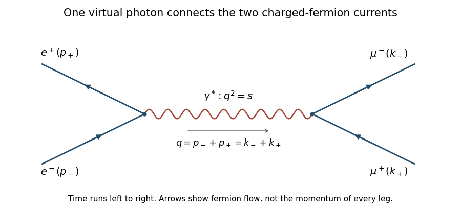

<h1 id="3/solution">Solution</h1>

↑ **Parent:** [3](../3.md)

At leading order in [quantum electrodynamics](../../../../quantum-electrodynamics.md), the electron-positron pair annihilates into one virtual [photon](../../../../photon.md), which produces the muon-antimuon pair. This is an s-channel [Feynman diagram](../../../../feynman-diagram.md) with $q=p_-+p_+=k_-+k_+$ and $q^2=s$. No QED vertex changes an electron directly into a muon, so there is no corresponding single-photon t-channel flavor-changing diagram.

**[Figure 1](#3/image-leading-order-electron-positron-annihilation-into-a-muon-pair-through-a-virtual-photon). Leading-order electron-positron annihilation into a muon pair through a virtual photon**. Original s-channel diagram. Arrows follow fermion-number flow; each labelled external four-momentum refers to the physical incoming or outgoing particle, and the virtual photon carries q from left to right.

Each charged-fermion vertex contributes $-ie\gamma^\mu$, the internal photon contributes $-ig_{\mu\nu}/(q^2+i0)$ in Feynman gauge, and external legs supply incoming $u(p_-),\bar v(p_+)$ and outgoing $\bar u(k_-),v(k_+)$. Their ordered contraction gives the stated amplitude. The overall convention-dependent phase does not affect its squared modulus.

For unpolarized scattering, average over the two spin choices of each incoming particle and sum over outgoing spins. The identities $\sum u\bar u=\not{p}+m$ and $\sum v\bar v=\not{p}-m$, together with $\gamma^0(\gamma^\mu)^\dagger\gamma^0=\gamma^\mu$, convert the products into [fermion spin sums](../../../../fermion-spin-sum.md):

$$
\boxed{\overline{|\mathcal M|^2}=\frac{e^4}{4s^2}
\operatorname{tr}\big[(\not{p}_+-m_e)\gamma_\mu(\not{p}_-+m_e)\gamma_\nu\big]
\operatorname{tr}\big[(\not{k}_-+m_\mu)\gamma^\mu(\not{k}_+-m_\mu)\gamma^\nu\big].}
$$

The factor $1/4$ averages the initial spins; there is no additional average over the final ones. In the massless limit the first trace is $4(p_{+\mu}p_{-\nu}+p_{+\nu}p_{-\mu}-g_{\mu\nu}p_+\cdot p_-)$, with the analogous expression for the outgoing current. Contracting gives

$$
\overline{|\mathcal M|^2}=\frac{8e^4}{s^2}
\left[(p_+\cdot k_-)(p_-\cdot k_+)+(p_+\cdot k_+)(p_-\cdot k_-)\right].
$$

In the [centre-of-mass frame](../../../../center-of-momentum-frame.md), every external energy is $E_{\rm cm}/2$. Choose $p_-$ along $+z$ and let $k_-$ make angle $\theta$ with it. The dot products are $p_-\cdot k_-=p_+\cdot k_+=s(1-\cos\theta)/4$ and $p_-\cdot k_+=p_+\cdot k_-=s(1+\cos\theta)/4$. Hence

$$
\boxed{\overline{|\mathcal M|^2}=e^4(1+\cos^2\theta).}
$$

The [electron-positron annihilation into a muon pair](../../../../electron-positron-annihilation-into-a-muon-pair.md) cross-section is therefore

$$
\frac{d\sigma}{d\Omega}=\frac{\alpha^2}{4s}(1+\cos^2\theta).
$$

Using $d\Omega=2\pi\,d(\cos\theta)$ gives

$$
\boxed{\sigma=\frac{4\pi\alpha^2}{3s}=\frac{4\pi\alpha^2}{3E_{\rm cm}^2}.}
$$

In ordinary units this becomes $4\pi\alpha^2(\hbar c)^2/(3E_{\rm cm}^2)$. It is the leading high-energy QED result: finite masses, radiative corrections and weak-interaction exchange modify the prediction outside that approximation.

Cross-section measurements can test spin assignments when the interaction and charges are specified. For example, keeping spin-half electrons but replacing the final muons by minimally coupled charged spin-zero particles replaces the fermion current by a momentum-difference current. In the massless limit, [scalar-pair production by fermion annihilation](../../../../scalar-pair-production-by-fermion-annihilation.md) gives $d\sigma/d\Omega=\alpha^2\sin^2\theta/(8s)$ and total $\pi\alpha^2/(3s)$. Its central angular peak differs from the fermionic $1+\cos^2\theta$ distribution.

Thus angular distributions, polarization information and suitably modeled rates distinguish spin hypotheses. A single total rate without assumptions about the couplings or the initial species does not independently establish both spins; changing interactions can mimic normalizations. The predicted fermion result is a testable consequence of the spin-half QED model, rather than a model-independent inference of spin from any one observed cross-section.

## ↑ Ancestors (13)

1. [3](../3.md)
2. [Paper 1](../../paper-1-split.md)
3. [2015](../../split.md)
4. [Past exam of the gauge field theory course of the University of Cambridge](../../../split.md)
5. [Gauge Field Theory course of the University of Cambridge](../../../../gauge-field-theory-course-of-the-university-of-cambridge.md)
6. [Physics course of the year 4 of the natural sciences course of the University of Cambridge](../../../../physics-course-of-the-year-4-of-the-natural-sciences-course-of-the-university-of-cambridge.md)
7. [Year 4 of the natural sciences course of the University of Cambridge](../../../../year-4-of-the-natural-sciences-course-of-the-university-of-cambridge.md)
8. [Year of the natural sciences course of the University of Cambridge](../../../../year-of-the-natural-sciences-course-of-the-university-of-cambridge.md)
9. [Natural sciences course of the University of Cambridge](../../../../natural-sciences-course-of-the-university-of-cambridge.md)
10. [Course of the University of Cambridge](../../../../course-of-the-university-of-cambridge.md)
11. [University of Cambridge](../../../../university-of-cambridge-split.md)
12. [List of universities](../../../../list-of-universities.md)
13. [Codex Wiki](../../../../split.md)
