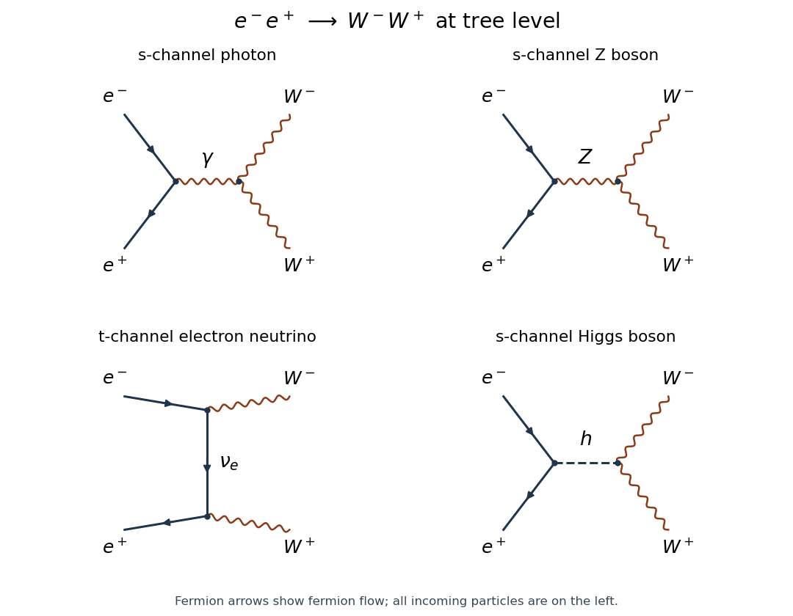

# Paper 1

↑ **Parent:** [2016](../2016.md)

Original public paper: [Physical PDF pages 813–815](https://www.whatdotheyknow.com/request/natural_science_tripos_physics_e_2/response/2340776/attach/2/FOI%202023%20399%20Zahid%20materials.pdf?cookie_passthrough=1#page=813). All three questions and all three alternatives in question 2 are answered. We use [natural units](../../mathematical-physics.md#natural-units) and [Minkowski metric](../../special-relativity.md#minkowski-metric) signature $+---$.

**Table of contents**

- [1](#1)
  - [Solution](#1/solution)
- [2](#2)
  - [a](#2/a)
    - [Solution](#2/a/solution)
  - [b](#2/b)
    - [Solution](#2/b/solution)
  - [c](#2/c)
    - [Solution](#2/c/solution)
- [3](#3)
  - [Solution](#3/solution)

## 1

↑ **Parent:** [Paper 1](paper-1.md)

<h3 id="1/solution">Solution</h3>

↑ **Parent:** [1](#1)

A [variational symmetry of a Lagrangian density](../../classical-field-theory.md#variational-symmetry-of-a-lagrangian-density) maps admissible field configurations to configurations with the same [action](../../lagrangian-mechanics.md#action), up to an allowed boundary contribution. Thus (i) the [action](../../lagrangian-mechanics.md#action) is invariant for suitable [boundary conditions](../../differential-equation.md#boundary-condition), while (ii) the [Lagrangian density](../../classical-field-theory.md#lagrangian-density) need only change by a [total divergence](../../multivariable-calculus.md#total-divergence), rather than be pointwise invariant. For an [internal symmetry of a classical field theory](../../classical-field-theory.md#internal-symmetry-of-a-classical-field-theory), the coordinates are fixed. A spacetime transformation also changes the integration measure and must be treated accordingly.

A [conserved current](../../classical-field-theory.md#conserved-current) satisfies $\partial_\mu j^\mu=0$ [on shell](../../classical-field-theory.md#on-shell). The [Noether charge](../../classical-field-theory.md#noether-charge) $Q=\int j^0\,d^3x$ then obeys $\dot Q=-\int_{\partial V}\mathbf j\cdot d\mathbf S$, so conservation of the integrated charge additionally requires vanishing net boundary flux.

For several real field components $q_A$ and a constant infinitesimal parameter, write $\delta q_A=\varepsilon X_A$ and $\delta\mathcal L=\varepsilon\partial_\mu K^\mu$. The [product rule](../../calculus.md#product-rule) gives

$$
\frac{\delta\mathcal L}{\varepsilon}=\sum_A\left(\frac{\partial\mathcal L}{\partial q_A}-\partial_\mu\frac{\partial\mathcal L}{\partial(\partial_\mu q_A)}\right)X_A+\partial_\mu\left(\sum_A\frac{\partial\mathcal L}{\partial(\partial_\mu q_A)}X_A\right).
$$

Subtract the specified divergence. The [Euler-Lagrange field equations](../../classical-field-theory.md#euler-lagrange-field-equation) make the first term vanish, proving the [Noether theorem](../../calculus-of-variations.md#noether-theorem) with

$$
\boxed{j^\mu=\sum_A\frac{\partial\mathcal L}{\partial(\partial_\mu q_A)}X_A-K^\mu,\qquad \partial_\mu j^\mu=0.}
$$

For a [complex scalar field](../../scalar-field-theory.md#complex-scalar-field), treat the field and its [complex conjugate](../../complex-analysis.md#complex-conjugate) as independent variables in this calculation; this is equivalent to using its two real components. This is the [Noether current for a first-derivative scalar field](../../classical-field-theory.md#noether-current-for-a-first-derivative-scalar-field), summed over components.

Collect the two complex fields into $\Phi=(\phi_1,\phi_2)^T$. Their [Lagrangian density](../../classical-field-theory.md#lagrangian-density) has the radial form

$$
\mathcal L=\partial_\mu\Phi^\dagger\partial^\mu\Phi-m^2\Phi^\dagger\Phi-\lambda(\Phi^\dagger\Phi)^2.
$$

For a constant [Hermitian matrix](../../hilbert-space.md#hermitian-operator) $T$, the [unitary transformation](../../vector-space.md#unitary-operator) $\delta\Phi=i\varepsilon T\Phi$ preserves both the kinetic contraction and $\Phi^\dagger\Phi$. In particular the two specified transformations have generators $T_1=\sigma_1$ and $T_2=\sigma_2$, the first two [Pauli matrices](../../algebra.md#pauli-matrices). Their [Noether currents](../../classical-field-theory.md#noether-current) are instances of the [unitary scalar multiplet current](../../classical-field-theory.md#unitary-scalar-multiplet-current)

$$
j_T^\mu=i\left[(\partial^\mu\Phi^\dagger)T\Phi-\Phi^\dagger T\partial^\mu\Phi\right].
$$

Explicitly,

$$
\begin{aligned}
j_1^\mu&=i\left(\phi_2\partial^\mu\phi_1^*+\phi_1\partial^\mu\phi_2^*-\phi_2^*\partial^\mu\phi_1-\phi_1^*\partial^\mu\phi_2\right),\\
j_2^\mu&=\phi_2\partial^\mu\phi_1^*-\phi_1\partial^\mu\phi_2^*+\phi_2^*\partial^\mu\phi_1-\phi_1^*\partial^\mu\phi_2.
\end{aligned}
$$

An overall change of current sign corresponds to reversing the associated symmetry parameter; the signs here follow the two transformations as written.

The [matrix commutator](../../lie-algebra.md#commutator) of their infinitesimal matrices is $[i\sigma_1,i\sigma_2]=-2i\sigma_3$. The antisymmetric difference of successive transformations therefore supplies a third symmetry, after a nonzero rescaling of its parameter:

$$
\delta\phi_1=i\zeta\phi_1,\qquad\delta\phi_2=-i\zeta\phi_2.
$$

Its current is

$$
\boxed{j_3^\mu=i\left(\phi_1\partial^\mu\phi_1^*-\phi_1^*\partial^\mu\phi_1-\phi_2\partial^\mu\phi_2^*+\phi_2^*\partial^\mu\phi_2\right).}
$$

The three [traceless matrices](../../linear-algebra.md#traceless-matrix) $\sigma_a/2$ obey $[\sigma_a/2,\sigma_b/2]=i\epsilon_{abc}\sigma_c/2$. Their exponentials act as [SU(2)](../../topological-group.md#su-2-group) on the complex doublet. This identifies both the [Lie algebra](../../lie-algebra.md) and the group acting on these fields: the central element $-I$ changes $\Phi$ and is not the identity transformation, so the doublet action is not an action of $SO(3)$ obtained by identifying $I$ with $-I$.

There is also a common [global phase symmetry of a complex scalar field](../../scalar-field-theory.md#global-phase-symmetry-of-a-complex-scalar-field), $\Phi\mapsto e^{i\alpha}\Phi$, with current $j_I^\mu$. Together with [SU(2)](../../topological-group.md#su-2-group) this gives $U(2)\simeq(SU(2)\times U(1))/\mathbb Z_2$ among complex-linear transformations. Independent constant phases of $\phi_1$ and $\phi_2$, and field interchange, are already contained in this group.

In fact this particular [scalar potential](../../classical-field-theory.md#scalar-potential) has a larger real internal symmetry. Write $\phi_1=(q_1+iq_2)/\sqrt2$ and $\phi_2=(q_3+iq_4)/\sqrt2$; then

$$
\mathcal L=\frac12\sum_{A=1}^4\partial_\mu q_A\partial^\mu q_A-\frac{m^2}{2}\sum_Aq_A^2-\frac\lambda4\left(\sum_Aq_A^2\right)^2.
$$

The [O(4) symmetry of a complex scalar doublet](../../classical-field-theory.md#o-4-symmetry-of-a-complex-scalar-doublet) includes transformations mixing $\Phi$ with $\Phi^*$, which need not be complex-linear. Its connected part has six rotation generators, so listing $U(2)$ alone would not exhaust the internal symmetries of the displayed isolated theory. Individual field conjugations are examples of its discrete transformations. Finally the spacetime-independent scalar coefficients and Lorentz contractions give [Poincaré symmetry](../../special-relativity.md#poincare-symmetry), and the real scalar action also permits spatial reflection and time reversal. These statements concern the action; a chosen vacuum or external [boundary conditions](../../differential-equation.md#boundary-condition) can preserve fewer symmetries. Special parameter choices can introduce additional symmetries, but are not required here.

## 2

↑ **Parent:** [Paper 1](paper-1.md)

<h3 id="2/a">a</h3>

↑ **Parent:** [2](#2)

<h4 id="2/a/solution">Solution</h4>

↑ **Parent:** [A](#2/a)

[Chirality](../../relativistic-quantum-field.md#chirality-physics) distinguishes the two inequivalent [Weyl spinor](../../relativistic-quantum-field.md#weyl-spinor) representations of the proper [Lorentz group](../../special-relativity.md#lorentz-group). For a [Dirac spinor](../../relativistic-quantum-field.md#dirac-spinor), define $\gamma^5=i\gamma^0\gamma^1\gamma^2\gamma^3$ and the [chiral projectors](../../relativistic-quantum-field.md#chiral-projector)

$$
P_L=\frac{1-\gamma^5}{2},\qquad P_R=\frac{1+\gamma^5}{2},\qquad\psi=\psi_L+\psi_R.
$$

They satisfy $P_LP_R=0$ and $P_L+P_R=I$. Proper [Lorentz transformations](../../special-relativity.md#lorentz-transformation) preserve each chiral representation, whereas [parity](../../quantum-mechanics.md#parity) exchanges them. [Helicity](../../special-relativity.md#helicity) instead measures the projection of [spin angular momentum](../../angular-momentum-operator.md#spin) along [momentum](../../momentum.md). For a massive particle it can change under a boost that overtakes the particle, so it must not be identified with [chirality](../../relativistic-quantum-field.md#chirality-physics). For massless positive-energy particles the left-chiral field annihilates negative-helicity particles and creates positive-helicity antiparticles.

The [Standard Model](../../standard-model.md) is a [chiral gauge theory](../../classical-field-theory.md#chiral-gauge-theory): left- and right-chiral fields have different [gauge group representations](../../relativistic-quantum-field.md#gauge-group-representation). In the convention $Q=T_3+Y$, one generation contains

$$
\begin{array}{c|c}
\text{field}&SU(3)_c\times SU(2)_L\text{ representation and }Y\\\hline
Q_L=(u_L,d_L)^T&(\mathbf3,\mathbf2)_{1/6}\\
u_R&(\mathbf3,\mathbf1)_{2/3}\\
d_R&(\mathbf3,\mathbf1)_{-1/3}\\
L_L=(\nu_L,e_L)^T&(\mathbf1,\mathbf2)_{-1/2}\\
e_R&(\mathbf1,\mathbf1)_{-1}
\end{array}
$$

The minimal field content has no [right-handed neutrino](../../standard-model.md#right-handed-neutrino). A sterile right-handed field is a possible extension, not a required member of that minimal list. The table displays [weak isospin](../../standard-model.md#weak-isospin), [hypercharge](../../standard-model.md#hypercharge) and [color charge](../../standard-model.md#color-charge) assignments, not assignments of massive-particle helicity.

The [weak charged current](../../standard-model.md#charged-current) contains $\bar\nu\gamma^\mu P_Le\,W_\mu^+$ and its [Hermitian conjugate](../../hilbert-space.md#hermitian-conjugation), with coupling $g/\sqrt2$. Only the left-chiral lepton doublet participates, giving [parity violation](../../standard-model.md#parity-violation). Both chiralities can couple to the [Z boson](../../standard-model.md#z-boson), but their coefficients differ:

$$
\mathcal L_Z=-\frac g{\cos\theta_W}Z_\mu\bar f\gamma^\mu\left[(T_3-Q\sin^2\theta_W)P_L-Q\sin^2\theta_WP_R\right]f.
$$

Here $T_3$ is that of the left-chiral component. For the electron, it is $-1/2$. The [photon](../../quantum-mechanics.md#photon) and [gluon](../../standard-model.md#gluon) couplings of a charged massive [fermion](../../tensor-product-of-quantum-systems.md#fermion) are vectorlike; this does not make the full [electroweak interaction](../../standard-model.md#electroweak-interaction) vectorlike.

A bare [Dirac mass term](../../relativistic-quantum-field.md#dirac-mass-term) $m\bar\psi\psi=m(\bar\psi_L\psi_R+\bar\psi_R\psi_L)$ joins the two chiral representations. Their different electroweak quantum numbers forbid that term before [electroweak symmetry breaking](../../standard-model.md#electroweak-symmetry-breaking). A [Yukawa interaction](../../standard-model.md#yukawa-interaction), such as $-y_e\bar L_LHe_R+\mathrm{h.c.}$, is gauge invariant; the [Higgs doublet](../../standard-model.md#higgs-field) expectation value then gives $m_e=y_ev/\sqrt2$. Up-type quarks use the conjugate doublet. Thus [chirality](../../relativistic-quantum-field.md#chirality-physics) explains the weak charge assignments, their [parity violation](../../standard-model.md#parity-violation), and why masses arise through the [Higgs mechanism](../../standard-model.md#higgs-mechanism). The consistency of these chiral assignments also requires [Standard Model anomaly cancellation](../../relativistic-quantum-field.md#standard-model-anomaly-cancellation).

<h3 id="2/b">b</h3>

↑ **Parent:** [2](#2)

<h4 id="2/b/solution">Solution</h4>

↑ **Parent:** [B](#2/b)

[Gauge boson self-interactions](../../relativistic-quantum-field.md#gauge-boson-self-interaction) follow from noncommuting generators, rather than a separate assumption that the force carriers should attract one another. With $D_\mu=\partial_\mu+igA_\mu^aT^a$ and $[T^a,T^b]=if^{abc}T^c$, the [Yang-Mills field strength](../../relativistic-quantum-field.md#gauge-field-strength) is

$$
F_{\mu\nu}^a=\partial_\mu A_\nu^a-\partial_\nu A_\mu^a-gf^{abc}A_\mu^bA_\nu^c.
$$

The last term is required so that $F_{\mu\nu}$ transforms covariantly under the [gauge group](../../relativistic-quantum-field.md#gauge-group). Let $G_{\mu\nu}^a=\partial_\mu A_\nu^a-\partial_\nu A_\mu^a$. Expanding $\mathcal L=-F_{\mu\nu}^aF^{a\mu\nu}/4$ gives a quadratic kinetic term and the [cubic and quartic Yang-Mills self-interactions](../../relativistic-quantum-field.md#cubic-and-quartic-yang-mills-self-interactions)

$$
\mathcal L_3=gf^{abc}(\partial_\mu A_\nu^a)A^{b\mu}A^{c\nu},\qquad
\mathcal L_4=-\frac{g^2}{4}f^{abc}f^{ade}A_\mu^bA_\nu^cA^{d\mu}A^{e\nu}.
$$

The [structure constants](../../algebra-over-a-field.md#structure-constant) and one [gauge coupling](../../relativistic-quantum-field.md#gauge-coupling) fix both types of vertex. For an Abelian group the structure constants vanish: the renormalizable pure [electromagnetic field](../../electromagnetism.md#electromagnetic-field) action has no elementary three- or four-[photon](../../quantum-mechanics.md#photon) vertex. Photon scattering through charged-particle loops is a different statement, not a contradiction.

In [Quantum chromodynamics](../../standard-model.md#quantum-chromodynamics), the non-Abelian $SU(3)_c$ structure produces three- and four-[gluon](../../standard-model.md#gluon) vertices; the gluons themselves carry [color charge](../../standard-model.md#color-charge). These vertices influence multi-jet production and the [renormalization group](../../critical-phenomenon.md#renormalization-group) running of the strong coupling. In the electroweak sector the $SU(2)_L$ fields mix with the Abelian field after [electroweak symmetry breaking](../../standard-model.md#electroweak-symmetry-breaking). The resulting charged-vector vertices include $W^+W^-\gamma$ and $W^+W^-Z$, with couplings $e$ and $g\cos\theta_W$, together with the related four-boson vertices. Neutral-only triple vertices such as $ZZ\gamma$ are absent at tree level in the [Standard Model](../../standard-model.md).

The [electroweak triple gauge coupling](../../standard-model.md#electroweak-triple-gauge-coupling) can be measured using $e^+e^-\to W^+W^-$. The neutrino exchange and neutral-vector exchange diagrams interfere: the gauge-related coefficients cancel the most rapidly growing longitudinal-polarization terms. Their relative strengths and angular dependence therefore test the theory more sharply than merely observing a pair of massive vector bosons. The electron-mass-suppressed Higgs contribution completes the corresponding mass-dependent cancellation. Adding arbitrary independent three- and four-vector couplings would generally destroy these relations.

At the [Large Electron–Positron Collider](../../particle-accelerator.md#large-electron-positron-collider), the [L3 experiment](../../particle-detection.md#l3-experiment) fitted charged triple-gauge parameters using hadronic and semileptonic W-pair events, complemented by single-W and single-photon channels. These measurements agreed with the predicted self-couplings. Their interpretation uses reconstructed decay products and differential distributions, rather than direct pictures of a three-boson vertex.[2004, abstract: W-pair channels at 189–209 GeV, complementary channels and agreement with Standard Model self-couplings](../../physics-bibliography.md#measurement-of-triple-gauge-boson-couplings-of-the-w-boson-at-lep-by-l3-collaboration)

<h3 id="2/c">c</h3>

↑ **Parent:** [2](#2)

<h4 id="2/c/solution">Solution</h4>

↑ **Parent:** [C](#2/c)

The evidence tests several linked claims: a [weak neutral current](../../standard-model.md#neutral-current), massive charged and neutral mediators, their chiral couplings, and the non-Abelian interactions among those mediators. A theory must describe these with a common set of electroweak parameters.

The [Gargamelle neutral-current experiment](../../standard-model.md#gargamelle) supplied a particularly direct early test. A neutrino beam crossed a heavy-liquid [bubble chamber](../../particle-detection.md#bubble-chamber); charged reaction products made visible tracks, while incoming and outgoing neutrinos did not. Neutral-current candidates had a hadronic vertex without an accompanying charged lepton, or an isolated recoiling electron. The visible final state differs from a muon-neutrino charged-current event with an outgoing muon. Neutral hadrons entering from surrounding material could imitate a hadronic vertex, so background rejection was essential. The 1973 observations supported an interaction carried by a neutral weak mediator; they did not directly reconstruct an on-shell Z resonance.[Experimental description: neutrino beam, heavy-liquid chamber, hadronic and electron-scattering searches](../../physics-bibliography.md#gargamelle-by-cern)

The [UA1 experiment](../../particle-detection.md#ua1-experiment) and [UA2 experiment](../../particle-detection.md#ua2-experiment) collider discoveries supplied complementary evidence in 1983. A proton–antiproton collider provided enough energy to produce the mediators. Charged W candidates used a high-transverse-momentum charged lepton and missing transverse momentum from an escaping neutrino; because its longitudinal momentum was not measured, a transverse-mass distribution was useful. Neutral Z candidates instead formed a charged-lepton pair with an invariant-mass peak. Observing both kinds of events and their masses tested the predicted mediator structure.[History: 1983 W and Z discovery at the proton–antiproton collider](../../physics-bibliography.md#the-z-boson-by-cern)

The [Weinberg angle](../../standard-model.md#weinberg-angle) connects independent measurements. At tree level, a [Higgs doublet](../../standard-model.md#higgs-field) gives

$$
m_W=\frac{gv}{2},\qquad m_Z=\frac{v}{2}\sqrt{g^2+g'^2},\qquad e=g\sin\theta_W,
$$

so **$m_W=m_Z\cos\theta_W$**. Neutral-current scattering, the mediator masses and electromagnetic measurements must be consistent with one mixing angle after a common renormalization prescription and [radiative corrections](../../perturbative-quantum-field-theory.md#radiative-correction) are included. Precise Z-resonance widths and asymmetries test the left- and right-chiral couplings; a mass peak alone would not establish those coupling assignments.

At higher collider energies, W-pair production tested the [electroweak triple gauge couplings](../../standard-model.md#electroweak-triple-gauge-coupling). Reconstructing hadronic jets or a charged lepton plus missing momentum identifies W decays; total rates and production/decay angles constrain the $WW\gamma$ and $WWZ$ vertices. Their non-Abelian relations are required for the characteristic interference with neutrino exchange. L3's 2004 analysis used these channels and found agreement with the Standard Model expectation.[Abstract: measured triple-gauge parameters and W-pair, single-W and single-photon samples](../../physics-bibliography.md#measurement-of-triple-gauge-boson-couplings-of-the-w-boson-at-lep-by-l3-collaboration)

Finally, the 2012 [Higgs boson discovery](../../standard-model.md#higgs-boson-discovery-in-2012) and subsequent coupling tests address the symmetry-breaking sector, beyond the existence of gauge mediators. The initial observation was a new resonance in several decay channels; establishing all its properties requires further measurements. These are mutually supporting tests of the [electroweak interaction](../../standard-model.md#electroweak-interaction), with distinct apparatus, observables and background controls, rather than a claim that any single event proves the entire theory.

## 3

↑ **Parent:** [Paper 1](paper-1.md)

<h3 id="3/solution">Solution</h3>

↑ **Parent:** [3](#3)

There are four relevant [tree-level Feynman diagrams](../../perturbative-quantum-field-theory.md#tree-level-feynman-diagram): $s$-channel [photon](../../quantum-mechanics.md#photon), [Z boson](../../standard-model.md#z-boson) and [Higgs boson](../../standard-model.md#higgs-boson) exchange, and $t$-channel electron-neutrino exchange. The [electron](../../physics.md#electron) and [Positron](../../physics.md#positron) are incoming, and $W^-$ and $W^+$ outgoing. The Higgs diagram is normally tiny because its electron coupling is proportional to $m_e$; it should nevertheless be included in the requested list.

**[Figure 1](#3/image-the-four-tree-level-diagrams-for-electron-positron-annihilation-into-a-charged-w-pair). The four tree-level diagrams for electron–positron annihilation into a charged W pair**. Original schematics. Fermion arrows show particle-number flow, which opposes the momentum of an incoming positron. W lines are labelled by charge.

Let $v=2m_W/g$. The [Higgs-electron coupling](../../standard-model.md#higgs-electron-coupling) is $m_e/v$, while the [Higgs boson coupling to W bosons](../../standard-model.md#higgs-boson-coupling-to-w-bosons) is $2m_W^2g_{\mu\nu}/v$. Multiplying the vertices and scalar propagator gives, up to an irrelevant overall phase,

$$
\mathcal M_h=\frac{g^2m_e}{2(s-m_h^2)}\bar v(p_2)u(p_1)\,\epsilon_1^*\cdot\epsilon_2^*.
$$

A scalar propagator has no vector index, the [Yukawa interaction](../../standard-model.md#yukawa-interaction) supplies the scalar spinor bilinear, and the second vertex contracts the two polarization vectors. We retain the tree propagator and neglect widths, consistently with the stated leading-order calculation.

For unpolarized incoming beams the [spin average](../../relativistic-quantum-field.md#spin-average) is $1/4$, not a sum without normalization. The [fermion spin sums](../../relativistic-quantum-field.md#fermion-spin-sum) and [gamma-matrix trace](../../relativistic-quantum-field.md#gamma-matrix-trace) identities give

$$
\begin{aligned}
\frac14\sum_{r,t}|\bar v_t(p_2)u_r(p_1)|^2
&=\frac14\operatorname{tr}\left[(\not p_2-m_e)(\not p_1+m_e)\right]\\
&=p_1\cdot p_2-m_e^2
=\frac{s-4m_e^2}{2}.
\end{aligned}
$$

The terms with one gamma matrix have zero trace; the two-gamma trace gives $4p_1\cdot p_2$. Both final polarization states are specified as longitudinal, so no final polarization average is appropriate.

In the [centre-of-momentum frame](../../special-relativity.md#center-of-momentum-frame), take $k_1=(E,k\widehat{\mathbf n})$ and $k_2=(E,-k\widehat{\mathbf n})$, where $E=\sqrt s/2$ and $k^2=E^2-m_W^2$. A pair of [longitudinal polarization vectors](../../special-relativity.md#longitudinal-polarization-vector) is

$$
\epsilon_{1L}=\frac1{m_W}(k,E\widehat{\mathbf n}),\qquad
\epsilon_{2L}=\frac1{m_W}(k,-E\widehat{\mathbf n}).
$$

Each obeys $\epsilon_i\cdot k_i=0$ and $\epsilon_i^2=-1$. Their contraction is angle independent:

$$
\epsilon_{1L}\cdot\epsilon_{2L}=\frac{k^2+E^2}{m_W^2}=\frac{s}{2m_W^2}-1.
$$

Consequently

$$
\boxed{\overline{|\mathcal M_h|^2}_{LL}=\frac{g^4m_e^2(s-4m_e^2)}{8(s-m_h^2)^2}\left(\frac{s}{2m_W^2}-1\right)^2.}
$$

For the [two-body scattering cross section](../../physics.md#two-body-scattering-cross-section), the outgoing-to-incoming momentum ratio is

$$
\frac{k}{p}=\frac{\beta_W}{\beta_e},\qquad
\beta_W=\sqrt{1-\frac{4m_W^2}{s}},\quad
\beta_e=\sqrt{1-\frac{4m_e^2}{s}}.
$$

The source's final sentence interchanges the particle names attached to these two momenta; physical final-state phase space and initial-state flux fix the ratio as written here. Since the Higgs-only spin-averaged expression is isotropic, integrating the [solid angle](../../euclidean-geometry.md#solid-angle) gives $4\pi$:

$$
\begin{aligned}
\sigma_{h,LL}
&=\frac1{16\pi s}\frac{\beta_W}{\beta_e}\overline{|\mathcal M_h|^2}_{LL}\\
&=\boxed{\frac{g^4m_e^2\beta_e\beta_W}{128\pi(s-m_h^2)^2}\left(\frac{s}{2m_W^2}-1\right)^2},\qquad s\ge4m_W^2.
\end{aligned}
$$

There is no identical-particle factor: $W^+$ and $W^-$ are distinguishable. The threshold factor $\beta_W$ makes this contribution vanish when the outgoing momentum vanishes. This is the isolated squared Higgs amplitude for a specified longitudinal pair, not the complete physical cross section: the full result squares the coherent sum of all four amplitudes and includes their interference.

## ↑ Ancestors (11)

1. [2016](../2016.md)
2. [Past exam of the gauge field theory course of the University of Cambridge](../../past-exam-of-the-gauge-field-theory-course-of-the-university-of-cambridge.md)
3. [Gauge Field Theory course of the University of Cambridge](../../university-of-cambridge.md#gauge-field-theory-course-of-the-university-of-cambridge)
4. [Physics course of the year 4 of the natural sciences course of the University of Cambridge](../../university-of-cambridge.md#physics-course-of-the-year-4-of-the-natural-sciences-course-of-the-university-of-cambridge)
5. [Year 4 of the natural sciences course of the University of Cambridge](../../university-of-cambridge.md#year-4-of-the-natural-sciences-course-of-the-university-of-cambridge)
6. [Year of the natural sciences course of the University of Cambridge](../../university-of-cambridge.md#year-of-the-natural-sciences-course-of-the-university-of-cambridge)
7. [Natural sciences course of the University of Cambridge](../../university-of-cambridge.md#natural-sciences-course-of-the-university-of-cambridge)
8. [Course of the University of Cambridge](../../university-of-cambridge.md#course-of-the-university-of-cambridge)
9. [University of Cambridge](../../university-of-cambridge.md)
10. [List of universities](../../README.md#list-of-universities)
11. [Codex Wiki](../../README.md)
