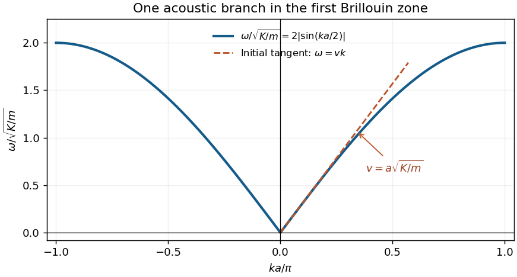
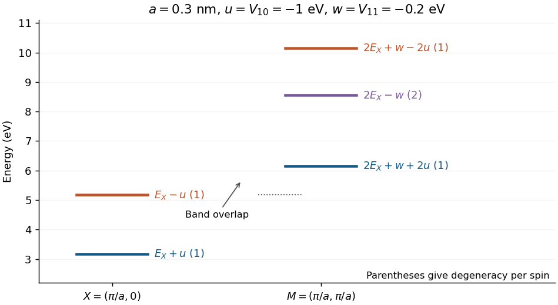
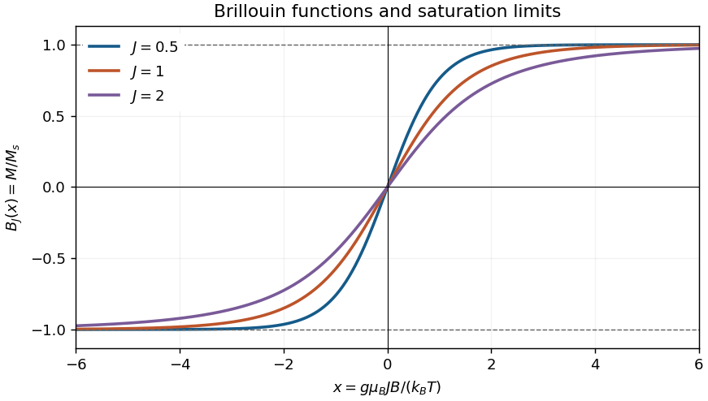

# 2011

↑ **Parent:** [Past exam of the general relativity and cosmology and condensed matter physics paper of Part B of the physics course of the University of Oxford](../past-exam-of-the-general-relativity-and-cosmology-and-condensed-matter-physics-paper-of-part-b-of-the-physics-course-of-the-university-of-oxford.md)

Source paper: [https://www-thphys.physics.ox.ac.uk/people/SteveSimon/condmat2015/b32011.pdf](https://www-thphys.physics.ox.ac.uk/people/SteveSimon/condmat2015/b32011.pdf)

Section V reuses the [official solution notes](https://www-thphys.physics.ox.ac.uk/people/AndreiStarinets/TUTORIALS_NOTES_GR/gr-cosmology-exam-paper-2011-solutions.pdf), with PDF page numbers below counting the cover as page 1. Only omissions and a short correction are supplied here. Section VI is solved below. The examiner report supplies feedback, rather than a worked answer set.

**Table of contents**

- [Section V](#section-v)
  - [1](#section-v/1)
    - [Unlettered 1](#section-v/1/unlettered-1)
      - [Solution](#section-v/1/unlettered-1/solution)
    - [Unlettered 2](#section-v/1/unlettered-2)
      - [Solution](#section-v/1/unlettered-2/solution)
    - [Unlettered 3](#section-v/1/unlettered-3)
      - [Solution](#section-v/1/unlettered-3/solution)
    - [Unlettered 4](#section-v/1/unlettered-4)
      - [Solution](#section-v/1/unlettered-4/solution)
  - [2](#section-v/2)
    - [Unlettered 1](#section-v/2/unlettered-1)
      - [Solution](#section-v/2/unlettered-1/solution)
    - [Unlettered 2](#section-v/2/unlettered-2)
      - [Solution](#section-v/2/unlettered-2/solution)
    - [Unlettered 3](#section-v/2/unlettered-3)
      - [Solution](#section-v/2/unlettered-3/solution)
    - [Unlettered 4](#section-v/2/unlettered-4)
      - [Solution](#section-v/2/unlettered-4/solution)
  - [3](#section-v/3)
    - [Unlettered 1](#section-v/3/unlettered-1)
      - [Solution](#section-v/3/unlettered-1/solution)
    - [Unlettered 2](#section-v/3/unlettered-2)
      - [Solution](#section-v/3/unlettered-2/solution)
    - [Unlettered 3](#section-v/3/unlettered-3)
      - [Solution](#section-v/3/unlettered-3/solution)
    - [Unlettered 4](#section-v/3/unlettered-4)
      - [Solution](#section-v/3/unlettered-4/solution)
    - [Unlettered 5](#section-v/3/unlettered-5)
      - [Solution](#section-v/3/unlettered-5/solution)
  - [4](#section-v/4)
    - [Unlettered 1](#section-v/4/unlettered-1)
      - [Solution](#section-v/4/unlettered-1/solution)
    - [Unlettered 2](#section-v/4/unlettered-2)
      - [Solution](#section-v/4/unlettered-2/solution)
    - [Unlettered 3](#section-v/4/unlettered-3)
      - [Solution](#section-v/4/unlettered-3/solution)
    - [Unlettered 4](#section-v/4/unlettered-4)
      - [Solution](#section-v/4/unlettered-4/solution)
- [Section VI](#section-vi)
  - [5](#section-vi/5)
    - [Unlettered 1](#section-vi/5/unlettered-1)
      - [Solution](#section-vi/5/unlettered-1/solution)
    - [Unlettered 2](#section-vi/5/unlettered-2)
      - [Solution](#section-vi/5/unlettered-2/solution)
    - [Unlettered 3](#section-vi/5/unlettered-3)
      - [Solution](#section-vi/5/unlettered-3/solution)
    - [Unlettered 4](#section-vi/5/unlettered-4)
      - [Solution](#section-vi/5/unlettered-4/solution)
    - [Unlettered 5](#section-vi/5/unlettered-5)
      - [Solution](#section-vi/5/unlettered-5/solution)
  - [6](#section-vi/6)
    - [Unlettered 1](#section-vi/6/unlettered-1)
      - [Solution](#section-vi/6/unlettered-1/solution)
    - [Unlettered 2](#section-vi/6/unlettered-2)
      - [Solution](#section-vi/6/unlettered-2/solution)
    - [Unlettered 3](#section-vi/6/unlettered-3)
      - [Solution](#section-vi/6/unlettered-3/solution)
  - [7](#section-vi/7)
    - [Unlettered 1](#section-vi/7/unlettered-1)
      - [Solution](#section-vi/7/unlettered-1/solution)
    - [i](#section-vi/7/i)
      - [Solution](#section-vi/7/i/solution)
    - [ii](#section-vi/7/ii)
      - [Solution](#section-vi/7/ii/solution)
    - [Unlettered 2](#section-vi/7/unlettered-2)
      - [Solution](#section-vi/7/unlettered-2/solution)
  - [8](#section-vi/8)
    - [i](#section-vi/8/i)
      - [Solution](#section-vi/8/i/solution)
    - [ii](#section-vi/8/ii)
      - [Solution](#section-vi/8/ii/solution)
    - [Unlettered 1](#section-vi/8/unlettered-1)
      - [Solution](#section-vi/8/unlettered-1/solution)
    - [Unlettered 2](#section-vi/8/unlettered-2)
      - [Solution](#section-vi/8/unlettered-2/solution)

## Section V

↑ **Parent:** [2011](2011.md)

<h3 id="section-v/1">1</h3>

↑ **Parent:** [Section V](#section-v)

<h4 id="section-v/1/unlettered-1">Unlettered 1</h4>

↑ **Parent:** [1](#section-v/1)

<h5 id="section-v/1/unlettered-1/solution">Solution</h5>

↑ **Parent:** [Unlettered 1](#section-v/1/unlettered-1)

The [official notes, PDF p. 7, handwritten p. 1](https://www-thphys.physics.ox.ac.uk/people/AndreiStarinets/TUTORIALS_NOTES_GR/gr-cosmology-exam-paper-2011-solutions.pdf#page=7) derive the affine choice of coordinate time and the circular-orbit angular velocity from the [geodesic equations](../riemannian-geometry.md#geodesic-equation).

<h4 id="section-v/1/unlettered-2">Unlettered 2</h4>

↑ **Parent:** [1](#section-v/1)

<h5 id="section-v/1/unlettered-2/solution">Solution</h5>

↑ **Parent:** [Unlettered 2](#section-v/1/unlettered-2)

The [official notes, PDF pp. 7–8, handwritten pp. 1–2](https://www-thphys.physics.ox.ac.uk/people/AndreiStarinets/TUTORIALS_NOTES_GR/gr-cosmology-exam-paper-2011-solutions.pdf#page=7) calculate both elapsed [proper times](../special-relativity.md#proper-time) and their weak-field ratio for satellite A and the polar station.

<h4 id="section-v/1/unlettered-3">Unlettered 3</h4>

↑ **Parent:** [1](#section-v/1)

<h5 id="section-v/1/unlettered-3/solution">Solution</h5>

↑ **Parent:** [Unlettered 3](#section-v/1/unlettered-3)

The [official notes, PDF pp. 8–9, handwritten pp. 2–3](https://www-thphys.physics.ox.ac.uk/people/AndreiStarinets/TUTORIALS_NOTES_GR/gr-cosmology-exam-paper-2011-solutions.pdf#page=8) calculate the geostationary satellite/station [proper time](../special-relativity.md#proper-time) ratio, including the equatorial station's rotation. They explicitly correct the formula printed in the paper; the printed target is not the first-order result of the stated [Schwarzschild metric](../schwarzschild-spacetime.md).

<h4 id="section-v/1/unlettered-4">Unlettered 4</h4>

↑ **Parent:** [1](#section-v/1)

<h5 id="section-v/1/unlettered-4/solution">Solution</h5>

↑ **Parent:** [Unlettered 4](#section-v/1/unlettered-4)

The [official notes, PDF p. 9, handwritten p. 3](https://www-thphys.physics.ox.ac.uk/people/AndreiStarinets/TUTORIALS_NOTES_GR/gr-cosmology-exam-paper-2011-solutions.pdf#page=9) compare the two clock ratios and identify the station's rotational contribution. PDF p. 10, handwritten p. 3a, separately clarifies the normalization when coordinate time is the [affine parameter](../riemannian-geometry.md#affine-parameter).

<h3 id="section-v/2">2</h3>

↑ **Parent:** [Section V](#section-v)

<h4 id="section-v/2/unlettered-1">Unlettered 1</h4>

↑ **Parent:** [2](#section-v/2)

<h5 id="section-v/2/unlettered-1/solution">Solution</h5>

↑ **Parent:** [Unlettered 1](#section-v/2/unlettered-1)

The [official notes, PDF p. 11, handwritten p. 4](https://www-thphys.physics.ox.ac.uk/people/AndreiStarinets/TUTORIALS_NOTES_GR/gr-cosmology-exam-paper-2011-solutions.pdf#page=11) give the [Lagrangian](../calculus-of-variations.md#lagrangian) for the [geodesic equations](../riemannian-geometry.md#geodesic-equation).

<h4 id="section-v/2/unlettered-2">Unlettered 2</h4>

↑ **Parent:** [2](#section-v/2)

<h5 id="section-v/2/unlettered-2/solution">Solution</h5>

↑ **Parent:** [Unlettered 2](#section-v/2/unlettered-2)

The [official notes, PDF pp. 11–13, handwritten pp. 4–6](https://www-thphys.physics.ox.ac.uk/people/AndreiStarinets/TUTORIALS_NOTES_GR/gr-cosmology-exam-paper-2011-solutions.pdf#page=11) derive all four [geodesic equations](../riemannian-geometry.md#geodesic-equation) and list the twelve nonzero [Christoffel symbols](../riemannian-geometry.md#christoffel-symbol) up to symmetry of the lower indices, using time coordinate $t$.

<h4 id="section-v/2/unlettered-3">Unlettered 3</h4>

↑ **Parent:** [2](#section-v/2)

<h5 id="section-v/2/unlettered-3/solution">Solution</h5>

↑ **Parent:** [Unlettered 3](#section-v/2/unlettered-3)

The [official notes, PDF pp. 13–14, handwritten pp. 6–7](https://www-thphys.physics.ox.ac.uk/people/AndreiStarinets/TUTORIALS_NOTES_GR/gr-cosmology-exam-paper-2011-solutions.pdf#page=13) integrate the radial [geodesic equations](../riemannian-geometry.md#geodesic-equation) and establish the vanishing integration constant for a [null geodesic](../special-relativity.md#null-geodesic).

<h4 id="section-v/2/unlettered-4">Unlettered 4</h4>

↑ **Parent:** [2](#section-v/2)

<h5 id="section-v/2/unlettered-4/solution">Solution</h5>

↑ **Parent:** [Unlettered 4](#section-v/2/unlettered-4)

The [official notes, PDF pp. 14–16, handwritten pp. 7–9](https://www-thphys.physics.ox.ac.uk/people/AndreiStarinets/TUTORIALS_NOTES_GR/gr-cosmology-exam-paper-2011-solutions.pdf#page=14) integrate the exponential [scale factor](../cosmology.md#scale-factor-cosmology), discuss the sign required for an incoming [photon](../quantum-mechanics.md#photon), and obtain the distance–[redshift](../optics.md#redshift) relation. They use $a(t_e)$ for the paper's otherwise undefined $R(t_e)$.

<h3 id="section-v/3">3</h3>

↑ **Parent:** [Section V](#section-v)

<h4 id="section-v/3/unlettered-1">Unlettered 1</h4>

↑ **Parent:** [3](#section-v/3)

<h5 id="section-v/3/unlettered-1/solution">Solution</h5>

↑ **Parent:** [Unlettered 1](#section-v/3/unlettered-1)

The [official notes, PDF pp. 17–18, handwritten pp. 10–11](https://www-thphys.physics.ox.ac.uk/people/AndreiStarinets/TUTORIALS_NOTES_GR/gr-cosmology-exam-paper-2011-solutions.pdf#page=17) give the [matter density](../cosmology.md#matter-density), curvature and [cosmological constant](../cosmology.md#cosmological-constant) scalings and the requested logarithmic sketch. For the closed model the curvature contribution to the [Friedmann equations](../cosmology.md#friedmann-equations) is negative; the sketched curvature magnitude must be read with that sign restored.

<h4 id="section-v/3/unlettered-2">Unlettered 2</h4>

↑ **Parent:** [3](#section-v/3)

<h5 id="section-v/3/unlettered-2/solution">Solution</h5>

↑ **Parent:** [Unlettered 2](#section-v/3/unlettered-2)

The [official notes, PDF p. 18, handwritten p. 11](https://www-thphys.physics.ox.ac.uk/people/AndreiStarinets/TUTORIALS_NOTES_GR/gr-cosmology-exam-paper-2011-solutions.pdf#page=18) explain the imminent maximum expansion, recollapse, remaining time of order the present age, and total lifetime of approximately twice that age.

<h4 id="section-v/3/unlettered-3">Unlettered 3</h4>

↑ **Parent:** [3](#section-v/3)

<h5 id="section-v/3/unlettered-3/solution">Solution</h5>

↑ **Parent:** [Unlettered 3](#section-v/3/unlettered-3)

The [official notes, PDF p. 19, handwritten p. 12](https://www-thphys.physics.ox.ac.uk/people/AndreiStarinets/TUTORIALS_NOTES_GR/gr-cosmology-exam-paper-2011-solutions.pdf#page=19) integrate the radial [null geodesic](../special-relativity.md#null-geodesic), express the radial coordinate in terms of [comoving distance](../cosmology.md#comoving-radial-distance), and give its maximum value in that coordinate chart. The maximum radial coordinate is not the total path length around a closed spatial slice.

<h4 id="section-v/3/unlettered-4">Unlettered 4</h4>

↑ **Parent:** [3](#section-v/3)

<h5 id="section-v/3/unlettered-4/solution">Solution</h5>

↑ **Parent:** [Unlettered 4](#section-v/3/unlettered-4)

The [official notes, PDF pp. 20–21, handwritten pp. 13–14](https://www-thphys.physics.ox.ac.uk/people/AndreiStarinets/TUTORIALS_NOTES_GR/gr-cosmology-exam-paper-2011-solutions.pdf#page=20) combine the [Friedmann equations](../cosmology.md#friedmann-equations) and [Raychaudhuri equation](../cosmology.md#friedmann-acceleration-equation) to derive the density and [scale factor](../cosmology.md#scale-factor-cosmology) of the [Einstein static universe](../general-relativity.md#einstein-static-universe).

<h4 id="section-v/3/unlettered-5">Unlettered 5</h4>

↑ **Parent:** [3](#section-v/3)

<h5 id="section-v/3/unlettered-5/solution">Solution</h5>

↑ **Parent:** [Unlettered 5](#section-v/3/unlettered-5)

The [official notes, PDF p. 21, handwritten p. 14](https://www-thphys.physics.ox.ac.uk/people/AndreiStarinets/TUTORIALS_NOTES_GR/gr-cosmology-exam-paper-2011-solutions.pdf#page=21) give the acceleration signs and the instability conclusion for the [Einstein static universe](../general-relativity.md#einstein-static-universe). One wording correction is necessary: their word “oscillatory” for the overdense perturbation is a slip. Starting near rest, an overdense model contracts and its [matter density](../cosmology.md#matter-density) rises, whereas an underdense model expands and its [matter density](../cosmology.md#matter-density) falls; both move away from the static balance.

<h3 id="section-v/4">4</h3>

↑ **Parent:** [Section V](#section-v)

<h4 id="section-v/4/unlettered-1">Unlettered 1</h4>

↑ **Parent:** [4](#section-v/4)

<h5 id="section-v/4/unlettered-1/solution">Solution</h5>

↑ **Parent:** [Unlettered 1](#section-v/4/unlettered-1)

The [official notes, PDF pp. 22–23, handwritten pp. 15–16](https://www-thphys.physics.ox.ac.uk/people/AndreiStarinets/TUTORIALS_NOTES_GR/gr-cosmology-exam-paper-2011-solutions.pdf#page=22) give both density scalings, integrate the radiation- and matter-dominated [Friedmann equations](../cosmology.md#friedmann-equations), normalize the late solution today, and match the two approximations at equality.

<h4 id="section-v/4/unlettered-2">Unlettered 2</h4>

↑ **Parent:** [4](#section-v/4)

<h5 id="section-v/4/unlettered-2/solution">Solution</h5>

↑ **Parent:** [Unlettered 2](#section-v/4/unlettered-2)

The [official notes, PDF p. 24, handwritten p. 17](https://www-thphys.physics.ox.ac.uk/people/AndreiStarinets/TUTORIALS_NOTES_GR/gr-cosmology-exam-paper-2011-solutions.pdf#page=24) integrate the physical [particle horizon](../cosmology.md#particle-horizon) and derive its early-time [redshift](../optics.md#redshift) dependence, explicitly stating the present matter-dominated approximation used in the printed expression.

<h4 id="section-v/4/unlettered-3">Unlettered 3</h4>

↑ **Parent:** [4](#section-v/4)

<h5 id="section-v/4/unlettered-3/solution">Solution</h5>

↑ **Parent:** [Unlettered 3](#section-v/4/unlettered-3)

The [official notes, PDF pp. 24–27, handwritten pp. 17–20](https://www-thphys.physics.ox.ac.uk/people/AndreiStarinets/TUTORIALS_NOTES_GR/gr-cosmology-exam-paper-2011-solutions.pdf#page=24) obtain the [photon number density](../statistical-physics.md#photon-number-density) by integrating the [Planck distribution](../statistical-physics.md#planck-photon-distribution), explain the temperature and dilution scalings, and compare the interaction time with the expansion time for [thermal equilibrium](../thermal-equilibrium.md). They also correct the missing cube and factor-of-two error in the paper's printed [photon number density](../statistical-physics.md#photon-number-density).

<h4 id="section-v/4/unlettered-4">Unlettered 4</h4>

↑ **Parent:** [4](#section-v/4)

<h5 id="section-v/4/unlettered-4/solution">Solution</h5>

↑ **Parent:** [Unlettered 4](#section-v/4/unlettered-4)

The [official notes, PDF p. 27, handwritten p. 20](https://www-thphys.physics.ox.ac.uk/people/AndreiStarinets/TUTORIALS_NOTES_GR/gr-cosmology-exam-paper-2011-solutions.pdf#page=27) derive the early-time [photon](../quantum-mechanics.md#photon) count, its vanishing limit, and the failure of [thermal equilibrium](../thermal-equilibrium.md) when the count is of order one. Two details need supplementing.

First, their constant $N_{\gamma0}$ is the normalization obtained by extrapolating the early-time [particle horizon](../cosmology.md#particle-horizon) formula to $z=0$. It is not the count within today's actual [particle horizon](../cosmology.md#particle-horizon). Let $N_0=N_\gamma(t_0)$ and let $r_{h0}$ be that horizon's physical radius. Using the paper's early-time approximation gives

$$
\boxed{1+z_*\simeq N_0^{1/3}\frac{c}{H_0r_{h0}}\sqrt{1+z_{\rm eq}},\qquad N_\gamma(z_*)=1.}
$$

For a present matter-dominated approximation, $r_{h0}\simeq2c/H_0$. Alternatively, retaining both components in the flat model exactly, $\Omega_R=1/(2+z_{\rm eq})$, and integrating the [particle horizon](../cosmology.md#particle-horizon) gives

$$
r_{h0}=\frac{2c}{H_0}\frac{\sqrt{2+z_{\rm eq}}}{\sqrt{2+z_{\rm eq}}+1},\qquad
\boxed{1+z_*\simeq\frac{N_0^{1/3}}2\left(\sqrt{2+z_{\rm eq}}+1\right).}
$$

The second boxed formula uses the exact two-component normalization and the radiation-dominated early-time limit. Its large-$z_{\rm eq}$ leading term agrees with the first expression and $r_{h0}\simeq2c/H_0$.

Second, a [particle horizon](../cosmology.md#particle-horizon) containing only order-one [photons](../quantum-mechanics.md#photon) cannot support a smooth, locally representative radiation density: discrete-particle fluctuations are of the same order as the mean, and a single photon's direction is strongly anisotropic. Thus the fluid description assuming [spatial homogeneity](../cosmology.md#spatial-homogeneity) and [cosmological isotropy](../cosmology.md#cosmological-isotropy) is not self-consistent on that causal scale. This does not by itself disprove an ensemble-averaged cosmological symmetry; it limits the extrapolation of the smooth [thermal equilibrium](../thermal-equilibrium.md) description.

## Section VI

↑ **Parent:** [2011](2011.md)

<h3 id="section-vi/5">5</h3>

↑ **Parent:** [Section VI](#section-vi)

<h4 id="section-vi/5/unlettered-1">Unlettered 1</h4>

↑ **Parent:** [5](#section-vi/5)

<h5 id="section-vi/5/unlettered-1/solution">Solution</h5>

↑ **Parent:** [Unlettered 1](#section-vi/5/unlettered-1)

For the mutually orthogonal direct [primitive lattice translation vectors](../quantum-scattering.md#primitive-lattice-translation-vector) $\mathbf a_i$, define the [reciprocal lattice](../quantum-scattering.md#reciprocal-lattice) basis by

$$
\boxed{\mathbf a_i\cdot\mathbf b_j=2\pi\delta_{ij},\qquad \mathbf b_i=\frac{2\pi\mathbf a_i}{|\mathbf a_i|^2}.}
$$

Thus $\mathbf G=\sum_i h_i\mathbf b_i$, with integer $h_i$, satisfies $\exp(i\mathbf G\cdot\mathbf R)=1$ for every [lattice vector](../quantum-scattering.md#lattice-vector) $\mathbf R$.

<h4 id="section-vi/5/unlettered-2">Unlettered 2</h4>

↑ **Parent:** [5](#section-vi/5)

<h5 id="section-vi/5/unlettered-2/solution">Solution</h5>

↑ **Parent:** [Unlettered 2](#section-vi/5/unlettered-2)

Write $\mathbf r=\sum_i s_i\mathbf a_i$. The [electron density](../chemistry.md#electron-density) is periodic with period one in each $s_i$, so its three-dimensional [Fourier series](../fourier-series.md) has integer harmonics:

$$
\rho(\mathbf r)=\sum_{h,k,l\in\mathbb Z}\rho_{hkl}e^{2\pi i(hs_1+ks_2+ls_3)}
=\boxed{\sum_{\mathbf G}\rho_{\mathbf G}e^{i\mathbf G\cdot\mathbf r}.}
$$

If $\Omega$ is a [primitive unit cell](../quantum-scattering.md#primitive-unit-cell) of volume $\Omega_c$, [Fourier orthogonality](../fourier-series.md#fourier-orthogonality) gives

$$
\rho_{\mathbf G}=\frac1{\Omega_c}\int_\Omega\rho(\mathbf r)e^{-i\mathbf G\cdot\mathbf r}\,d^3r.
$$

Conversely, translation by $\mathbf a_i$ multiplies a general [plane wave](../wave-function.md#plane-wave) by $e^{i\mathbf q\cdot\mathbf a_i}$. Periodicity permits only $\mathbf q\cdot\mathbf a_i\in2\pi\mathbb Z$, precisely the [reciprocal lattice vectors](../quantum-scattering.md#reciprocal-lattice-vector). For a physical bounded periodic [electron density](../chemistry.md#electron-density), the expansion exists in the usual square-integrable sense.

<h4 id="section-vi/5/unlettered-3">Unlettered 3</h4>

↑ **Parent:** [5](#section-vi/5)

<h5 id="section-vi/5/unlettered-3/solution">Solution</h5>

↑ **Parent:** [Unlettered 3](#section-vi/5/unlettered-3)

Use the [scattering vector](../optics.md#scattering-vector) $\mathbf q=\mathbf k_{\rm in}-\mathbf k_{\rm out}$; reversing its sign conjugates the following amplitudes without changing the intensities. In the [kinematic approximation](../quantum-scattering.md#kinematic-approximation), the [atomic scattering factor](../quantum-scattering.md#atomic-scattering-factor) of atom $s$ is

$$
f_s(\mathbf q)=\int n_s(\mathbf u)e^{i\mathbf q\cdot\mathbf u}\,d^3u.
$$

Atoms at $\mathbf R+\mathbf d_s$ therefore give the [scattering amplitude](../quantum-scattering.md#scattering-amplitude)

$$
\boxed{A(\mathbf q)=A_e(\mathbf q)\underbrace{\sum_s f_s(\mathbf q)e^{i\mathbf q\cdot\mathbf d_s}}_{F(\mathbf q)}\underbrace{\sum_{\mathbf R}e^{i\mathbf q\cdot\mathbf R}}_{S_L(\mathbf q)}.}
$$

Here $A_e$ is the single-electron amplitude; $F$ is the [unit cell](../quantum-scattering.md#unit-cell) [structure factor](../quantum-scattering.md#structure-factor), and $S_L$ is the geometrical lattice sum. If the crystal has $N_i$ repeats along $\mathbf a_i$, the latter factor is a product of [geometric series](../sequence-and-series.md#geometric-series), whose magnitudes contain

$$
\left|\frac{\sin(N_i\mathbf q\cdot\mathbf a_i/2)}{\sin(\mathbf q\cdot\mathbf a_i/2)}\right|.
$$

The sharp constructive peaks occur when every $\mathbf q\cdot\mathbf a_i=2\pi h_i$. Thus **a permitted reflection has wavevector change equal to a [reciprocal lattice vector](../quantum-scattering.md#reciprocal-lattice-vector)**, with $F(\mathbf G)\ne0$ and the additional elastic condition $|\mathbf k_{\rm out}|=|\mathbf k_{\rm in}|$. A finite crystal broadens these peaks; it does not impose an exact delta-function selection on every scattered photon.

<h4 id="section-vi/5/unlettered-4">Unlettered 4</h4>

↑ **Parent:** [5](#section-vi/5)

<h5 id="section-vi/5/unlettered-4/solution">Solution</h5>

↑ **Parent:** [Unlettered 4](#section-vi/5/unlettered-4)

In the conventional cubic [unit cell](../quantum-scattering.md#unit-cell), the four [face-centered cubic lattice](../quantum-scattering.md#face-centered-cubic-lattice) positions contribute

$$
S_{\rm FCC}=1+e^{i\pi(k+l)}+e^{i\pi(h+l)}+e^{i\pi(h+k)}.
$$

The two-atom [atomic basis of a crystal](../physical-chemistry.md#atomic-basis-of-a-crystal) gives the [zinc blende structure factor](../physical-chemistry.md#zinc-blende-structure-factor)

$$
\boxed{F_{hkl}=S_{\rm FCC}\left[f_{\rm Ga}+f_{\rm As}e^{i\pi(h+k+l)/2}\right].}
$$

Mixed-parity [Miller indices](../physical-chemistry.md#miller-index) have $S_{\rm FCC}=0$. With all indices even or all odd, $S_{\rm FCC}=4$. For real [atomic scattering factors](../quantum-scattering.md#atomic-scattering-factor),

$$
|F_{hkl}|^2=16\begin{cases}
f_{\rm Ga}^2+f_{\rm As}^2,&h,k,l\text{ all odd},\\
(f_{\rm Ga}+f_{\rm As})^2,&h,k,l\text{ all even},\ h+k+l=0\pmod4,\\
(f_{\rm Ga}-f_{\rm As})^2,&h,k,l\text{ all even},\ h+k+l=2\pmod4.
\end{cases}
$$

Hence **all same-parity reflections are generally permitted in GaAs**, although the last class is weak when the two [atomic scattering factors](../quantum-scattering.md#atomic-scattering-factor) nearly coincide. These are the structural selection rules; a particular experiment must also satisfy the [elastic Bragg scattering condition](../quantum-scattering.md#elastic-bragg-scattering-condition).

<h4 id="section-vi/5/unlettered-5">Unlettered 5</h4>

↑ **Parent:** [5](#section-vi/5)

<h5 id="section-vi/5/unlettered-5/solution">Solution</h5>

↑ **Parent:** [Unlettered 5](#section-vi/5/unlettered-5)

In the electron-count estimate $f_{\rm Ga}\simeq31$, $f_{\rm As}\simeq33$, the [structure factors](../quantum-scattering.md#structure-factor) are $F_{111}=4(31-33i)$ and $F_{200}=4(31-33)$. Thus a single-directed-reflection estimate is

$$
\frac{|F_{111}|^2}{|F_{200}|^2}=\frac{31^2+33^2}{(31-33)^2}=512.5.
$$

A [powder X-ray diffraction](../quantum-scattering.md#powder-x-ray-diffraction) peak collects all equivalent reflections. The [powder diffraction multiplicities](../physical-chemistry.md#powder-diffraction-multiplicity) are eight for $\{111\}$ and six for $\{200\}$, so the multiplicity-and-electron-count estimate is

$$
\boxed{\frac{I_{\{111\}}}{I_{\{200\}}}\simeq\frac86\frac{31^2+33^2}{(31-33)^2}=6.83\times10^2.}
$$

At $(200)$ the two sublattice amplitudes are opposite in phase and nearly cancel; at $(111)$ their relative phase is a quarter cycle, so this cancellation does not occur. In [silicon](../chemical-substance.md#silicon), the two [atomic scattering factors](../quantum-scattering.md#atomic-scattering-factor) are identical and the [diamond cubic structure](../physical-chemistry.md#diamond-cubic-structure) has **an exactly forbidden $(200)$ reflection**, while $(111)$ remains allowed in the [kinematic approximation](../quantum-scattering.md#kinematic-approximation).

The numerical ratio neglects the angular dependence of the [atomic scattering factors](../quantum-scattering.md#atomic-scattering-factor), the [Lorentz-polarization factor](../physical-chemistry.md#lorentz-polarization-factor) and thermal-motion corrections. No wavelength or measurement geometry is supplied to refine those factors. This is therefore a stated structural estimate, rather than a unique precision ratio of measured peak areas.

<h3 id="section-vi/6">6</h3>

↑ **Parent:** [Section VI](#section-vi)

<h4 id="section-vi/6/unlettered-1">Unlettered 1</h4>

↑ **Parent:** [6](#section-vi/6)

<h5 id="section-vi/6/unlettered-1/solution">Solution</h5>

↑ **Parent:** [Unlettered 1](#section-vi/6/unlettered-1)

Let $a$ be a stable equilibrium separation: $V'(a)=0$, $K=V''(a)>0$. With bond extension $\delta=x-a$, the [Taylor expansion](../calculus.md#taylor-expansion) is

$$
V(a+\delta)=V(a)+\tfrac12K\delta^2+\tfrac16V'''(a)\delta^3+\cdots.
$$

The [harmonic approximation](../lagrangian-mechanics.md#harmonic-approximation) applies when the typical thermal and zero-point bond fluctuations satisfy $|\delta|\ll a$ and the higher terms are negligible, for example $|V'''(a)\delta|\ll3K$ and $|V''''(a)\delta^2|\ll12K$. The relevant small quantity is the relative displacement of neighbouring atoms. **Small bond excursions about a stable minimum give an amplitude-independent [spring constant](../elasticity-physics.md#spring-constant) $K=V''(a)$.** Large thermal excursions, bond breaking or appreciable [anharmonicity](../wave.md#anharmonicity) invalidate the approximation.

<h4 id="section-vi/6/unlettered-2">Unlettered 2</h4>

↑ **Parent:** [6](#section-vi/6)

<h5 id="section-vi/6/unlettered-2/solution">Solution</h5>

↑ **Parent:** [Unlettered 2](#section-vi/6/unlettered-2)

With atomic displacement $u_j$, the harmonic potential energy is $\tfrac12K\sum_j(u_{j+1}-u_j)^2$. [Newton's second law](../force.md#newton-s-second-law) gives

$$
m\ddot u_j=K(u_{j+1}+u_{j-1}-2u_j).
$$

For a periodic chain of $N$ atoms, its [normal modes](../wave-equation.md#normal-mode) are $u_j=Ue^{i(kja-\omega t)}$, with $k=2\pi s/(Na)$ and one representative per [Brillouin zone](../bloch-s-theorem.md#brillouin-zone). Substitution yields the [monatomic-chain dispersion relation](../quantum-ideal-gas-statistics.md#monatomic-chain-dispersion-relation)

$$
-m\omega^2=K(e^{ika}+e^{-ika}-2),\qquad
\boxed{\omega(k)=2\sqrt{\frac Km}\left|\sin\frac{ka}{2}\right|.}
$$

A real general displacement is a superposition of these [normal modes](../wave-equation.md#normal-mode) and their complex conjugates. The $k=0$ mode is a rigid translation. At small $|k|$, the [acoustic phonon branch](../quantum-ideal-gas-statistics.md#acoustic-phonon-branch) is linear, with [speed of sound](../compressible-flow.md#speed-of-sound)

$$
\boxed{v=\lim_{k\to0^+}\frac{d\omega}{dk}=a\sqrt{\frac Km}.}
$$

For $0<k<\pi/a$, the [group velocity](../dispersion-relation.md#group-velocity) is $a\sqrt{K/m}\cos(ka/2)$ and vanishes at the zone boundary. The dashed initial tangent in the sketch has slope $v$.

**[Figure 1](#section-vi/6/unlettered-2/image-monatomic-chain-dispersion-and-its-sound-speed-tangent). Monatomic-chain dispersion and its sound-speed tangent**.

<h4 id="section-vi/6/unlettered-3">Unlettered 3</h4>

↑ **Parent:** [6](#section-vi/6)

<h5 id="section-vi/6/unlettered-3/solution">Solution</h5>

↑ **Parent:** [Unlettered 3](#section-vi/6/unlettered-3)

For the [Lennard-Jones potential](../energy.md#lennard-jones-potential),

$$
V'(x)=\frac{24\epsilon}{x}\left[\left(\frac\sigma x\right)^6-2\left(\frac\sigma x\right)^{12}\right].
$$

Its minimum and harmonic [spring constant](../elasticity-physics.md#spring-constant) are

$$
a=2^{1/6}\sigma,\qquad
K=4\epsilon\left(\frac{156\sigma^{12}}{a^{14}}-\frac{42\sigma^6}{a^8}\right)=\frac{72\epsilon}{a^2}.
$$

Using the [monatomic-chain dispersion relation](../quantum-ideal-gas-statistics.md#monatomic-chain-dispersion-relation),

$$
\boxed{v=\sqrt{\frac{72\epsilon}{m}},\qquad
\omega_{\max}=2\sqrt{\frac Km}=\frac2{2^{1/6}\sigma}\sqrt{\frac{72\epsilon}{m}},\qquad f_{\max}=\frac{\omega_{\max}}{2\pi}.}
$$

The maximum is at $|k|=\pi/a$. Taking the [argon](../chemical-substance.md#argon) atomic mass as $m\simeq39.95\,\mathrm u=6.63\times10^{-26}\,\mathrm{kg}$ and $\epsilon=1.602\times10^{-21}\,\mathrm J$ gives

$$
a\simeq0.382\,\mathrm{nm},\qquad K\simeq0.792\,\mathrm{N\,m^{-1}},
$$

$$
\boxed{v\simeq1.32\times10^3\,\mathrm{m\,s^{-1}},\qquad\omega_{\max}\simeq6.91\times10^{12}\,\mathrm{s^{-1}},\qquad f_{\max}\simeq1.10\,\mathrm{THz}.}
$$

These are the stipulated one-dimensional nearest-neighbour model estimates; a three-dimensional [argon](../chemical-substance.md#argon) crystal has additional neighbours and [phonon polarizations](../quantum-ideal-gas-statistics.md#phonon-polarization).

<h3 id="section-vi/7">7</h3>

↑ **Parent:** [Section VI](#section-vi)

<h4 id="section-vi/7/unlettered-1">Unlettered 1</h4>

↑ **Parent:** [7](#section-vi/7)

<h5 id="section-vi/7/unlettered-1/solution">Solution</h5>

↑ **Parent:** [Unlettered 1](#section-vi/7/unlettered-1)

Normalize the [plane waves](../wave-function.md#plane-wave) in a periodic crystal of area or volume $\mathcal V$. The [Fourier coefficients](../fourier-series.md#fourier-coefficient) of the [periodic potential](../bloch-s-theorem.md#periodic-potential) obey

$$
\langle\mathbf k|V|\mathbf k'\rangle=\frac1{\mathcal V}\int_{\mathcal V}V(\mathbf r)e^{-i(\mathbf k-\mathbf k')\cdot\mathbf r}\,d\mathbf r=V_{\mathbf k-\mathbf k'}.
$$

Translation of the integral by any [lattice vector](../quantum-scattering.md#lattice-vector) $\mathbf R$ leaves it invariant but multiplies it by $e^{-i(\mathbf k-\mathbf k')\cdot\mathbf R}$. A nonzero result therefore requires $\mathbf k-\mathbf k'$ to be a [reciprocal lattice vector](../quantum-scattering.md#reciprocal-lattice-vector).

Near an isolated [Bragg scattering](../quantum-scattering.md#bragg-scattering) degeneracy, ordinary nondegenerate [perturbation theory](../asymptotic-expansion.md#perturbation-theory) fails because the free energies coincide. Retain the resonant [plane waves](../wave-function.md#plane-wave) $|\mathbf k\rangle$, $|\mathbf k+\mathbf G\rangle$ and apply [degenerate perturbation theory](../quantum-mechanics.md#degenerate-perturbation-theory). Absorb the constant $V_{\mathbf0}$ into the energy origin. Since a real potential has $V_{-\mathbf G}=V_{\mathbf G}^*$, the projected [Schrödinger equation](../mathematical-physics.md#schrodinger-equation) has coefficient matrix

$$
\begin{pmatrix}
\epsilon_0(\mathbf k)-E&V_{-\mathbf G}\\
V_{\mathbf G}&\epsilon_0(\mathbf k+\mathbf G)-E
\end{pmatrix}.
$$

A nonzero eigenstate requires

$$
\boxed{[\epsilon_0(\mathbf k)-E][\epsilon_0(\mathbf k+\mathbf G)-E]-|V_{\mathbf G}|^2=0.}
$$

Off-resonant [plane waves](../wave-function.md#plane-wave) give higher-order energy shifts omitted in this leading [nearly-free electron model](../bloch-s-theorem.md#nearly-free-electron-model).

<h4 id="section-vi/7/i">i</h4>

↑ **Parent:** [7](#section-vi/7)

<h5 id="section-vi/7/i/solution">Solution</h5>

↑ **Parent:** [I](#section-vi/7/i)

Let $u=V_{10}<0$ and

$$
E_X=\frac{\hbar^2\pi^2}{2m_ea^2}.
$$

At $X=(\pi/a,0)$ the two degenerate [plane waves](../wave-function.md#plane-wave) have momenta $(\pi/a,0)$ and $(-\pi/a,0)$ and coupling $u$. Thus

$$
\begin{vmatrix}E_X-E&u\\u&E_X-E\end{vmatrix}=0,\qquad
\boxed{E_{X,1}=E_X+u,\quad E_{X,2}=E_X-u.}
$$

Their symmetric and antisymmetric combinations are the lower and upper states respectively. The local [band gap](../bloch-s-theorem.md#band-gap) is $2|u|$.

<h4 id="section-vi/7/ii">ii</h4>

↑ **Parent:** [7](#section-vi/7)

<h5 id="section-vi/7/ii/solution">Solution</h5>

↑ **Parent:** [Ii](#section-vi/7/ii)

Put $w=V_{11}<0$. At $M=(\pi/a,\pi/a)$, the free energy is $2E_X$. The four cyclic combinations in the supplied [secular equation](../linear-operator-theory.md#secular-equation-linear-algebra) give the [four-plane-wave splitting at a square-zone corner](../bloch-s-theorem.md#four-plane-wave-splitting-at-a-square-zone-corner)

$$
\boxed{E_{M,1}=2E_X+w+2u,\qquad E_{M,2}=E_{M,3}=2E_X-w,\qquad E_{M,4}=2E_X+w-2u.}
$$

For example, the normalized coefficient vectors in the source's cyclic basis are $(1,1,1,1)/2$, $(1,0,-1,0)/\sqrt2$, $(0,1,0,-1)/\sqrt2$, and $(1,-1,1,-1)/2$. Because $u<w<0$, these are ordered as written: a lower singlet, a central doublet and an upper singlet. The sketch puts the $X$ and $M$ energies on one common scale; its representative negative couplings are stated in the caption.

**[Figure 2](#section-vi/7/ii/image-common-energy-scale-at-the-square-zone-edge-and-corner-with-illustrative-couplings-v10-minus-1-ev-and-v11-minus-0-2-ev). Common energy scale at the square-zone edge and corner, with illustrative couplings V10 = −1 eV and V11 = −0.2 eV**.

<h4 id="section-vi/7/unlettered-2">Unlettered 2</h4>

↑ **Parent:** [7](#section-vi/7)

<h5 id="section-vi/7/unlettered-2/solution">Solution</h5>

↑ **Parent:** [Unlettered 2](#section-vi/7/unlettered-2)

There are two [electrons](../physics.md#electron) per [primitive unit cell](../quantum-scattering.md#primitive-unit-cell); a spin-degenerate [energy band](../bloch-s-theorem.md#energy-band) accommodates exactly that number. A [semiconductor](../semiconductor.md) results when the first band is full and does not overlap the second. In the leading two-wave/four-wave approximation, compare the first-band maximum at $M$ with the second-band minimum at $X$:

$$
\Delta_{\rm ind}=E_{X,2}-E_{M,1}
=(E_X-u)-(2E_X+w+2u)=-E_X-w-3u.
$$

This is an [indirect band gap](../bloch-s-theorem.md#indirect-band-gap); a nonzero local splitting at $X$ alone is insufficient. At the onset,

$$
\boxed{V_{10,\rm crit}=-\frac{E_X+V_{11}}3.}
$$

With $a=0.3\,\mathrm{nm}$, $\hbar^2/(2m_e)=0.03810\,\mathrm{eV\,nm^2}$ gives $E_X\simeq4.178\,\mathrm{eV}$, hence

$$
\boxed{V_{10,\rm crit}\simeq-1.326\,\mathrm{eV}.}
$$

For $V_{10}$ more negative than this value the estimated [indirect band gap](../bloch-s-theorem.md#indirect-band-gap) is positive; at equality the bands just touch. This is the onset estimate within the source's [nearly-free electron model](../bloch-s-theorem.md#nearly-free-electron-model) truncation, not an exact critical potential after coupling all [plane waves](../wave-function.md#plane-wave).

<h3 id="section-vi/8">8</h3>

↑ **Parent:** [Section VI](#section-vi)

<h4 id="section-vi/8/i">i</h4>

↑ **Parent:** [8](#section-vi/8)

<h5 id="section-vi/8/i/solution">Solution</h5>

↑ **Parent:** [I](#section-vi/8/i)

The [Brillouin function](../electromagnetism.md#brillouin-function) is odd, increases monotonically through zero, and approaches $\pm1$ for $x\to\pm\infty$. Its small-$x$ slope is $(J+1)/(3J)$. For $x\gg1$, the magnetic ions overwhelmingly occupy the largest field-aligned moment projection, so the [magnetization](../electromagnetism.md#magnetization) reaches [magnetic saturation](../electromagnetism.md#magnetic-saturation):

$$
\boxed{M\longrightarrow M_s=ng\mu_BJ.}
$$

The sketch shows several $J$ values; all have the same limiting values, while their slopes differ.

**[Figure 3](#section-vi/8/i/image-brillouin-functions-approaching-magnetic-saturation). Brillouin functions approaching magnetic saturation**.

<h4 id="section-vi/8/ii">ii</h4>

↑ **Parent:** [8](#section-vi/8)

<h5 id="section-vi/8/ii/solution">Solution</h5>

↑ **Parent:** [Ii](#section-vi/8/ii)

The $1/x$ terms in the [Brillouin function](../electromagnetism.md#brillouin-function) cancel. Keeping the linear terms gives

$$
B_J(x)=\frac{(2J+1)^2-1}{12J^2}x+O(x^3)=\frac{J+1}{3J}x+O(x^3).
$$

Consequently,

$$
M\simeq\frac{n(g\mu_B)^2J(J+1)}{3k_BT}B.
$$

Use the dimensionless SI [magnetic susceptibility](../statistical-physics.md#magnetic-susceptibility) $\chi=\partial M/\partial H_{\rm applied}$ and $B_{\rm applied}=\mu_0H_{\rm applied}$, as in the source's molecular-field convention. The [Curie law](../statistical-physics.md#curie-s-law) is

$$
\boxed{\chi=\frac CT,\qquad C=\frac{\mu_0n(g\mu_B)^2J(J+1)}{3k_B}.}
$$

If susceptibility is instead defined as $\partial M/\partial B$, its coefficient is $C/\mu_0$ and is dimensionful. The SI convention above makes the subsequent [Curie–Weiss law](../electromagnetism.md#curie-weiss-law) and $\lambda$ consistent.

<h4 id="section-vi/8/unlettered-1">Unlettered 1</h4>

↑ **Parent:** [8](#section-vi/8)

<h5 id="section-vi/8/unlettered-1/solution">Solution</h5>

↑ **Parent:** [Unlettered 1](#section-vi/8/unlettered-1)

For positive $\lambda$, a fluctuation of [magnetization](../electromagnetism.md#magnetization) produces a [Weiss molecular field](../statistical-physics.md#weiss-molecular-field) in the same direction, reinforcing alignment. The [mean-field self-consistency equation](../critical-phenomenon.md#self-consistency-equation) is

$$
M=M_sB_J\!\left[\frac{g\mu_BJ\mu_0}{k_BT}(H_{\rm applied}+\lambda M)\right].
$$

Linearizing in the paramagnetic phase gives

$$
M=\frac CT(H_{\rm applied}+\lambda M),\qquad
\boxed{\chi=\frac C{T-\lambda C}=\frac C{T-T_C},\qquad T_C=\lambda C=\frac{\mu_0\lambda n(g\mu_B)^2J(J+1)}{3k_B}.}
$$

At zero applied field, the right-hand side's slope at $M=0$ is $T_C/T$. Below $T_C$ this exceeds one, and the saturation of the [Brillouin function](../electromagnetism.md#brillouin-function) allows stable nonzero solutions of opposite sign: spontaneous [ferromagnetism](../electromagnetism.md#ferromagnetism). Above $T_C$, only the zero-field solution $M=0$ remains stable. The stated linear susceptibility is the paramagnetic branch for $T>T_C$; it must not be continued as a negative susceptibility below the transition.

<h4 id="section-vi/8/unlettered-2">Unlettered 2</h4>

↑ **Parent:** [8](#section-vi/8)

<h5 id="section-vi/8/unlettered-2/solution">Solution</h5>

↑ **Parent:** [Unlettered 2](#section-vi/8/unlettered-2)

Using the supplied [iron](../chemical-substance.md#iron) parameters gives

$$
C=\frac{\mu_0(8.5\times10^{28})(2\mu_B)^2(1)(2)}{3k_B}\simeq1.77\,\mathrm K,\qquad
\boxed{\lambda=\frac{1043}{C}\simeq5.88\times10^2.}
$$

An internal [Weiss molecular field](../statistical-physics.md#weiss-molecular-field) depends on [temperature](../temperature.md) through $M(T)$. Its low-temperature saturation estimate uses $M_s=ng\mu_BJ\simeq1.58\times10^6\,\mathrm{A\,m^{-1}}$:

$$
\boxed{B_{e,\rm sat}=\mu_0\lambda M_s=\frac{3k_BT_C}{g\mu_B(J+1)}\simeq1.16\times10^3\,\mathrm T.}
$$

At and above $T_C$ the zero-applied-field [magnetization](../electromagnetism.md#magnetization) vanishes in this model, so this is a saturation estimate, not the field at $T_C$.

Use the paper's stipulated [face-centered cubic lattice](../quantum-scattering.md#face-centered-cubic-lattice), which has twelve nearest neighbours. The saturated one-ion alignment scale is

$$
(g\mu_BJ)B_{e,\rm sat}=\frac{3J}{J+1}k_BT_C\simeq0.135\,\mathrm{eV}.
$$

Dividing the effective field among twelve equivalent neighbours gives the per-bond [exchange interaction](../electromagnetism.md#exchange-interaction) scale

$$
\boxed{E_{\rm bond}\simeq\frac{g\mu_BJ B_{e,\rm sat}}{12}\simeq1.12\times10^{-2}\,\mathrm{eV}=11.2\,\mathrm{meV}.}
$$

To specify the convention, write the [Heisenberg model](../angular-momentum-operator.md#heisenberg-model) as $\mathcal H=-\mathcal J\sum_{\langle ij\rangle}\mathbf J_i\cdot\mathbf J_j$, with dimensionless angular-momentum operators and each bond counted once. Then $g\mu_BB_e=12\mathcal J\langle J_z\rangle$, so $\mathcal J=3k_BT_C/[12J(J+1)]\simeq11.2\,\mathrm{meV}$ here. A convention with $-2\mathcal J'$ instead has $\mathcal J'=5.62\,\mathrm{meV}$. The total saturated interaction energy per ion is $-12\mathcal J J^2/2\simeq-67.4\,\mathrm{meV}$; the factor of one half avoids counting each bond twice.

## ↑ Ancestors (9)

1. [Past exam of the general relativity and cosmology and condensed matter physics paper of Part B of the physics course of the University of Oxford](../past-exam-of-the-general-relativity-and-cosmology-and-condensed-matter-physics-paper-of-part-b-of-the-physics-course-of-the-university-of-oxford.md)
2. [General relativity and cosmology and condensed matter physics paper of Part B of the physics course of the University of Oxford](../university-of-oxford.md#general-relativity-and-cosmology-and-condensed-matter-physics-paper-of-part-b-of-the-physics-course-of-the-university-of-oxford)
3. [Year 3 of the physics course of the University of Oxford](../university-of-oxford.md#year-3-of-the-physics-course-of-the-university-of-oxford)
4. [Physics course of the University of Oxford](../university-of-oxford.md#physics-course-of-the-university-of-oxford)
5. [Undergraduate course of the University of Oxford](../university-of-oxford.md#undergraduate-course-of-the-university-of-oxford)
6. [Course of the University of Oxford](../university-of-oxford.md#course-of-the-university-of-oxford)
7. [University of Oxford](../university-of-oxford.md)
8. [List of universities](../README.md#list-of-universities)
9. [Codex Wiki](../README.md)
