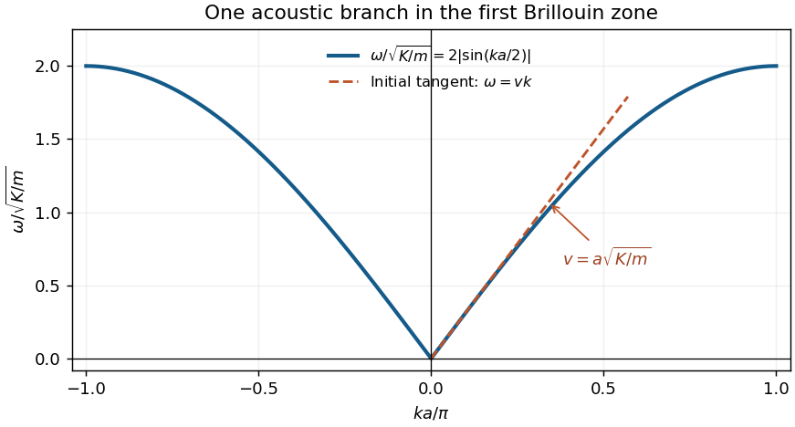

<h1 id="section-vi/6/unlettered-2/solution">Solution</h1>

↑ **Parent:** [Unlettered 2](../unlettered-2.md)

With atomic displacement $u_j$, the harmonic potential energy is $\tfrac12K\sum_j(u_{j+1}-u_j)^2$. [Newton's second law](../../../../../newton-s-second-law.md) gives

$$
m\ddot u_j=K(u_{j+1}+u_{j-1}-2u_j).
$$

For a periodic chain of $N$ atoms, its [normal modes](../../../../../normal-mode.md) are $u_j=Ue^{i(kja-\omega t)}$, with $k=2\pi s/(Na)$ and one representative per [Brillouin zone](../../../../../brillouin-zone.md). Substitution yields the [monatomic-chain dispersion relation](../../../../../monatomic-chain-dispersion-relation.md)

$$
-m\omega^2=K(e^{ika}+e^{-ika}-2),\qquad
\boxed{\omega(k)=2\sqrt{\frac Km}\left|\sin\frac{ka}{2}\right|.}
$$

A real general displacement is a superposition of these [normal modes](../../../../../normal-mode.md) and their complex conjugates. The $k=0$ mode is a rigid translation. At small $|k|$, the [acoustic phonon branch](../../../../../acoustic-phonon-branch.md) is linear, with [speed of sound](../../../../../speed-of-sound.md)

$$
\boxed{v=\lim_{k\to0^+}\frac{d\omega}{dk}=a\sqrt{\frac Km}.}
$$

For $0<k<\pi/a$, the [group velocity](../../../../../group-velocity.md) is $a\sqrt{K/m}\cos(ka/2)$ and vanishes at the zone boundary. The dashed initial tangent in the sketch has slope $v$.

**[Figure 1](#section-vi/6/unlettered-2/image-monatomic-chain-dispersion-and-its-sound-speed-tangent). Monatomic-chain dispersion and its sound-speed tangent**.

## ↑ Ancestors (13)

1. [Unlettered 2](../unlettered-2.md)
2. [6](../../6.md)
3. [Section VI](../../../section-vi.md)
4. [2011](../../../../2011-split.md)
5. [Past exam of the general relativity and cosmology and condensed matter physics paper of Part B of the physics course of the University of Oxford](../../../../split.md)
6. [General relativity and cosmology and condensed matter physics paper of Part B of the physics course of the University of Oxford](../../../../../general-relativity-and-cosmology-and-condensed-matter-physics-paper-of-part-b-of-the-physics-course-of-the-university-of-oxford.md)
7. [Year 3 of the physics course of the University of Oxford](../../../../../year-3-of-the-physics-course-of-the-university-of-oxford.md)
8. [Physics course of the University of Oxford](../../../../../physics-course-of-the-university-of-oxford.md)
9. [Undergraduate course of the University of Oxford](../../../../../undergraduate-course-of-the-university-of-oxford.md)
10. [Course of the University of Oxford](../../../../../course-of-the-university-of-oxford.md)
11. [University of Oxford](../../../../../university-of-oxford-split.md)
12. [List of universities](../../../../../list-of-universities.md)
13. [Codex Wiki](../../../../../split.md)
