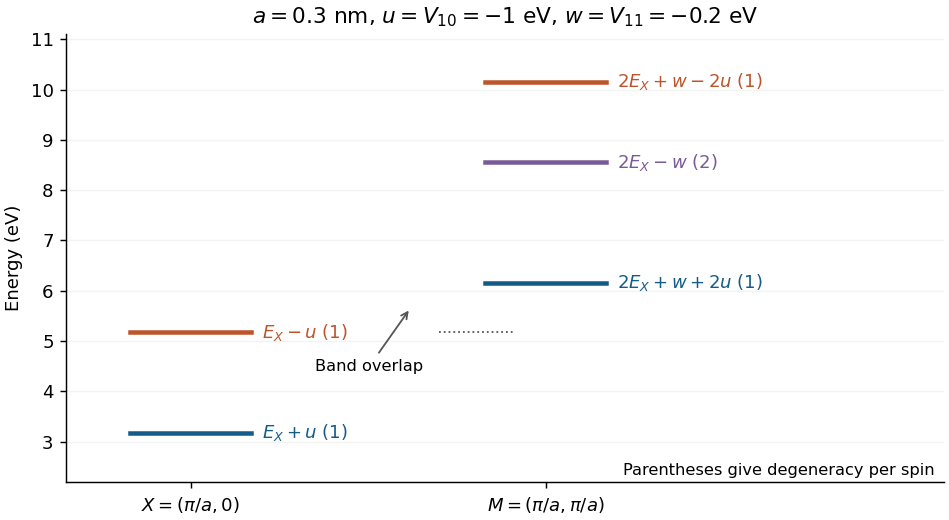

<h1 id="section-vi/7/ii/solution">Solution</h1>

↑ **Parent:** [Ii](../ii.md)

Put $w=V_{11}<0$. At $M=(\pi/a,\pi/a)$, the free energy is $2E_X$. The four cyclic combinations in the supplied [secular equation](../../../../../secular-equation-linear-algebra.md) give the [four-plane-wave splitting at a square-zone corner](../../../../../four-plane-wave-splitting-at-a-square-zone-corner.md)

$$
\boxed{E_{M,1}=2E_X+w+2u,\qquad E_{M,2}=E_{M,3}=2E_X-w,\qquad E_{M,4}=2E_X+w-2u.}
$$

For example, the normalized coefficient vectors in the source's cyclic basis are $(1,1,1,1)/2$, $(1,0,-1,0)/\sqrt2$, $(0,1,0,-1)/\sqrt2$, and $(1,-1,1,-1)/2$. Because $u<w<0$, these are ordered as written: a lower singlet, a central doublet and an upper singlet. The sketch puts the $X$ and $M$ energies on one common scale; its representative negative couplings are stated in the caption.

**[Figure 2](#section-vi/7/ii/image-common-energy-scale-at-the-square-zone-edge-and-corner-with-illustrative-couplings-v10-minus-1-ev-and-v11-minus-0-2-ev). Common energy scale at the square-zone edge and corner, with illustrative couplings V10 = −1 eV and V11 = −0.2 eV**.

## ↑ Ancestors (13)

1. [Ii](../ii.md)
2. [7](../../7.md)
3. [Section VI](../../../section-vi.md)
4. [2011](../../../../2011-split.md)
5. [Past exam of the general relativity and cosmology and condensed matter physics paper of Part B of the physics course of the University of Oxford](../../../../split.md)
6. [General relativity and cosmology and condensed matter physics paper of Part B of the physics course of the University of Oxford](../../../../../general-relativity-and-cosmology-and-condensed-matter-physics-paper-of-part-b-of-the-physics-course-of-the-university-of-oxford.md)
7. [Year 3 of the physics course of the University of Oxford](../../../../../year-3-of-the-physics-course-of-the-university-of-oxford.md)
8. [Physics course of the University of Oxford](../../../../../physics-course-of-the-university-of-oxford.md)
9. [Undergraduate course of the University of Oxford](../../../../../undergraduate-course-of-the-university-of-oxford.md)
10. [Course of the University of Oxford](../../../../../course-of-the-university-of-oxford.md)
11. [University of Oxford](../../../../../university-of-oxford-split.md)
12. [List of universities](../../../../../list-of-universities.md)
13. [Codex Wiki](../../../../../split.md)
