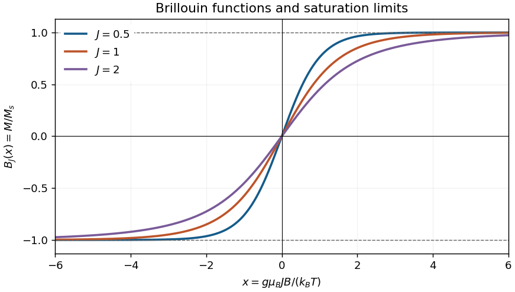

<h1 id="section-vi/8/i/solution">Solution</h1>

↑ **Parent:** [I](../i.md)

The [Brillouin function](../../../../../brillouin-function.md) is odd, increases monotonically through zero, and approaches $\pm1$ for $x\to\pm\infty$. Its small-$x$ slope is $(J+1)/(3J)$. For $x\gg1$, the magnetic ions overwhelmingly occupy the largest field-aligned moment projection, so the [magnetization](../../../../../magnetization.md) reaches [magnetic saturation](../../../../../magnetic-saturation.md):

$$
\boxed{M\longrightarrow M_s=ng\mu_BJ.}
$$

The sketch shows several $J$ values; all have the same limiting values, while their slopes differ.

**[Figure 3](#section-vi/8/i/image-brillouin-functions-approaching-magnetic-saturation). Brillouin functions approaching magnetic saturation**.

## ↑ Ancestors (13)

1. [I](../i.md)
2. [8](../../8.md)
3. [Section VI](../../../section-vi.md)
4. [2011](../../../../2011-split.md)
5. [Past exam of the general relativity and cosmology and condensed matter physics paper of Part B of the physics course of the University of Oxford](../../../../split.md)
6. [General relativity and cosmology and condensed matter physics paper of Part B of the physics course of the University of Oxford](../../../../../general-relativity-and-cosmology-and-condensed-matter-physics-paper-of-part-b-of-the-physics-course-of-the-university-of-oxford.md)
7. [Year 3 of the physics course of the University of Oxford](../../../../../year-3-of-the-physics-course-of-the-university-of-oxford.md)
8. [Physics course of the University of Oxford](../../../../../physics-course-of-the-university-of-oxford.md)
9. [Undergraduate course of the University of Oxford](../../../../../undergraduate-course-of-the-university-of-oxford.md)
10. [Course of the University of Oxford](../../../../../course-of-the-university-of-oxford.md)
11. [University of Oxford](../../../../../university-of-oxford-split.md)
12. [List of universities](../../../../../list-of-universities.md)
13. [Codex Wiki](../../../../../split.md)
