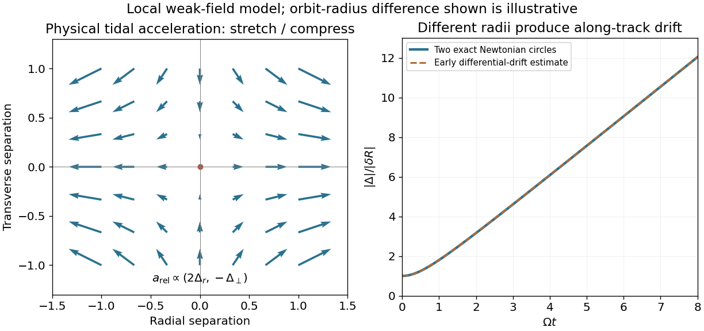

<h1 id="1/c/solution">Solution</h1>

↑ **Parent:** [C](../c.md)

[Geodesic deviation](../../../../geodesic-deviation.md) compares neighboring members of a family of freely falling trajectories. Subtracting their [geodesic equations](../../../../geodesic-equation.md) to first order in the connecting vector gives a covariant relative-acceleration equation governed by the [Riemann curvature tensor](../../../../riemann-curvature-tensor-split.md). For a slowly moving satellite, $u^0=c\dot t\simeq c$ dominates the spatial components. Choose simultaneous spatial separation in a locally transported frame, take the [weak-field approximation](../../../../weak-field-approximation.md), and neglect terms quadratic in the small separation and higher velocity corrections. The leading spatial equation becomes

$$
\boxed{\frac{d^2\Delta^i}{d\tau^2}+c^2R^i{}_{0j0}\Delta^j\simeq0.}
$$

Replacing the transported covariant derivatives by ordinary derivatives is a leading local or Newtonian approximation; a rotating orbital frame would introduce additional inertial terms. In the convention established above, the instantaneous [tidal acceleration](../../../../tidal-acceleration.md) stretches radial separations and compresses transverse ones.

The growth expected for nearby _different-radius_ circular orbits is especially transparent from [Kepler's third law](../../../../kepler-s-third-law.md). If the radii are $R$ and $R+\delta R$, their coordinate angular frequencies differ by $\delta\Omega\simeq-(3/2)\Omega\delta R/R$. Initially aligned orbits therefore acquire an along-track separation $R\delta\Omega\,t\simeq-(3/2)\Omega\delta R\,t$. Over the interval in which the nearby-orbit approximation remains valid, this produces a growing separation without needing to solve the deviation equation.

This growth is not universal or indefinitely unbounded. Equal-radius co-orbiting geodesics with a fixed phase offset have constant separation, and slightly inclined equal-radius circular orbits have bounded, periodically varying separation. Even different-radius circular orbits have bounded exact positions; their relative angle eventually wraps around. The secular drift statement assumes distinct radii and describes the local differential-orbit regime.

**[Figure 1](#1/c/image-physical-tidal-stretching-and-the-early-differential-drift-of-neighboring-circular-orbits). Physical tidal stretching and the early differential drift of neighboring circular orbits**.

## ↑ Ancestors (12)

1. [C](../c.md)
2. [1](../../1.md)
3. [2012](../../../2012-split.md)
4. [Past exam of the general relativity and cosmology course of the University of Oxford](../../../split.md)
5. [General relativity and cosmology course of the University of Oxford](../../../../general-relativity-and-cosmology-course-of-the-university-of-oxford.md)
6. [Year 3 of the physics course of the University of Oxford](../../../../year-3-of-the-physics-course-of-the-university-of-oxford.md)
7. [Physics course of the University of Oxford](../../../../physics-course-of-the-university-of-oxford.md)
8. [Undergraduate course of the University of Oxford](../../../../undergraduate-course-of-the-university-of-oxford.md)
9. [Course of the University of Oxford](../../../../course-of-the-university-of-oxford.md)
10. [University of Oxford](../../../../university-of-oxford-split.md)
11. [List of universities](../../../../list-of-universities.md)
12. [Codex Wiki](../../../../split.md)
