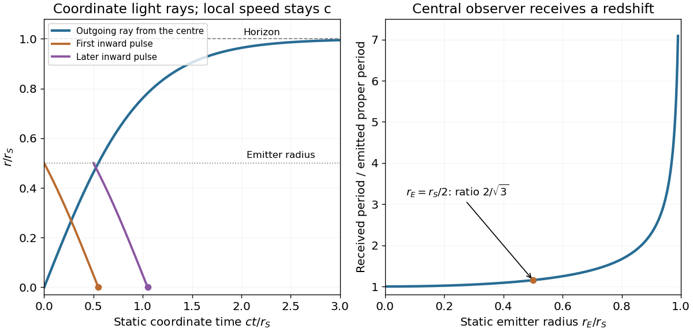

<h1 id="2/b/solution">Solution</h1>

↑ **Parent:** [B](../b.md)

For [radial null geodesics in a de Sitter static patch](../../../../radial-null-geodesics-in-a-de-sitter-static-patch.md), the conserved time quantity and the stated normalization at the origin give $\alpha\dot t=1$. The null condition then gives

$$
0=-c^2\alpha\dot t^2+\alpha^{-1}\dot r^2,\qquad \dot r^2=c^2\alpha^2\dot t^2=c^2.
$$

The emitted outgoing ray selects the positive branch, so

$$
\boxed{\dot r=c,\qquad\dot t=\frac1{1-r^2/r_S^2}.}
$$

The ingoing branch would have $\dot r=-c$ instead. Set the affine parameter to zero at emission. Then $r=c\lambda$, and integrating $dt/dr=1/[c(1-r^2/r_S^2)]$ gives

$$
t=\frac{r_S}{c}\operatorname{artanh}\frac r{r_S},\qquad \boxed{r(t)=r_S\tanh\frac{ct}{r_S}.}
$$

The coordinate time diverges as $r\to r_S$, although the outgoing affine parameter reaches $r_S/c$ there. This is a coordinate-horizon effect: a local stationary observer inside the patch measures radial distance $dr/\sqrt\alpha$ and proper time $\sqrt\alpha\,dt$, whose ratio along the ray is still $c$.

**[Figure 2](#2/b/image-radial-light-rays-in-static-coordinates-and-the-redshift-of-a-stationary-emitter). Radial light rays in static coordinates and the redshift of a stationary emitter**.

## ↑ Ancestors (12)

1. [B](../b.md)
2. [2](../../2.md)
3. [2012](../../../2012-split.md)
4. [Past exam of the general relativity and cosmology course of the University of Oxford](../../../split.md)
5. [General relativity and cosmology course of the University of Oxford](../../../../general-relativity-and-cosmology-course-of-the-university-of-oxford.md)
6. [Year 3 of the physics course of the University of Oxford](../../../../year-3-of-the-physics-course-of-the-university-of-oxford.md)
7. [Physics course of the University of Oxford](../../../../physics-course-of-the-university-of-oxford.md)
8. [Undergraduate course of the University of Oxford](../../../../undergraduate-course-of-the-university-of-oxford.md)
9. [Course of the University of Oxford](../../../../course-of-the-university-of-oxford.md)
10. [University of Oxford](../../../../university-of-oxford-split.md)
11. [List of universities](../../../../list-of-universities.md)
12. [Codex Wiki](../../../../split.md)
