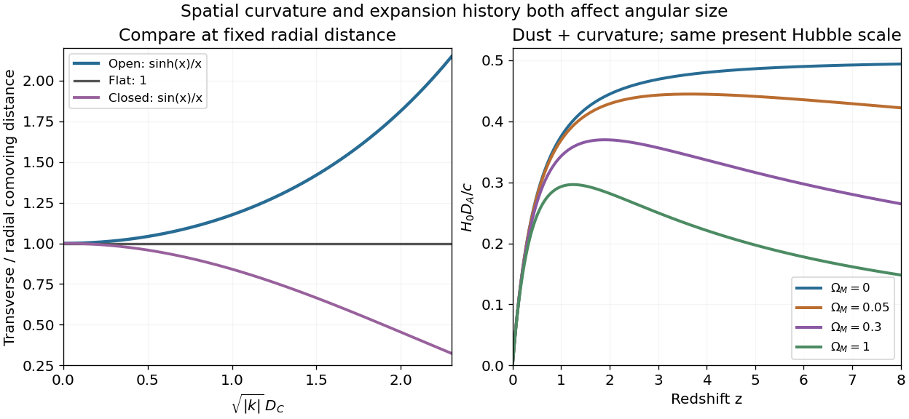

<h1 id="3/d/solution">Solution</h1>

↑ **Parent:** [D](../d.md)

At fixed radial [comoving distance](../../../../comoving-radial-distance.md) and fixed emission scale factor, open spatial geometry has transverse radius $\sinh(\kappa D_C)/\kappa>D_C$. Hence its [angular diameter distance](../../../../angular-diameter-distance.md) exceeds the flat value, and a standard object of fixed proper size has

$$
\boxed{\delta\theta=\ell/D_A\quad\text{smaller in the open geometry}.}
$$

The same comparison can be expressed at fixed proper radial distance on the emission slice. A comparison at fixed _redshift_ must additionally account for the different expansion histories in $D_C(z)$; curvature and expansion effects must not be silently conflated.

Known-size [cosmological standard rulers](../../../../cosmological-standard-ruler.md) with measured redshifts provide $D_A(z)$ through their angular sizes. The function depends on the spatial-curvature parameter directly and on matter, radiation or dark energy through the expansion history. For a comoving ruler such as a calibrated [baryon acoustic oscillation](../../../../baryon-acoustic-oscillation.md) scale, the transverse angular measurement determines $(1+z)D_A$. Angular acoustic scales in the [cosmic microwave background](../../../../cosmic-microwave-background-split.md) similarly probe the ratio of a calibrated early-time length to a cosmological distance. A range of redshifts constrains parameter-dependent shapes and the overall distance scale, but one angular measurement cannot uniquely separate all density parameters. Ruler calibration, source evolution and lensing must be modeled, and independent expansion or distance information helps break the degeneracies.

**[Figure 3](#3/d/image-transverse-curvature-geometry-and-angular-diameter-distances-in-dust-plus-curvature-models). Transverse curvature geometry and angular diameter distances in dust-plus-curvature models**.

## ↑ Ancestors (12)

1. [D](../d.md)
2. [3](../../3.md)
3. [2012](../../../2012-split.md)
4. [Past exam of the general relativity and cosmology course of the University of Oxford](../../../split.md)
5. [General relativity and cosmology course of the University of Oxford](../../../../general-relativity-and-cosmology-course-of-the-university-of-oxford.md)
6. [Year 3 of the physics course of the University of Oxford](../../../../year-3-of-the-physics-course-of-the-university-of-oxford.md)
7. [Physics course of the University of Oxford](../../../../physics-course-of-the-university-of-oxford.md)
8. [Undergraduate course of the University of Oxford](../../../../undergraduate-course-of-the-university-of-oxford.md)
9. [Course of the University of Oxford](../../../../course-of-the-university-of-oxford.md)
10. [University of Oxford](../../../../university-of-oxford-split.md)
11. [List of universities](../../../../list-of-universities.md)
12. [Codex Wiki](../../../../split.md)
