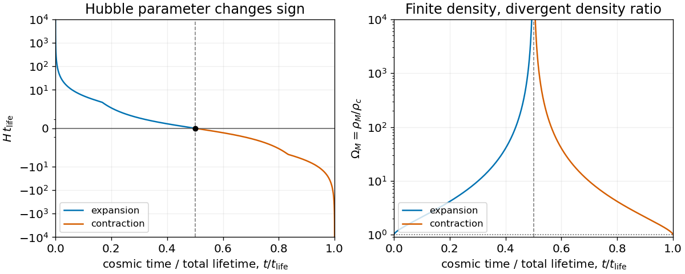
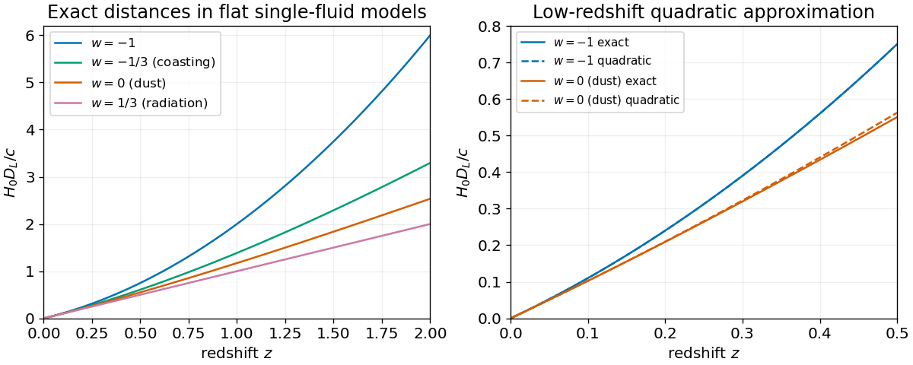

# 2013

↑ **Parent:** [Past exam of the general relativity and cosmology course of the University of Oxford](../past-exam-of-the-general-relativity-and-cosmology-course-of-the-university-of-oxford.md)

Source paper: [https://www-thphys.physics.ox.ac.uk/people/AndreiStarinets/TUTORIALS_NOTES_GR/gr_cosmology_exam_paper_2013.pdf](https://www-thphys.physics.ox.ac.uk/people/AndreiStarinets/TUTORIALS_NOTES_GR/gr_cosmology_exam_paper_2013.pdf)

The lettered subdivisions index the successive separately marked blocks of each source question.

**Table of contents**

- [1](#1)
  - [a](#1/a)
    - [Solution](#1/a/solution)
  - [b](#1/b)
    - [Solution](#1/b/solution)
  - [c](#1/c)
    - [Solution](#1/c/solution)
  - [d](#1/d)
    - [Solution](#1/d/solution)
- [2](#2)
  - [a](#2/a)
    - [Solution](#2/a/solution)
  - [b](#2/b)
    - [Solution](#2/b/solution)
  - [c](#2/c)
    - [Solution](#2/c/solution)
  - [d](#2/d)
    - [Solution](#2/d/solution)
- [3](#3)
  - [a](#3/a)
    - [Solution](#3/a/solution)
  - [b](#3/b)
    - [Solution](#3/b/solution)
  - [c](#3/c)
    - [Solution](#3/c/solution)
  - [d](#3/d)
    - [Solution](#3/d/solution)
- [4](#4)
  - [a](#4/a)
    - [Solution](#4/a/solution)
  - [b](#4/b)
    - [Solution](#4/b/solution)
  - [c](#4/c)
    - [Solution](#4/c/solution)
  - [d](#4/d)
    - [Solution](#4/d/solution)

## 1

↑ **Parent:** [2013](2013.md)

<h3 id="1/a">a</h3>

↑ **Parent:** [1](#1)

<h4 id="1/a/solution">Solution</h4>

↑ **Parent:** [A](#1/a)

Use [metric signature](../topological-manifold.md#metric-signature) $(-,+,+,+)$, $x^0=ct$, and retain terms linear in $\Phi/c^2$ or $\Psi/c^2$. The [inverse metric](../general-relativity.md#inverse-metric) is $g^{00}=-(1-2\Phi/c^2)$ and $g^{ij}=(1+2\Psi/c^2)\delta^{ij}$. In the [Christoffel symbol](../riemannian-geometry.md#christoffel-symbol) formula

$$
\Gamma^\alpha{}_{\beta\gamma}=\frac12g^{\alpha\delta}(\partial_\beta g_{\delta\gamma}+\partial_\gamma g_{\delta\beta}-\partial_\delta g_{\beta\gamma}),
$$

the differentiated [metric perturbation](../linearized-gravity.md) is already first order, so the prefactor can be replaced by the flat [inverse metric](../general-relativity.md#inverse-metric). For example $\Gamma^0{}_{ij}=\tfrac12\partial_0g_{ij}=-\delta_{ij}\partial_0\Psi/c^2$ and $\Gamma^k{}_{00}=-\tfrac12\partial_kg_{00}=\partial_k\Phi/c^2$. Evaluating the remaining components gives

$$
\boxed{\begin{aligned}
\Gamma^0{}_{00}&=\frac{\partial_0\Phi}{c^2},&
\Gamma^0{}_{0i}&=\frac{\partial_i\Phi}{c^2},&
\Gamma^0{}_{ij}&=-\frac{\partial_0\Psi}{c^2}\delta_{ij},\\
\Gamma^k{}_{00}&=\frac{\partial_k\Phi}{c^2},&
\Gamma^k{}_{0i}&=-\frac{\partial_0\Psi}{c^2}\delta^k_i,&
\Gamma^k{}_{ij}&=-\frac{\partial_i\Psi\delta^k_j+\partial_j\Psi\delta^k_i-\partial^k\Psi\delta_{ij}}{c^2}.
\end{aligned}}
$$

The lower-index symmetry follows from the [torsion-free connection](../vector-bundle.md#torsion-free-connection). Products of these first-order [Christoffel symbols](../riemannian-geometry.md#christoffel-symbol) are beyond the retained [weak-field approximation](../linearized-gravity.md#weak-field-approximation).

<h3 id="1/b">b</h3>

↑ **Parent:** [1](#1)

<h4 id="1/b/solution">Solution</h4>

↑ **Parent:** [B](#1/b)

A [pressureless relativistic fluid](../stress-energy-tensor.md#relativistic-dust) has [stress-energy tensor](../stress-energy-tensor.md) $T^{\mu\nu}=\rho u^\mu u^\nu$, with [four-velocity](../special-relativity.md#four-velocity) normalized by $u^\mu u_\mu=-c^2$. In its [rest frame](../mathematical-physics.md#rest-frame), $u^i=0$, so $\boxed{T^0{}_0=-\rho c^2,\ T^i{}_j=0}$. Here $\rho$ is rest-frame [mass density](../fluid-mechanics.md#density), or [energy density](../statistical-physics.md#energy-density) divided by $c^2$.

For the [linearized Ricci tensor and scalar](../linearized-gravity.md#linearized-ricci-tensor-and-scalar), discard the quadratic connection terms. The contracted connection is $\Gamma^\mu{}_{\mu\nu}=\partial_\nu(\Phi-3\Psi)/c^2$. Differentiation then gives

$$
\boxed{\begin{aligned}
R_{00}&=\frac{\nabla^2\Phi+3\partial_0^2\Psi}{c^2},\\
R_{0i}&=\frac{2\partial_0\partial_i\Psi}{c^2},\\
R_{ij}&=\frac{\partial_i\partial_j(\Psi-\Phi)+\delta_{ij}(\nabla^2\Psi-\partial_0^2\Psi)}{c^2},\\
R&=\frac{4\nabla^2\Psi-2\nabla^2\Phi-6\partial_0^2\Psi}{c^2}.
\end{aligned}}
$$

The [Ricci scalar](../general-relativity.md#ricci-scalar) uses the zeroth-order [inverse metric](../general-relativity.md#inverse-metric), $R=-R_{00}+\delta^{ij}R_{ij}$, because multiplying first-order [curvature](../differential-geometry.md#curvature) by another [metric perturbation](../linearized-gravity.md) would again be second order. These are the [linearized curvature of a two-potential weak-field metric](../linearized-gravity.md#linearized-curvature-of-a-two-potential-weak-field-metric) in the paper's [Riemann curvature tensor](../riemann-curvature-tensor.md) sign convention.

<h3 id="1/c">c</h3>

↑ **Parent:** [1](#1)

<h4 id="1/c/solution">Solution</h4>

↑ **Parent:** [C](#1/c)

The [Einstein tensor](../riemann-curvature-tensor.md#einstein-tensor) is $G^\mu{}_\nu=R^\mu{}_\nu-\tfrac12\delta^\mu_\nu R$. Thus $G^0{}_0=-R_{00}-R/2$, where the time raising introduces the minus sign. Substitution cancels the $\Phi$ and time-derivative terms in that component and gives

$$
\boxed{\begin{aligned}
G^0{}_0&=-\frac{2\nabla^2\Psi}{c^2}=-\frac{8\pi G\rho}{c^2},\\
G^i{}_j&=\frac{2\partial_0^2\Psi\delta^i_j+\nabla^2(\Phi-\Psi)\delta^i_j+\partial^i\partial_j(\Psi-\Phi)}{c^2}=0.
\end{aligned}}
$$

The right sides follow from the [Einstein field equations](../einstein-field-equations.md) $G^\mu{}_\nu=(8\pi G/c^4)T^\mu{}_\nu$ with zero [cosmological constant](../cosmology.md#cosmological-constant). The full equations also contain the momentum constraint $G^0{}_i=-2\partial_0\partial_i\Psi/c^2=0$ for dust at rest to this order. Specifying arbitrary time-dependent potentials without that constraint would not give a solution of all the [Einstein field equations](../einstein-field-equations.md).

<h3 id="1/d">d</h3>

↑ **Parent:** [1](#1)

<h4 id="1/d/solution">Solution</h4>

↑ **Parent:** [D](#1/d)

For a massive particle parametrized by [proper time](../special-relativity.md#proper-time), the [geodesic equation](../riemannian-geometry.md#geodesic-equation) is

$$
\frac{d^2x^\mu}{d\tau^2}+\Gamma^\mu{}_{\alpha\beta}\frac{dx^\alpha}{d\tau}\frac{dx^\beta}{d\tau}=0,
\qquad g_{\alpha\beta}\frac{dx^\alpha}{d\tau}\frac{dx^\beta}{d\tau}=-c^2.
$$

The [weak-field approximation](../linearized-gravity.md#weak-field-approximation) alone does not imply Newtonian motion. Also take a [nonrelativistic limit](../special-relativity.md#nonrelativistic-limit), $|v|/c\ll1$, in the usual quasistatic regime so the potentials' time variation does not compensate for the small velocity factors. Reparametrizing by coordinate time and retaining the leading velocity-independent spatial term gives

$$
\boxed{\frac{d^2x^i}{dt^2}=-c^2\Gamma^i{}_{00}=-\partial_i\Phi.}
$$

In empty space the first field equation gives $\nabla^2\Psi=0$. For static potentials, the spatial equations imply $\nabla^2(\Phi-\Psi)=0$ and then $\partial_i\partial_j(\Phi-\Psi)=0$. The difference is at most affine; isolated-system boundary conditions fixing both potentials to zero at infinity remove it. Thus $\Phi=\Psi$ and

$$
\boxed{\nabla^2\Phi=0\quad\text{in vacuum},}
$$

the empty-space [Newton-Poisson equation](../newton-s-law-of-universal-gravitation.md#poisson-equation-for-newtonian-gravity). With the same quasistatic assumptions and dust present it becomes $\nabla^2\Phi=4\pi G\rho$. Keeping rapid time dependence instead leaves $\nabla^2\Phi=-3\partial_0^2\Psi$ in vacuum, so the static qualification matters.

## 2

↑ **Parent:** [2013](2013.md)

<h3 id="2/a">a</h3>

↑ **Parent:** [2](#2)

<h4 id="2/a/solution">Solution</h4>

↑ **Parent:** [A](#2/a)

Although $\nabla_\beta f=\partial_\beta f$ for a [scalar field](../classical-field-theory.md#scalar-field), its first derivative is a [covector field](../differential-form.md#one-form). Therefore

$$
\nabla_\alpha\nabla_\beta f=\partial_\alpha\partial_\beta f-\Gamma^\gamma{}_{\alpha\beta}\partial_\gamma f.
$$

Commuting [partial derivatives](../multivariable-calculus.md#partial-derivative) and using the [torsion-free connection](../vector-bundle.md#torsion-free-connection) gives $\boxed{[\nabla_\alpha,\nabla_\beta]f=0}$. For a [vector field](../multivariable-calculus.md#vector-field), differentiate the $(1,1)$ [tensor](../multilinear-algebra.md#tensor) $\nabla_\beta V^\mu$ with both its indices included:

$$
\nabla_\alpha\nabla_\beta V^\mu
=\partial_\alpha(\nabla_\beta V^\mu)+\Gamma^\mu{}_{\alpha\epsilon}\nabla_\beta V^\epsilon
-\Gamma^\epsilon{}_{\alpha\beta}\nabla_\epsilon V^\mu.
$$

Subtract the expression with $\alpha,\beta$ exchanged. Second derivatives of $V$ cancel; the terms multiplying first derivatives cancel pairwise, and the final lower-index connection terms cancel by symmetry. The remaining coefficient of $V^\nu$ is

$$
\boxed{[\nabla_\alpha,\nabla_\beta]V^\mu=
\left(\partial_\alpha\Gamma^\mu{}_{\beta\nu}-\partial_\beta\Gamma^\mu{}_{\alpha\nu}
+\Gamma^\mu{}_{\alpha\epsilon}\Gamma^\epsilon{}_{\beta\nu}-\Gamma^\mu{}_{\beta\epsilon}\Gamma^\epsilon{}_{\alpha\nu}\right)V^\nu
=R^\mu{}_{\nu\alpha\beta}V^\nu.}
$$

This is the [curvature commutator](../riemann-curvature-tensor.md#commutator-of-covariant-derivatives). On a covariant index the sign reverses, giving the [curvature commutator on a covariant tensor](../riemann-curvature-tensor.md#curvature-commutator-on-a-covariant-tensor) used in the next part.

<h3 id="2/b">b</h3>

↑ **Parent:** [2](#2)

<h4 id="2/b/solution">Solution</h4>

↑ **Parent:** [B](#2/b)

For a [torsion-free connection](../vector-bundle.md#torsion-free-connection), the connection terms in the antisymmetrized [covariant derivative](../general-relativity.md#covariant-derivative) cancel: $F_{\mu\nu}=\partial_\mu A_\nu-\partial_\nu A_\mu$. Thus the [electromagnetic field tensor](../relativistic-electromagnetism.md#electromagnetic-field-tensor) is the [exterior derivative](../differential-form.md#exterior-derivative) of the [four-potential](../relativistic-electromagnetism.md#electromagnetic-four-potential). It is a [tensor](../multilinear-algebra.md#tensor), is invariant under $A_\mu\mapsto A_\mu+\partial_\mu\chi$, and obeys the homogeneous [Maxwell equations](../maxwell-equations.md) $\nabla_{[\alpha}F_{\beta\gamma]}=0$. The covariant divergence equation is the generally covariant form of the local source equation; use its minus sign as specified in the paper.

Expand that equation before imposing the [Lorenz gauge condition](../relativistic-electromagnetism.md#lorenz-gauge-condition):

$$
\nabla^\mu F_{\mu\nu}=\nabla^\mu\nabla_\mu A_\nu-\nabla^\mu\nabla_\nu A_\mu.
$$

The [curvature commutator on a covariant tensor](../riemann-curvature-tensor.md#curvature-commutator-on-a-covariant-tensor) gives

$$
[\nabla_\rho,\nabla_\nu]A_\mu=-R^\alpha{}_{\mu\rho\nu}A_\alpha,
\qquad
\nabla^\mu\nabla_\nu A_\mu=\nabla_\nu(\nabla^\mu A_\mu)+R^\alpha{}_\nu A_\alpha.
$$

Here the contraction $g^{\mu\rho}R^\alpha{}_{\mu\rho\nu}=-R^\alpha{}_\nu$ accounts for the second sign reversal. Hence in [Lorenz gauge](../relativistic-electromagnetism.md#lorenz-gauge-condition)

$$
\boxed{\nabla^\mu\nabla_\mu A_\nu-R^\alpha{}_\nu A_\alpha=-\mu_0J_\nu.}
$$

This [curved-spacetime electromagnetic potential wave equation](../relativistic-electromagnetism.md#curved-spacetime-electromagnetic-potential-wave-equation) contains a [Ricci tensor](../riemann-curvature-tensor.md#ricci-tensor) term even in a locally inertial coordinate system: a connection can vanish at one point while its derivatives and [curvature](../differential-geometry.md#curvature) remain nonzero.

<h3 id="2/c">c</h3>

↑ **Parent:** [2](#2)

<h4 id="2/c/solution">Solution</h4>

↑ **Parent:** [C](#2/c)

Write $\mathcal H=a'/a$, with the prime denoting $\partial_0=c^{-1}\partial_\eta$. The [metric](../topological-analysis.md#metric) and [inverse metric](../general-relativity.md#inverse-metric) are $g_{\mu\nu}=a^2\eta_{\mu\nu}$ and $g^{\mu\nu}=a^{-2}\eta^{\mu\nu}$. Since $a$ depends only on $x^0$, the [Christoffel symbols](../riemannian-geometry.md#christoffel-symbol) reduce to

$$
\Gamma^\alpha{}_{\beta\gamma}
=\mathcal H\left(\delta^\alpha_\beta\delta^0_\gamma+\delta^\alpha_\gamma\delta^0_\beta-\eta_{\beta\gamma}\eta^{\alpha0}\right).
$$

Consequently

$$
\boxed{\Gamma^0{}_{00}=\mathcal H,\quad\Gamma^0{}_{0i}=0,\quad\Gamma^0{}_{ij}=\mathcal H\delta_{ij},\quad
\Gamma^k{}_{00}=0,\quad\Gamma^k{}_{0i}=\mathcal H\delta^k_i,\quad\Gamma^k{}_{ij}=0.}
$$

For the stated [de Sitter spacetime](../general-relativity.md#de-sitter-spacetime) scale factor, $\mathcal H=-1/(c\eta)$. The factor $c^{-1}$ is required because the prime is not differentiation with respect to $\eta$ itself.

<h3 id="2/d">d</h3>

↑ **Parent:** [2](#2)

<h4 id="2/d/solution">Solution</h4>

↑ **Parent:** [D](#2/d)

For a [minimally coupled massless scalar field](../scalar-field-theory.md#minimally-coupled-massless-scalar-field), the [covariant wave operator](../quantum-field-theory.md#covariant-wave-operator) is

$$
\Box\phi=\frac1{\sqrt{-g}}\partial_\mu(\sqrt{-g}\,g^{\mu\nu}\partial_\nu\phi)
=\frac1{a^2}\left[-\partial_0^2\phi-2\mathcal H\partial_0\phi+\nabla^2\phi\right].
$$

The [Fourier mode](../fourier-analysis.md#fourier-mode) $\phi=u(\eta)e^{i\mathbf k\cdot\mathbf r}$ therefore satisfies

$$
u_{\eta\eta}-\frac2\eta u_\eta+\omega^2u=0,\qquad\omega=c|k|.
$$

Substituting $u=(A+B\eta)e^{-i\omega\eta}$ leaves $2(i\omega A-B)e^{-i\omega\eta}/\eta$. Thus

$$
\boxed{B=i\omega A=ic|k|A,\qquad
\phi=A(1+ic|k|\eta)e^{-ic|k|\eta+i\mathbf k\cdot\mathbf r}.}
$$

This is an [unrescaled de Sitter massless scalar mode](../scalar-field-theory.md#unrescaled-de-sitter-massless-scalar-mode). For $k\ne0$, the opposite-frequency time solution supplies the second independent mode; a real [scalar field](../classical-field-theory.md#scalar-field) combines appropriate conjugate spatial modes. For $k=0$ the particular ansatz gives only the constant solution, while the full homogeneous solution is $u=C+D\eta^3$. The requested ansatz was not a general zero-mode parametrization.

## 3

↑ **Parent:** [2013](2013.md)

<h3 id="3/a">a</h3>

↑ **Parent:** [3](#3)

<h4 id="3/a/solution">Solution</h4>

↑ **Parent:** [A](#3/a)

Use [mass density](../fluid-mechanics.md#density) units for the $\rho$ appearing in the [Friedmann equation](../cosmology.md#friedmann-equations); an actual [energy density](../statistical-physics.md#energy-density) is $\rho c^2$. Conservation, $\dot\rho+3H(\rho+P/c^2)=0$, gives $\boxed{\rho_M=\rho_{M,0}a^{-3},\quad\rho_R=\rho_{R,0}a^{-4}}$ for [pressureless matter](../cosmology.md#pressureless-matter) and [radiation in cosmology](../cosmology.md#radiation-in-cosmology), respectively, with $a_0=1$. The first scaling counts dilution of particle number, while the second includes the [cosmological redshift](../cosmology.md#cosmological-redshift) of each photon's [energy](../energy.md).

Define the present [cosmological density parameters](../cosmology.md#cosmological-density-parameter) by $\Omega_{X,0}=8\pi G\rho_{X,0}/(3H_0^2)$. Then

$$
\frac{H^2}{H_0^2}=\Omega_{M,0}a^{-3}+\Omega_{R,0}a^{-4}+\Omega_{k,0}a^{-2},\qquad
\Omega_{k,0}=-\frac{kc^2}{H_0^2}=1-\Omega_{M,0}-\Omega_{R,0}.
$$

For $k=0$, [conformal time](../cosmology.md#conformal-time) gives $da/d\eta=a^2H$, so the expanding branch obeys $(da/d\eta)^2=H_0^2(\Omega_{M,0}a+\Omega_{R,0})$. Set $\eta=0$ at the [Big Bang](../cosmology.md#big-bang). Integrating gives

$$
\sqrt{\Omega_{M,0}a+\Omega_{R,0}}=\sqrt{\Omega_{R,0}}+\frac12\Omega_{M,0}H_0\eta,
$$

and hence the [flat matter-radiation conformal solution](../cosmology.md#flat-matter-radiation-conformal-solution)

$$
\boxed{a(\eta)=\sqrt{\Omega_{R,0}}H_0\eta+\frac14\Omega_{M,0}(H_0\eta)^2.}
$$

The limiting pure-radiation and pure-matter cases follow continuously.

<h3 id="3/b">b</h3>

↑ **Parent:** [3](#3)

<h4 id="3/b/solution">Solution</h4>

↑ **Parent:** [B](#3/b)

At [matter-radiation equality](../cosmology.md#matter-radiation-equality), $\rho_{M,0}a^{-3}=\rho_{R,0}a^{-4}$, so $a_{\rm eq}=\Omega_{R,0}/\Omega_{M,0}$. Evaluating the integrated square-root relation gives

$$
\boxed{\eta_{\rm eq}=\frac{2(\sqrt2-1)\sqrt{\Omega_{R,0}}}{\Omega_{M,0}H_0}.}
$$

This assumes both present densities are positive and uses the same [Big Bang](../cosmology.md#big-bang) origin for [conformal time](../cosmology.md#conformal-time).

<h3 id="3/c">c</h3>

↑ **Parent:** [3](#3)

<h4 id="3/c/solution">Solution</h4>

↑ **Parent:** [C](#3/c)

For dust alone, write $\dot a^2=c^2(A/a-k)$, where

$$
\boxed{A=\frac{8\pi G\rho_{M,0}}{3c^2}=\frac{\Omega_{M,0}H_0^2}{c^2}.}
$$

Set $\theta=\sqrt{k}c\eta$ and $a=(A/k)\sin^2(\theta/2)$. Differentiation gives $\dot a=c\sqrt{k}\cot(\theta/2)$ once $dt=a\,d\eta$ is used, verifying the [Friedmann equation](../cosmology.md#friedmann-equations). Integrating the time relation from the [Big Bang](../cosmology.md#big-bang) yields the [closed matter-dominated Friedmann solution](../cosmology.md#closed-matter-dominated-friedmann-solution)

$$
a=\frac A{k}\sin^2\frac\theta2,\qquad
t=\frac{A}{2ck^{3/2}}(\theta-\sin\theta),\qquad0<\theta<2\pi.
$$

The [Hubble parameter](../cosmology.md#hubble-parameter) and the [cosmological density parameter](../cosmology.md#cosmological-density-parameter) are

$$
\boxed{H(\theta)=\frac{ck^{3/2}}A\frac{\cos(\theta/2)}{\sin^3(\theta/2)},\qquad
\Omega_M(\theta)=\sec^2\frac\theta2.}
$$

The first decreases from positive infinity through zero at maximum expansion to negative infinity at the [Big Crunch](../cosmology.md#big-crunch). The second approaches one near either singular endpoint and diverges at maximum expansion. This is a [density-parameter divergence at a cosmological turnaround](../cosmology.md#density-parameter-divergence-at-a-cosmological-turnaround): $H=0$ makes the [critical density](../cosmology.md#critical-density) vanish even though the physical dust density there is finite.

**[Figure 1](#3/c/image-closed-dust-universe-the-hubble-parameter-changes-sign-and-the-density-parameter-diverges-at-maximum-expansion). Closed dust universe: the Hubble parameter changes sign and the density parameter diverges at maximum expansion**.

<h3 id="3/d">d</h3>

↑ **Parent:** [3](#3)

<h4 id="3/d/solution">Solution</h4>

↑ **Parent:** [D](#3/d)

At maximum expansion, $a_{\max}=A/k$. With $a_0=1$, the present [Friedmann equation](../cosmology.md#friedmann-equations) gives $kc^2=H_0^2(\Omega_{M,0}-1)$, so positive curvature requires $\Omega_{M,0}>1$. Taking $H_0>0$ for the presently expanding branch gives

$$
\boxed{a_{\max}=\frac{\Omega_{M,0}}{\Omega_{M,0}-1},\qquad
t_{\rm life}=\frac{\pi\Omega_{M,0}}{H_0(\Omega_{M,0}-1)^{3/2}},\qquad
q_0=\frac{\Omega_{M,0}}2.}
$$

The [lifetime of a closed dust universe](../cosmology.md#lifetime-of-a-closed-dust-universe) follows by setting $\theta=2\pi$. The [deceleration parameter](../cosmology.md#deceleration-parameter) follows from the [Friedmann acceleration equation](../cosmology.md#friedmann-acceleration-equation), $\ddot a/a=-4\pi G\rho_M/3$. Thus this model always decelerates while expanding. Its total lifetime includes the elapsed age; it is not the remaining lifetime.

The [supernova discovery of accelerating expansion](../cosmology.md#supernova-discovery-of-accelerating-expansion) does not support this dust-only recollapse model as a description of the observed expansion history. Already the 1998 and 1999 [Type Ia supernova](../stellar-astrophysics.md#type-ia-supernova) analyses favoured [accelerating expansion](../cosmology.md#accelerating-expansion-of-the-universe), requiring ingredients beyond this zero-[cosmological constant](../cosmology.md#cosmological-constant), positive-curvature dust model within the usual [FLRW metric](../cosmology.md#friedmann-lemaitre-robertson-walker-metric) interpretation.[Abstract: evidence for present acceleration](../physics-bibliography.md#observational-evidence-from-supernovae-for-an-accelerating-universe-and-a-cosmological-constant-by-adam-riess-and-others)[Abstract: positive cosmological constant preferred](../physics-bibliography.md#measurements-of-omega-and-lambda-from-42-high-redshift-supernovae-by-saul-perlmutter-and-others)

## 4

↑ **Parent:** [2013](2013.md)

<h3 id="4/a">a</h3>

↑ **Parent:** [4](#4)

<h4 id="4/a/solution">Solution</h4>

↑ **Parent:** [A](#4/a)

Throughout this question use [natural units](../mathematical-physics.md#natural-units) with $c=1$. For zero potential and nonzero [kinetic energy](../energy.md#kinetic-energy), the homogeneous canonical [scalar field](../classical-field-theory.md#scalar-field) has $P=\rho=\dot\varphi^2/2$, so $\boxed{w=1}$. Its [equation of motion](../classical-mechanics.md#equation-of-motion) becomes $d(a^3\dot\varphi)/dt=0$, giving $\dot\varphi\propto a^{-3}$ and therefore

$$
\boxed{\rho\propto a^{-6}.}
$$

The same scaling follows from [cosmological energy conservation](../cosmology.md#cosmological-continuity-equation) with constant [equation-of-state parameter](../cosmology.md#equation-of-state-parameter) $w=1$. If the field is exactly constant, both $P$ and $\rho$ vanish and their ratio is undefined; that is the separate empty solution.

<h3 id="4/b">b</h3>

↑ **Parent:** [4](#4)

<h4 id="4/b/solution">Solution</h4>

↑ **Parent:** [B](#4/b)

Write $M=M_{\rm Pl}$ for the [reduced Planck mass](../mathematical-physics.md#reduced-planck-mass). For a nontrivial power law with $\lambda\ne0$, $H=p/t$, $\dot\varphi=BM/t$, and $V=V_0(t/t_0)^{-\lambda B}$. Matching its time dependence to the kinetic and [Friedmann equation](../cosmology.md#friedmann-equations) terms requires $\lambda B=2$. The [scalar field equation of motion](../scalar-field-theory.md#scalar-field-equation-of-motion) and the [Friedmann equation](../cosmology.md#friedmann-equations) then reduce to

$$
B(3p-1)M^2=\lambda V_0t_0^2,\qquad
3M^2p^2=\frac{B^2M^2}{2}+V_0t_0^2.
$$

Solving gives the [exponential-potential scalar-dominated power-law solution](../cosmology.md#exponential-potential-scalar-dominated-power-law-solution)

$$
\boxed{p=\frac2{\lambda^2},\qquad B=\frac2\lambda,\qquad
t_0^2=\frac{2M^2(6-\lambda^2)}{\lambda^4V_0}.}
$$

Choose $t>0$ and the positive square root for $t_0$. The [existence conditions for exponential-potential scaling](../cosmology.md#existence-conditions-for-exponential-potential-scaling) matter: if $V_0>0$, a finite real $t_0$ requires $0<\lambda^2<6$, rather than an inclusive bound on signed $\lambda$. At $\lambda^2=6$, nonzero $V_0$ is incompatible with this logarithmic ansatz. If $V_0<0$, the corresponding scaling solution instead requires $\lambda^2>6$. The sign of $\lambda$ changes the field's rolling direction, not $p$. For $\lambda=0$ the potential is constant and this finite-$p$ ansatz does not apply; with positive $V_0$, a constant field gives [de Sitter spacetime](../general-relativity.md#de-sitter-spacetime) expansion.

<h3 id="4/c">c</h3>

↑ **Parent:** [4](#4)

<h4 id="4/c/solution">Solution</h4>

↑ **Parent:** [C](#4/c)

The scaling solution has $\rho=3M^2p^2/t^2$ and $\rho+P=\dot\varphi^2=4M^2/(\lambda^2t^2)$. Therefore

$$
\boxed{w=-1+\frac{\lambda^2}{3},\qquad q_0=\frac1p-1=\frac{\lambda^2}{2}-1.}
$$

More generally any real canonical [scalar field](../classical-field-theory.md#scalar-field) with positive total [energy density](../statistical-physics.md#energy-density) obeys $\rho+P=\dot\varphi^2\ge0$, so **it cannot have $w<-1$**. A negative potential does not reverse this conclusion.

The proper [particle horizon](../cosmology.md#particle-horizon) is $a(t)\int_0^t dt'/a(t')$. For $a\propto t^p$ the lower-limit integral diverges exactly when $p\ge1$. Thus, assuming the same power law extends to the initial boundary, there is no finite [particle horizon](../cosmology.md#particle-horizon) for $\boxed{0<\lambda^2\le2}$. For the strict inequality, $p>1$, the proper [cosmological event horizon](../general-relativity.md#cosmological-event-horizon) and present age are

$$
\boxed{R_{\rm EH,0}=\frac{t_{\rm now}}{p-1}=\frac{2}{(2-\lambda^2)H_0},\qquad
t_{\rm now}=\frac{p}{H_0}=\frac{2}{\lambda^2H_0}.}
$$

At $\lambda^2=2$, $a\propto t$ has an infinite particle-horizon integral but also an infinite future event-horizon integral, so no finite event horizon exists. The age remains $H_0^{-1}$. The $\lambda=0$ constant-potential case is separate: its flat [de Sitter](../general-relativity.md#de-sitter-spacetime) patch has event-horizon radius $H_0^{-1}$ and no finite-age power-law [Big Bang](../cosmology.md#big-bang).

<h3 id="4/d">d</h3>

↑ **Parent:** [4](#4)

<h4 id="4/d/solution">Solution</h4>

↑ **Parent:** [D](#4/d)

For a single constant-$w$ [perfect fluid](../general-relativity.md#perfect-fluid) in a flat expanding [FLRW metric](../cosmology.md#friedmann-lemaitre-robertson-walker-metric) model, [cosmological energy conservation](../cosmology.md#cosmological-continuity-equation) gives $\rho=\rho_0a^{-3(1+w)}$ and $H(z)=H_0(1+z)^{3(1+w)/2}$. With $a_0=1$, the [luminosity distance](../cosmology.md#luminosity-distance) follows by integrating the radial [null geodesic](../special-relativity.md#null-geodesic):

$$
D_L(z)=(1+z)\int_0^z\frac{dz'}{H(z')}.
$$

The [constant-equation-of-state luminosity distance](../cosmology.md#constant-equation-of-state-luminosity-distance) is consequently

$$
\boxed{D_L(z)=\begin{cases}
\displaystyle\frac{2(1+z)}{H_0(1+3w)}\left[1-(1+z)^{-(1+3w)/2}\right],&w\ne-1/3,\\[5pt]
\displaystyle\frac{1+z}{H_0}\log(1+z),&w=-1/3.
\end{cases}}
$$

This includes $w=-1$ regularly, giving $D_L=z(1+z)/H_0$. Restoring conventional units multiplies the distance formulas by $c$. Expanding about $z=0$ gives

$$
\boxed{D_L(z)=\frac1{H_0}\left[z+\frac{1-3w}{4}z^2+O(z^3)\right],\qquad
q_0=\frac{1+3w}{2}.}
$$

The second result also follows directly from the [Friedmann acceleration equation](../cosmology.md#friedmann-acceleration-equation). The expansion agrees with the general coefficient $(1-q_0)/2$ of $z^2$.

For [phantom energy](../cosmology.md#phantom-energy), $w<-1$, put $n=3(1+w)/2<0$. Integration of $\dot a=H_0a^{1-n}$ with $a(t_{\rm now})=1$ gives

$$
a(t)=\left[1+nH_0(t-t_{\rm now})\right]^{1/n}.
$$

Because $1/n<0$, the [scale factor](../cosmology.md#scale-factor-cosmology) diverges at the [Big Rip](../cosmology.md#big-rip) time

$$
\boxed{t_{\rm rip}-t_{\rm now}=\frac{2}{3|1+w|H_0}.}
$$

This is a property of the stipulated constant-$w$ fluid model; it is not realizable by the positive-density canonical scalar of the preceding parts.

**[Figure 2](#4/d/image-exact-flat-single-fluid-luminosity-distances-for-several-constant-equations-of-state-including-the-logarithmic-coasting-case). Exact flat single-fluid luminosity distances for several constant equations of state, including the logarithmic coasting case**.

## ↑ Ancestors (9)

1. [Past exam of the general relativity and cosmology course of the University of Oxford](../past-exam-of-the-general-relativity-and-cosmology-course-of-the-university-of-oxford.md)
2. [General relativity and cosmology course of the University of Oxford](../university-of-oxford.md#general-relativity-and-cosmology-course-of-the-university-of-oxford)
3. [Year 3 of the physics course of the University of Oxford](../university-of-oxford.md#year-3-of-the-physics-course-of-the-university-of-oxford)
4. [Physics course of the University of Oxford](../university-of-oxford.md#physics-course-of-the-university-of-oxford)
5. [Undergraduate course of the University of Oxford](../university-of-oxford.md#undergraduate-course-of-the-university-of-oxford)
6. [Course of the University of Oxford](../university-of-oxford.md#course-of-the-university-of-oxford)
7. [University of Oxford](../university-of-oxford.md)
8. [List of universities](../README.md#list-of-universities)
9. [Codex Wiki](../README.md)
