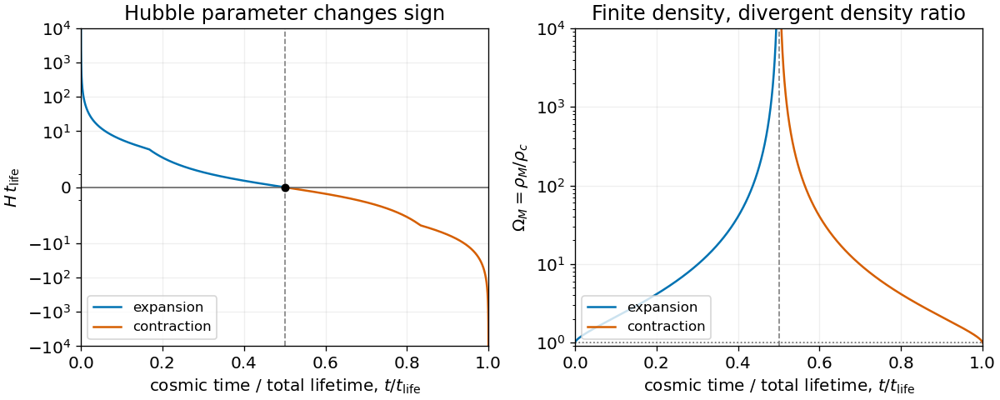

<h1 id="3/c/solution">Solution</h1>

↑ **Parent:** [C](../c.md)

For dust alone, write $\dot a^2=c^2(A/a-k)$, where

$$
\boxed{A=\frac{8\pi G\rho_{M,0}}{3c^2}=\frac{\Omega_{M,0}H_0^2}{c^2}.}
$$

Set $\theta=\sqrt{k}c\eta$ and $a=(A/k)\sin^2(\theta/2)$. Differentiation gives $\dot a=c\sqrt{k}\cot(\theta/2)$ once $dt=a\,d\eta$ is used, verifying the [Friedmann equation](../../../../friedmann-equations.md). Integrating the time relation from the [Big Bang](../../../../big-bang.md) yields the [closed matter-dominated Friedmann solution](../../../../closed-matter-dominated-friedmann-solution.md)

$$
a=\frac A{k}\sin^2\frac\theta2,\qquad
t=\frac{A}{2ck^{3/2}}(\theta-\sin\theta),\qquad0<\theta<2\pi.
$$

The [Hubble parameter](../../../../hubble-parameter.md) and the [cosmological density parameter](../../../../cosmological-density-parameter.md) are

$$
\boxed{H(\theta)=\frac{ck^{3/2}}A\frac{\cos(\theta/2)}{\sin^3(\theta/2)},\qquad
\Omega_M(\theta)=\sec^2\frac\theta2.}
$$

The first decreases from positive infinity through zero at maximum expansion to negative infinity at the [Big Crunch](../../../../big-crunch.md). The second approaches one near either singular endpoint and diverges at maximum expansion. This is a [density-parameter divergence at a cosmological turnaround](../../../../density-parameter-divergence-at-a-cosmological-turnaround.md): $H=0$ makes the [critical density](../../../../critical-density.md) vanish even though the physical dust density there is finite.

**[Figure 1](#3/c/image-closed-dust-universe-the-hubble-parameter-changes-sign-and-the-density-parameter-diverges-at-maximum-expansion). Closed dust universe: the Hubble parameter changes sign and the density parameter diverges at maximum expansion**.

## ↑ Ancestors (12)

1. [C](../c.md)
2. [3](../../3.md)
3. [2013](../../../2013-split.md)
4. [Past exam of the general relativity and cosmology course of the University of Oxford](../../../split.md)
5. [General relativity and cosmology course of the University of Oxford](../../../../general-relativity-and-cosmology-course-of-the-university-of-oxford.md)
6. [Year 3 of the physics course of the University of Oxford](../../../../year-3-of-the-physics-course-of-the-university-of-oxford.md)
7. [Physics course of the University of Oxford](../../../../physics-course-of-the-university-of-oxford.md)
8. [Undergraduate course of the University of Oxford](../../../../undergraduate-course-of-the-university-of-oxford.md)
9. [Course of the University of Oxford](../../../../course-of-the-university-of-oxford.md)
10. [University of Oxford](../../../../university-of-oxford-split.md)
11. [List of universities](../../../../list-of-universities.md)
12. [Codex Wiki](../../../../split.md)
