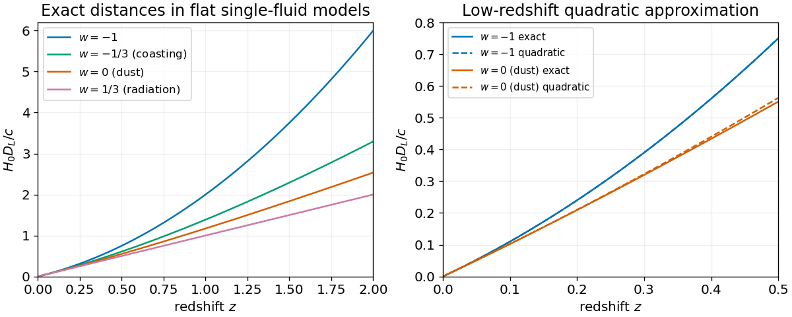

<h1 id="4/d/solution">Solution</h1>

↑ **Parent:** [D](../d.md)

For a single constant-$w$ [perfect fluid](../../../../perfect-fluid.md) in a flat expanding [FLRW metric](../../../../friedmann-lemaitre-robertson-walker-metric.md) model, [cosmological energy conservation](../../../../cosmological-continuity-equation.md) gives $\rho=\rho_0a^{-3(1+w)}$ and $H(z)=H_0(1+z)^{3(1+w)/2}$. With $a_0=1$, the [luminosity distance](../../../../luminosity-distance.md) follows by integrating the radial [null geodesic](../../../../null-geodesic.md):

$$
D_L(z)=(1+z)\int_0^z\frac{dz'}{H(z')}.
$$

The [constant-equation-of-state luminosity distance](../../../../constant-equation-of-state-luminosity-distance.md) is consequently

$$
\boxed{D_L(z)=\begin{cases}
\displaystyle\frac{2(1+z)}{H_0(1+3w)}\left[1-(1+z)^{-(1+3w)/2}\right],&w\ne-1/3,\\[5pt]
\displaystyle\frac{1+z}{H_0}\log(1+z),&w=-1/3.
\end{cases}}
$$

This includes $w=-1$ regularly, giving $D_L=z(1+z)/H_0$. Restoring conventional units multiplies the distance formulas by $c$. Expanding about $z=0$ gives

$$
\boxed{D_L(z)=\frac1{H_0}\left[z+\frac{1-3w}{4}z^2+O(z^3)\right],\qquad
q_0=\frac{1+3w}{2}.}
$$

The second result also follows directly from the [Friedmann acceleration equation](../../../../friedmann-acceleration-equation.md). The expansion agrees with the general coefficient $(1-q_0)/2$ of $z^2$.

For [phantom energy](../../../../phantom-energy.md), $w<-1$, put $n=3(1+w)/2<0$. Integration of $\dot a=H_0a^{1-n}$ with $a(t_{\rm now})=1$ gives

$$
a(t)=\left[1+nH_0(t-t_{\rm now})\right]^{1/n}.
$$

Because $1/n<0$, the [scale factor](../../../../scale-factor-cosmology.md) diverges at the [Big Rip](../../../../big-rip.md) time

$$
\boxed{t_{\rm rip}-t_{\rm now}=\frac{2}{3|1+w|H_0}.}
$$

This is a property of the stipulated constant-$w$ fluid model; it is not realizable by the positive-density canonical scalar of the preceding parts.

**[Figure 2](#4/d/image-exact-flat-single-fluid-luminosity-distances-for-several-constant-equations-of-state-including-the-logarithmic-coasting-case). Exact flat single-fluid luminosity distances for several constant equations of state, including the logarithmic coasting case**.

## ↑ Ancestors (12)

1. [D](../d.md)
2. [4](../../4.md)
3. [2013](../../../2013-split.md)
4. [Past exam of the general relativity and cosmology course of the University of Oxford](../../../split.md)
5. [General relativity and cosmology course of the University of Oxford](../../../../general-relativity-and-cosmology-course-of-the-university-of-oxford.md)
6. [Year 3 of the physics course of the University of Oxford](../../../../year-3-of-the-physics-course-of-the-university-of-oxford.md)
7. [Physics course of the University of Oxford](../../../../physics-course-of-the-university-of-oxford.md)
8. [Undergraduate course of the University of Oxford](../../../../undergraduate-course-of-the-university-of-oxford.md)
9. [Course of the University of Oxford](../../../../course-of-the-university-of-oxford.md)
10. [University of Oxford](../../../../university-of-oxford-split.md)
11. [List of universities](../../../../list-of-universities.md)
12. [Codex Wiki](../../../../split.md)
