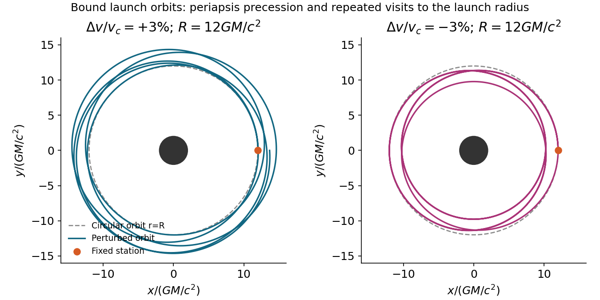
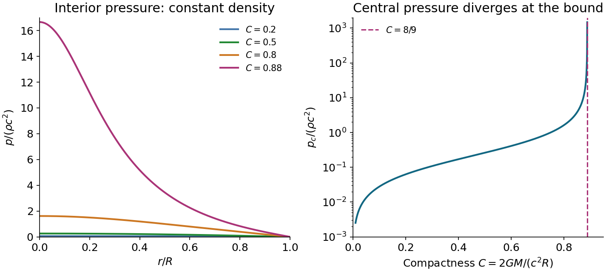
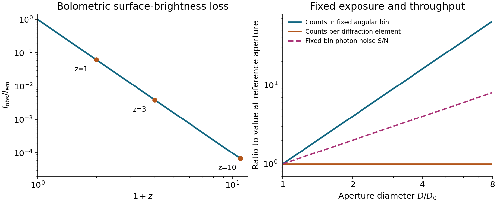

# 2016

↑ **Parent:** [Past exam of the general relativity and cosmology course of the University of Oxford](../past-exam-of-the-general-relativity-and-cosmology-course-of-the-university-of-oxford.md)

Source paper: [https://www.whatdotheyknow.com/request/physics_past_exam_papers_2015_16/response/973997/attach/3/Cowell%20Attachment.zip?cookie_passthrough=1.](https://www.whatdotheyknow.com/request/physics_past_exam_papers_2015_16/response/973997/attach/3/Cowell%20Attachment.zip?cookie_passthrough=1.) The dated cover identifies the Part B sitting of 18 June 2016. All four options are solved below.

**Table of contents**

- [1](#1)
  - [Solution](#1/solution)
- [2](#2)
  - [Solution](#2/solution)
- [3](#3)
  - [Solution](#3/solution)
- [4](#4)
  - [Solution](#4/solution)

## 1

↑ **Parent:** [2016](2016.md)

<h3 id="1/solution">Solution</h3>

↑ **Parent:** [1](#1)

**Constants and radial motion.** Write $m=GM/c^2$ and $f(r)=1-2m/r$. A [Schwarzschild black hole](../schwarzschild-spacetime.md) has [spherical symmetry](../geometry-and-topology.md#spherical-symmetry), so its conserved [angular momentum](../momentum.md#angular-momentum) fixes an orbital plane through the centre. A rotation of the angular coordinates puts any nonradial orbit in the equatorial plane. A radial orbit can also be placed in such a plane. This is a choice of coordinates, not a restriction on the possible orbital inclinations.

The quadratic [geodesic](../riemannian-geometry.md#geodesic) [Lagrangian](../calculus-of-variations.md#lagrangian), with a dot denoting differentiation with respect to the satellite's [proper time](../special-relativity.md#proper-time), is

$$
\mathcal L=\frac12\left[-fc^2\dot t^2+f^{-1}\dot r^2+r^2\dot\phi^2\right]=-\frac{c^2}2.
$$

The last equality is [four-velocity](../special-relativity.md#four-velocity) normalization, imposed after deriving the [Euler-Lagrange equations](../analysis.md#euler-lagrange-equation). The cyclic coordinates $t,\phi$ give independent conserved specific [Killing energy](../killing-vector-field.md#killing-energy) and [angular momentum](../momentum.md#angular-momentum):

$$
\boxed{e=f\dot t,\qquad \ell=r^2\dot\phi,\qquad \dot t=\frac e f,\qquad \dot\phi=\frac\ell{r^2}}.
$$

Here $e$ is the conserved energy per unit rest energy and $\ell$ has dimensions of [angular momentum](../momentum.md#angular-momentum) per unit mass. Substituting them in the normalization condition gives

$$
\boxed{\dot r^2=c^2e^2-f\left(c^2+\frac{\ell^2}{r^2}\right)
=c^2(e^2-1)+\frac{2GM}r-\frac{\ell^2}{r^2}+\frac{2GM\ell^2}{c^2r^3}}.
$$

The two signs of $\dot r$ distinguish outgoing and ingoing branches; the expression must be nonnegative on the allowed radial interval.

For a nonradial orbit, put $u=1/r$. Since $\dot r=-\ell\,du/d\phi$, the radial equation becomes

$$
\left(\frac{du}{d\phi}\right)^2=\frac{c^2(e^2-1)}{\ell^2}+\frac{2GM}{\ell^2}u-u^2+2mu^3.
$$

Differentiating and extending continuously through isolated radial turning points gives

$$
\boxed{\frac{d^2u}{d\phi^2}+u=\frac{GM}{\ell^2}+\frac{3GM}{c^2}u^2,\qquad A=\frac{GM}{\ell^2},\quad B=\frac{3GM}{c^2}}.
$$

A circular solution can equivalently be obtained directly from the radial [geodesic equation](../riemannian-geometry.md#geodesic-equation), avoiding division by $du/d\phi=0$ everywhere on that special orbit.

**Circular launch and the station's clock.** For $u=1/R$ the orbit equation gives

$$
\ell_c^2=\frac{GMR}{1-3m/R},\qquad e_c=\frac{1-2m/R}{\sqrt{1-3m/R}},\qquad \Omega=\frac{d\phi}{dt}=\sqrt{\frac{GM}{R^3}}.
$$

The static astronaut measures circumferential proper length $R\,d\phi$ and station [proper time](../special-relativity.md#proper-time) $d\tau_s=\sqrt{f(R)}\,dt$. Thus the [Schwarzschild circular-orbit local speed](../schwarzschild-spacetime.md#schwarzschild-circular-orbit-local-speed) and return time are

$$
\boxed{v_{\rm circ}=\frac{R\Omega}{\sqrt{f(R)}}=\sqrt{\frac{GM}{R-2GM/c^2}},\qquad
\Delta\tau_s=2\pi\sqrt{\frac{R^3}{GM}}\sqrt{1-\frac{2GM}{c^2R}}}.
$$

This is a local speed measured with the astronaut's clock, not the satellite's proper velocity $\gamma v$. After one azimuthal revolution the circular satellite meets the fixed station again. For comparison, the satellite's own elapsed [proper time](../special-relativity.md#proper-time) would instead be $2\pi\sqrt{R^3/(GM)}\sqrt{1-3m/R}$.

A static station requires $R>2m$; a timelike circular satellite requires $R>3m$, since the local circular speed must be below $c$. The circular orbit is stable only for $R>6m$, marginal at $6m$, and unstable for $3m<R<6m$. Thus a request for a robust near-circular trajectory implicitly needs more than merely placing the station outside the horizon.

**Slightly changing the launch speed.** In the stable, bound regime, a small tangential increase makes the launch point a pericentre; a small decrease makes it an apocentre, provided the perturbed orbit remains outside its plunge separatrix. In either case the orbit is a precessing rosette, not an exactly closed Newtonian ellipse. For an explicit first-order description write $A=A_c+\delta A$ and $u=1/R+\delta u$. Then

$$
\delta u''+\kappa_\phi^2\delta u=\delta A,\qquad \kappa_\phi^2=1-\frac{6m}R,\qquad
\delta u=\frac{\delta A}{\kappa_\phi^2}[1-\cos(\kappa_\phi\phi)].
$$

The tangential launch gives $\delta u(0)=\delta u'(0)=0$. At the station, $\ell=R\gamma v$, so $\delta\ell/\ell_c=\gamma_c^2\Delta v/v_{\rm circ}$ and $\delta A=-2A_c\gamma_c^2\Delta v/v_{\rm circ}$. Therefore

$$
\boxed{r-R\simeq\frac{2(R-2m)}{1-6m/R}\frac{\Delta v}{v_{\rm circ}}\left[1-\cos(\kappa_\phi\phi)\right]}.
$$

This perturbative expression also requires the resulting radial excursion to be small compared with $R$; close to the innermost stable orbit, $|\Delta v|\ll v_{\rm circ}$ alone does not ensure that.

The [Schwarzschild launch-orbit recurrence](../general-relativity.md#schwarzschild-launch-orbit-recurrence) needs care when deciding whether a collision is inevitable. The satellite returns to radius $R$ once per radial cycle, after an azimuthal advance approximately $\Phi_r=2\pi/\kappa_\phi$. It returns to the station's exact point only if an integer number of radial cycles also gives an integer number of azimuthal revolutions. Rational $\Phi_r/(2\pi)$ gives an exact return; an irrational ratio gives arbitrarily close approaches but no exact post-launch return for ideal point objects. At $R=12m$, for example, the linearized ratio is $\sqrt2$, illustrating why precession alone does not prove an exact collision. For generic bound orbits the dense recurrence eventually threatens any station and satellite of nonzero size; a resonant closed rosette returns exactly. A small speed adjustment is therefore not a robust permanent collision-avoidance manoeuvre for a bound satellite.

There is no unconditional collision conclusion without specifying the regime. An unstable circular orbit cannot support the small bounded oscillations used above. In particular, near $R=3.5m$ the circular specific energy is already $e_c>1$; a small positive speed increment can send the satellite outward on an unbound escape orbit, with no subsequent return to $R$. Such an escape is a different way to avoid a future encounter. Radiation reaction and manoeuvres have been excluded throughout the ideal test-particle calculation.

**[Figure 1](#1/image-bound-schwarzschild-trajectories-after-small-positive-and-negative-tangential-launch-speed-changes). Bound Schwarzschild trajectories after small positive and negative tangential launch-speed changes**.

## 2

↑ **Parent:** [2016](2016.md)

<h3 id="2/solution">Solution</h3>

↑ **Parent:** [2](#2)

**Curvature and conservation.** The [stress-energy tensor](../stress-energy-tensor.md) is symmetric and obeys [covariant conservation of stress-energy](../stress-energy-tensor.md#stress-energy-conservation), $\nabla_aT^{ab}=0$. To construct a local field equation linear in the [Ricci tensor](../riemann-curvature-tensor.md#ricci-tensor) and its trace, consider $R^{ab}+\alpha g^{ab}R$. The [contracted Bianchi identity](../riemann-curvature-tensor.md#contracted-bianchi-identity) and [metric compatibility](../vector-bundle.md#metric-compatibility) give

$$
\nabla_aR^{ab}=\frac12\nabla^bR,\qquad
\nabla_a(R^{ab}+\alpha g^{ab}R)=\left(\frac12+\alpha\right)\nabla^bR.
$$

The divergence must vanish identically, rather than constrain every matter source to have constant scalar curvature. Therefore $\alpha=-1/2$, giving the [Einstein tensor](../riemann-curvature-tensor.md#einstein-tensor)

$$
\boxed{G^{ab}=R^{ab}-\frac12g^{ab}R,\qquad \nabla_aG^{ab}=0}.
$$

A constant multiple of the metric can also be added, corresponding to a [cosmological constant](../cosmology.md#cosmological-constant); it is omitted in this stellar problem. Proportionality to matter by itself does not exclude arbitrary higher-curvature theories. The stated linear combination assumes the usual second-order metric field equation, linear in curvature, with its coupling fixed by the Newtonian limit.

The source's displayed curvature components use the convention $G_{ab}=-8\pi GT_{ab}/c^4$, opposite to another common curvature convention. Retain both that sign and those components together: replacing only the sign would give an incorrect negative stellar mass.

**Fluid frame and mass function.** Because the metric and the [Einstein tensor](../riemann-curvature-tensor.md#einstein-tensor) are diagonal, the mixed time-space components of the [stress-energy tensor](../stress-energy-tensor.md) vanish. For the [perfect fluid in general relativity](../stress-energy-tensor.md#perfect-fluid-in-general-relativity), $T^{0i}=(\rho+p/c^2)u^0u^i$. A future timelike [four-velocity](../special-relativity.md#four-velocity) has $u^0\ne0$, so ordinary matter with $\rho c^2+p\ne0$ must have $u^i=0$. Normalizing $g_{ab}u^au^b=-c^2$ then yields

$$
\boxed{u^0=ce^{-\Phi},\qquad u_0=-ce^{\Phi}}.
$$

The [static perfect-fluid rest-frame criterion](../stress-energy-tensor.md#static-perfect-fluid-rest-frame-criterion) needs the nonzero enthalpy assumption. A vacuum-like component with $p=-\rho c^2$ has $T^{ab}=p g^{ab}$ for every normalized timelike $u^a$, so diagonality cannot pick its rest frame. That is a concrete exception to the unqualified inference about velocity; it does not describe the ordinary stellar fluid considered next.

Lowering the indices of the static-fluid tensor gives $T_{00}=\rho c^2e^{2\Phi}$ and $T_{11}=pe^{2\Lambda}$. The time component of the field equation therefore implies

$$
\frac{d}{dr}\left[r(1-e^{-2\Lambda})\right]=\frac{8\pi G}{c^2}\rho r^2=\frac{2G}{c^2}\frac{dM}{dr}.
$$

Regularity at the centre fixes the integration constant to zero, giving

$$
\boxed{e^{-2\Lambda(r)}=1-\frac{2GM(r)}{c^2r},\qquad
\Lambda(r)=-\frac12\ln\left(1-\frac{2GM(r)}{c^2r}\right)}.
$$

A central point mass would introduce an additional constant, but is excluded by the regular-star boundary condition. The radial field equation is

$$
\frac{e^{2\Lambda}-1}{r^2}-\frac{2\Phi'}r=-\frac{8\pi G}{c^4}pe^{2\Lambda}.
$$

Solving and substituting the mass function gives

$$
\boxed{\Phi'=\frac{G[M(r)+4\pi p r^3/c^2]}{c^2r^2[1-2GM(r)/(c^2r)]}}.
$$

Combining this with fluid conservation gives the [Tolman–Oppenheimer–Volkoff equation](../stress-energy-tensor.md#tolman-oppenheimer-volkoff-equation), in conventions where $\rho$ is the rest-frame mass-equivalent energy density:

$$
\boxed{\frac{dp}{dr}=-\frac{G(\rho+p/c^2)[M(r)+4\pi p r^3/c^2]}{r^2[1-2GM(r)/(c^2r)]},\qquad M'=4\pi\rho r^2}.
$$

The [pressure](../pressure.md) contributes to inertial mass density and active gravity, while the last denominator is a relativistic curvature correction. The weak-field, low-pressure limit recovers $p'\simeq-G\rho M/r^2$.

**Constant-density integration.** Set $w=p/(\rho c^2)$ and $\alpha=8\pi G\rho/(3c^2)$. Now $M(r)=4\pi\rho r^3/3$ and

$$
\frac{dw}{(1+w)(1+3w)}=-\frac\alpha2\frac{r\,dr}{1-\alpha r^2}.
$$

The surface boundary condition is $p(R)=0$, with finite central [pressure](../pressure.md). Integrating from the surface gives

$$
\frac12\ln\frac{1+3w}{1+w}=\frac14\ln\frac{1-\alpha r^2}{1-\alpha R^2}.
$$

Write $s(r)=\sqrt{1-2GMr^2/(c^2R^3)}$ and $s_R=\sqrt{1-2GM/(c^2R)}$. Solving for $w$ gives the [Interior Schwarzschild solution](../stress-energy-tensor.md#interior-schwarzschild-metric):

$$
\boxed{p(r)=\rho c^2\frac{s(r)-s_R}{3s_R-s(r)},\qquad
p_0=\rho c^2\frac{1-s_R}{3s_R-1}}.
$$

The printed integration hint has a missing factor for general $A$. The [common-intercept partial fraction identity](../isolated-singularity.md#common-intercept-partial-fraction-identity) gives

$$
\frac1{(A+3x)(A+x)}=\frac1{2A}\left[\frac3{A+3x}-\frac1{A+x}\right]\qquad(A\ne0).
$$

For instance, at $A=2,x=0$ the integrand on the left is $1/4$, while the derivative of the printed right-hand side is $1/2$. The normalized $w$ calculation above uses $A=1$, where that missing factor happens not to matter.

Positive finite central [pressure](../pressure.md) requires $3s_R>1$. Consequently

$$
\boxed{\frac{2GM}{c^2R}<\frac89,\qquad M<\frac{4c^2R}{9G}}.
$$

Equality is a singular limiting solution with divergent [pressure](../pressure.md). The constant-density model is incompressible and is not a realistic causal neutron-star equation of state. Nevertheless, [Buchdahl's theorem](../stress-energy-tensor.md#buchdahl-s-theorem) extends this compactness bound to regular static spherical isotropic fluids with nonincreasing density, under its usual assumptions.

For an emitted surface line received by a static observer at infinity, the [gravitational redshift between static Schwarzschild observers](../schwarzschild-spacetime.md#gravitational-redshift-between-static-schwarzschild-observers) gives

$$
1+z=\left(1-\frac{2GM}{c^2R}\right)^{-1/2}<3,\qquad \boxed{z<2}.
$$

A claimed purely gravitational surface redshift $z=3.1$ would require compactness $1-1/(4.1)^2\simeq0.9405$, exceeding $8/9$. It is inconsistent with the regular isotropic static neutron-star interpretation, even though the surface would formally remain outside its [Schwarzschild radius](../schwarzschild-spacetime.md#schwarzschild-radius). Misidentification, additional kinematic shifts or departures from the model would need examination before treating that line as a neutron-star surface measurement.

**[Figure 2](#2/image-constant-density-relativistic-pressure-profiles-and-the-divergence-at-the-compactness-bound). Constant-density relativistic pressure profiles and the divergence at the compactness bound**.

## 3

↑ **Parent:** [2016](2016.md)

<h3 id="3/solution">Solution</h3>

↑ **Parent:** [3](#3)

**Spatial geometry.** An embedding of the [three-sphere](../euclidean-geometry.md#three-sphere) is

$$
w=A\cos\chi,\quad z=A\sin\chi\cos\theta,\quad
x=A\sin\chi\sin\theta\cos\phi,\quad y=A\sin\chi\sin\theta\sin\phi.
$$

Taking differentials and collecting terms gives the induced [metric tensor](../general-relativity.md#metric-tensor)

$$
d\ell^2=A^2d\chi^2+A^2\sin^2\chi\,(d\theta^2+\sin^2\theta\,d\phi^2).
$$

Put $\bar r=A\sin\chi$. Then $d\bar r=A\cos\chi\,d\chi$, so

$$
\boxed{d\ell^2=\frac{d\bar r^2}{1-\bar r^2/A^2}+\bar r^2d\Omega^2},\qquad d\Omega^2=d\theta^2+\sin^2\theta\,d\phi^2.
$$

The [areal radius](../general-relativity.md#areal-radius) $\bar r$ is not a global radial coordinate on the entire [three-sphere](../euclidean-geometry.md#three-sphere): its maximum occurs at the equator and two hemispheres share each smaller value. Use separate charts there; the coordinate singularity at $\bar r=A$ is not a physical singularity.

For [Euclidean space](../normed-vector-space.md#euclidean-norm) and [hyperbolic space](../hyperbolic-geometry.md#hyperbolic-space) of curvature $-1/A^2$, respectively,

$$
\boxed{d\ell_0^2=d\bar r^2+\bar r^2d\Omega^2,\qquad
 d\ell_-^2=\frac{d\bar r^2}{1+\bar r^2/A^2}+\bar r^2d\Omega^2}.
$$

For the latter, $\bar r=A\sinh\chi$ gives $d\ell_-^2=A^2[d\chi^2+\sinh^2\chi\,d\Omega^2]$. In all three cases the induced two-metric at fixed $\bar r=\bar R$ is $\bar R^2d\Omega^2$. Its [surface area](../differential-geometry.md#surface-area) is therefore

$$
\boxed{\mathcal A(\bar R)=\int_0^{2\pi}\!d\phi\int_0^\pi\!\bar R^2\sin\theta\,d\theta=4\pi\bar R^2}.
$$

This equality compares the same areal radius, not the same proper radial distance. For a proper radial distance $\ell$, the corresponding areas are $4\pi A^2\sin^2(\ell/A)$, $4\pi\ell^2$, and $4\pi A^2\sinh^2(\ell/A)$.

**Homogeneity, isotropy and redshift.** The [FRW metric](../cosmology.md#friedmann-lemaitre-robertson-walker-metric) has constant-time spatial slices of constant curvature $k/a^2(t)$, with $k=+1,0,-1$ selecting the three geometries above. Their isometries act transitively on points and isotropically about every point, implementing the [cosmological principle](../cosmology.md#cosmological-principle). Multiplication by one common time-dependent [scale factor](../cosmology.md#scale-factor-cosmology) preserves these properties. With the source's $k=\pm1$ normalization, $r$ is dimensionless and $a$ has units of length; using a dimensionless [scale factor](../cosmology.md#scale-factor-cosmology) instead rescales the spatial curvature parameter. The origin of the spherical coordinates is arbitrary; it does not identify a physical centre. Cosmic time is the [proper time](../special-relativity.md#proper-time) of the comoving observers, and the absence of time-space cross terms makes their worldlines orthogonal to the homogeneous slices.

For a radial [null geodesic](../special-relativity.md#null-geodesic) between comoving endpoints,

$$
\int_{t_E}^{t_0}\frac{c\,dt}{a(t)}=\int_0^R\frac{dr}{\sqrt{1-kr^2}}.
$$

The next wave crest travels between the same endpoints. Subtracting the two path integrals, for wave periods short compared with the expansion time, gives $\delta t_0/a_0=\delta t_E/a_E$. Thus the [cosmological redshift](../cosmology.md#cosmological-redshift) is

$$
\boxed{1+z=\frac{\lambda_0}{\lambda_E}=\frac{\nu_E}{\nu_0}=\frac{a_0}{a_E}}.
$$

Both observers' clocks are cosmic proper-time clocks. Peculiar velocities and local gravitational-potential shifts have been left out of this homogeneous calculation.

**Angular size and brightness.** For a galaxy small compared with its distance, the [angular diameter distance](../cosmology.md#angular-diameter-distance) is $D_A=a_ER$ and its angular diameter is

$$
\boxed{\Delta\theta\simeq\frac d{a_ER}=\frac{(1+z)d}{a_0R}}.
$$

Here the emitted proper diameter is measured transverse to the line of sight; radial proper distance is a different integral when $k\ne0$. Ignoring absorption, lensing caustics and intrinsic evolution, photon-number conservation spreads an isotropic-equivalent luminosity across the sphere $4\pi a_0^2R^2$. Each [photon](../quantum-mechanics.md#photon) loses energy by $1+z$, and its arrival interval is stretched by the same factor. The received bolometric flux is

$$
F=\frac{L}{4\pi a_0^2R^2(1+z)^2},\qquad D_L=(1+z)a_0R=(1+z)^2D_A.
$$

The disc's proper projected area is $\mathcal A_d=\pi d^2/4$, and its observed [solid angle](../euclidean-geometry.md#solid-angle) is $\Omega_d\simeq\mathcal A_d/D_A^2$. Therefore its [surface brightness](../astrophysics.md#surface-brightness) is

$$
\boxed{I_{\rm obs}=\frac F{\Omega_d}=\frac{L}{4\pi\mathcal A_d}(1+z)^{-4}=\frac{L}{\pi^2d^2}(1+z)^{-4}}.
$$

This is [cosmological surface-brightness dimming](../astrophysics.md#cosmological-surface-brightness-dimming). The normalization uses $L$ as isotropic-equivalent luminosity along the viewing direction; another disc emission law changes that normalization but not the redshift power. This is a bolometric result. In a specified observed frequency band the emitted spectrum is sampled at a shifted frequency and requires a spectral correction.

The distinction in [telescope aperture and resolved surface brightness](../astrophysics.md#telescope-aperture-and-resolved-surface-brightness) matters here. A larger [telescope](../physics.md#telescope) collects more [photons](../quantum-mechanics.md#photon) and improves [angular resolution](../astrophysics.md#angular-resolution), but cannot restore the incoming radiance lost by cosmological dimming. For aperture diameter $D$ and a diffraction resolution element of [solid angle](../euclidean-geometry.md#solid-angle) $\Omega_{\rm res}\sim(\lambda/D)^2$, the collected power from uniform resolved brightness scales as

$$
I_{\rm obs}\,A_{\rm tel}\Omega_{\rm res}\propto I_{\rm obs}\lambda^2,
$$

independent of $D$. This is consistent with [conservation of etendue](../geometrical-optics.md#conservation-of-etendue). It explains why increasing aperture while keeping every gain in resolution does not increase counts per native resolution element from a smooth extended source. It does **not** make larger telescopes useless: at a fixed angular bin the counts grow as $D^2$, so a photon-noise-limited or uniform-sky-noise-limited [signal-to-noise ratio](../electrical-engineering.md#signal-to-noise-ratio) grows roughly as $D\sqrt{t_{\rm exp}}$. They also resolve smaller structures and improve point-source sensitivity. Aperture, exposure and angular binning help measure a dim galaxy, without changing its intrinsic $(1+z)^{-4}$ brightness penalty.

**[Figure 3](#3/image-cosmological-surface-brightness-dimming-and-the-distinct-aperture-scalings-of-fixed-angular-bins-and-diffraction-elements). Cosmological surface-brightness dimming and the distinct aperture scalings of fixed angular bins and diffraction elements**.

## 4

↑ **Parent:** [2016](2016.md)

<h3 id="4/solution">Solution</h3>

↑ **Parent:** [4](#4)

**Two stages of the thermal history.** [Big Bang nucleosynthesis](../cosmology.md#big-bang-nucleosynthesis) is nuclear assembly in an almost fully ionized, radiation-dominated plasma. Around $t\sim1\ \mathrm s$, at [temperatures](../temperature.md) of order $1\ \mathrm{MeV}/k_B$, the weak [neutron](../neutron.md)–[proton](../physics.md#proton) conversion rate falls below the expansion rate. The neutron-to-proton abundance freezes out at order $1/5$ and then decreases by [neutron](../neutron.md) decay. The [deuterium bottleneck](../cosmology.md#deuterium-bottleneck) delays effective nuclear assembly until $k_BT\sim0.07$–$0.1\ \mathrm{MeV}$, at ages of a few minutes: the high photon-to-baryon ratio permits photodissociation despite the deuteron binding energy exceeding the mean [photon energy](../quantum-mechanics.md#photon-energy). Once deuterium survives, reactions rapidly put most remaining [neutrons](../neutron.md) into helium-4. A [neutron-to-proton ratio](../cosmology.md#neutron-to-proton-ratio) near $1/7$ gives a [helium](../chemical-substance.md#helium) mass fraction $Y_p\simeq2(n/p)/(1+n/p)\simeq1/4$, with [hydrogen](../chemical-substance.md#hydrogen) dominant by number and small residual deuterium, helium-3 and lithium-7 abundances. Expansion and low density prevent substantial heavy-element production. Nuclear binding is involved; neutral atoms do not yet survive.

[Photon decoupling](../cosmology.md#photon-decoupling) occurs much later, near a few thousand kelvin and a few hundred thousand years, after matter has overtaken radiation in the expansion dynamics. [Electrons](../physics.md#electron) and nuclei form neutral atoms during [cosmological recombination](../cosmology.md#recombination-cosmology). The resulting decline of free-electron density reduces Thomson opacity, and [photons](../quantum-mechanics.md#photon) begin to free stream over cosmological distances. Those [photons](../quantum-mechanics.md#photon) form the observed [cosmic microwave background](../cosmic-microwave-background.md). Atomic binding and scattering opacity, rather than new nuclear reactions, control this stage. [Helium](../chemical-substance.md#helium) forms neutral atoms earlier than [hydrogen](../chemical-substance.md#hydrogen). Recombination, [photon](../quantum-mechanics.md#photon) last scattering, [baryon](../physics.md#baryon) drag release and the later thermal decoupling of the gas are related but not identical events.

The [temperature](../temperature.md) falls through expansion: after the relevant entropy releases have ended, $T_\gamma\propto a^{-1}$ and number densities scale as $a^{-3}$. Big Bang nucleosynthesis lies in the [radiation-dominated universe](../cosmology.md#radiation-dominated-universe); [photon decoupling](../cosmology.md#photon-decoupling) lies after matter–radiation equality, when a matter-dominated approximation is useful but radiation is not exactly negligible.

**[Photon](../quantum-mechanics.md#photon) density and [baryon](../physics.md#baryon) abundance.** The [cosmic microwave background](../cosmic-microwave-background.md) has a [black-body radiation](../statistical-physics.md#black-body-radiation) spectrum obeying [Planck's law](../statistical-physics.md#planck-s-law):

$$
u_\nu=\frac{8\pi h\nu^3}{c^3}\frac1{e^{h\nu/(k_BT)}-1},\qquad T_0\simeq2.725\ \mathrm K,
$$

where $u_\nu$ is spectral energy density, not a photon-number density. The measured [temperature](../temperature.md) is about $2.72548\ \mathrm K$.[Abstract: literature-combined black-body [temperature](../temperature.md), 2.72548 ± 0.00057 K](../physics-bibliography.md#the-temperature-of-the-cosmic-microwave-background-by-dale-j-fixsen) The mean [photon energy](../quantum-mechanics.md#photon-energy) in a black body is

$$
\langle E_\gamma\rangle=\frac{\pi^4}{30\zeta(3)}k_BT\simeq2.701k_BT.
$$

Using the supplied rounded energy density gives

$$
\boxed{n_{\gamma0}\simeq\frac{4\times10^{-14}}{2.701k_BT_0}\simeq3.9\times10^8\ \mathrm{m^{-3}}}.
$$

The exact black-body number integral at $2.725\ \mathrm K$ gives $4.1\times10^8\ \mathrm{m^{-3}}$; the difference reflects rounding of the stated energy density. Either estimate is adequate.

A numerical photon-to-baryon ratio additionally needs a [baryon](../physics.md#baryon) density, which is not printed in this question. Make that observational input explicit rather than infer [baryons](../physics.md#baryon) from radiation alone. For illustration take the standard rounded physical density $\Omega_bh_H^2\simeq0.022$, with $H_0=100h_H\ \mathrm{km\,s^{-1}\,Mpc^{-1}}$. This is consistent with the cosmological parameter fits available around the paper's date.[Base ΛCDM parameter tables: physical [baryon](../physics.md#baryon) density near 0.022; illustrative expansion normalization H0 about 68 km s−1 Mpc−1 and matter fraction about 0.31](../physics-bibliography.md#planck-2015-cosmological-parameters-by-planck-collaboration) It gives

$$
\rho_{b0}=(\Omega_bh_H^2)\frac{3(100\ \mathrm{km\,s^{-1}\,Mpc^{-1}})^2}{8\pi G}\simeq4.1\times10^{-28}\ \mathrm{kg\,m^{-3}},\qquad n_{b0}\simeq\frac{\rho_{b0}}{m_p}\simeq0.25\ \mathrm{m^{-3}}.
$$

Counting [baryons](../physics.md#baryon), including those bound in [helium](../chemical-substance.md#helium), rather than counting nuclei then gives

$$
\boxed{\frac{n_\gamma}{n_b}\sim1.6\times10^9,\qquad \eta\equiv\frac{n_b}{n_\gamma}\sim6\times10^{-10}}.
$$

Both populations dilute as $a^{-3}$ after [electron](../physics.md#electron)–positron annihilation, so this ratio also applies at [hydrogen](../chemical-substance.md#hydrogen) recombination in the standard adiabatic history.

**Estimating decoupling.** The large [photon](../quantum-mechanics.md#photon) excess explains why setting $k_BT$ equal to the [Hydrogen binding energy](../cosmology.md#hydrogen-binding-energy) $\chi_H=13.6\ \mathrm{eV}$ is wrong. Even a small ionizing tail can oppose neutral-atom formation. The crude exponential balance $e^{-\chi_H/(k_BT)}\sim\eta$ gives $\chi_H/(k_BT)\sim\ln(1/\eta)\sim21$, or $T\sim7\times10^3\ \mathrm K$. This only establishes the scale and the large suppression below $\chi_H/k_B$; it neglects phase-space factors and the opacity criterion.

A more controlled elementary [Saha-Thomson decoupling estimate](../cosmology.md#saha-thomson-decoupling-estimate) uses the [hydrogen-only Saha equation](../cosmology.md#hydrogen-only-saha-equation). With $X_e=n_e/n_H$ and ground-state statistical weights combined in the usual way,

$$
\frac{X_e^2}{1-X_e}=\frac1{n_H}\left(\frac{2\pi m_ek_BT}{h^2}\right)^{3/2}e^{-\chi_H/(k_BT)},\qquad
n_H\simeq(1-Y_p)n_{b0}\left(\frac T{T_0}\right)^3.
$$

The [electron](../physics.md#electron) translational phase-space factor is significant inside the logarithm. This equilibrium relation places the sharp neutralization interval around $T\sim(3\text{–}4)\times10^3\ \mathrm K$. Combine it with the approximate [Thomson decoupling rate criterion](../cosmology.md#thomson-decoupling-rate-criterion)

$$
\Gamma_\gamma=n_e\sigma_Tc\sim H,\qquad
H\simeq H_0\sqrt{\Omega_m}\left(\frac T{T_0}\right)^{3/2}.
$$

For $Y_p\simeq0.25$, $n_{b0}\simeq0.25\ \mathrm{m^{-3}}$, $H_0\simeq68\ \mathrm{km\,s^{-1}\,Mpc^{-1}}$, and $\Omega_m\simeq0.31$, solving these two approximate relations gives $T\simeq3.1\times10^3\ \mathrm K$, with equilibrium $X_e$ of order $10^{-2}$. Thus the appropriate estimate is

$$
\boxed{T_{\rm dec}\sim3\times10^3\ \mathrm K,\qquad k_BT_{\rm dec}\sim0.26\ \mathrm{eV},\qquad z_{\rm dec}\sim1100}.
$$

This is not a precision recombination calculation. Hydrogen-only equilibrium omits the kinetic bottleneck in escaping Lyman [photons](../quantum-mechanics.md#photon), two-photon processes, the detailed [helium](../chemical-substance.md#helium) history and freeze-out; $\Gamma/H\sim1$ is not identical to the maximum of the last-scattering visibility function. These approximations must be improved to predict an accurate free-electron fraction or a percent-level last-scattering redshift. The high photon-to-baryon ratio alone does not fix that detailed history.

The [electrons](../physics.md#electron) are highly nonrelativistic: $k_BT/(m_ec^2)\sim5\times10^{-7}$, and their thermal root-mean-square speed is only about $10^{-3}c$. [Photon](../quantum-mechanics.md#photon) coupling does not make their kinetic energies relativistic.

**Age–[temperature](../temperature.md) relation.** During a nearly flat pressureless matter-dominated phase, with radiation, curvature and vacuum energy neglected in the expansion equation,

$$
\rho_m\propto a^{-3},\qquad \left(\frac{\dot a}a\right)^2\propto a^{-3},\qquad \boxed{a(t)\propto t^{2/3}}.
$$

Here the Big Bang time is chosen as $t=0$. Conserved [photon](../quantum-mechanics.md#photon) entropy gives $T\propto a^{-1}$, so

$$
\boxed{T\propto t^{-2/3},\qquad t\propto T^{-3/2}}.
$$

To normalize this relation, use the matter-era expansion rate expressed in present-day measured parameters, rather than assume the late universe is still matter dominated:

$$
\boxed{t(T)\simeq\frac{2}{3H_0\sqrt{\Omega_m}}\left(\frac{T_0}T\right)^{3/2}}.
$$

The same illustrative parameters give $t_{\rm dec}\sim4.5\text{–}5\times10^5\ \mathrm{yr}$ for $T_{\rm dec}\sim3.0\text{–}3.1\times10^3\ \mathrm K$. Radiation was still a meaningful correction; retaining it reduces the age, and a more complete recombination calculation gives the familiar scale of roughly $4\times10^5\ \mathrm{yr}$.[§6.7: recombination and [photon decoupling](../cosmology.md#photon-decoupling) near redshift 10^3, at an age around 400000 years; distinction from detailed kinetic ionization-history calculations](../physics-bibliography.md#planck-2015-cosmological-parameters-by-planck-collaboration) A numerical age cannot follow from a proportionality $t\propto T^{-3/2}$ alone: an expansion or density normalization is essential. The small amount of dark energy at decoupling can be neglected even though it affects the present age.

## ↑ Ancestors (9)

1. [Past exam of the general relativity and cosmology course of the University of Oxford](../past-exam-of-the-general-relativity-and-cosmology-course-of-the-university-of-oxford.md)
2. [General relativity and cosmology course of the University of Oxford](../university-of-oxford.md#general-relativity-and-cosmology-course-of-the-university-of-oxford)
3. [Year 3 of the physics course of the University of Oxford](../university-of-oxford.md#year-3-of-the-physics-course-of-the-university-of-oxford)
4. [Physics course of the University of Oxford](../university-of-oxford.md#physics-course-of-the-university-of-oxford)
5. [Undergraduate course of the University of Oxford](../university-of-oxford.md#undergraduate-course-of-the-university-of-oxford)
6. [Course of the University of Oxford](../university-of-oxford.md#course-of-the-university-of-oxford)
7. [University of Oxford](../university-of-oxford.md)
8. [List of universities](../README.md#list-of-universities)
9. [Codex Wiki](../README.md)
