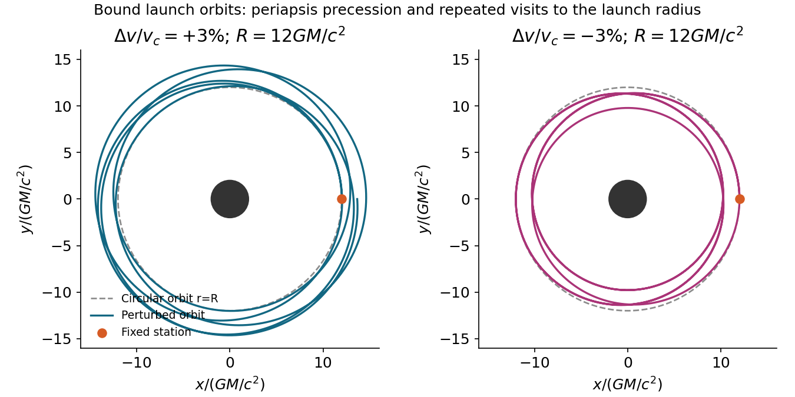

<h1 id="1/solution">Solution</h1>

↑ **Parent:** [1](../1.md)

**Constants and radial motion.** Write $m=GM/c^2$ and $f(r)=1-2m/r$. A [Schwarzschild black hole](../../../schwarzschild-spacetime-split.md) has [spherical symmetry](../../../spherical-symmetry.md), so its conserved [angular momentum](../../../angular-momentum.md) fixes an orbital plane through the centre. A rotation of the angular coordinates puts any nonradial orbit in the equatorial plane. A radial orbit can also be placed in such a plane. This is a choice of coordinates, not a restriction on the possible orbital inclinations.

The quadratic [geodesic](../../../geodesic.md) [Lagrangian](../../../lagrangian.md), with a dot denoting differentiation with respect to the satellite's [proper time](../../../proper-time.md), is

$$
\mathcal L=\frac12\left[-fc^2\dot t^2+f^{-1}\dot r^2+r^2\dot\phi^2\right]=-\frac{c^2}2.
$$

The last equality is [four-velocity](../../../four-velocity.md) normalization, imposed after deriving the [Euler-Lagrange equations](../../../euler-lagrange-equation.md). The cyclic coordinates $t,\phi$ give independent conserved specific [Killing energy](../../../killing-energy.md) and [angular momentum](../../../angular-momentum.md):

$$
\boxed{e=f\dot t,\qquad \ell=r^2\dot\phi,\qquad \dot t=\frac e f,\qquad \dot\phi=\frac\ell{r^2}}.
$$

Here $e$ is the conserved energy per unit rest energy and $\ell$ has dimensions of [angular momentum](../../../angular-momentum.md) per unit mass. Substituting them in the normalization condition gives

$$
\boxed{\dot r^2=c^2e^2-f\left(c^2+\frac{\ell^2}{r^2}\right)
=c^2(e^2-1)+\frac{2GM}r-\frac{\ell^2}{r^2}+\frac{2GM\ell^2}{c^2r^3}}.
$$

The two signs of $\dot r$ distinguish outgoing and ingoing branches; the expression must be nonnegative on the allowed radial interval.

For a nonradial orbit, put $u=1/r$. Since $\dot r=-\ell\,du/d\phi$, the radial equation becomes

$$
\left(\frac{du}{d\phi}\right)^2=\frac{c^2(e^2-1)}{\ell^2}+\frac{2GM}{\ell^2}u-u^2+2mu^3.
$$

Differentiating and extending continuously through isolated radial turning points gives

$$
\boxed{\frac{d^2u}{d\phi^2}+u=\frac{GM}{\ell^2}+\frac{3GM}{c^2}u^2,\qquad A=\frac{GM}{\ell^2},\quad B=\frac{3GM}{c^2}}.
$$

A circular solution can equivalently be obtained directly from the radial [geodesic equation](../../../geodesic-equation.md), avoiding division by $du/d\phi=0$ everywhere on that special orbit.

**Circular launch and the station's clock.** For $u=1/R$ the orbit equation gives

$$
\ell_c^2=\frac{GMR}{1-3m/R},\qquad e_c=\frac{1-2m/R}{\sqrt{1-3m/R}},\qquad \Omega=\frac{d\phi}{dt}=\sqrt{\frac{GM}{R^3}}.
$$

The static astronaut measures circumferential proper length $R\,d\phi$ and station [proper time](../../../proper-time.md) $d\tau_s=\sqrt{f(R)}\,dt$. Thus the [Schwarzschild circular-orbit local speed](../../../schwarzschild-circular-orbit-local-speed.md) and return time are

$$
\boxed{v_{\rm circ}=\frac{R\Omega}{\sqrt{f(R)}}=\sqrt{\frac{GM}{R-2GM/c^2}},\qquad
\Delta\tau_s=2\pi\sqrt{\frac{R^3}{GM}}\sqrt{1-\frac{2GM}{c^2R}}}.
$$

This is a local speed measured with the astronaut's clock, not the satellite's proper velocity $\gamma v$. After one azimuthal revolution the circular satellite meets the fixed station again. For comparison, the satellite's own elapsed [proper time](../../../proper-time.md) would instead be $2\pi\sqrt{R^3/(GM)}\sqrt{1-3m/R}$.

A static station requires $R>2m$; a timelike circular satellite requires $R>3m$, since the local circular speed must be below $c$. The circular orbit is stable only for $R>6m$, marginal at $6m$, and unstable for $3m<R<6m$. Thus a request for a robust near-circular trajectory implicitly needs more than merely placing the station outside the horizon.

**Slightly changing the launch speed.** In the stable, bound regime, a small tangential increase makes the launch point a pericentre; a small decrease makes it an apocentre, provided the perturbed orbit remains outside its plunge separatrix. In either case the orbit is a precessing rosette, not an exactly closed Newtonian ellipse. For an explicit first-order description write $A=A_c+\delta A$ and $u=1/R+\delta u$. Then

$$
\delta u''+\kappa_\phi^2\delta u=\delta A,\qquad \kappa_\phi^2=1-\frac{6m}R,\qquad
\delta u=\frac{\delta A}{\kappa_\phi^2}[1-\cos(\kappa_\phi\phi)].
$$

The tangential launch gives $\delta u(0)=\delta u'(0)=0$. At the station, $\ell=R\gamma v$, so $\delta\ell/\ell_c=\gamma_c^2\Delta v/v_{\rm circ}$ and $\delta A=-2A_c\gamma_c^2\Delta v/v_{\rm circ}$. Therefore

$$
\boxed{r-R\simeq\frac{2(R-2m)}{1-6m/R}\frac{\Delta v}{v_{\rm circ}}\left[1-\cos(\kappa_\phi\phi)\right]}.
$$

This perturbative expression also requires the resulting radial excursion to be small compared with $R$; close to the innermost stable orbit, $|\Delta v|\ll v_{\rm circ}$ alone does not ensure that.

The [Schwarzschild launch-orbit recurrence](../../../schwarzschild-launch-orbit-recurrence.md) needs care when deciding whether a collision is inevitable. The satellite returns to radius $R$ once per radial cycle, after an azimuthal advance approximately $\Phi_r=2\pi/\kappa_\phi$. It returns to the station's exact point only if an integer number of radial cycles also gives an integer number of azimuthal revolutions. Rational $\Phi_r/(2\pi)$ gives an exact return; an irrational ratio gives arbitrarily close approaches but no exact post-launch return for ideal point objects. At $R=12m$, for example, the linearized ratio is $\sqrt2$, illustrating why precession alone does not prove an exact collision. For generic bound orbits the dense recurrence eventually threatens any station and satellite of nonzero size; a resonant closed rosette returns exactly. A small speed adjustment is therefore not a robust permanent collision-avoidance manoeuvre for a bound satellite.

There is no unconditional collision conclusion without specifying the regime. An unstable circular orbit cannot support the small bounded oscillations used above. In particular, near $R=3.5m$ the circular specific energy is already $e_c>1$; a small positive speed increment can send the satellite outward on an unbound escape orbit, with no subsequent return to $R$. Such an escape is a different way to avoid a future encounter. Radiation reaction and manoeuvres have been excluded throughout the ideal test-particle calculation.

**[Figure 1](#1/image-bound-schwarzschild-trajectories-after-small-positive-and-negative-tangential-launch-speed-changes). Bound Schwarzschild trajectories after small positive and negative tangential launch-speed changes**.

## ↑ Ancestors (11)

1. [1](../1.md)
2. [2016](../../2016-split.md)
3. [Past exam of the general relativity and cosmology course of the University of Oxford](../../split.md)
4. [General relativity and cosmology course of the University of Oxford](../../../general-relativity-and-cosmology-course-of-the-university-of-oxford.md)
5. [Year 3 of the physics course of the University of Oxford](../../../year-3-of-the-physics-course-of-the-university-of-oxford.md)
6. [Physics course of the University of Oxford](../../../physics-course-of-the-university-of-oxford.md)
7. [Undergraduate course of the University of Oxford](../../../undergraduate-course-of-the-university-of-oxford.md)
8. [Course of the University of Oxford](../../../course-of-the-university-of-oxford.md)
9. [University of Oxford](../../../university-of-oxford-split.md)
10. [List of universities](../../../list-of-universities.md)
11. [Codex Wiki](../../../split.md)
