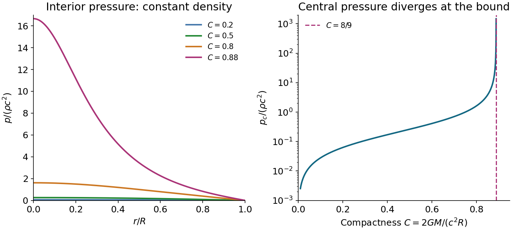

<h1 id="2/solution">Solution</h1>

↑ **Parent:** [2](../2.md)

**Curvature and conservation.** The [stress-energy tensor](../../../stress-energy-tensor-split.md) is symmetric and obeys [covariant conservation of stress-energy](../../../stress-energy-conservation.md), $\nabla_aT^{ab}=0$. To construct a local field equation linear in the [Ricci tensor](../../../ricci-tensor.md) and its trace, consider $R^{ab}+\alpha g^{ab}R$. The [contracted Bianchi identity](../../../contracted-bianchi-identity.md) and [metric compatibility](../../../metric-compatibility.md) give

$$
\nabla_aR^{ab}=\frac12\nabla^bR,\qquad
\nabla_a(R^{ab}+\alpha g^{ab}R)=\left(\frac12+\alpha\right)\nabla^bR.
$$

The divergence must vanish identically, rather than constrain every matter source to have constant scalar curvature. Therefore $\alpha=-1/2$, giving the [Einstein tensor](../../../einstein-tensor.md)

$$
\boxed{G^{ab}=R^{ab}-\frac12g^{ab}R,\qquad \nabla_aG^{ab}=0}.
$$

A constant multiple of the metric can also be added, corresponding to a [cosmological constant](../../../cosmological-constant.md); it is omitted in this stellar problem. Proportionality to matter by itself does not exclude arbitrary higher-curvature theories. The stated linear combination assumes the usual second-order metric field equation, linear in curvature, with its coupling fixed by the Newtonian limit.

The source's displayed curvature components use the convention $G_{ab}=-8\pi GT_{ab}/c^4$, opposite to another common curvature convention. Retain both that sign and those components together: replacing only the sign would give an incorrect negative stellar mass.

**Fluid frame and mass function.** Because the metric and the [Einstein tensor](../../../einstein-tensor.md) are diagonal, the mixed time-space components of the [stress-energy tensor](../../../stress-energy-tensor-split.md) vanish. For the [perfect fluid in general relativity](../../../perfect-fluid-in-general-relativity.md), $T^{0i}=(\rho+p/c^2)u^0u^i$. A future timelike [four-velocity](../../../four-velocity.md) has $u^0\ne0$, so ordinary matter with $\rho c^2+p\ne0$ must have $u^i=0$. Normalizing $g_{ab}u^au^b=-c^2$ then yields

$$
\boxed{u^0=ce^{-\Phi},\qquad u_0=-ce^{\Phi}}.
$$

The [static perfect-fluid rest-frame criterion](../../../static-perfect-fluid-rest-frame-criterion.md) needs the nonzero enthalpy assumption. A vacuum-like component with $p=-\rho c^2$ has $T^{ab}=p g^{ab}$ for every normalized timelike $u^a$, so diagonality cannot pick its rest frame. That is a concrete exception to the unqualified inference about velocity; it does not describe the ordinary stellar fluid considered next.

Lowering the indices of the static-fluid tensor gives $T_{00}=\rho c^2e^{2\Phi}$ and $T_{11}=pe^{2\Lambda}$. The time component of the field equation therefore implies

$$
\frac{d}{dr}\left[r(1-e^{-2\Lambda})\right]=\frac{8\pi G}{c^2}\rho r^2=\frac{2G}{c^2}\frac{dM}{dr}.
$$

Regularity at the centre fixes the integration constant to zero, giving

$$
\boxed{e^{-2\Lambda(r)}=1-\frac{2GM(r)}{c^2r},\qquad
\Lambda(r)=-\frac12\ln\left(1-\frac{2GM(r)}{c^2r}\right)}.
$$

A central point mass would introduce an additional constant, but is excluded by the regular-star boundary condition. The radial field equation is

$$
\frac{e^{2\Lambda}-1}{r^2}-\frac{2\Phi'}r=-\frac{8\pi G}{c^4}pe^{2\Lambda}.
$$

Solving and substituting the mass function gives

$$
\boxed{\Phi'=\frac{G[M(r)+4\pi p r^3/c^2]}{c^2r^2[1-2GM(r)/(c^2r)]}}.
$$

Combining this with fluid conservation gives the [Tolman–Oppenheimer–Volkoff equation](../../../tolman-oppenheimer-volkoff-equation.md), in conventions where $\rho$ is the rest-frame mass-equivalent energy density:

$$
\boxed{\frac{dp}{dr}=-\frac{G(\rho+p/c^2)[M(r)+4\pi p r^3/c^2]}{r^2[1-2GM(r)/(c^2r)]},\qquad M'=4\pi\rho r^2}.
$$

The [pressure](../../../pressure-split.md) contributes to inertial mass density and active gravity, while the last denominator is a relativistic curvature correction. The weak-field, low-pressure limit recovers $p'\simeq-G\rho M/r^2$.

**Constant-density integration.** Set $w=p/(\rho c^2)$ and $\alpha=8\pi G\rho/(3c^2)$. Now $M(r)=4\pi\rho r^3/3$ and

$$
\frac{dw}{(1+w)(1+3w)}=-\frac\alpha2\frac{r\,dr}{1-\alpha r^2}.
$$

The surface boundary condition is $p(R)=0$, with finite central [pressure](../../../pressure-split.md). Integrating from the surface gives

$$
\frac12\ln\frac{1+3w}{1+w}=\frac14\ln\frac{1-\alpha r^2}{1-\alpha R^2}.
$$

Write $s(r)=\sqrt{1-2GMr^2/(c^2R^3)}$ and $s_R=\sqrt{1-2GM/(c^2R)}$. Solving for $w$ gives the [Interior Schwarzschild solution](../../../interior-schwarzschild-metric.md):

$$
\boxed{p(r)=\rho c^2\frac{s(r)-s_R}{3s_R-s(r)},\qquad
p_0=\rho c^2\frac{1-s_R}{3s_R-1}}.
$$

The printed integration hint has a missing factor for general $A$. The [common-intercept partial fraction identity](../../../common-intercept-partial-fraction-identity.md) gives

$$
\frac1{(A+3x)(A+x)}=\frac1{2A}\left[\frac3{A+3x}-\frac1{A+x}\right]\qquad(A\ne0).
$$

For instance, at $A=2,x=0$ the integrand on the left is $1/4$, while the derivative of the printed right-hand side is $1/2$. The normalized $w$ calculation above uses $A=1$, where that missing factor happens not to matter.

Positive finite central [pressure](../../../pressure-split.md) requires $3s_R>1$. Consequently

$$
\boxed{\frac{2GM}{c^2R}<\frac89,\qquad M<\frac{4c^2R}{9G}}.
$$

Equality is a singular limiting solution with divergent [pressure](../../../pressure-split.md). The constant-density model is incompressible and is not a realistic causal neutron-star equation of state. Nevertheless, [Buchdahl's theorem](../../../buchdahl-s-theorem.md) extends this compactness bound to regular static spherical isotropic fluids with nonincreasing density, under its usual assumptions.

For an emitted surface line received by a static observer at infinity, the [gravitational redshift between static Schwarzschild observers](../../../gravitational-redshift-between-static-schwarzschild-observers.md) gives

$$
1+z=\left(1-\frac{2GM}{c^2R}\right)^{-1/2}<3,\qquad \boxed{z<2}.
$$

A claimed purely gravitational surface redshift $z=3.1$ would require compactness $1-1/(4.1)^2\simeq0.9405$, exceeding $8/9$. It is inconsistent with the regular isotropic static neutron-star interpretation, even though the surface would formally remain outside its [Schwarzschild radius](../../../schwarzschild-radius.md). Misidentification, additional kinematic shifts or departures from the model would need examination before treating that line as a neutron-star surface measurement.

**[Figure 2](#2/image-constant-density-relativistic-pressure-profiles-and-the-divergence-at-the-compactness-bound). Constant-density relativistic pressure profiles and the divergence at the compactness bound**.

## ↑ Ancestors (11)

1. [2](../2.md)
2. [2016](../../2016-split.md)
3. [Past exam of the general relativity and cosmology course of the University of Oxford](../../split.md)
4. [General relativity and cosmology course of the University of Oxford](../../../general-relativity-and-cosmology-course-of-the-university-of-oxford.md)
5. [Year 3 of the physics course of the University of Oxford](../../../year-3-of-the-physics-course-of-the-university-of-oxford.md)
6. [Physics course of the University of Oxford](../../../physics-course-of-the-university-of-oxford.md)
7. [Undergraduate course of the University of Oxford](../../../undergraduate-course-of-the-university-of-oxford.md)
8. [Course of the University of Oxford](../../../course-of-the-university-of-oxford.md)
9. [University of Oxford](../../../university-of-oxford-split.md)
10. [List of universities](../../../list-of-universities.md)
11. [Codex Wiki](../../../split.md)
