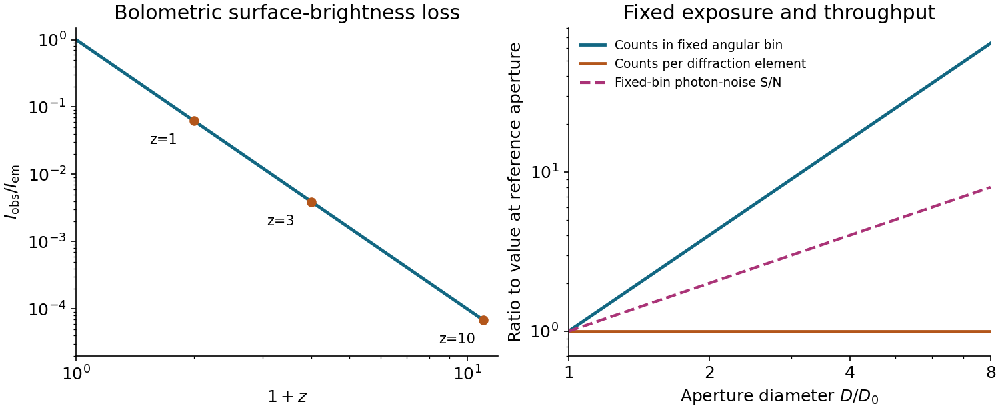

<h1 id="3/solution">Solution</h1>

↑ **Parent:** [3](../3.md)

**Spatial geometry.** An embedding of the [three-sphere](../../../three-sphere.md) is

$$
w=A\cos\chi,\quad z=A\sin\chi\cos\theta,\quad
x=A\sin\chi\sin\theta\cos\phi,\quad y=A\sin\chi\sin\theta\sin\phi.
$$

Taking differentials and collecting terms gives the induced [metric tensor](../../../metric-tensor.md)

$$
d\ell^2=A^2d\chi^2+A^2\sin^2\chi\,(d\theta^2+\sin^2\theta\,d\phi^2).
$$

Put $\bar r=A\sin\chi$. Then $d\bar r=A\cos\chi\,d\chi$, so

$$
\boxed{d\ell^2=\frac{d\bar r^2}{1-\bar r^2/A^2}+\bar r^2d\Omega^2},\qquad d\Omega^2=d\theta^2+\sin^2\theta\,d\phi^2.
$$

The [areal radius](../../../areal-radius.md) $\bar r$ is not a global radial coordinate on the entire [three-sphere](../../../three-sphere.md): its maximum occurs at the equator and two hemispheres share each smaller value. Use separate charts there; the coordinate singularity at $\bar r=A$ is not a physical singularity.

For [Euclidean space](../../../euclidean-norm.md) and [hyperbolic space](../../../hyperbolic-space.md) of curvature $-1/A^2$, respectively,

$$
\boxed{d\ell_0^2=d\bar r^2+\bar r^2d\Omega^2,\qquad
 d\ell_-^2=\frac{d\bar r^2}{1+\bar r^2/A^2}+\bar r^2d\Omega^2}.
$$

For the latter, $\bar r=A\sinh\chi$ gives $d\ell_-^2=A^2[d\chi^2+\sinh^2\chi\,d\Omega^2]$. In all three cases the induced two-metric at fixed $\bar r=\bar R$ is $\bar R^2d\Omega^2$. Its [surface area](../../../surface-area.md) is therefore

$$
\boxed{\mathcal A(\bar R)=\int_0^{2\pi}\!d\phi\int_0^\pi\!\bar R^2\sin\theta\,d\theta=4\pi\bar R^2}.
$$

This equality compares the same areal radius, not the same proper radial distance. For a proper radial distance $\ell$, the corresponding areas are $4\pi A^2\sin^2(\ell/A)$, $4\pi\ell^2$, and $4\pi A^2\sinh^2(\ell/A)$.

**Homogeneity, isotropy and redshift.** The [FRW metric](../../../friedmann-lemaitre-robertson-walker-metric.md) has constant-time spatial slices of constant curvature $k/a^2(t)$, with $k=+1,0,-1$ selecting the three geometries above. Their isometries act transitively on points and isotropically about every point, implementing the [cosmological principle](../../../cosmological-principle.md). Multiplication by one common time-dependent [scale factor](../../../scale-factor-cosmology.md) preserves these properties. With the source's $k=\pm1$ normalization, $r$ is dimensionless and $a$ has units of length; using a dimensionless [scale factor](../../../scale-factor-cosmology.md) instead rescales the spatial curvature parameter. The origin of the spherical coordinates is arbitrary; it does not identify a physical centre. Cosmic time is the [proper time](../../../proper-time.md) of the comoving observers, and the absence of time-space cross terms makes their worldlines orthogonal to the homogeneous slices.

For a radial [null geodesic](../../../null-geodesic.md) between comoving endpoints,

$$
\int_{t_E}^{t_0}\frac{c\,dt}{a(t)}=\int_0^R\frac{dr}{\sqrt{1-kr^2}}.
$$

The next wave crest travels between the same endpoints. Subtracting the two path integrals, for wave periods short compared with the expansion time, gives $\delta t_0/a_0=\delta t_E/a_E$. Thus the [cosmological redshift](../../../cosmological-redshift.md) is

$$
\boxed{1+z=\frac{\lambda_0}{\lambda_E}=\frac{\nu_E}{\nu_0}=\frac{a_0}{a_E}}.
$$

Both observers' clocks are cosmic proper-time clocks. Peculiar velocities and local gravitational-potential shifts have been left out of this homogeneous calculation.

**Angular size and brightness.** For a galaxy small compared with its distance, the [angular diameter distance](../../../angular-diameter-distance.md) is $D_A=a_ER$ and its angular diameter is

$$
\boxed{\Delta\theta\simeq\frac d{a_ER}=\frac{(1+z)d}{a_0R}}.
$$

Here the emitted proper diameter is measured transverse to the line of sight; radial proper distance is a different integral when $k\ne0$. Ignoring absorption, lensing caustics and intrinsic evolution, photon-number conservation spreads an isotropic-equivalent luminosity across the sphere $4\pi a_0^2R^2$. Each [photon](../../../photon.md) loses energy by $1+z$, and its arrival interval is stretched by the same factor. The received bolometric flux is

$$
F=\frac{L}{4\pi a_0^2R^2(1+z)^2},\qquad D_L=(1+z)a_0R=(1+z)^2D_A.
$$

The disc's proper projected area is $\mathcal A_d=\pi d^2/4$, and its observed [solid angle](../../../solid-angle.md) is $\Omega_d\simeq\mathcal A_d/D_A^2$. Therefore its [surface brightness](../../../surface-brightness.md) is

$$
\boxed{I_{\rm obs}=\frac F{\Omega_d}=\frac{L}{4\pi\mathcal A_d}(1+z)^{-4}=\frac{L}{\pi^2d^2}(1+z)^{-4}}.
$$

This is [cosmological surface-brightness dimming](../../../cosmological-surface-brightness-dimming.md). The normalization uses $L$ as isotropic-equivalent luminosity along the viewing direction; another disc emission law changes that normalization but not the redshift power. This is a bolometric result. In a specified observed frequency band the emitted spectrum is sampled at a shifted frequency and requires a spectral correction.

The distinction in [telescope aperture and resolved surface brightness](../../../telescope-aperture-and-resolved-surface-brightness.md) matters here. A larger [telescope](../../../telescope.md) collects more [photons](../../../photon.md) and improves [angular resolution](../../../angular-resolution.md), but cannot restore the incoming radiance lost by cosmological dimming. For aperture diameter $D$ and a diffraction resolution element of [solid angle](../../../solid-angle.md) $\Omega_{\rm res}\sim(\lambda/D)^2$, the collected power from uniform resolved brightness scales as

$$
I_{\rm obs}\,A_{\rm tel}\Omega_{\rm res}\propto I_{\rm obs}\lambda^2,
$$

independent of $D$. This is consistent with [conservation of etendue](../../../conservation-of-etendue.md). It explains why increasing aperture while keeping every gain in resolution does not increase counts per native resolution element from a smooth extended source. It does **not** make larger telescopes useless: at a fixed angular bin the counts grow as $D^2$, so a photon-noise-limited or uniform-sky-noise-limited [signal-to-noise ratio](../../../signal-to-noise-ratio.md) grows roughly as $D\sqrt{t_{\rm exp}}$. They also resolve smaller structures and improve point-source sensitivity. Aperture, exposure and angular binning help measure a dim galaxy, without changing its intrinsic $(1+z)^{-4}$ brightness penalty.

**[Figure 3](#3/image-cosmological-surface-brightness-dimming-and-the-distinct-aperture-scalings-of-fixed-angular-bins-and-diffraction-elements). Cosmological surface-brightness dimming and the distinct aperture scalings of fixed angular bins and diffraction elements**.

## ↑ Ancestors (11)

1. [3](../3.md)
2. [2016](../../2016-split.md)
3. [Past exam of the general relativity and cosmology course of the University of Oxford](../../split.md)
4. [General relativity and cosmology course of the University of Oxford](../../../general-relativity-and-cosmology-course-of-the-university-of-oxford.md)
5. [Year 3 of the physics course of the University of Oxford](../../../year-3-of-the-physics-course-of-the-university-of-oxford.md)
6. [Physics course of the University of Oxford](../../../physics-course-of-the-university-of-oxford.md)
7. [Undergraduate course of the University of Oxford](../../../undergraduate-course-of-the-university-of-oxford.md)
8. [Course of the University of Oxford](../../../course-of-the-university-of-oxford.md)
9. [University of Oxford](../../../university-of-oxford-split.md)
10. [List of universities](../../../list-of-universities.md)
11. [Codex Wiki](../../../split.md)
