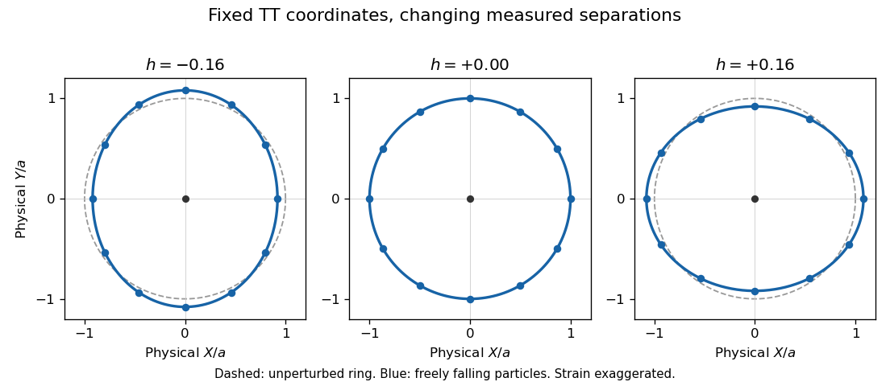

<h1 id="3/c/solution">Solution</h1>

↑ **Parent:** [C](../c.md)

Take the real physical wave and write $h(t,z)=A\cos[k(z-ct)]$. The specified amplitude has zero trace, so its [metric perturbation](../../../../linearized-gravity-split.md) equals its [trace-reversed metric perturbation](../../../../trace-reversed-metric-perturbation.md). It is in [transverse-traceless gauge](../../../../transverse-traceless-gauge.md):

$$
ds^2=-c^2dt^2+[1+h(t,z)]dx^2+[1-h(t,z)]dy^2+dz^2
$$

to first order. Assume the freely falling particles are initially at rest in these coordinates. Since $g_{00}=-1$ and $g_{0i}=0$ in coordinates $(ct,x,y,z)$,

$$
\Gamma^i{}_{00}
=\frac12g^{ij}(2\partial_0g_{0j}-\partial_jg_{00})=0.
$$

The [geodesic equations](../../../../geodesic-equation.md) therefore admit

$$
\boxed{x=x_0,\qquad y=y_0,\qquad z=z_0,\qquad t=\tau.}
$$

Uniqueness preserves these initial conditions. Thus the coordinate locations remain fixed; this conclusion does not apply to arbitrary initially moving particles.

Coordinate position is not measured separation. In the central observer's local [orthonormal frame in spacetime](../../../../orthonormal-frame-in-spacetime.md), and in the long-wavelength limit appropriate to a small detector, the transverse physical separations are

$$
X=\left(1+\frac h2\right)x,\qquad
Y=\left(1-\frac h2\right)y
$$

to first order. In particular the two principal semiaxes of the ring are

$$
\boxed{
a_x=a\left(1+\frac h2\right),\qquad
a_y=a\left(1-\frac h2\right).
}
$$

For a point at angular position $\varphi$ the radial displacement is

$$
\delta\ell(\varphi,t)=\frac{a h(t,z_0)}2\cos(2\varphi).
$$

The [freely falling ring in transverse-traceless gauge](../../../../freely-falling-ring-in-transverse-traceless-gauge.md) alternates between ellipses elongated in the $x$ and $y$ directions. Its area is unchanged to first order. This is the plus [gravitational wave polarization](../../../../gravitational-wave-polarization.md); the axes exchange their roles after half a period.

**[Figure 1](#3/c/image-physical-distances-in-a-freely-falling-ring-under-plus-polarization-with-exaggerated-strain). Physical distances in a freely falling ring under plus polarization, with exaggerated strain**.

An observer at the center detects these changing distances, for example by exchanging light signals with the particles. Equivalently [geodesic deviation](../../../../geodesic-deviation.md) gives the local [tidal acceleration](../../../../tidal-acceleration.md)

$$
\ddot X=\frac12\ddot h\,X,\qquad
\ddot Y=-\frac12\ddot h\,Y
$$

to the same order. There is physical relative motion and nonzero [Riemann curvature tensor](../../../../riemann-curvature-tensor-split.md), even though the selected coordinate positions are constant. For a detector comparable to a wavelength, its light-travel-time response must be included rather than treating all distances as simultaneously measured local lengths.

## ↑ Ancestors (12)

1. [C](../c.md)
2. [3](../../3.md)
3. [2017](../../../2017-split.md)
4. [Past exam of the general relativity and cosmology course of the University of Oxford](../../../split.md)
5. [General relativity and cosmology course of the University of Oxford](../../../../general-relativity-and-cosmology-course-of-the-university-of-oxford.md)
6. [Year 3 of the physics course of the University of Oxford](../../../../year-3-of-the-physics-course-of-the-university-of-oxford.md)
7. [Physics course of the University of Oxford](../../../../physics-course-of-the-university-of-oxford.md)
8. [Undergraduate course of the University of Oxford](../../../../undergraduate-course-of-the-university-of-oxford.md)
9. [Course of the University of Oxford](../../../../course-of-the-university-of-oxford.md)
10. [University of Oxford](../../../../university-of-oxford-split.md)
11. [List of universities](../../../../list-of-universities.md)
12. [Codex Wiki](../../../../split.md)
