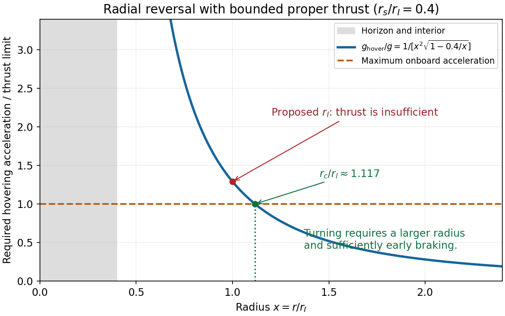
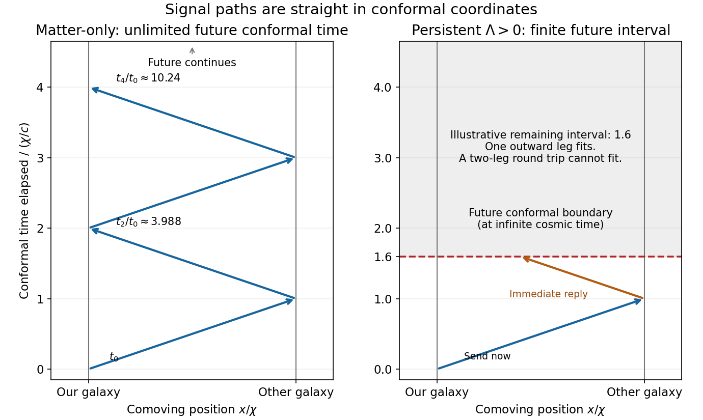

# 2018

↑ **Parent:** [Past exam of the general relativity and cosmology course of the University of Oxford](../past-exam-of-the-general-relativity-and-cosmology-course-of-the-university-of-oxford.md)

Source paper: [https://www-thphys.physics.ox.ac.uk/people/AndreiStarinets/TUTORIALS_NOTES_GR/gr_cosmology_exam_paper_2018.pdf](https://www-thphys.physics.ox.ac.uk/people/AndreiStarinets/TUTORIALS_NOTES_GR/gr_cosmology_exam_paper_2018.pdf)

**Table of contents**

- [1](#1)
  - [a](#1/a)
    - [Solution](#1/a/solution)
  - [b](#1/b)
    - [Solution](#1/b/solution)
  - [c](#1/c)
    - [Solution](#1/c/solution)
  - [d](#1/d)
    - [Solution](#1/d/solution)
  - [e](#1/e)
    - [Solution](#1/e/solution)
- [2](#2)
  - [a](#2/a)
    - [Solution](#2/a/solution)
  - [b](#2/b)
    - [Solution](#2/b/solution)
  - [c](#2/c)
    - [Solution](#2/c/solution)
- [3](#3)
  - [a](#3/a)
    - [Solution](#3/a/solution)
  - [b](#3/b)
    - [Solution](#3/b/solution)
  - [c](#3/c)
    - [Solution](#3/c/solution)
  - [d](#3/d)
    - [Solution](#3/d/solution)
  - [e](#3/e)
    - [Solution](#3/e/solution)
- [4](#4)
  - [a](#4/a)
    - [Solution](#4/a/solution)
  - [b](#4/b)
    - [Solution](#4/b/solution)
  - [c](#4/c)
    - [Solution](#4/c/solution)
  - [d](#4/d)
    - [Solution](#4/d/solution)
  - [e](#4/e)
    - [Solution](#4/e/solution)

## 1

↑ **Parent:** [2018](2018.md)

<h3 id="1/a">a</h3>

↑ **Parent:** [1](#1)

<h4 id="1/a/solution">Solution</h4>

↑ **Parent:** [A](#1/a)

The [strong equivalence principle](../general-relativity.md#strong-equivalence-principle) extends universality of [free fall](../newton-s-law-of-universal-gravitation.md#free-fall) to bodies with appreciable gravitational self-energy, and states that the outcome of any local experiment, including a gravitational experiment, in a freely falling laboratory is independent of its location and [velocity](../classical-mechanics.md#velocity). In a sufficiently small freely falling laboratory the external gravitational influence can be removed to first order by choosing a [local inertial frame](../mathematical-physics.md#local-inertial-frame).

This does not remove [tidal forces](../newton-s-law-of-universal-gravitation.md#tidal-force) or the [Riemann curvature tensor](../riemann-curvature-tensor.md). The laboratory must be small compared with the length scale over which the external gravitational field varies. These qualifications distinguish a local equivalence statement from the incorrect assertion that gravity can be transformed away throughout an extended curved region.

<h3 id="1/b">b</h3>

↑ **Parent:** [1](#1)

<h4 id="1/b/solution">Solution</h4>

↑ **Parent:** [B](#1/b)

In general coordinates the basis changes along the [world line](../special-relativity.md#world-line). Differentiating only the components of a [vector](../vector-space.md#vector) omits that basis change, and does not transform as a [vector](../vector-space.md#vector) under a position-dependent coordinate transformation. The appropriate rate is the [covariant derivative along a curve](../vector-bundle.md#covariant-derivative-along-a-curve):

$$
\boxed{\frac{DV^\alpha}{d\lambda}
=\frac{dV^\alpha}{d\lambda}
+\Gamma^\alpha{}_{\beta\gamma}\frac{dx^\beta}{d\lambda}V^\gamma.}
$$

For the metric-compatible torsion-free connection, the [Christoffel symbols](../riemannian-geometry.md#christoffel-symbol) are determined by the [metric tensor](../general-relativity.md#metric-tensor) and its first derivatives:

$$
\Gamma^\alpha{}_{\beta\gamma}
=\frac12g^{\alpha\delta}(\partial_\beta g_{\delta\gamma}
+\partial_\gamma g_{\delta\beta}-\partial_\delta g_{\beta\gamma}).
$$

Thus the ship's [four-acceleration](../special-relativity.md#four-acceleration) is

$$
\boxed{a^\alpha=\frac{Du^\alpha}{d\tau}
=\frac{du^\alpha}{d\tau}+\Gamma^\alpha{}_{\beta\gamma}u^\beta u^\gamma.}
$$

In Cartesian coordinates of an [inertial frame](../mathematical-physics.md#inertial-frame) in flat [spacetime](../special-relativity.md#spacetime), the connection coefficients vanish and the ordinary component derivative happens to suffice. In curved [spacetime](../special-relativity.md#spacetime) it suffices at a chosen event in a [local inertial frame](../mathematical-physics.md#local-inertial-frame), but not generally along an extended trajectory.

<h3 id="1/c">c</h3>

↑ **Parent:** [1](#1)

<h4 id="1/c/solution">Solution</h4>

↑ **Parent:** [C](#1/c)

Use [metric signature](../topological-manifold.md#metric-signature) $(-,+,+,+)$ and $x^0=ct$. At an event in the ship's instantaneous rest [local inertial frame](../mathematical-physics.md#local-inertial-frame), $u^\alpha=(c,0,0,0)$. Since its squared norm is a scalar,

$$
\boxed{u^\alpha u_\alpha=-c^2}
$$

in every coordinate system. Equivalently it follows directly from $ds^2=-c^2d\tau^2$ and $u^\alpha=dx^\alpha/d\tau$.

[Metric compatibility](../vector-bundle.md#metric-compatibility) lets us differentiate this identity covariantly:

$$
0=\frac D{d\tau}(g_{\alpha\beta}u^\alpha u^\beta)
=2u_\alpha a^\alpha,
\qquad\boxed{u_\alpha a^\alpha=0.}
$$

In the instantaneous rest [local inertial frame](../mathematical-physics.md#local-inertial-frame), the last equation gives $a^0=0$. The spatial components are the acceleration recorded by an onboard accelerometer, $\mathbf a_{\rm rest}$, whose magnitude is $g$. Therefore

$$
\boxed{a^\alpha a_\alpha=|\mathbf a_{\rm rest}|^2=g^2.}
$$

This [proper acceleration](../special-relativity.md#proper-acceleration) is zero in ideal [free fall](../newton-s-law-of-universal-gravitation.md#free-fall), even when the coordinate position has a nonzero second derivative. A coordinate acceleration and an accelerometer reading are different quantities.

<h3 id="1/d">d</h3>

↑ **Parent:** [1](#1)

<h4 id="1/d/solution">Solution</h4>

↑ **Parent:** [D](#1/d)

Put $F(r)=1-r_s/r$ and $r_s=2GM/c^2$. For radial motion $u^\theta=u^\phi=0$. The given [Christoffel symbols](../riemannian-geometry.md#christoffel-symbol) imply

$$
\boxed{a^0=\frac{du^0}{d\tau}
+\frac{2GM}{c^2r^2F}u^0u^r,}
$$

and

$$
\boxed{a^r=\frac{du^r}{d\tau}
+\frac{GM}{c^2r^2}\left[F(u^0)^2-F^{-1}(u^r)^2\right].}
$$

The [four-velocity](../special-relativity.md#four-velocity) normalization of part [c](#1/c) is

$$
-F(u^0)^2+F^{-1}(u^r)^2=-c^2.
$$

Its bracketed combination is therefore exactly $c^2$, independently of the instantaneous [velocity](../classical-mechanics.md#velocity) or the thrust history. Consequently

$$
\boxed{a^r=\frac{du^r}{d\tau}+\frac{GM}{r^2}.}
$$

The derivative here is with respect to [proper time](../special-relativity.md#proper-time). This expression does not say that the ship measures a gravitational acceleration $GM/r^2$ during [free fall](../newton-s-law-of-universal-gravitation.md#free-fall); setting $a^r=0$ gives its radial proper-time equation of motion in [Schwarzschild spacetime](../schwarzschild-spacetime.md).

<h3 id="1/e">e</h3>

↑ **Parent:** [1](#1)

<h4 id="1/e/solution">Solution</h4>

↑ **Parent:** [E](#1/e)

For radial motion outside the [Schwarzschild event horizon](../schwarzschild-spacetime.md#schwarzschild-event-horizon), the equations needed to determine the acceleration components are

$$
\boxed{\begin{aligned}
-F(u^0)^2+F^{-1}(u^r)^2&=-c^2,\\
-Fu^0a^0+F^{-1}u^ra^r&=0,\\
-F(a^0)^2+F^{-1}(a^r)^2&=g^2.
\end{aligned}}
$$

They are respectively the [four-velocity](../special-relativity.md#four-velocity) norm, velocity-acceleration orthogonality, and the maximum [proper acceleration](../special-relativity.md#proper-acceleration) norm. Together with part [d](#1/d) they give the stated thrust equation; no integration of the trajectory is required. The positive radial sign corresponds to outward thrust.

Let $r_I=\sqrt{GM/g}$. A first transition from inward to outward motion requires $u^r=0$ at a minimum radius and $du^r/d\tau\ge0$ there. The largest possible radial derivative at such an event is

$$
\left.\frac{du^r}{d\tau}\right|_{u^r=0}
=g\sqrt{1-r_s/r}-\frac{GM}{r^2}.
$$

At $r=r_I>r_s$, this is

$$
\boxed{\left.\frac{du^r}{d\tau}\right|_{r_I,u^r=0}
=g\left[\sqrt{1-r_s/r_I}-1\right]<0.}
$$

Thus the ship cannot reverse its inward motion there. It cannot reverse at any smaller exterior radius either: $GM/r^2$ grows while $\sqrt{1-r_s/r}$ decreases. If it first reaches $r_I$ while falling inward, **it cannot return home using the stipulated bounded radial thrust**. If $r_I\le r_s$, it would instead have reached the black-hole horizon before that radius, which already prevents escape.

The [minimum radius for radial turnaround with bounded proper acceleration](../schwarzschild-spacetime.md#minimum-radius-for-radial-turnaround-with-bounded-proper-acceleration) lies strictly outside the proposed radius. Define $r_c>r_s$ by

$$
\boxed{g=\frac{GM}{r_c^2\sqrt{1-r_s/r_c}}.}
$$

The right side is the [proper acceleration](../special-relativity.md#proper-acceleration) required to hover, decreases monotonically from infinity to zero, and exceeds $GM/r^2$. A genuine turnaround needs $r_{\rm turn}>r_c>r_I$; equality gives no positive initial outward acceleration at rest. A sufficiently early burn is also needed to remove the pre-existing inward [velocity](../classical-mechanics.md#velocity). The failure at $r_I$ follows from the turning-point condition, not from treating the moving ship as static throughout its fall.

**[Figure 1](#1/e/image-the-newtonian-proposed-radius-lies-inside-the-bounded-thrust-turnaround-limit). The Newtonian proposed radius lies inside the bounded-thrust turnaround limit**. For the illustrative ratio rs/rI equal to 0.4, the curve is the required hovering proper acceleration divided by the maximum onboard acceleration. At rI it exceeds one. Its crossing with one determines the critical radius rc; the outer side is necessary for radial reversal. The black-hole interior is excluded from this static-coordinate comparison.

## 2

↑ **Parent:** [2018](2018.md)

<h3 id="2/a">a</h3>

↑ **Parent:** [2](#2)

<h4 id="2/a/solution">Solution</h4>

↑ **Parent:** [A](#2/a)

In coordinates $(ct,r,\phi,z)$ the diagonal [metric tensor](../general-relativity.md#metric-tensor) is $\operatorname{diag}(-1,1,f^2,1)$, and only $g_{\phi\phi}$ depends on position. Substitution into the connection formula gives

$$
\boxed{\Gamma^r{}_{\phi\phi}=-ff',\qquad
\Gamma^\phi{}_{r\phi}=\Gamma^\phi{}_{\phi r}=\frac{f'}f,}
$$

with all other [Christoffel symbols](../riemannian-geometry.md#christoffel-symbol) zero away from singular axes.

Use the explicit [Ricci tensor](../riemann-curvature-tensor.md#ricci-tensor) formula and the [Einstein equation](../einstein-field-equations.md) sign printed on the source formula sheet. They give

$$
R_{rr}=\frac{f''}f,\qquad R_{\phi\phi}=ff'',\qquad
\mathcal R=g^{\alpha\beta}R_{\alpha\beta}=2\frac{f''}f.
$$

For example, in $R_{rr}$ the two terms proportional to $(f'/f)^2$ cancel. For $R_{\phi\phi}$ the derivative of $-ff'$ contributes $(f')^2+ff''$, the product terms contribute $-2(f')^2$, and the determinant term contributes $(f')^2$.

**Formula-sheet qualification.** Directly contracting the separately printed [Riemann curvature tensor](../riemann-curvature-tensor.md) as instructed on that sheet instead gives $R_{rr}=-f''/f$, the opposite sign. For the concrete example $f(r)=\ell\sin(r/\ell)$, that contraction gives $+1/\ell^2$, whereas the explicit [Ricci tensor](../riemann-curvature-tensor.md#ricci-tensor) formula gives $-1/\ell^2$. The two source formulas cannot both hold with the stated contraction. The calculation here uses the explicit [Ricci tensor](../riemann-curvature-tensor.md#ricci-tensor) formula, whose pairing with the negative [Einstein equation](../einstein-field-equations.md) coupling yields the requested [stress-energy tensor](../stress-energy-tensor.md).

The desired matter tensor assumes $\Lambda=0$; otherwise the cosmological-constant contribution must also be included. With that assumption,

$$
T_{\alpha\beta}=-\frac{c^4}{8\pi G}
\left(R_{\alpha\beta}-\frac12g_{\alpha\beta}\mathcal R\right),
$$

and raising both indices gives

$$
\boxed{T^{\alpha\beta}=\frac{c^4}{8\pi G}\frac{f''}f
\operatorname{diag}(-1,0,0,1).}
$$

The static observer measures [energy density](../statistical-physics.md#energy-density) $T^{00}=-c^4f''/(8\pi Gf)$ and equal-magnitude negative axial [pressure](../pressure.md) when that energy is positive. The axial stress is a tension. Keeping the source's curvature sign and its negative Einstein-equation coupling together is essential to this result.

<h3 id="2/b">b</h3>

↑ **Parent:** [2](#2)

<h4 id="2/b/solution">Solution</h4>

↑ **Parent:** [B](#2/b)

Assume $\phi$ has period $2\pi$, $f>0$ in the regular bulk, and consider a unit proper length in $z$. The proper transverse area element is $dA=f\,dr\,d\phi$, while the mass density is $T^{00}/c^2$. The [axial boundary term in the mass of a cylindrical spacetime](../cosmology.md#axial-boundary-term-in-the-mass-of-a-cylindrical-spacetime) is therefore

$$
\boxed{\mu_{\rm bulk}=\int_0^R\frac{T^{00}}{c^2}\,2\pi f\,dr
=-\frac{c^2}{4G}\int_0^Rf''\,dr
=\frac{c^2}{4G}[f'(0^+)-f'(R^-)].}
$$

Choose the usual deficit branch $0\le\lambda<1$, so $f_{\rm out}=(1-\lambda)r$. Continuity of the induced metric requires $f(R^-)=(1-\lambda)R$. If there is no distributional thin shell at $R$, continuity of the [extrinsic curvature](../smooth-manifold.md#extrinsic-curvature) also requires $f'(R^-)=1-\lambda$. A jump in $f'$ would add a surface-layer stress and cannot simply be discarded.

**Using the printed inner condition** $f'(0^+)=0$, these assumptions yield

$$
\boxed{\mu_{\rm bulk}=\frac{c^2}{4G}(\lambda-1).}
$$

This is the literal smooth-bulk answer. It is negative for the ordinary deficit range, so it must not be silently replaced by the usual positive cosmic-string mass formula.

For comparison, a regular axis with proper radial coordinate and angular period $2\pi$ requires $f(0)=0$ and $f'(0)=1$, since the circumference-to-radius ratio must approach $2\pi$. Under that different regular-axis condition the same integral gives

$$
\boxed{\mu_{\rm regular}=\frac{\lambda c^2}{4G},\qquad
\delta=2\pi\lambda=\frac{8\pi G\mu_{\rm regular}}{c^2}.}
$$

The original PDF really prints the derivative limit zero. It describes either a nonregular axis or an inner geometry different from an ordinary smooth string core; any additional singular-axis matter is not included in the bulk integral above and would need its own stress specification. Standard regular-core matching can also require an offset in the exterior radial origin. Thus the regular-axis formula is a qualified physical interpretation, not a derivation from the printed zero. For a general exterior branch replace $1-\lambda$ by $|1-\lambda|$ in the boundary derivative.

<h3 id="2/c">c</h3>

↑ **Parent:** [2](#2)

<h4 id="2/c/solution">Solution</h4>

↑ **Parent:** [C](#2/c)

Outside the core, $f''=0$ and the metric is locally flat: set $\widetilde\phi=(1-\lambda)\phi$. Static test particles have no Newtonian-like attraction because $g_{00}$ is constant and $\Gamma^r{}_{00}=0$. Local trajectories are straight lines in locally unwrapped coordinates, so a very thin dark core is hard to identify through ordinary orbital accelerations or local [tidal forces](../newton-s-law-of-universal-gravitation.md#tidal-force).

The global angular range is nevertheless $2\pi(1-\lambda)$ rather than $2\pi$. The missing angle $\delta=2\pi\lambda$ can give [gravitational lensing](../gravitational-lensing.md) with two nearly identical, essentially undistorted images of a background galaxy, and multiple such pairs aligned along the projected object. For a small deficit, a straight string and favourable geometry, their angular separation is of order $\delta D_{ls}/D_s$, with an additional inclination factor for a tilted string. The matching spectra and common line of image pairs distinguish this from an ordinary compact lens.

A moving [cosmic string](../cosmology.md#cosmic-string) can also induce a step in the [cosmic microwave background](../cosmic-microwave-background.md) [temperature](../temperature.md) across its path. That signature needs motion in addition to the static geometry supplied here. These are consequences of the exterior conical geometry; interpreting the inferred deficit as a positive mass per length requires the regular-axis/core assumptions distinguished in part [b](#2/b).

## 3

↑ **Parent:** [2018](2018.md)

<h3 id="3/a">a</h3>

↑ **Parent:** [3](#3)

<h4 id="3/a/solution">Solution</h4>

↑ **Parent:** [A](#3/a)

The [cosmic distance ladder](../cosmology.md#cosmic-distance-ladder) starts by calibrating a physical baseline. Radar echoes from planets or spacecraft give a round-trip light time and hence a distance $d=c\Delta t/2$, after accounting for orbital motion and propagation delays. Combining this with orbital geometry fixes the Earth-Sun orbital scale; directly timing a reflected pulse from the solar surface is not required.

That baseline supplies annual [stellar parallax](../astrophysics.md#stellar-parallax): for small parallax angle $p$, $d\simeq b/p$, or $d$ in parsecs equals $1/p$ when $p$ is in arcseconds and $b$ is one astronomical unit. Nearby parallax distances calibrate stellar [absolute magnitudes](../astrophysics.md#absolute-magnitude). [Main-sequence fitting](../cosmology.md#main-sequence-fitting) extends the scale to star clusters, and the calibrated [Cepheid period-luminosity relation](../stellar-astrophysics.md#cepheid-period-luminosity-relation) gives [luminosities](../astrophysics.md#luminosity) for Cepheids visible in nearby galaxies.

Cepheid-host galaxies then calibrate [Type Ia supernovae](../stellar-astrophysics.md#type-ia-supernova). After light-curve and colour standardization, their high [luminosities](../astrophysics.md#luminosity) permit distances to much more remote galaxies. For a source of calibrated [luminosity](../astrophysics.md#luminosity) $L$ and observed bolometric flux $F$,

$$
\boxed{d_L=\sqrt{\frac{L}{4\pi F}},\qquad
m-M=5\log_{10}\left(\frac{d_L}{10\,\mathrm{pc}}\right)}
$$

with consistent bandpass definitions and corrections. [Interstellar extinction](../galaxy.md#interstellar-extinction), composition, stellar-population differences and calibration uncertainty must be propagated through the steps. Redshift can subsequently provide a distance within a fitted cosmological model; using it alone cannot independently calibrate the [Hubble constant](../cosmology.md#hubble-constant).

<h3 id="3/b">b</h3>

↑ **Parent:** [3](#3)

<h4 id="3/b/solution">Solution</h4>

↑ **Parent:** [B](#3/b)

Normalize the [scale factor](../cosmology.md#scale-factor-cosmology) to $a(t)=R(t)/R(t_0)$, with $a(t_0)=1$. Along a radial [null geodesic](../special-relativity.md#null-geodesic), $d\chi=c\,dt/a(t)$. Two successive wave crests sent by the same comoving emitter and received by the same comoving observer traverse the same [comoving distance](../cosmology.md#comoving-radial-distance), so

$$
\int_{t_e}^{t_0}\frac{c\,dt}{a(t)}
=\int_{t_e+\delta t_e}^{t_0+\delta t_0}\frac{c\,dt}{a(t)}.
$$

To first order, $\delta t_0/a(t_0)=\delta t_e/a(t_e)$. Frequencies are inverse proper periods for the [comoving observers](../cosmology.md#comoving-observer), giving the [cosmological redshift](../cosmology.md#cosmological-redshift)

$$
\boxed{1+z=\frac{\lambda_0}{\lambda_e}
=\frac{R(t_0)}{R(t_e)}=\frac1{a(t_e)}.}
$$

Expansion stretches wavelengths, so a spectral line of known rest wavelength gives $z=\lambda_{\rm obs}/\lambda_{\rm rest}-1$.

At small $z$, the light travel time is short compared with the expansion time. Expanding $R(t_e)$ gives $z\simeq H_0(t_0-t_e)$ and $d\simeq c(t_0-t_e)$, hence

$$
\boxed{cz\simeq H_0d,\qquad H_0=\left.\frac{\dot R}{R}\right|_{t_0}.}
$$

Combine independently calibrated [luminosity distances](../cosmology.md#luminosity-distance) with galaxy spectral redshifts and fit the slope. Nearby peculiar velocities must be allowed for, while high-redshift data require the full distance-redshift relation rather than the linear approximation.

<h3 id="3/c">c</h3>

↑ **Parent:** [3](#3)

<h4 id="3/c/solution">Solution</h4>

↑ **Parent:** [C](#3/c)

Use standardized [Type Ia supernovae](../stellar-astrophysics.md#type-ia-supernova) as distance indicators and measure their redshifts. The curvature of the luminosity-distance relation constrains the [deceleration parameter](../cosmology.md#deceleration-parameter):

$$
\boxed{d_L(z)=\frac c{H_0}\left[z+\frac{1-q_0}{2}z^2+O(z^3)\right],\qquad
q_0=-\frac{\ddot R(t_0)}{R(t_0)H_0^2}.}
$$

Fainter supernovae at a given redshift imply larger distances, and comparison with the predicted curve tests accelerated expansion. In practice one fits the full expansion history over the observed redshift range and controls [luminosity](../astrophysics.md#luminosity) evolution, extinction and calibration, rather than relying only on a short low-$z$ series.

The [cosmological fate from local expansion data](../cosmology.md#cosmological-fate-from-local-expansion-data) is conditional on a matter model. For the spatially flat model of part [b](#3/b), if the only relevant components are pressureless matter and a constant $\Lambda$, put $A_0=\ddot R(t_0)/R(t_0)$. The two [Friedmann equations](../cosmology.md#friedmann-equations) give

$$
\boxed{\rho_{m0}=\frac{H_0^2-A_0}{4\pi G},\qquad
\Lambda c^2=H_0^2+2A_0.}
$$

Here $\Lambda$ follows the sign of the supplied [Friedmann equations](../cosmology.md#friedmann-equations), where positive $\Lambda$ contributes positive acceleration. These fix the parameters governing subsequent evolution. Positive $\Lambda$ yields eternal late-time accelerated expansion; zero $\Lambda$ gives the flat matter solution; negative $\Lambda$ leads to eventual recollapse in this dust model. If instead one assumes dust and zero $\Lambda$ while allowing curvature, $q_0=\Omega_{m0}/2$ determines whether the matter universe is closed and recollapsing or expands indefinitely.

Without a fixed [equation of state](../pressure.md#equation-of-state) and its future evolution, two present derivatives do **not** uniquely fix the future. For a concrete counterexample in units with $t_0=0$, the positive scale factors $a_+(t)=1+t+t^2/2$ and $a_-(t)=1+t+t^2/2-t^3$ have the same $a,\dot a,\ddot a$ now. The former expands forever; the latter turns around and later reaches zero. Different time-dependent matter stresses can support their different flat expansion histories. Thus the printed sufficiency statement needs the cosmological-model assumption.

<h3 id="3/d">d</h3>

↑ **Parent:** [3](#3)

<h4 id="3/d/solution">Solution</h4>

↑ **Parent:** [D](#3/d)

In an [Einstein-de Sitter universe](../large-scale-structure-of-the-universe.md#einstein-de-sitter-universe), take $a(t)=(t/t_0)^{2/3}$ and $t_0=2/(3H_0)$. The galaxy seen today at $z=1$ emitted the light now reaching us when $a(t_e)=1/2$, so $t_e/t_0=2^{-3/2}$. Its fixed [comoving radial distance](../cosmology.md#comoving-radial-distance) is

$$
\chi=c\int_{t_e}^{t_0}\frac{dt}{a(t)}
=3ct_0\left(1-\frac1{\sqrt2}\right).
$$

Put $b=1-1/\sqrt2$. A new message sent now reaches the galaxy at $t_1$, where

$$
\chi=3ct_0[(t_1/t_0)^{1/3}-1],\qquad
\frac{t_1}{t_0}=(1+b)^3.
$$

Assume an immediate reply and negligible local handling delays. The return consumes the same additional [conformal time](../cosmology.md#conformal-time), giving the [Einstein-de Sitter round-trip message time](../general-relativity.md#einstein-de-sitter-round-trip-message-time)

$$
\boxed{\frac{t_2}{t_0}=(1+2b)^3=(3-\sqrt2)^3\simeq3.98781,\qquad
\Delta t=t_2-t_0\simeq2.98781t_0=\frac{1.99187}{H_0}.}
$$

For the numerical value $H_0=72\,\mathrm{km\,s^{-1}\,Mpc^{-1}}$ supplied later in the paper, $H_0^{-1}=13.58\,\mathrm{Gyr}$ and the waiting time is about $27.1\,\mathrm{Gyr}$. The age $t_0=9.05\,\mathrm{Gyr}$ here belongs to the stipulated matter-only model, not a claim about the actual measured cosmic age.

After $n$ one-way legs, $t_n=t_0(1+nb)^3$. Since $\int_{t_0}^{\infty}dt/a(t)=\infty$, every finite number of messages is possible and there is no finite fundamental upper count. The exchange takes arbitrarily long, with successively longer intervals; infinitely many messages are not completed in finite cosmic time.

**[Figure 2](#3/d/image-message-exchange-depends-on-the-remaining-conformal-time-not-just-the-present-expansion-rate). Message exchange depends on the remaining conformal time, not just the present expansion rate**. The left conformal spacetime diagram shows repeated light-signal legs between two comoving galaxies in an Einstein-de Sitter model. The right diagram illustrates a finite future conformal interval: one outward leg fits but a complete round trip does not. The right interval is a schematic example, not a parameter estimate for our Universe.

<h3 id="3/e">e</h3>

↑ **Parent:** [3](#3)

<h4 id="3/e/solution">Solution</h4>

↑ **Parent:** [E](#3/e)

Spatial flatness constrains the total density, not matter alone. A flat model can have

$$
\boxed{\Omega_{m0}+\Omega_{\Lambda0}+\Omega_{r0}=1}
$$

with a substantial [dark energy](../cosmology.md#dark-energy) component. A positive [cosmological constant](../cosmology.md#cosmological-constant) has [pressure](../pressure.md) $p_\Lambda=-\rho_\Lambda c^2$ and does not dilute like matter; it can produce the observed accelerated expansion.

If positive $\Lambda$ persists, $a(t)$ becomes exponential and the future [conformal time](../cosmology.md#conformal-time) interval

$$
\Delta\eta_{\rm future}=\int_{t_0}^{\infty}\frac{dt}{a(t)}
$$

is finite. For two comoving civilisations separated by $\chi$, each one-way signal consumes $\chi/c$. Thus a message completing $n$ legs at finite time requires

$$
\boxed{n\frac\chi c<\Delta\eta_{\rm future}.}
$$

Only finitely many legs, and hence finitely many full exchanges, can then occur. A reply to even the first new message requires $2\chi/c<\Delta\eta_{\rm future}$, the [cosmological round-trip communication horizon](../general-relativity.md#cosmological-round-trip-communication-horizon) condition. Depending on the density parameters, the initial outward message might arrive while its reply can never reach us, as in the right-hand panel of part [d](#3/d).

The source gives no matter and dark-energy fractions, so it does not specify an exact count for the $z=1$ pair in the real Universe. Flatness and lack of matter dominance alone do not prove a finite horizon: a radiation-dominated flat universe, for example, has divergent future [conformal time](../cosmology.md#conformal-time) if that power-law expansion persists. The finite-message conclusion uses persistent accelerated expansion such as positive constant $\Lambda$.

## 4

↑ **Parent:** [2018](2018.md)

<h3 id="4/a">a</h3>

↑ **Parent:** [4](#4)

<h4 id="4/a/solution">Solution</h4>

↑ **Parent:** [A](#4/a)

For a [photon gas](../statistical-physics.md#photon-gas) in thermal and [chemical equilibrium](../chemical-potential.md#chemical-equilibrium), [photon](../quantum-mechanics.md#photon) number is not a conserved thermodynamic charge. Number-changing processes can create and absorb [photons](../quantum-mechanics.md#photon) without a corresponding conserved-number constraint, so the equilibrium [photon chemical potential](../chemical-potential.md#photon-chemical-potential) is zero.

At $T=5\times10^9\,\mathrm K$, $k_{\rm B}T\simeq0.431\,\mathrm{MeV}$. The other light species are [electrons](../physics.md#electron), [Positrons](../physics.md#positron), three [neutrino](../standard-model.md#neutrino) species and their antiparticles. [Neutrinos](../standard-model.md#neutrino) are [ultrarelativistic](../special-relativity.md#ultrarelativistic-particle); [electrons](../physics.md#electron) and [Positrons](../physics.md#positron) are only moderately relativistic at this particular [temperature](../temperature.md) because $m_ec^2=0.511\,\mathrm{MeV}$. The later simple counting formulas use the intended [ultrarelativistic](../special-relativity.md#ultrarelativistic-particle) approximation for them. Baryons, muons and heavier particles are not an abundant relativistic bath at this [temperature](../temperature.md).

Pair equilibrium implies $\mu_{e^-}+\mu_{e^+}=2\mu_\gamma=0$. Approximate charge symmetry, with the net [electron](../physics.md#electron) excess tied to the much smaller baryon asymmetry, then makes both [electron](../physics.md#electron) and [Positron](../physics.md#positron) [chemical potentials](../chemical-potential.md) small compared with $k_{\rm B}T$. For [neutrinos](../standard-model.md#neutrino) one additionally assumes negligible lepton asymmetry. Their near-zero [chemical potentials](../chemical-potential.md) are not implied merely by their statistics. After [neutrino decoupling](../cosmology.md#neutrino-decoupling), a distribution initially having negligible [chemical potential](../chemical-potential.md) retains a redshifted [Fermi-Dirac distribution](../quantum-ideal-gas-statistics.md#fermi-dirac-distribution), with its own [temperature](../temperature.md).

<h3 id="4/b">b</h3>

↑ **Parent:** [4](#4)

<h4 id="4/b/solution">Solution</h4>

↑ **Parent:** [B](#4/b)

Let $V$ be proper volume, let $g_i$ count the populated internal states, and take $\mu_i=0$ and $\epsilon=pc$. Spherical integration in momentum space gives

$$
\frac{N_i}{V}=\frac{g_i}{2\pi^2}\left(\frac{k_{\rm B}T}{\hbar c}\right)^3
\int_0^\infty\frac{x^2\,dx}{e^x\mp1},\qquad x=\frac{pc}{k_{\rm B}T}.
$$

Using the [fermion-to-boson thermal integral ratio](../quantum-ideal-gas-statistics.md#fermion-to-boson-thermal-integral-ratio), the minus-denominator [boson](../tensor-product-of-quantum-systems.md#boson) integral is $2\zeta(3)$ and the plus-denominator [fermion](../tensor-product-of-quantum-systems.md#fermion) integral is $3\zeta(3)/2$. Hence

$$
\boxed{N_B=\frac{g_B\zeta(3)}{\pi^2}V\left(\frac{k_{\rm B}T}{\hbar c}\right)^3,\qquad
N_F=\frac34\frac{g_F\zeta(3)}{\pi^2}V\left(\frac{k_{\rm B}T}{\hbar c}\right)^3.}
$$

The energy integral has one extra factor $pc=k_{\rm B}Tx$:

$$
\frac{U_i}{V}=\frac{g_i}{2\pi^2}\frac{(k_{\rm B}T)^4}{(\hbar c)^3}
\int_0^\infty\frac{x^3\,dx}{e^x\mp1}.
$$

The supplied distribution identity gives the [fermion](../tensor-product-of-quantum-systems.md#fermion) integral as $(1-2^{-3})\pi^4/15=7\pi^4/120$. Therefore

$$
\boxed{U_B=\frac{g_B\pi^2}{30}V\frac{(k_{\rm B}T)^4}{(\hbar c)^3},\qquad
U_F=\frac78\frac{g_F\pi^2}{30}V\frac{(k_{\rm B}T)^4}{(\hbar c)^3}.}
$$

For an isotropic [ultrarelativistic](../special-relativity.md#ultrarelativistic-particle) gas, momentum flux gives $P_i=\tfrac13\int p v f_i\,d^3p$. Since $v=c$ and $pc=\epsilon$,

$$
\boxed{P_i=\frac{U_i}{3V}.}
$$

[Photons](../quantum-mechanics.md#photon) have $g_\gamma=2$, [electrons](../physics.md#electron) and [Positrons](../physics.md#positron) each have $g=2$, and each [neutrino](../standard-model.md#neutrino) or antineutrino species has one populated [helicity](../special-relativity.md#helicity) in the standard thermal bath.

<h3 id="4/c">c</h3>

↑ **Parent:** [4](#4)

<h4 id="4/c/solution">Solution</h4>

↑ **Parent:** [C](#4/c)

For zero [chemical potential](../chemical-potential.md), each species contributes $S_i=(U_i+P_iV)/T=4U_i/(3T)$. Thus

$$
\boxed{\frac{S_B}{V}=\frac{2\pi^2}{45}g_Bk_{\rm B}
\left(\frac{k_{\rm B}T}{\hbar c}\right)^3,\qquad
\frac{S_F}{V}=\frac78\frac{2\pi^2}{45}g_Fk_{\rm B}
\left(\frac{k_{\rm B}T}{\hbar c}\right)^3.}
$$

[Entropy density](../entropy.md#entropy-density) scales as $T^3$ at fixed relativistic particle content; total [entropy](../entropy.md) also includes the changing proper volume. An isolated adiabatically expanding comoving gas has conserved total [entropy](../entropy.md) and $aT$ constant, rather than its total [entropy](../entropy.md) falling as $T^3$.

At equal [temperature](../temperature.md), single [electrons](../physics.md#electron) and [photons](../quantum-mechanics.md#photon) each have two spin/polarization states. In the [ultrarelativistic](../special-relativity.md#ultrarelativistic-particle) approximation,

$$
\boxed{\frac{S_{e^-}}{S_\gamma}=\frac78.}
$$

[Positrons](../physics.md#positron) are a separate species with the same contribution, so $(S_{e^-}+S_{e^+})/S_\gamma=7/4$. This distinction is needed for the heating count in part [d](#4/d). At the exact supplied [temperature](../temperature.md) the [electron](../physics.md#electron) rest mass gives corrections to the ideal $7/8$ ratio; it is the limiting relativistic value requested by the problem.

There is also a sign convention issue in the introductory [entropy](../entropy.md) formula. With the chemical-potential convention used in the supplied distribution, the Euler relation is $U=TS-PV+\sum_i\mu_iN_i$, so $S=(U+PV-\sum_i\mu_iN_i)/T$. Its chemical-potential term has the opposite sign to the printed one. For a concrete counterexample, a dilute monatomic [ideal gas](../ideal-gas.md) with one internal state and $n\lambda_T^3=e^{-1}$, where $\lambda_T$ is the [thermal de Broglie wavelength](../canonical-ensemble.md#thermal-de-broglie-wavelength), has $\mu=-k_{\rm B}T$, $U=3Nk_{\rm B}T/2$ and $PV=Nk_{\rm B}T$. Its [entropy](../entropy.md) is $7Nk_{\rm B}/2$; the printed plus sign would instead give $3Nk_{\rm B}/2$. All [chemical potentials](../chemical-potential.md) have been neglected here, so this source error does not change any of the above results.

<h3 id="4/d">d</h3>

↑ **Parent:** [4](#4)

<h4 id="4/d/solution">Solution</h4>

↑ **Parent:** [D](#4/d)

As the plasma cools through electron-positron annihilation, the pairs transfer their [entropy](../entropy.md) to the coupled [photons](../quantum-mechanics.md#photon). [Neutrinos](../standard-model.md#neutrino) have largely decoupled and do not share that heating in the instantaneous-decoupling approximation. Before annihilation the electromagnetic [entropy](../entropy.md) count is

$$
g_{*s,\rm before}=2+\frac78(2+2)=\frac{11}{2},
$$

while after it $g_{*s,\rm after}=2$. Conservation of electromagnetic [comoving entropy](../entropy.md#comoving-entropy), $g_{*s}T_\gamma^3a^3=\text{constant}$, gives the relative [photon](../quantum-mechanics.md#photon) heating factor

$$
\boxed{\frac{(aT_\gamma)_{\rm after}}{(aT_\gamma)_{\rm before}}
=\left(\frac{11}{4}\right)^{1/3}\simeq1.401.}
$$

Equivalently $T_\gamma/T_\nu=(11/4)^{1/3}$ afterward. The exact $11/4$ count compares an asymptotic relativistic pair bath with the pair-free bath; at the supplied [temperature](../temperature.md) some finite-electron-mass [entropy](../entropy.md) loss has already begun.

The word “rises” requires care. The [photons](../quantum-mechanics.md#photon) become hotter than an otherwise freely redshifting bath at the same [scale factor](../cosmology.md#scale-factor-cosmology); their absolute [temperature](../temperature.md) need not rise during the expansion. In the smooth equilibrium process,

$$
\boxed{\frac{d\ln T_\gamma}{d\ln a}
=-\frac{3}{3+d\ln g_{*s}/d\ln T_\gamma}<0,}
$$

since the pair contribution grows with [temperature](../temperature.md). This [monotonic photon cooling during pair annihilation](../cosmology.md#monotonic-photon-cooling-during-pair-annihilation) is slower than $a^{-1}$ while $aT_\gamma$ increases. The factor $1.401$ compares the [photon](../quantum-mechanics.md#photon) [temperature](../temperature.md) with the freely redshifting [neutrino](../standard-model.md#neutrino) bath, not two consecutive absolute temperatures along the expanding history.

<h3 id="4/e">e</h3>

↑ **Parent:** [4](#4)

<h4 id="4/e/solution">Solution</h4>

↑ **Parent:** [E](#4/e)

Use the observed present [photon](../quantum-mechanics.md#photon) [temperature](../temperature.md) $T_{\gamma0}\simeq2.725\,\mathrm K$. This is an additional observational input, consistent with [abstract: combined CMB-temperature determination](../physics-bibliography.md#the-temperature-of-the-cosmic-microwave-background-by-dale-j-fixsen). Standard [neutrino decoupling](../cosmology.md#neutrino-decoupling) and electron-positron [entropy](../entropy.md) transfer give

$$
\boxed{T_{\nu0}=\left(\frac4{11}\right)^{1/3}T_{\gamma0}\simeq1.945\,\mathrm K.}
$$

For nonrelativistic relic [neutrinos](../standard-model.md#neutrino) this is the [temperature](../temperature.md) parameter of the redshifted momentum distribution, not the [temperature](../temperature.md) of a newly thermalized gas of massive particles.

The [photon number density](../statistical-physics.md#photon-number-density) from part [b](#4/b) is

$$
n_{\gamma0}=\frac{2\zeta(3)}{\pi^2}
\left(\frac{k_{\rm B}T_{\gamma0}}{\hbar c}\right)^3\simeq410.5\,\mathrm{cm^{-3}}.
$$

One [neutrino](../standard-model.md#neutrino) mass eigenstate and its antineutrino have two populated [helicity](../special-relativity.md#helicity) states. Thus

$$
\boxed{n_{\nu_i}+n_{\bar\nu_i}
=\frac34\left(\frac{T_\nu}{T_\gamma}\right)^3n_\gamma
=\frac3{11}n_\gamma\simeq112\,\mathrm{cm^{-3}}.}
$$

The total over three species is about $336\,\mathrm{cm^{-3}}$, including antineutrinos. Comoving number conservation preserves these abundances after the particles become nonrelativistic.

For the supplied $H_0=72\,\mathrm{km\,s^{-1}\,Mpc^{-1}}=2.33\times10^{-18}\,\mathrm{s^{-1}}$,

$$
\rho_c=\frac{3H_0^2}{8\pi G}\simeq9.74\times10^{-27}\,\mathrm{kg\,m^{-3}}.
$$

Assuming nonnegative other energy components, relic [neutrino](../standard-model.md#neutrino) rest-mass density cannot exceed the near-critical total density. With the common per-species abundance $n_*=n_{\nu_i}+n_{\bar\nu_i}$,

$$
\rho_{\nu,\rm rest}=n_*\sum_{i=1}^3m_i\le\rho_c,
\qquad
\boxed{\sum_{i=1}^3m_i\lesssim\frac{\rho_c}{n_*}
\simeq48.8\,\mathrm{eV}/c^2\approx50\,\mathrm{eV}/c^2.}
$$

Using the total $336\,\mathrm{cm^{-3}}$ would instead bound the mean mass, not the sum. This [critical-density bound on the sum of relic neutrino masses](../cosmology.md#critical-density-bound-on-the-sum-of-relic-neutrino-masses) is deliberately conservative: baryons, dark matter and [dark energy](../cosmology.md#dark-energy) leave less density available. It assumes the standard thermal abundance, negligible [chemical potentials](../chemical-potential.md), no later dilution or extra populated states, and the idealized decoupling count. Small non-instantaneous-decoupling corrections do not matter for this estimate.

## ↑ Ancestors (9)

1. [Past exam of the general relativity and cosmology course of the University of Oxford](../past-exam-of-the-general-relativity-and-cosmology-course-of-the-university-of-oxford.md)
2. [General relativity and cosmology course of the University of Oxford](../university-of-oxford.md#general-relativity-and-cosmology-course-of-the-university-of-oxford)
3. [Year 3 of the physics course of the University of Oxford](../university-of-oxford.md#year-3-of-the-physics-course-of-the-university-of-oxford)
4. [Physics course of the University of Oxford](../university-of-oxford.md#physics-course-of-the-university-of-oxford)
5. [Undergraduate course of the University of Oxford](../university-of-oxford.md#undergraduate-course-of-the-university-of-oxford)
6. [Course of the University of Oxford](../university-of-oxford.md#course-of-the-university-of-oxford)
7. [University of Oxford](../university-of-oxford.md)
8. [List of universities](../README.md#list-of-universities)
9. [Codex Wiki](../README.md)
