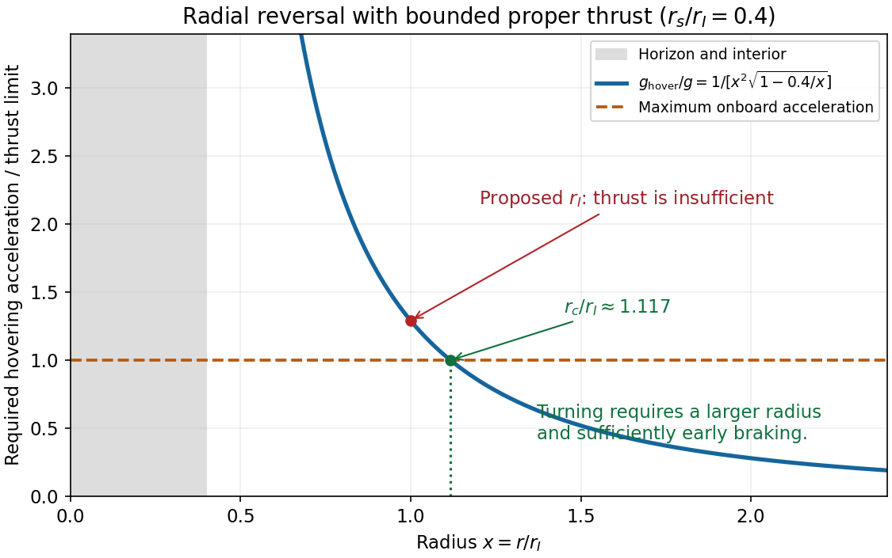

<h1 id="1/e/solution">Solution</h1>

↑ **Parent:** [E](../e.md)

For radial motion outside the [Schwarzschild event horizon](../../../../schwarzschild-event-horizon.md), the equations needed to determine the acceleration components are

$$
\boxed{\begin{aligned}
-F(u^0)^2+F^{-1}(u^r)^2&=-c^2,\\
-Fu^0a^0+F^{-1}u^ra^r&=0,\\
-F(a^0)^2+F^{-1}(a^r)^2&=g^2.
\end{aligned}}
$$

They are respectively the [four-velocity](../../../../four-velocity.md) norm, velocity-acceleration orthogonality, and the maximum [proper acceleration](../../../../proper-acceleration.md) norm. Together with part [d](../d.md) they give the stated thrust equation; no integration of the trajectory is required. The positive radial sign corresponds to outward thrust.

Let $r_I=\sqrt{GM/g}$. A first transition from inward to outward motion requires $u^r=0$ at a minimum radius and $du^r/d\tau\ge0$ there. The largest possible radial derivative at such an event is

$$
\left.\frac{du^r}{d\tau}\right|_{u^r=0}
=g\sqrt{1-r_s/r}-\frac{GM}{r^2}.
$$

At $r=r_I>r_s$, this is

$$
\boxed{\left.\frac{du^r}{d\tau}\right|_{r_I,u^r=0}
=g\left[\sqrt{1-r_s/r_I}-1\right]<0.}
$$

Thus the ship cannot reverse its inward motion there. It cannot reverse at any smaller exterior radius either: $GM/r^2$ grows while $\sqrt{1-r_s/r}$ decreases. If it first reaches $r_I$ while falling inward, **it cannot return home using the stipulated bounded radial thrust**. If $r_I\le r_s$, it would instead have reached the black-hole horizon before that radius, which already prevents escape.

The [minimum radius for radial turnaround with bounded proper acceleration](../../../../minimum-radius-for-radial-turnaround-with-bounded-proper-acceleration.md) lies strictly outside the proposed radius. Define $r_c>r_s$ by

$$
\boxed{g=\frac{GM}{r_c^2\sqrt{1-r_s/r_c}}.}
$$

The right side is the [proper acceleration](../../../../proper-acceleration.md) required to hover, decreases monotonically from infinity to zero, and exceeds $GM/r^2$. A genuine turnaround needs $r_{\rm turn}>r_c>r_I$; equality gives no positive initial outward acceleration at rest. A sufficiently early burn is also needed to remove the pre-existing inward [velocity](../../../../velocity.md). The failure at $r_I$ follows from the turning-point condition, not from treating the moving ship as static throughout its fall.

**[Figure 1](#1/e/image-the-newtonian-proposed-radius-lies-inside-the-bounded-thrust-turnaround-limit). The Newtonian proposed radius lies inside the bounded-thrust turnaround limit**. For the illustrative ratio rs/rI equal to 0.4, the curve is the required hovering proper acceleration divided by the maximum onboard acceleration. At rI it exceeds one. Its crossing with one determines the critical radius rc; the outer side is necessary for radial reversal. The black-hole interior is excluded from this static-coordinate comparison.

## ↑ Ancestors (12)

1. [E](../e.md)
2. [1](../../1.md)
3. [2018](../../../2018-split.md)
4. [Past exam of the general relativity and cosmology course of the University of Oxford](../../../split.md)
5. [General relativity and cosmology course of the University of Oxford](../../../../general-relativity-and-cosmology-course-of-the-university-of-oxford.md)
6. [Year 3 of the physics course of the University of Oxford](../../../../year-3-of-the-physics-course-of-the-university-of-oxford.md)
7. [Physics course of the University of Oxford](../../../../physics-course-of-the-university-of-oxford.md)
8. [Undergraduate course of the University of Oxford](../../../../undergraduate-course-of-the-university-of-oxford.md)
9. [Course of the University of Oxford](../../../../course-of-the-university-of-oxford.md)
10. [University of Oxford](../../../../university-of-oxford-split.md)
11. [List of universities](../../../../list-of-universities.md)
12. [Codex Wiki](../../../../split.md)
